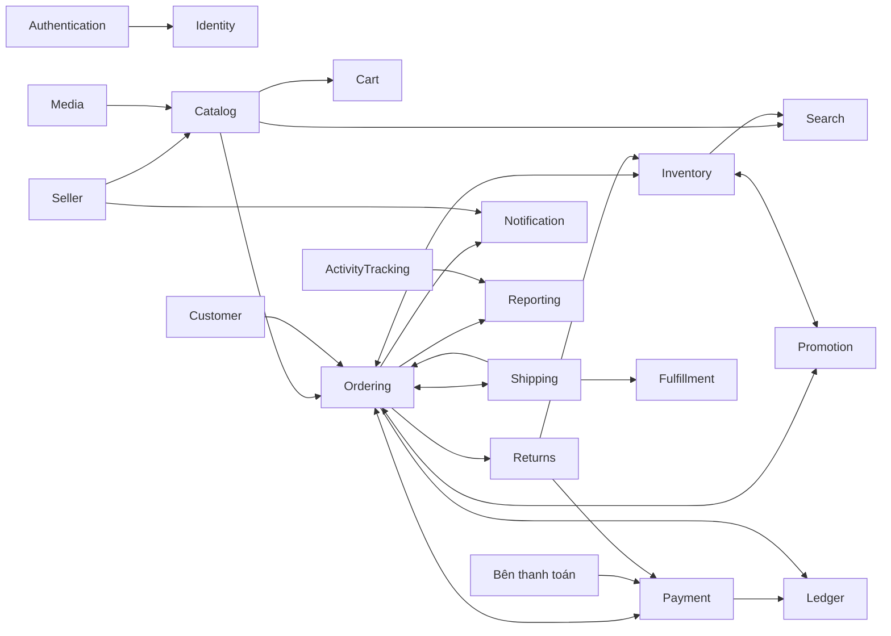

# Context map

> **Bản nháp để duyệt.**

## 1. Mục đích và cách đọc

File này chia hệ thống thành các bounded context (BC), nói mỗi BC giữ gì, và các BC nói chuyện với nhau ra sao. Nguồn là các nghiệp
vụ đã chọn ở `2-business-analysis.md` và các bài toán ở `3-non-functional-requirement.md`.

- Tên BC, khái niệm, event và kiểu quan hệ viết bằng tiếng Anh, nghĩa tra ở `4-glossary.md`.
- Mức chi tiết là **mức tên**: chưa có API, bảng dữ liệu hay thứ tự triển khai. Những thứ đó thuộc tài liệu của từng BC và roadmap.

## 2. Cách chia

Hai nghiệp vụ nằm chung một BC khi chúng dùng chung một ngôn ngữ và một bộ quy tắc. Bốn câu hỏi được dùng để quyết định tách:

1. **Cùng một từ có mang nghĩa khác nhau không?** "Sản phẩm" ở chỗ người bán niêm yết là thứ có giá, ảnh, biến thể; ở chỗ tìm kiếm
   là một dòng trong chỉ mục để lọc. Nghĩa khác thì tách (`Catalog` và `Search`).
2. **Có quy tắc nào cần đúng ngay lập tức, trong cùng một giao dịch không?** Quy tắc đó phải nằm trọn trong một BC. Ví dụ "tồn không
   âm" nằm trọn trong `Inventory`; nếu hai BC cùng giữ một nửa quy tắc thì không bảo vệ được nó khi tải cao.
3. **Hai phần có thay đổi vì những lý do khác nhau không?** Chính sách đăng nhập đổi vì bảo mật; hồ sơ hiển thị đổi vì giao diện. Lý
   do khác thì tách (`Authentication` và `Identity`).
4. **Đặc tính tải có khác hẳn không?** Chỉ tách vì tải khi trỏ được tới một bài toán cụ thể ở `3-non-functional-requirement.md`. Ví dụ
   `Search` chỉ đọc, chịu phần lớn lượng đọc (bài toán 3.8), nên tách khỏi `Catalog`.

### Không phải BC

Một số thứ trông như một phần riêng nhưng không có ngôn ngữ nghiệp vụ của riêng nó:

- **Quản trị** là một ứng dụng, không phải BC. Mỗi thao tác quản trị thuộc BC sở hữu dữ liệu đó: duyệt người bán ở `Seller`, chặn
  sản phẩm ở `Catalog`, khóa tài khoản ở `Authentication`. Gom chúng vào một BC "Quản trị" sẽ khiến BC đó chạm vào dữ liệu của mọi
  BC khác.
- **Lập lịch** (hủy đơn quá hạn, nhả giữ chỗ): là công cụ; quy tắc "quá hạn thì làm gì" nằm ở BC sở hữu (`Ordering`, `Inventory`).
- **Giả lập và thử tải**, **nhật ký kiểm toán**, **cổng API**: hạ tầng hoặc công cụ, phục vụ mọi BC.

## 3. Danh sách BC

**Loại:** *Core* là nơi các bài toán chính của dự án nằm, đáng đầu tư nhiều nhất; *Supporting* cần cho nghiệp vụ, làm đủ dùng;
*Generic* là thứ hệ thống nào cũng có.

### 3.1 Từ nghiệp vụ lõi

| BC               | Loại       | Giữ gì                                                                            | Quy tắc chính                                                                   | Bài toán (file 3)                           |
|------------------|------------|-----------------------------------------------------------------------------------|---------------------------------------------------------------------------------|---------------------------------------------|
| `Authentication` | Generic    | `Account`, `Role`, `Session`; đăng nhập, khóa tài khoản                           | Mỗi tài khoản một vai; tài khoản bị khóa không đăng nhập được                   | 3.4 làn sóng đăng nhập                      |
| `Identity`       | Generic    | Hồ sơ hiển thị, `Device`, `LoginHistory`                                          | Lịch sử đăng nhập chỉ thêm                                                      | 3.11 dữ liệu tăng theo thời gian            |
| `Customer`       | Supporting | `Address` của người mua                                                           |                                                                                 |                                             |
| `Seller`         | Supporting | `SellerProfile`, `Shop`; duyệt, từ chối, nộp lại                                  | Mỗi tài khoản tối đa một hồ sơ người bán; chỉ hồ sơ bị từ chối mới nộp lại được |                                             |
| `Catalog`        | Supporting | `Product`, `Variant`, `SKU`, `Category`, `Attribute`, `ListPrice`; đăng, gỡ, chặn | Chỉ người bán đã duyệt mới đăng được sản phẩm                                   | 3.3 đọc dồn lúc flash sale                  |
| `Search`         | Core       | `SearchDocument`                                                                  | Chỉ hiện sản phẩm đang đăng                                                     | 3.8 tìm kiếm trên hàng triệu sản phẩm       |
| `Cart`           | Supporting | `Cart`, `GuestCart`                                                               | Gộp giỏ vãng lai khi đăng nhập không mất dòng                                   |                                             |
| `Inventory`      | Core       | `Stock`, `Reservation`                                                            | Tồn không âm; giữ chỗ quá hạn được nhả                                          | 3.1 nhiều người tranh một mặt hàng          |
| `Ordering`       | Core       | `Checkout`, `Order`, `OrderStatus`; điều phối các bước của đặt hàng               | Mọi đơn cuối cùng dừng ở trạng thái hợp lệ; đặt lặp không ra hai đơn            | 3.5 gửi lặp; 3.6 nhất quán; 3.9 lịch sử đơn |
| `Payment`        | Supporting | `Payment` (`ONLINE`, `COD`), `Refund`                                             | Kết quả lặp chỉ xử lý một lần; tiền đã thu cho đơn hủy phải được hoàn           | 3.5 thanh toán bên ngoài                    |
| `Shipping`       | Supporting | `ShippingFee`, `Shipment` (giả lập)                                               | Mỗi đơn tối đa một vận đơn đang chạy                                            |                                             |
| `Notification`   | Generic    | `Notification`; kết nối thời gian thực                                            |                                                                                 | 3.7 nhiều kết nối thời gian thực            |
| `Media`          | Generic    | `Image`                                                                           |                                                                                 |                                             |

### 3.2 Từ nghiệp vụ mở rộng

| BC                 | Loại       | Giữ gì                                                          | Quy tắc chính                                                   | Bài toán (file 3)                  |
|--------------------|------------|-----------------------------------------------------------------|-----------------------------------------------------------------|------------------------------------|
| `Promotion`        | Core       | `Voucher`, `FlashSale`, `Quota`, `PerUserLimit`                 | Không cấp quá suất; mỗi người không vượt giới hạn               | 3.1, 3.2 suất có giới hạn          |
| `Reporting`        | Supporting | Số liệu tổng hợp theo ngày                                      | Số liệu khớp với đơn gốc sau một độ trễ đã ghi                  | 3.10 báo cáo trên dữ liệu lớn      |
| `Returns`          | Supporting | `ReturnRequest`                                                 | Chỉ trả được đơn đã giao, trong hạn                             |                                    |
| `Ledger`           | Supporting | `Balance`, `Payout`, `LedgerEntry`, `Reconciliation`            | Sổ luôn cân; bút toán chỉ thêm                                  |                                    |
| `Chat`             | Generic    | `Conversation`                                                  |                                                                 | 3.7 nhiều kết nối thời gian thực   |
| `ActivityTracking` | Generic    | Sự kiện xem, nhấp, tìm                                          |                                                                 | 3.11 dữ liệu tăng theo thời gian   |
| `Fulfillment`      | Supporting | Kho nền tảng, `Courier`, phân công, vị trí giao                 | Tiền COD người giao đang giữ bằng thu trừ nộp                   | 3.12 nghiệp vụ mở rộng             |

`Customer` và `Media` chưa có dòng riêng trong danh sách nghiệp vụ lõi của `2-business-analysis.md` (sổ địa chỉ cần cho đặt hàng, ảnh
cần cho niêm yết). Cần bổ sung ở file đó.

## 4. Quan hệ giữa các BC

**Cách tích hợp:** *event* khi bên nhận chỉ cần biết một việc đã xảy ra và chấp nhận biết trễ một chút; *gọi đồng bộ* khi bên gọi cần
câu trả lời ngay để đi tiếp.

| Upstream → Downstream                  | Kiểu quan hệ          | Cách tích hợp        | Thứ đi qua                                                      |
|----------------------------------------|-----------------------|----------------------|-----------------------------------------------------------------|
| `Authentication` → mọi BC              | Open Host, Conformist | Token                | Mã tài khoản, vai; BC khác tự đọc token, không gọi lại          |
| `Authentication` → `Identity`          | Published Language    | Event                | `UserLoggedIn`, `AccountLocked`                                 |
| `Seller` → `Catalog`                   | Customer-Supplier     | Event                | `SellerApproved`; `Catalog` giữ bản sao trạng thái người bán    |
| `Media` → `Catalog`                    | Open Host             | Gọi đồng bộ          | Tải ảnh lên, nhận mã ảnh                                        |
| `Catalog` → `Search`                   | Published Language    | CDC hoặc event       | Sản phẩm đăng, gỡ, đổi                                          |
| `Inventory` → `Search`                 | Published Language    | Event                | Còn hàng hay hết                                                |
| `Catalog` → `Cart`, `Ordering`         | Customer-Supplier     | Gọi đồng bộ          | Giá và thông tin SKU lúc thêm giỏ, lúc đặt                      |
| `Shipping` → `Ordering`                | Customer-Supplier     | Gọi đồng bộ          | Phí vận chuyển lúc đặt                                          |
| `Customer` → `Ordering`                | Customer-Supplier     | Gọi đồng bộ          | Địa chỉ nhận hàng lúc đặt                                       |
| `Inventory` ↔ `Ordering`               | Customer-Supplier     | Lệnh và event        | Giữ chỗ, chốt, nhả                                              |
| `Payment` ↔ `Ordering`                 | Customer-Supplier     | Lệnh và event        | Tạo thanh toán; `PaymentSucceeded`, `PaymentFailed`; hoàn tiền  |
| `Shipping` ↔ `Ordering`                | Customer-Supplier     | Lệnh và event        | Tạo vận đơn; `ShipmentDelivered`, `ShipmentFailed`              |
| Bên thanh toán bên ngoài → `Payment`   | Anti-corruption Layer | Webhook              | Kết quả thanh toán, dịch sang mô hình của `Payment`             |
| `Promotion` ↔ `Ordering`               | Customer-Supplier     | Gọi đồng bộ và event | Áp voucher, xác nhận suất; trả suất khi đơn hủy                 |
| `Inventory` ↔ `Promotion`              | Customer-Supplier     | Lệnh và event        | Tách tồn cho đợt flash sale; trả phần chưa bán khi đợt kết thúc |
| `Ordering`, `Seller` → `Notification`  | Published Language    | Event                | Đổi trạng thái đơn, kết quả duyệt                               |
| `Ordering` → `Reporting`               | Published Language    | CDC hoặc event       | Đơn và trạng thái đơn                                           |
| `Ordering` → `Returns`                 | Customer-Supplier     | Gọi đồng bộ          | Kiểm đơn đã giao, trong hạn trả                                 |
| `Returns` → `Payment`, `Inventory`     | Customer-Supplier     | Lệnh                 | Hoàn tiền, hoàn tồn                                             |
| `Payment`, `Ordering` → `Ledger`       | Published Language    | Event                | Tiền thu, tiền hoàn, đơn hoàn tất                               |
| `Shipping` → `Fulfillment`             | Customer-Supplier     | Lệnh và event        | Khi làm mở rộng: giao thật bằng đội giao, thay cho giả lập      |
| Ứng dụng cửa hàng → `ActivityTracking` | Published Language    | Event                | Xem, nhấp, tìm                                                  |

`Authentication` cung cấp token cho mọi BC nên không vẽ từng mũi tên.

## 5. Luồng xuyên BC

### 5.1 Đặt hàng, trả trực tuyến

1. Người mua bấm đặt. `Ordering` tạo một `Checkout`, tách thành các `Order` theo người bán, chốt giá, phí và giảm giá tại lúc đó.
2. `Ordering` yêu cầu `Inventory` giữ chỗ. Thiếu hàng thì dừng, báo người mua.
3. `Ordering` yêu cầu `Payment` tạo một thanh toán cho cả `Checkout`. Đơn ở trạng thái chờ thanh toán, có `PaymentDeadline`.
4. Bên thanh toán gọi webhook. `Payment` phát `PaymentSucceeded` hoặc `PaymentFailed`.
5. Thành công: các đơn sang chờ người bán xác nhận. Thất bại hoặc quá hạn: `Ordering` hủy đơn, `Inventory` nhả chỗ (bước bù).
6. Người bán xác nhận; `Ordering` yêu cầu `Shipping` tạo vận đơn; `ShipmentDelivered` thì đơn hoàn tất. `Notification` báo người
   mua ở mỗi bước.

### 5.2 Đặt hàng COD

Bước 1, 2 như 5.1. Ở bước 3, `Payment` ghi một khoản COD chờ thu, không có hạn thanh toán; đơn sang chờ người bán xác nhận ngay. Khi
`ShipmentDelivered`, khoản COD thành đã thu. Khi `ShipmentFailed`, `Ordering` hủy đơn và `Inventory` hoàn tồn.

### 5.3 Mua flash sale

1. Trước giờ mở, `Promotion` yêu cầu `Inventory` tách trước số lượng cho đợt (`FlashSaleStarted`). Tồn thường giảm tương ứng, nên
   phần tách ra không bao giờ bị bán trùng.
2. Trong đợt, thao tác nóng nằm trọn trong `Promotion`: trừ một suất và tăng đếm của người mua trong cùng một thao tác. Hết suất
   hoặc vượt giới hạn mỗi người thì trượt ngay.
3. Giữ được suất thì đi tiếp như 5.1 hoặc 5.2, với đơn trỏ tới suất đã giữ thay vì giữ chỗ ở `Inventory`.
4. Đơn hủy thì suất trả về `Promotion`. Hết đợt (`FlashSaleEnded`), suất chưa bán trả về `Inventory`.

Vì thao tác nóng chỉ nằm trong `Promotion`, kịch bản lát cắt flash sale (file 3, mục 4.3) chỉ cần chạy thật `Promotion`, các BC khác
là bản giả.

### 5.4 Người bán đăng ký và được duyệt

Người dùng nộp hồ sơ ở `Seller` (`SellerProfileSubmitted`). Quản trị duyệt hoặc từ chối trên ứng dụng quản trị, thao tác thuộc
`Seller` (`SellerApproved` hoặc `SellerRejected`). `Catalog` nhận `SellerApproved` để cho phép đăng sản phẩm; `Notification` báo kết
quả. Bị từ chối thì sửa và nộp lại.

### 5.5 Sản phẩm đăng lên tới tìm kiếm

Người bán đăng sản phẩm ở `Catalog` (`ProductPublished`). Thay đổi được đồng bộ sang `Search` qua CDC hoặc event; người mua thấy sản
phẩm sau một độ trễ ngắn. Tồn đổi giữa còn và hết thì `Inventory` báo cho `Search` để lọc "còn hàng".

### 5.6 Event chính

Các event dưới đây cần bổ sung vào `4-glossary.md`: `UserLoggedIn`, `AccountLocked`, `SellerProfileSubmitted`, `SellerApproved`,
`SellerRejected`, `ProductPublished`, `ProductUnpublished`, `StockReserved`, `ReservationReleased`, `PaymentSucceeded`,
`PaymentFailed`, `OrderConfirmed`, `OrderCancelled`, `ShipmentDelivered`, `ShipmentFailed`, `FlashSaleStarted`, `FlashSaleEnded`.

## 6. Quyết định và câu hỏi còn mở

**Đã quyết trong file này** (có thể đổi khi phân tích chi tiết từng BC; đổi thì ghi lý do):

| Quyết định                                                     | Lý do                                                                                      |
|----------------------------------------------------------------|--------------------------------------------------------------------------------------------|
| Suất flash sale do `Promotion` giữ, tồn được tách trước ở `Inventory` | Mỗi quy tắc (không bán vượt tồn; không quá suất; không quá giới hạn mỗi người) nằm trọn một BC; lát cắt flash sale chỉ cần một BC chạy thật |
| `Ordering` điều phối các bước của đặt hàng                      | Một nơi biết toàn bộ trạng thái của đơn; dễ lần vết và bù khi lỗi hơn để các BC tự gọi nhau theo chuỗi |
| Một `Payment` cho một `Checkout`, hoàn tiền theo từng `Order`  | Người mua trả một lần dù mua của nhiều người bán; hủy một đơn không ảnh hưởng đơn khác     |
| `Ordering` chốt giá, phí, giảm giá lúc đặt                      | Người bán đổi giá sau đó không làm đổi đơn đã đặt                                          |
| `Authentication` và `Identity` tách riêng                       | Thứ quyết định ai được vào đổi vì bảo mật; thứ chỉ để xem đổi vì giao diện                 |

**Còn mở:**

| Câu hỏi                                                        | Mặc định tạm                                                                  |
|----------------------------------------------------------------|-------------------------------------------------------------------------------|
| Voucher giảm giá trên cả đơn: tính ở `Promotion` hay `Ordering`? | `Promotion` tính và giữ lượt dùng; `Ordering` chỉ lưu kết quả lúc đặt         |
| Phí vận chuyển có cần BC định giá riêng không?                  | Chưa; phí cố định theo vùng nằm ở `Shipping`                                  |
| `Customer` có gộp vào `Identity` được không?                    | Tách: địa chỉ phục vụ đặt hàng, hồ sơ hiển thị phục vụ giao diện              |
