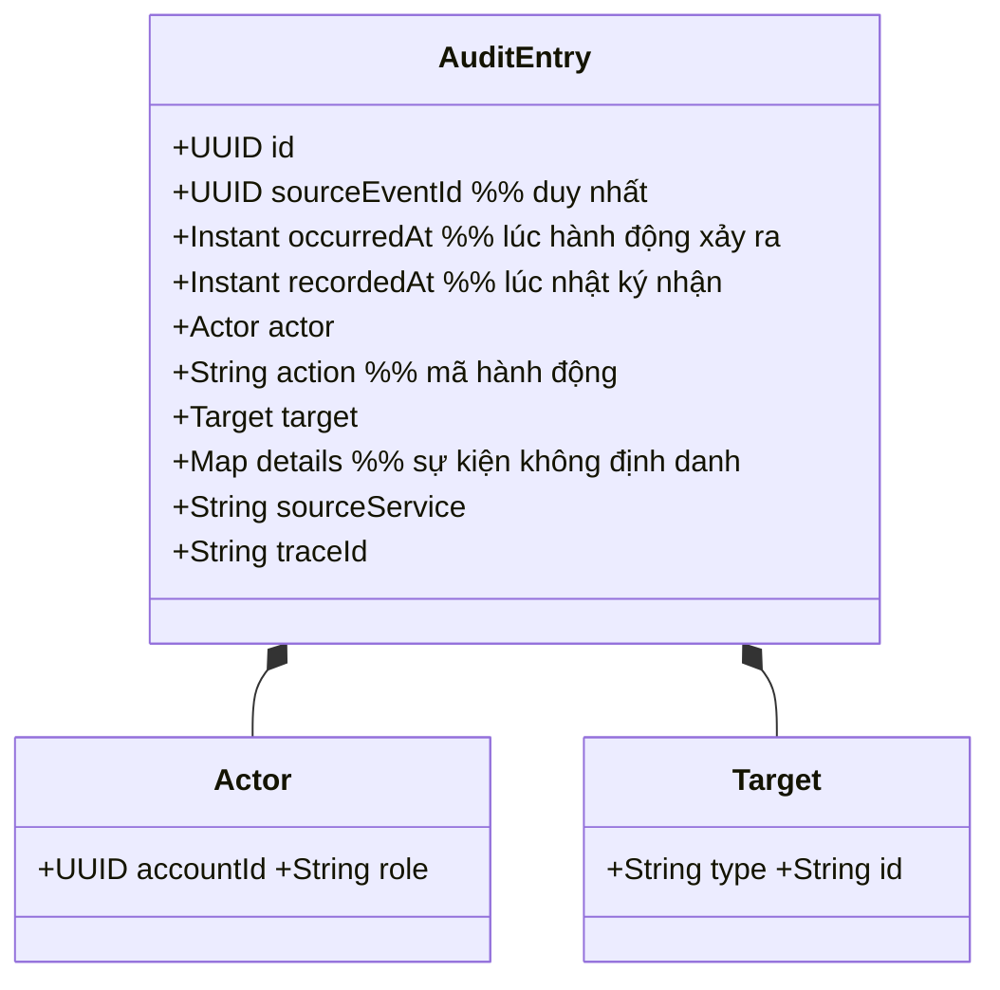
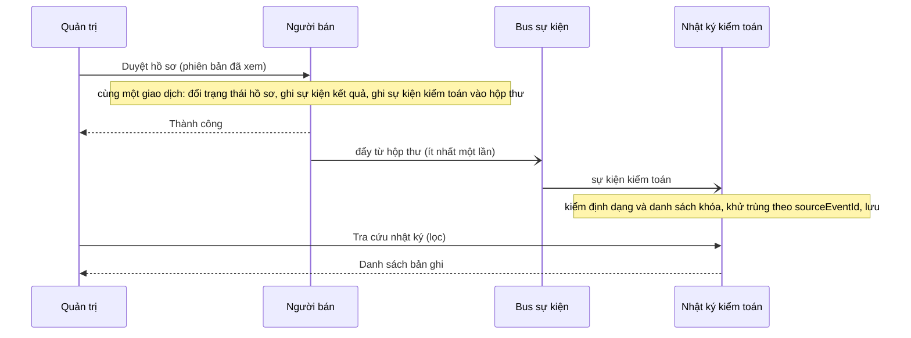

# Nháp: mô hình Nhật ký kiểm toán (C1a)

Bản nháp để người dùng xem trước khi viết `analysis.md`. Nguồn: `stage.md` của C1a §2.5, context map B25, `logging.md`.
Chưa đối chiếu code.

## 1. Phạm vi

Nhật ký kiểm toán là BC **dùng chung** (loại Chung trong context map): nhiều BC cùng ghi vào, chỉ quản trị đọc. Ở C1a nó chỉ nhận
một loại hành động: **duyệt và từ chối hồ sơ người bán**. C1b thêm khóa/mở tài khoản và chặn/mở sản phẩm mà không đổi mô hình.

**Việc của BC này:** nhận bản ghi hành động từ BC khác, lưu bất biến, cho quản trị tra cứu.
**Không phải việc của BC này:**
- Log ứng dụng (`logging.md`): để chẩn đoán lỗi, có thời hạn giữ, mất đi cũng không sai nghiệp vụ. Nhật ký kiểm toán là dữ liệu nghiệp vụ.
- Lịch sử trạng thái của thực thể trong BC gốc (ví dụ `reviewedAt/By` trên hồ sơ): BC gốc vẫn giữ trạng thái hiện tại; nhật ký giữ *chuỗi hành động*.
- Phát hiện gian lận, báo cáo, cảnh báo: BC khác đọc nhật ký sau này.

**Tiêu chí để một hành động vào nhật ký (cả ba cùng đúng):** có chủ thể xác định (tài khoản hoặc `SYSTEM`); tác động lên người khác hoặc dữ liệu
chung, không phải dữ liệu riêng của chính chủ; đã thành công và có hậu quả cần truy khi tranh chấp.

**Ranh giới toàn hệ thống (đề xuất, chờ xác nhận mục 12 câu 9–10):**

| Thứ | Nơi giữ | Vì sao không ở đây |
|---|---|---|
| Bút toán, số dư, tiền | Sổ cái, Thanh toán | Là nguồn sự thật của tiền, ghi cùng giao dịch, khối lượng lớn, sổ phải cân bằng. Nhật ký chỉ ghi việc *ai can thiệp bằng tay* và mã bút toán, không giữ số tiền |
| Điểm thưởng | Không dự kiến (context map: ngoài phạm vi) | Nếu làm sau thì là sổ cộng trừ riêng, như Sổ cái |
| Lịch sử trạng thái đơn, tồn kho | Đơn hàng, Tồn kho | Dữ liệu nghiệp vụ của BC sở hữu |
| Lịch sử đăng nhập, thiết bị, đổi mật khẩu của người dùng | Xác thực, Định danh (C3c) | Dữ liệu của chính chủ tài khoản, mục đích bảo mật |
| Thử bị từ chối quyền, 401, 429 | Log ứng dụng (WARN) | Sự kiện bảo mật, chưa có hậu quả |

Bên phát theo chặng: Người bán (C1a); Xác thực (khóa, mở tài khoản) và Danh mục hàng (chặn, mở sản phẩm) ở C1b; sau này Dữ liệu tham chiếu và
cấu hình, Giao nhận, Kho vật lý, Sổ cái, Lập lịch (người làm `SYSTEM`). Bên đọc: chỉ quản trị, qua cổng Vận hành.

## 2. Suy luận

**Vì sao không tự suy từ sự kiện nghiệp vụ.** Có thể để Nhật ký nghe `SellerApproved` và `SellerRejected`. Không nên:
- sự kiện nghiệp vụ được thiết kế cho bên nhận nghiệp vụ (không mang lý do từ chối, không mang người ra quyết định) và đổi theo nhu cầu của họ;
- nhật ký cần một **hợp đồng riêng, ổn định**, vì nó phải đọc được nhiều năm sau và dùng chung cho mọi BC;
- mỗi lần BC khác thêm hành động nhạy cảm, Nhật ký phải biết thêm sự kiện của BC đó (phụ thuộc ngược).

Vì vậy Nhật ký sở hữu một **hợp đồng bản ghi** (published language): BC nào có hành động cần kiểm toán thì phát sự kiện theo hợp
đồng này, cùng giao dịch với hành động (outbox). Nhật ký chỉ nghe một loại sự kiện, không cần biết nghiệp vụ của bên phát.

**Chỉ ghi hành động đã thành công.** Hành động bị từ chối quyền (403) hay bị kiểm đầu vào là sự kiện bảo mật, đã có dòng log
WARN riêng (`logging.md`); không đưa vào nhật ký kiểm toán. Hệ quả: R12 (quyết định và bản ghi cùng thành công hoặc cùng không)
chỉ cần bảo đảm ở phía phát, bằng outbox cùng giao dịch.

**Nhất quán cuối cùng.** Bản ghi đến Nhật ký sau một nhịp (qua bus). Chấp nhận được vì tra cứu nhật ký không nằm trên đường nóng.
Điều không chấp nhận: mất bản ghi (outbox bảo đảm ít nhất một lần) hoặc ghi trùng (Nhật ký khử trùng theo mã sự kiện).

## 3. Mô hình

`AuditEntry` là thực thể **bất biến**: tạo một lần, không có hành vi sửa. Không có aggregate nhiều thực thể, nên không có
khái niệm "phiên bản" hay khóa lạc quan.

| Trường | Ý nghĩa | Ghi chú |
|---|---|---|
| `id` | Mã bản ghi | UUID v7 (ADR-0001), sắp xếp theo thời gian |
| `sourceEventId` | Mã sự kiện nguồn | Duy nhất; khử trùng khi nhận lặp |
| `occurredAt` | Lúc hành động xảy ra (giờ của BC phát) | Dùng để sắp xếp và lọc |
| `recordedAt` | Lúc Nhật ký lưu | Chẩn đoán độ trễ |
| `actor.accountId`, `actor.role` | Người làm, vai tại thời điểm làm | Chụp lại; đổi vai sau này không sửa bản ghi cũ |
| `action` | Mã hành động, ví dụ `SELLER_PROFILE_APPROVED`, `SELLER_PROFILE_REJECTED` | Chuỗi định dạng `ĐỐI_TƯỢNG_HÀNH_ĐỘNG`; Nhật ký không kiểm ý nghĩa |
| `target.type`, `target.id` | Đối tượng bị tác động, ví dụ `SELLER_PROFILE` và mã hồ sơ | Chỉ mã, không dữ liệu của đối tượng |
| `details` | Vài sự kiện bổ sung, khóa-giá trị phẳng | Chỉ khóa nằm trong danh sách cho phép của hành động (xem INV-AUD-04) |
| `sourceService` | BC phát | Tra nguồn |
| `traceId` | Mã truy vết của yêu cầu gốc | Nối nhật ký với log ứng dụng |

**Chi tiết của hai hành động ở C1a:**

| Hành động | `target` | `details` |
|---|---|---|
| `SELLER_PROFILE_APPROVED` | `SELLER_PROFILE`, mã hồ sơ | `profileVersion` (phiên bản quản trị đã xem), `sellerAccountId` |
| `SELLER_PROFILE_REJECTED` | như trên | `profileVersion`, `sellerAccountId`, `reason` (lý do từ chối) |

Lý do từ chối **vào** nhật ký: nó là nội dung của quyết định và là thứ cần khi tranh chấp, người bán cũng được xem. Không vào:
số căn cước, mã số thuế, địa chỉ, tên pháp lý, số điện thoại (dữ liệu định danh của hồ sơ). Sự an toàn đến từ **cấu trúc**:
chỉ khóa nằm trong danh sách cho phép mới được lưu, nên không phụ thuộc vào việc bên phát nhớ lọc.

## 4. Bất biến

| Mã | Bất biến | Lý do |
|---|---|---|
| INV-AUD-01 | Bản ghi chỉ được thêm, không sửa, không xóa (kể cả bởi quản trị) | Giá trị của nhật ký là ở chỗ không ai che được dấu vết (R13) |
| INV-AUD-02 | Một `sourceEventId` chỉ cho một bản ghi | Bus giao ít nhất một lần; nhận lặp không được ghi đôi |
| INV-AUD-03 | Mỗi bản ghi có đủ `occurredAt`, `actor`, `action`, `target`, `sourceService`; thiếu thì không lưu và đưa vào hàng chờ lỗi | Bản ghi thiếu người làm hoặc thời điểm không dùng để truy vết được |
| INV-AUD-04 | `details` chỉ chứa khóa thuộc danh sách cho phép của `action`, giá trị là chuỗi hoặc số ngắn; khóa lạ thì bỏ và ghi cảnh báo, không lưu | Chặn rò dữ liệu định danh (R11) bằng cấu trúc |
| INV-AUD-05 | `actor` là bản chụp tại thời điểm hành động | Đổi vai hoặc khóa tài khoản sau đó không đổi lịch sử |
| INV-AUD-06 | Chỉ `ADMIN` tra cứu | Nhật ký chứa quyết định nội bộ |
| INV-AUD-07 | Nhật ký không từ chối bản ghi vì `action` lạ, chỉ vì sai định dạng hoặc thiếu trường | Thêm hành động mới ở BC khác không bắt Nhật ký phát hành lại |
| INV-AUD-08 | Bản ghi không bị dọn ở C1a (không hết hạn) | Chưa có chính sách lưu trữ; xem phần hoãn |

**Cách bảo đảm INV-AUD-01 ở C1a:** (1) không có API sửa/xóa; (2) vai cơ sở dữ liệu của dịch vụ chỉ có quyền `INSERT`, `SELECT` trên
bảng, và một trigger chặn `UPDATE`/`DELETE` như lớp phòng thủ thứ hai. Bằng chứng toàn vẹn (chuỗi băm) là điểm nối, chưa làm.

## 5. Lệnh và truy vấn

| Mã | Tên | Ai gọi | Mô tả |
|---|---|---|---|
| CMD-AUD-01 | Ghi bản ghi | Sự kiện từ bus | Kiểm INV-AUD-02/03/04, lưu; lặp thì bỏ qua êm |
| RM-AUD-01 | Tra cứu danh sách | `ADMIN` | Lọc theo khoảng thời gian, `actor`, `action`, `target`; sắp xếp mới nhất trước; phân trang theo con trỏ (`occurredAt`, `id`) |
| RM-AUD-02 | Xem chi tiết một bản ghi | `ADMIN` | Trả đủ trường, gồm `details` và `traceId` |

Không có lệnh sửa/xóa. Việc **xem** nhật ký không tự ghi vào nhật ký ở C1a (xem câu 6).

## 6. Luồng

## 7. Đường không suôn sẻ

| Tình huống | Cách xử lý |
|---|---|
| Nhật ký đang tắt | Sự kiện nằm lại trên bus, nhận bù khi lên lại; không mất, chỉ chậm |
| Nhận cùng sự kiện hai lần | Khử trùng theo `sourceEventId`, bỏ qua êm |
| Sự kiện sai định dạng hoặc thiếu trường bắt buộc | Không lưu, chuyển sang hàng chờ lỗi, báo cảnh báo; không chặn các sự kiện sau |
| `details` mang khóa lạ | Bỏ khóa đó, vẫn lưu bản ghi, ghi cảnh báo nêu tên khóa (không nêu giá trị) |
| Hai bản ghi cùng `occurredAt` | Sắp xếp phụ theo `id` (UUID v7) để thứ tự ổn định |
| Đồng hồ hai dịch vụ lệch | `occurredAt` theo giờ BC phát; `recordedAt` để thấy độ lệch; không sửa |
| Quản trị tra cứu khoảng thời gian rất rộng | Bắt buộc phân trang, giới hạn số dòng mỗi trang |

## 8. Sự kiện (hợp đồng bản ghi)

Một loại sự kiện duy nhất mà Nhật ký **nhận**: `AuditActionRecorded`.

| Trường | Ghi chú |
|---|---|
| `eventId`, `occurredAt`, `traceId`, `sourceService` | Phần chung của mọi sự kiện |
| `actor { accountId, role }`, `action`, `target { type, id }`, `details {}` | Nội dung bản ghi |

Nhật ký **không phát** sự kiện nào ở C1a. Hợp đồng do Nhật ký sở hữu; BC phát dùng một thành phần chung (thư viện nhỏ) để dựng
sự kiện và ghi vào hộp thư, chi tiết để bước thiết kế kỹ thuật.

## 9. Dữ liệu

Bảng `audit_entry`: `id` (khóa chính), `source_event_id` (duy nhất), `occurred_at`, `recorded_at`, `actor_account_id`,
`actor_role`, `action`, `target_type`, `target_id`, `details` (JSON), `source_service`, `trace_id`.

Chỉ mục: `(occurred_at DESC, id DESC)` cho danh sách; `(actor_account_id, occurred_at DESC)`; `(target_type, target_id, occurred_at DESC)`;
`(action, occurred_at DESC)`. Bảng chỉ INSERT: không cần chỉ mục cho cập nhật; chi phí ghi nằm ở chỉ mục, nên giữ ít.

Về sau bảng tăng không ngừng (thêm BC, thêm hành động). Chia phân vùng theo tháng là điểm nối, chưa cần ở C1a.

## 10. Phạm vi

| Trạng thái | Nội dung |
|---|---|
| **Trong C1a** | Nhận bản ghi từ bus; khử trùng; lưu bất biến (không API sửa/xóa, quyền cơ sở dữ liệu, trigger); kiểm khóa `details`; tra cứu có lọc và phân trang; xem chi tiết; hai hành động của hồ sơ người bán; `traceId` nối log |
| **Cắt tạm** | Chuỗi băm chống sửa (bằng chứng toàn vẹn); ghi lại lượt xem nhật ký; chính sách lưu trữ, phân vùng, đưa ra kho lạnh; xuất báo cáo; cảnh báo theo mẫu hành động; tìm kiếm văn bản trong `details` |
| **C1b** | Thêm hành động: khóa/mở tài khoản, chặn/mở sản phẩm |
| **Ngoài** | Event sourcing; nhật ký người dùng cuối (lịch sử đăng nhập là việc của Xác thực, C3c) |
| **Giao diện** | Một màn "Nhật ký kiểm toán" ở cổng Vận hành: bảng, lọc, xem chi tiết |

## 11. Phân quyền ở C1a

Chú thích `ADMIN` trên hai điểm cuối tra cứu, mặc định từ chối (xem `c1a-seller-profile-model.md` §13). Không có quyền ghi qua API:
bản ghi chỉ vào qua bus.

## 12. Câu hỏi mở

| # | Câu hỏi | Mặc định đề xuất |
|---|---|---|
| 1 | Chỉ ghi hành động thành công, hay cả thử bị từ chối? | Chỉ thành công; từ chối quyền đã có log bảo mật riêng |
| 2 | Lý do từ chối vào `details`? | Có; số định danh thì không (bảo đảm bằng danh sách khóa cho phép) |
| 3 | Mã hành động là chuỗi tự do định dạng, hay danh mục đóng do Nhật ký quản? | Chuỗi định dạng, không kiểm ý nghĩa (INV-AUD-07); danh mục hành động ghi ở tài liệu của BC phát |
| 4 | Nhật ký là dịch vụ riêng nhận qua bus, hay thư viện ghi vào bảng chung? | **Đã chốt `2026-10-23`:** dựng `audit-service` tối thiểu ngay ở C1a. Lý do: không có BC chủ tự nhiên để gộp; quyền ghi-thêm chỉ ép chắc khi có cơ sở dữ liệu và vai riêng; C1b chắc chắn có bên ghi thứ hai nên bảng cục bộ sẽ phải làm lại. Phương án thư viện cộng bảng cục bộ đã cân nhắc và loại. Mở rộng sau này chỉ thêm hành động ở BC phát |
| 5 | Chặn sửa/xóa: chỉ ở ứng dụng, hay thêm lớp cơ sở dữ liệu? | Cả hai (quyền vai + trigger); chuỗi băm hoãn |
| 6 | Ghi lại việc quản trị xem nhật ký? | Cắt tạm (ghi vào phần hoãn); làm khi có nhu cầu truy vết người xem |
| 7 | Giữ bản ghi bao lâu? | Không hết hạn ở C1a; chính sách lưu trữ là điểm nối |
| 8 | `actor` hệ thống (job, tự động) biểu diễn thế nào? | `accountId` rỗng và `role = SYSTEM`; chưa có hành động nào như vậy ở C1a, chừa chỗ |
| 9 | Quản danh mục, thuộc tính, thương hiệu vào nhật ký từ C1a? | **Đã chốt `2026-10-23`:** có. Thêm hành động `CATEGORY_*`, `ATTRIBUTE_*`, `BRAND_*` (tạo, sửa, ngừng dùng); `target` là mã đối tượng, `details` chỉ mang `version`. Kiểm chứng tính dùng chung của hợp đồng |
| 10 | Hành động nhạy cảm của người dùng thường (đổi mật khẩu, bật xác thực nhiều lớp) ở nhật ký này? | **Đã chốt `2026-10-23`:** không; thuộc lịch sử bảo mật của Xác thực (C3c). Nhật ký chỉ giữ hành động của người có quyền lực đối với người khác |
| 11 | Dấu vết tài chính và điểm thưởng? | **Đã chốt `2026-10-23`:** không ở đây; Sổ cái giữ (mục 1). Đã sửa `logging.md` cho khớp |
