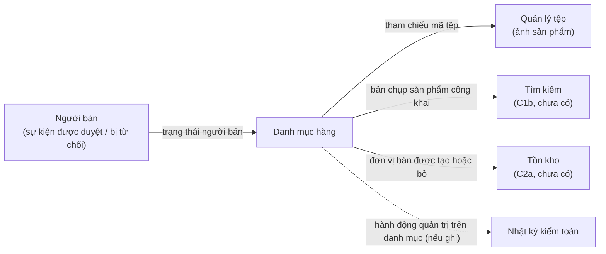
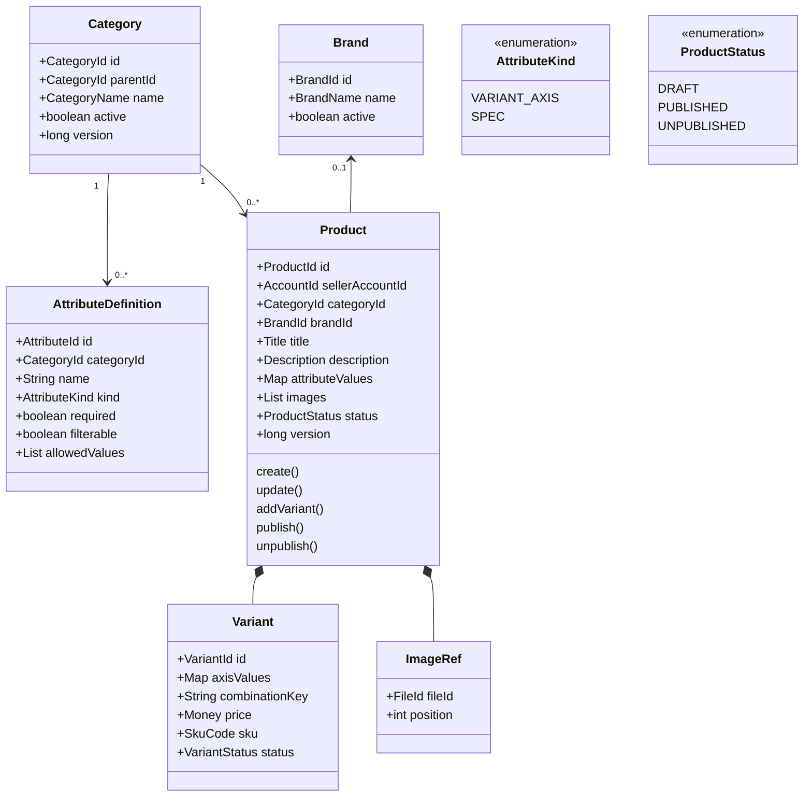
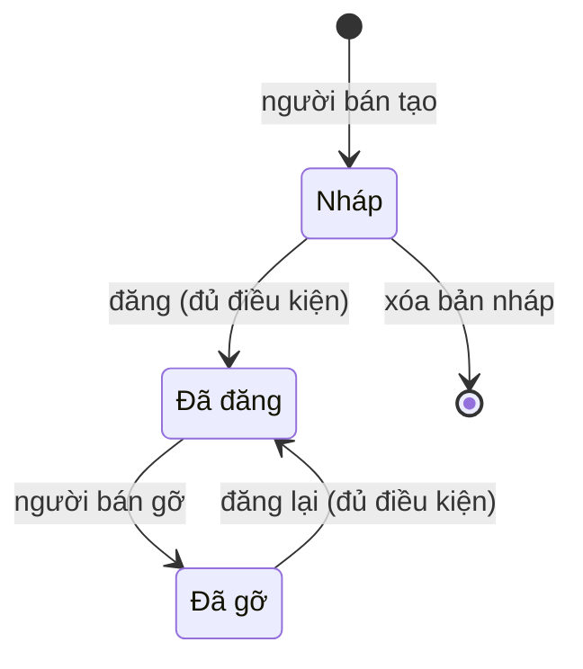
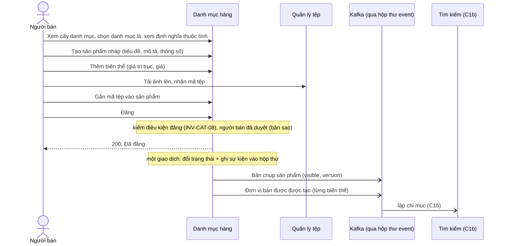

# C1a: phân tích và mô hình Danh mục hàng (bản nháp để duyệt)

> **Trạng thái:** nháp thảo luận `2026-10-22`, viết **trước** khi đối chiếu mã có sẵn (đối chiếu ở `_so-sanh-catalog.md`), chưa vào `stage.md` hay `analysis.md` · **BC:** Danh mục hàng (B1) · **Chặng:** C1a (phần chặn sản phẩm, tìm kiếm, lọc là C1b)
>
> Các mục "Mặc định đề xuất" là ý của agent, chờ người xác nhận. Mã `INV-CAT`, `CMD-CAT`, `RM-CAT` là tạm.

## 1. Phạm vi và giả định

Danh mục hàng cho phép người bán **mô tả hàng của mình một cách có cấu trúc** và đưa nó lên sàn. Phạm vi theo bản đồ BC (B1), phần thuộc C1a:

- Quản lý danh mục và thuộc tính; quản lý thương hiệu (tối giản).
- Tạo, sửa sản phẩm và biến thể; một giá niêm yết cho mỗi biến thể.
- Ảnh sản phẩm (tối giản, lưu qua Quản lý tệp).
- Đăng và gỡ sản phẩm.

**Không có ở C1a:** chặn và mở sản phẩm bởi quản trị (C1b), duyệt sản phẩm trước khi hiển thị (cắt tạm), tìm kiếm và lọc (C1b), tồn kho, khuyến mãi, phí vận chuyển.

Giả định: người bán tham chiếu bằng **mã tài khoản**; Danh mục biết "người bán đã được duyệt chưa" qua **bản sao cục bộ** cập nhật từ sự kiện của Người bán (xem `c1a-seller-profile-model.md`).

## 2. Vì sao cần BC này (suy luận)

Người mua cần biết sàn bán gì; người bán cần cách mô tả hàng để tìm được, lọc được, so sánh được. Từ đó sinh ra bốn khái niệm tách bạch:

1. **Cấu trúc để tìm và lọc đúng:** cây danh mục và thuộc tính. Nếu mỗi người bán tự đặt tên "Màu" là "màu sắc", "Color", "mau" thì không lọc được. Vì vậy cấu trúc do nền tảng (Quản trị) giữ, người bán chọn.
2. **Cái được mô tả cho người mua xem:** *sản phẩm* (áo thun nam X).
3. **Cái thật sự được bán:** *biến thể* (áo X, màu đỏ, cỡ M): đơn vị mà tồn kho, giỏ, đơn hàng trỏ tới. Tách khỏi sản phẩm vì một sản phẩm có nhiều lựa chọn với giá và tồn khác nhau.
4. **Điều khiển hiển thị:** sản phẩm có lúc nên thấy, lúc không (đang soạn, người bán gỡ, bị chặn). Hai bên điều khiển (người bán và quản trị) nên cần khép kín quy tắc hiển thị.

Danh mục **không** lo tồn kho, khuyến mãi, phí; nó chỉ giữ giá niêm yết. Giữ ranh giới này để Danh mục thay đổi theo nhịp riêng.

## 3. Ranh giới BC

- **Danh mục giữ:** cây danh mục, định nghĩa thuộc tính, thương hiệu, sản phẩm, biến thể, giá niêm yết, tham chiếu ảnh, trạng thái đăng.
- **Danh mục không giữ:** nội dung tệp ảnh (Quản lý tệp), trạng thái người bán (chỉ bản sao), số lượng tồn (Tồn kho), giá sau khuyến mãi (Khuyến mãi, Định phí).
- **Điểm cần sửa ở bản đồ BC:** B1 ghi "Vào: không", nhưng ràng buộc "chỉ người bán được duyệt mới đăng" cần Danh mục **nhận sự kiện trạng thái người bán**. Cần cập nhật B1 thành "Vào: người bán được duyệt, bị từ chối (từ Người bán)".

## 4. Mô hình miền

**Các aggregate:**

| Aggregate | Trách nhiệm | Ghi chú |
|---|---|---|
| `Category` (và `AttributeDefinition` thuộc nó) | Cây danh mục, định nghĩa thuộc tính | Quản trị sửa; nhỏ, ít đổi |
| `Brand` | Danh sách thương hiệu | Quản trị sửa; tối giản (tên, ngừng dùng) |
| `Product` (gồm `Variant`, `ImageRef`) | Sản phẩm của một người bán | Một giao dịch mỗi hành động; `version` tăng đơn điệu |

Biến thể nằm **trong** aggregate sản phẩm vì quy tắc "tổ hợp thuộc tính duy nhất trong sản phẩm" và "đăng cần mọi biến thể có giá" là bất biến cắt ngang các biến thể. Mã định danh dùng UUID v7 (ADR-0001). Biến thể có mã riêng và bền vì các BC khác (Tồn kho, Giỏ, Đơn hàng) tham chiếu *biến thể*, không phải sản phẩm.

### 4.1. Hai loại thuộc tính

| Loại | Dùng để | Ví dụ | Giá trị |
|---|---|---|---|
| `VARIANT_AXIS` (trục biến thể) | Phân biệt các biến thể của cùng sản phẩm | Màu, Cỡ | Chọn từ danh sách giá trị cho phép do Quản trị định |
| `SPEC` (thông số) | Mô tả sản phẩm, lọc | Chất liệu, Xuất xứ, Dung lượng | Chữ, số hoặc chọn từ danh sách |

Lý do tách: trục biến thể quyết định *cái gì là một đơn vị bán được*, còn thông số chỉ mô tả. Giá trị trục là danh sách chuẩn (không do người bán gõ tự do) để C1b lọc "màu đỏ" qua mọi người bán được.

### 4.2. Trường chính

| Thực thể | Trường | Quy tắc |
|---|---|---|
| Danh mục | `name` | duy nhất trong cùng cha, so sánh sau chuẩn hóa (bỏ dấu, chữ thường); độ sâu tối đa 4 |
| Danh mục | `active` | ngừng dùng thay vì xóa khi đã có sản phẩm |
| Thuộc tính | `kind`, `required`, `filterable`, `allowedValues` | chỉ gắn ở danh mục lá; `VARIANT_AXIS` bắt buộc có `allowedValues` |
| Thương hiệu | `name` | duy nhất sau chuẩn hóa; sản phẩm được phép không có thương hiệu |
| Sản phẩm | `title` | 5 đến 200 ký tự |
| Sản phẩm | `description` | **chữ thuần**, tối đa 5.000 ký tự, không cho HTML (hiển thị cho người mua nên tránh chèn mã) |
| Sản phẩm | `categoryId` | phải là danh mục lá đang dùng |
| Sản phẩm | `attributeValues` | đúng kiểu và đúng danh sách cho phép; thuộc tính `required` phải có khi đăng |
| Sản phẩm | `images` | tối đa 9, thứ tự có nghĩa, ảnh đầu là ảnh chính |
| Biến thể | `axisValues` | đủ mọi trục của danh mục, mỗi trục một giá trị cho phép |
| Biến thể | `combinationKey` | chuỗi chuẩn hóa của tổ hợp trục, duy nhất trong sản phẩm, **bất biến sau khi tạo** |
| Biến thể | `price` | số nguyên đồng (VND), lớn hơn 0 và không quá trần (1 tỷ) |
| Biến thể | `sku` | mã người bán tự đặt, tùy chọn, 1 đến 50 ký tự, duy nhất trong cùng người bán |
| Biến thể | `status` | `ACTIVE` hoặc `INACTIVE` |

Sản phẩm không có trục biến thể (danh mục không định nghĩa trục) có **đúng một biến thể mặc định** với tổ hợp rỗng, để mọi thứ phía sau luôn trỏ vào biến thể. Tối đa 50 biến thể mỗi sản phẩm.

## 5. Vòng đời sản phẩm

**Hiển thị cho người mua** = `PUBLISHED` **và** không bị chặn (C1b) **và** người bán còn được duyệt (C1b khóa người bán) **và** danh mục còn dùng. Danh mục lưu một cờ `visible` suy ra, đưa vào bản chụp công khai; người mua chỉ thấy khi `visible`.

| Hành động | Ai | Điều kiện |
|---|---|---|
| Tạo, sửa nháp | người bán đã duyệt, chủ sản phẩm | dữ liệu hợp lệ (chưa cần đủ để đăng) |
| Đăng | như trên | **đủ điều kiện đăng** (INV-CAT-08) |
| Gỡ | như trên | đang `PUBLISHED` |
| Sửa sản phẩm đã đăng | như trên | hợp lệ; có hiệu lực ngay, **không duyệt lại** (duyệt sản phẩm là cắt tạm); không đổi tổ hợp của biến thể đã có |
| Xóa | như trên | chỉ khi `DRAFT` |
| Thêm biến thể | như trên | tổ hợp chưa có; giá hợp lệ |
| Ngừng biến thể | như trên | đặt `INACTIVE`; không xóa biến thể của sản phẩm đã từng đăng |

## 6. Quy tắc (bất biến)

| Mã | Quy tắc | Lý do nghiệp vụ |
|---|---|---|
| INV-CAT-01 | Sản phẩm chỉ thuộc danh mục lá; danh mục đã có sản phẩm không được thêm danh mục con | Sản phẩm đặt ở nút giữa của cây làm lọc và hiển thị theo danh mục sai nghĩa |
| INV-CAT-02 | Tên danh mục duy nhất trong cùng cha (sau chuẩn hóa); tên thương hiệu duy nhất toàn sàn | Chống trùng và nhầm lẫn |
| INV-CAT-03 | Thuộc tính chỉ gắn ở danh mục lá | Thuộc tính gắn ở nút giữa phải kế thừa xuống, làm khó cả quy tắc lẫn lọc |
| INV-CAT-04 | Danh mục, thuộc tính, thương hiệu đang được dùng không bị xóa, chỉ ngừng dùng | Sản phẩm đang tham chiếu không được mồ côi |
| INV-CAT-05 | Tổ hợp giá trị trục của biến thể duy nhất trong sản phẩm và bất biến sau khi tạo | Biến thể là đơn vị mà đơn hàng trỏ tới; đổi nghĩa của nó làm sai đơn cũ |
| INV-CAT-06 | Giá lớn hơn 0, là số nguyên đồng, không quá trần | Tiền không âm, không phân số; trần chặn lỗi nhập |
| INV-CAT-07 | Hiển thị ⇔ đã đăng, không bị chặn, người bán còn được duyệt, danh mục còn dùng | Hai bên điều khiển hiển thị; cần một nơi định nghĩa khép kín |
| INV-CAT-08 | Đăng cần: người bán đã duyệt; danh mục lá đang dùng; ít nhất một biến thể hoạt động; mọi biến thể hoạt động có giá hợp lệ; thuộc tính bắt buộc đủ; **ít nhất một ảnh** | Sản phẩm thiếu những thứ này không bán được hoặc không nên hiện |
| INV-CAT-09 | Chỉ người bán đã duyệt tạo và sửa sản phẩm; chỉ chủ sản phẩm sửa sản phẩm đó | Chống tạo nháp hàng loạt từ tài khoản bất kỳ; chống sửa hàng của người khác |
| INV-CAT-10 | Chỉ `ADMIN` quản danh mục, thuộc tính, thương hiệu | Cấu trúc dùng chung của sàn |
| INV-CAT-11 | Biến thể của sản phẩm đã từng đăng không bị xóa, chỉ ngừng hoạt động | Đơn và tồn kho tham chiếu biến thể |
| INV-CAT-12 | `version` của sản phẩm tăng đơn điệu; bản chụp mang `version` | Bên nhận (Tìm kiếm) không bao giờ lùi về bản cũ khi sự kiện đến sai thứ tự |
| INV-CAT-13 | Mô tả là chữ thuần | Người mua đọc mô tả; cho HTML là mở cửa chèn mã |

## 7. Hành động và truy vấn

| Mã | Hành động | Ai |
|---|---|---|
| CMD-CAT-01 | Tạo, đổi tên, ngừng dùng danh mục | `ADMIN` |
| CMD-CAT-02 | Định nghĩa, sửa, ngừng thuộc tính của danh mục lá (kèm giá trị cho phép) | `ADMIN` |
| CMD-CAT-03 | Tạo, đổi tên, ngừng thương hiệu | `ADMIN` |
| CMD-CAT-04 | Tạo sản phẩm (nháp) | người bán đã duyệt |
| CMD-CAT-05 | Sửa sản phẩm (tiêu đề, mô tả, thương hiệu, thông số) | chủ sản phẩm |
| CMD-CAT-06 | Thêm biến thể; đổi giá; đặt sku; ngừng hoạt động | chủ sản phẩm |
| CMD-CAT-07 | Gắn, bỏ, sắp xếp ảnh | chủ sản phẩm |
| CMD-CAT-08 | Đăng; gỡ; đăng lại | chủ sản phẩm |
| CMD-CAT-09 | Xóa bản nháp | chủ sản phẩm |

| Mã | Truy vấn | Ai |
|---|---|---|
| RM-CAT-01 | Cây danh mục (để chọn khi tạo sản phẩm, để quản trị sửa) | người bán, `ADMIN` |
| RM-CAT-02 | Định nghĩa thuộc tính của một danh mục lá | người bán, `ADMIN` |
| RM-CAT-03 | Danh sách thương hiệu đang dùng | người bán, `ADMIN` |
| RM-CAT-04 | Sản phẩm của tôi (danh sách phân trang, lọc theo trạng thái) và chi tiết | chủ sản phẩm |
| RM-CAT-05 | Xem sản phẩm công khai | người mua (C1b) |

## 8. Luồng chính: đăng một sản phẩm

## 9. Đường không suôn sẻ

| Tình huống | Kết quả mong đợi |
|---|---|
| Tài khoản chưa được duyệt làm người bán tạo sản phẩm | 403 `SELLER_NOT_APPROVED` |
| Người bán sửa sản phẩm của người khác | 404 (không lộ sự tồn tại) |
| Chọn danh mục không phải lá hoặc đã ngừng dùng | 400 `CATEGORY_NOT_LEAF` hoặc `CATEGORY_INACTIVE` |
| Giá trị thuộc tính ngoài danh sách cho phép, sai kiểu | 400 kèm tên thuộc tính |
| Tổ hợp biến thể trùng trong sản phẩm (kể cả hai yêu cầu cùng lúc) | 409 `VARIANT_COMBINATION_EXISTS`; chỉ mục duy nhất ở cơ sở dữ liệu chốt |
| Mã sku trùng trong cùng người bán | 409 `SKU_TAKEN` |
| Giá không hợp lệ | 400 `INVALID_PRICE` |
| Đăng thiếu điều kiện (không ảnh, không biến thể hoạt động, thiếu thuộc tính bắt buộc) | 409 `CANNOT_PUBLISH`, kèm danh sách điều kiện còn thiếu để người bán sửa một lượt |
| Hai thao tác sửa cùng sản phẩm đồng thời | 409 `STALE_VERSION` (khóa lạc quan) |
| Sửa tổ hợp của biến thể đã có | 409 `COMBINATION_IMMUTABLE` |
| Xóa sản phẩm không còn là nháp | 409 `INVALID_STATE` |
| Xóa hay đổi kiểu thuộc tính đã có sản phẩm dùng; thêm danh mục con vào danh mục đã có sản phẩm | 409 kèm lý do |
| Mô tả chứa HTML | Lưu như chữ thuần (thoát ký tự khi hiển thị), không từ chối |
| Sự kiện "người bán được duyệt" chưa tới Danh mục | Người bán thấy "được duyệt" ở cổng nhưng chưa tạo được sản phẩm vài giây: chấp nhận |
| Gắn mã tệp không tồn tại hoặc không phải ảnh | Xem câu hỏi mở số 5 |

## 10. Sự kiện

| Sự kiện | Bên phát | Bên nhận | Nội dung chính |
|---|---|---|---|
| Bản chụp sản phẩm công khai | Danh mục | Tìm kiếm (C1b) | toàn bộ dữ liệu hiển thị (tiêu đề, mô tả, danh mục, thương hiệu, thông số, ảnh, biến thể và giá), cờ `visible`, `version`. **Trạng thái đầy đủ, không phải phần thay đổi**, để bên nhận chỉ cần ghi đè nếu `version` mới hơn |
| Đơn vị bán được được tạo, bị bỏ | Danh mục | Tồn kho (C2a) | mã biến thể, mã sản phẩm, mã người bán; không mang giá |
| Danh mục thay đổi | Danh mục | Tìm kiếm (C1b) | mã danh mục, `version` |
| (vào) người bán được duyệt, bị từ chối | Người bán | Danh mục | để cập nhật bản sao trạng thái người bán |

Phát **một** loại bản chụp (trạng thái đầy đủ) thay vì nhiều sự kiện nhỏ ("đã đăng", "đã gỡ", "đã đổi giá"), vì bên nhận chỉ cần ghi đè theo `version`, nhận lặp hay sai thứ tự đều an toàn. Đổi lại mỗi bản chụp lớn hơn; chấp nhận ở quy mô này.

## 11. Dữ liệu dự kiến (chi tiết ở `data.md` sau)

`categories` (`id`, `parent_id`, `name`, `name_key`, `active`, `version`; duy nhất `(parent_id, name_key)`), `attribute_definitions` (`id`, `category_id`, `name`, `kind`, `required`, `filterable`, `allowed_values`), `brands` (`id`, `name`, `name_key` duy nhất, `active`),
`products` (`id`, `seller_account_id`, `category_id`, `brand_id`, `title`, `description`, `attribute_values`, `status`, `version`, `visible`), `product_images` (`product_id`, `file_id`, `position`),
`variants` (`id`, `product_id`, `axis_values`, `combination_key` — duy nhất `(product_id, combination_key)`, `price`, `sku` — duy nhất `(seller_account_id, sku)` khi có, `status`), `seller_status` (bản sao: `account_id`, `approved`, `profile_version`).

## 12. Phạm vi

| Trạng thái | Nội dung |
|---|---|
| **Trong C1a** | Quản danh mục, thuộc tính, thương hiệu (Quản trị); tạo, sửa sản phẩm và biến thể; giá niêm yết; gắn ảnh; đăng, gỡ, đăng lại; xóa nháp; sản phẩm của tôi; bản chụp và sự kiện đơn vị bán được; kiểm người bán đã duyệt qua bản sao |
| **Cắt tạm** | Chặn và mở sản phẩm (C1b); duyệt sản phẩm trước khi hiển thị; lịch sử giá; nhóm thuộc tính dùng chung giữa các danh mục; ảnh riêng cho biến thể; nhập sản phẩm hàng loạt; sao chép sản phẩm; di chuyển danh mục; mô tả có định dạng; video; slug thân thiện đường dẫn |
| **Ngoài** | Tồn kho, khuyến mãi, phí vận chuyển, nhiều loại tiền |

## 13. Câu hỏi mở và mặc định đề xuất

| # | Câu hỏi | Mặc định đề xuất |
|---|---|---|
| 1 | Trục biến thể do danh mục định nghĩa (chuẩn hóa, lọc được) hay người bán tự đặt tên? | Danh mục định nghĩa (khớp "tổ hợp thuộc tính của biến thể" trong bản đồ BC và cho C1b lọc được) |
| 2 | Cổng "người bán đã duyệt" đặt ở lúc tạo sản phẩm hay chỉ lúc đăng? | Lúc tạo (INV-CAT-09), để chặn tạo nháp hàng loạt |
| 3 | Đăng có bắt buộc ít nhất một ảnh? | Có |
| 4 | Ai tạo danh mục, thuộc tính, thương hiệu; có cần dữ liệu khởi tạo ban đầu? | `ADMIN` ở ứng dụng Vận hành; cần một bộ danh mục mẫu để demo (script khởi tạo, giống tài khoản Quản trị) |
| 5 | Có kiểm mã tệp thuộc về chính người bán khi gắn ảnh? | Chưa ở C1a (ảnh công khai, rủi ro thấp); Quản lý tệp ghi chủ sở hữu để kiểm sau |
| 6 | Giới hạn: 9 ảnh, 50 biến thể, cây sâu 4, tiêu đề 5 đến 200, mô tả 5.000 | Theo bảng, cấu hình được |
| 7 | Tiền: số nguyên đồng, một loại tiền, trần 1 tỷ | Có |
| 8 | Mô tả chữ thuần, không HTML | Có |
| 9 | Sửa sản phẩm đã đăng có hiệu lực ngay, không duyệt lại | Có (duyệt sản phẩm là cắt tạm) |
| 10 | Bản chụp là trạng thái đầy đủ, một loại sự kiện | Có |
| 11 | Biến thể không có trục: một biến thể mặc định | Có |
| 12 | Danh mục bị ngừng dùng thì sản phẩm trong đó ẩn hay giữ hiện? | Ẩn (INV-CAT-07), người bán thấy cảnh báo cần chuyển danh mục (cần quy tắc di chuyển sản phẩm, cắt tạm) |
| 13 | Thương hiệu: danh sách do Quản trị, hay người bán tự thêm? | Do Quản trị (tối giản); xác thực quyền thương hiệu là cắt tạm |
