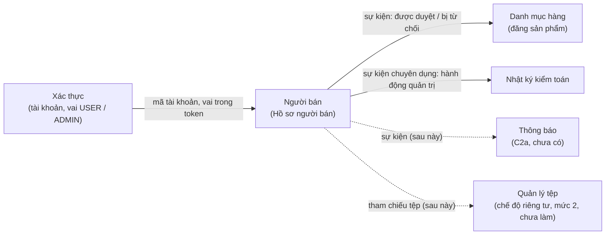
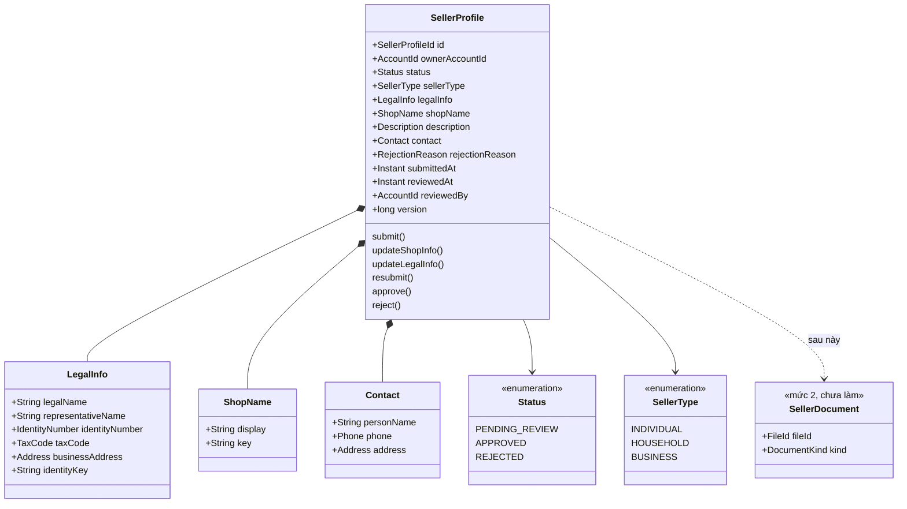
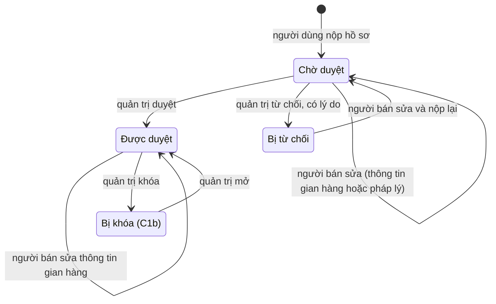

# C1a: phân tích và mô hình Hồ sơ người bán (bản nháp để duyệt, bản 3)

> **Trạng thái:** nháp thảo luận `2026-10-22` (bản 2: thêm loại hình và thông tin pháp lý), chưa vào `stage.md` hay `analysis.md` · **BC:** Người bán (B10) · **Chặng:** C1a
>
> Các mục "Mặc định đề xuất" là ý của agent, chờ người xác nhận. Mã `INV-SEL`, `CMD-SEL`, `RM-SEL` là tạm.
> **Thay đổi so với bản 1:** thêm *loại hình người bán* và *thông tin pháp lý khai báo* (mức 1), chừa chỗ cắm tài liệu đính kèm riêng tư (mức 2, chưa làm); thêm bốn bất biến (INV-SEL-09 đến 12).
> **Bản 3:** bỏ `pickupAddress` (nghiệp vụ của ta là người bán tự mang hàng tới kho, không ai đến lấy); thêm `businessAddress` vào thông tin pháp lý và `address` (địa chỉ liên hệ) vào liên hệ.

## 1. Phạm vi và giả định

Chặng C1a tập trung vào **Hồ sơ người bán**: một tài khoản `USER` xin được bán, quản trị xét, và gian hàng có danh tính tối thiểu.

- Một tài khoản có tối đa một hồ sơ; người bán **không phải vai** (token chỉ có `USER` hoặc `ADMIN`).
- Tài khoản nội bộ (`ADMIN`) không nộp hồ sơ.
- **Mức xác minh: mức 1.** Người nộp *khai* loại hình và thông tin pháp lý; quản trị xem và quyết định. Chưa có tệp đính kèm (mức 2) và không có xác thực điện tử qua định danh điện tử như sàn thật.
- Khách hàng (B11) chưa vào C1a; Dữ liệu tham chiếu chưa cần vì mọi địa chỉ ở C1a (địa chỉ kinh doanh, địa chỉ liên hệ) là văn bản tự do; cấu trúc hóa theo tỉnh, huyện, xã khi Giao nhận cần.

## 2. Vì sao có hồ sơ (suy luận)

Sàn có nhiều người bán lạ mặt gặp người mua, và nền tảng đứng ra bảo đảm giao dịch. Nếu ai có tài khoản cũng đăng hàng được thì sàn
không bảo đảm được gì. Vì vậy cần ba thứ tách khỏi tài khoản đăng nhập:

1. **Cổng kiểm soát ai được bán:** người nộp hồ sơ, quản trị xét. Tài khoản chờ duyệt vẫn đăng nhập và mua bình thường, nên đây là trạng thái của *hồ sơ*, không phải của tài khoản.
2. **Biết người bán là ai về mặt pháp lý:** cá nhân, hộ kinh doanh hay doanh nghiệp, với thông tin tương ứng. Đây là nền cho trách nhiệm, thuế và truy vết sau này. Một tài khoản đăng nhập chỉ biết email.
3. **Danh tính gian hàng:** tên, mô tả và thông tin liên hệ (người liên hệ, điện thoại, địa chỉ liên hệ). Nó có vòng đời khác tài khoản và khác thông tin pháp lý (đổi tên gian hàng dễ, đổi pháp nhân thì gần như là người bán khác).

## 3. Ranh giới BC



- **Người bán giữ:** hồ sơ, loại hình, thông tin pháp lý khai báo, trạng thái duyệt, danh tính gian hàng.
- **Người bán không giữ:** tài khoản và mật khẩu (Xác thực), sản phẩm (Danh mục hàng), nhật ký (Nhật ký kiểm toán), hồ sơ người mua (Khách hàng), nội dung tệp (Quản lý tệp).
- **BC khác tham chiếu người bán bằng mã tài khoản** (`ownerAccountId`), không bằng mã hồ sơ.
- **Thông tin định danh không đi ra khỏi BC Người bán** qua sự kiện hay log; chỉ chủ hồ sơ và quản trị đọc được qua API của chính BC này.

## 4. Mô hình miền



**Aggregate:** `SellerProfile` (một aggregate, một giao dịch mỗi hành động). Mã `id` là UUID v7 (ADR-0001).

### 4.1. Trường của hồ sơ

| Trường | Kiểu | Quy tắc | Ghi chú |
|---|---|---|---|
| `id` | UUID v7 | | |
| `ownerAccountId` | UUID | duy nhất, không rỗng | khóa mà BC khác dùng |
| `status` | enum | `PENDING_REVIEW`, `APPROVED`, `REJECTED` | C1b thêm `SUSPENDED` |
| `sellerType` | enum | `INDIVIDUAL`, `HOUSEHOLD`, `BUSINESS` | bất biến sau khi được duyệt (INV-SEL-11) |
| `legalInfo` | khối | bắt buộc theo loại hình (mục 4.2) | **dữ liệu cá nhân** |
| `shopName.display` | chữ | 3 đến 60 ký tự sau khi bỏ khoảng trắng thừa | hiển thị nguyên dạng người nhập |
| `shopName.key` | chữ | duy nhất toàn sàn | chuẩn hóa: bỏ khoảng trắng thừa, chữ thường, **bỏ dấu tiếng Việt** (INV-SEL-04) |
| `description` | chữ | tối đa 500 ký tự | tùy chọn |
| `contact.personName` | chữ | 2 đến 100 ký tự | người liên hệ về gian hàng (có thể khác người đại diện pháp lý) |
| `contact.phone` | chữ | số điện thoại Việt Nam hợp lệ | chuẩn hóa về một dạng |
| `contact.address` | chữ tự do | 10 đến 300 ký tự; tùy chọn | **địa chỉ liên hệ** của gian hàng, có thể khác địa chỉ kinh doanh (văn phòng, kho); để trống thì coi như trùng địa chỉ kinh doanh |
| `rejectionReason` | chữ | bắt buộc khi `REJECTED`, tối đa 500 | lý do lần từ chối gần nhất |
| `submittedAt` | thời điểm | lần nộp hoặc nộp lại gần nhất | thứ tự hàng chờ |
| `reviewedAt`, `reviewedBy` | thời điểm, mã tài khoản | bắt buộc khi `APPROVED` hoặc `REJECTED` | người quyết định |
| `version` | số | tăng mỗi thay đổi | khóa lạc quan; duyệt kèm phiên bản đã xem |

### 4.2. Thông tin pháp lý theo loại hình

| Trường | Cá nhân (`INDIVIDUAL`) | Hộ kinh doanh (`HOUSEHOLD`) | Doanh nghiệp (`BUSINESS`) |
|---|---|---|---|
| `legalName` | họ tên (bắt buộc) | tên chủ hộ (bắt buộc) | tên doanh nghiệp (bắt buộc) |
| `representativeName` | không có | không có | người đại diện theo pháp luật (bắt buộc) |
| `identityNumber` (số căn cước, 12 chữ số) | bắt buộc | bắt buộc (của chủ hộ) | bắt buộc (của người đại diện) |
| `taxCode` (mã số thuế, 10 hoặc 13 chữ số) | tùy chọn | bắt buộc | bắt buộc |
| `businessAddress` (địa chỉ kinh doanh, chữ tự do 10 đến 300 ký tự) | nơi cư trú (bắt buộc) | địa điểm kinh doanh (bắt buộc) | trụ sở (bắt buộc) |
| **`identityKey`** (khóa định danh, suy ra) | `identityNumber` | `taxCode` | `taxCode` |

`identityKey` là giá trị chuẩn hóa dùng để nhận ra "cùng một chủ thể pháp lý": cá nhân nhận ra bằng số căn cước; hộ và doanh nghiệp nhận ra bằng mã số thuế. Lý do chọn khác nhau theo loại hình: cùng một người có thể vừa là cá nhân bán hàng, vừa là người đại diện của một doanh nghiệp (cùng số căn cước), nên số căn cước không thể là khóa duy nhất cho mọi loại.

**Địa chỉ kinh doanh (pháp lý) khác địa chỉ liên hệ (gian hàng).** Địa chỉ kinh doanh là một phần của danh tính pháp lý: quản trị đối chiếu khi duyệt, không hiển thị công khai, khóa sau khi được duyệt như phần còn lại của thông tin pháp lý. Địa chỉ liên hệ là thông tin vận hành của gian hàng: người bán đổi được bất cứ lúc nào (chuyển văn phòng, đổi nơi nhận), và là ứng viên để hiển thị cho người mua sau này. Tách hai thứ này để việc dọn văn phòng không kéo theo xét lại hồ sơ pháp lý.

**Tách "đã khai" khỏi "đã xác minh".** Ở C1a các giá trị này là *người nộp tự khai*, quản trị đọc rồi quyết định. Sàn thật xác thực bằng định danh điện tử (Luật Thương mại điện tử 2025 yêu cầu nền tảng xác thực người bán trước khi mở gian hàng), việc đó nằm ngoài dự án. Hồ sơ không có cờ "đã xác minh" riêng: trạng thái `APPROVED` là sự công nhận của quản trị.

Lịch sử các lần nộp, từ chối **không nằm trong aggregate**: nằm ở Nhật ký kiểm toán. Hồ sơ chỉ giữ lý do từ chối gần nhất để người bán sửa.

## 5. Vòng đời



| Từ | Hành động | Ai | Sang | Điều kiện |
|---|---|---|---|---|
| (chưa có) | Nộp hồ sơ | `USER` | `PENDING_REVIEW` | chưa có hồ sơ; tên gian hàng chưa dùng; thông tin pháp lý đủ theo loại hình; khóa định danh chưa có hồ sơ hiệu lực khác |
| `PENDING_REVIEW` | Duyệt | `ADMIN` | `APPROVED` | đúng phiên bản quản trị đã xem |
| `PENDING_REVIEW` | Từ chối | `ADMIN` | `REJECTED` | có lý do; đúng phiên bản đã xem |
| `REJECTED` | Sửa và nộp lại (được sửa mọi trường, kể cả loại hình và thông tin pháp lý) | chủ hồ sơ | `PENDING_REVIEW` | như khi nộp; xóa lý do từ chối |
| `PENDING_REVIEW` | Sửa thông tin gian hàng hoặc thông tin pháp lý | chủ hồ sơ | giữ nguyên | như khi nộp; phiên bản tăng |
| `APPROVED` | Sửa **thông tin gian hàng** (tên, mô tả, liên hệ kể cả địa chỉ liên hệ) | chủ hồ sơ | giữ nguyên | tên vẫn duy nhất; không duyệt lại |
| `APPROVED` | Sửa loại hình hoặc thông tin pháp lý | | | **không cho** ở C1a (INV-SEL-11) |
| `APPROVED` | Khóa, mở | `ADMIN` | `SUSPENDED` và ngược lại | **chỉ C1b** (cắt tạm khỏi C1a) |

## 6. Quy tắc (bất biến)

| Mã | Quy tắc | Lý do nghiệp vụ |
|---|---|---|
| INV-SEL-01 | Mỗi tài khoản có tối đa một hồ sơ; nộp lặp không tạo hồ sơ thứ hai | Bấm hai lần, mạng chậm là chuyện thường; một gian hàng một chủ ở C1a |
| INV-SEL-02 | Chỉ chuyển trạng thái theo bảng mục 5 | Tránh nhảy trạng thái (từ chối rồi coi như đã duyệt) |
| INV-SEL-03 | Từ chối phải có lý do | Người bán biết sửa gì; quản trị chịu trách nhiệm quyết định |
| INV-SEL-04 | Tên gian hàng duy nhất toàn sàn, so sánh sau chuẩn hóa (bỏ khoảng trắng thừa, chữ thường, bỏ dấu) | Chống mạo danh: "Cửa Hàng A" và "cua hang a" là một tên với người mua |
| INV-SEL-05 | Chỉ `ADMIN` duyệt hoặc từ chối; chỉ `USER` nộp hồ sơ | Người bán không tự duyệt mình; tài khoản nội bộ không bán |
| INV-SEL-06 | Duyệt hoặc từ chối chỉ áp dụng cho **đúng phiên bản hồ sơ quản trị đã xem** | Nếu người nộp sửa trong lúc quản trị đang xem, quản trị không duyệt nhầm bản cũ |
| INV-SEL-07 | Mỗi lần duyệt hoặc từ chối ghi nhật ký kiểm toán **cùng giao dịch** với thay đổi hồ sơ | Không có hành động quản trị nào thành công mà thiếu dấu vết |
| INV-SEL-08 | Tài khoản có hồ sơ `APPROVED` mới đăng được sản phẩm (Danh mục hàng kiểm) | Khép kín "chỉ người bán được duyệt mới niêm yết" |
| INV-SEL-09 | Thông tin pháp lý phải đủ và đúng định dạng theo loại hình (bảng 4.2) | Hồ sơ thiếu thông tin pháp lý không đủ để quản trị quyết định; định dạng sai là lỗi gõ cần báo sớm |
| INV-SEL-10 | Mỗi **khóa định danh** chỉ có tối đa một hồ sơ hiệu lực (`PENDING_REVIEW` hoặc `APPROVED`); hồ sơ `REJECTED` không giữ khóa | Một chủ thể pháp lý không mở nhiều gian hàng để lách khi một gian hàng bị xử lý; hồ sơ bị từ chối không chặn người đó nộp lại |
| INV-SEL-11 | Sau khi được duyệt, loại hình và thông tin pháp lý không đổi (ở C1a) | Đổi pháp nhân gần như là người bán khác và cần xét lại; chưa có luồng xét lại ở C1a |
| INV-SEL-12 | Số căn cước, mã số thuế, địa chỉ kinh doanh không xuất hiện trong log, sự kiện, danh sách; chỉ trả đầy đủ ở "hồ sơ của tôi" và chi tiết cho quản trị | Dữ liệu cá nhân nhạy cảm; lộ qua log hay bus rất khó thu hồi |

## 7. Hành động và truy vấn

| Mã | Hành động | Ai | Kết quả |
|---|---|---|---|
| CMD-SEL-01 | Nộp hồ sơ (loại hình, thông tin pháp lý, thông tin gian hàng) | `USER` | tạo `PENDING_REVIEW`; phát sự kiện nộp |
| CMD-SEL-02 | Sửa thông tin gian hàng | chủ hồ sơ, khi `PENDING_REVIEW` hoặc `APPROVED` | cập nhật; không đổi trạng thái |
| CMD-SEL-03 | Sửa thông tin pháp lý hoặc loại hình | chủ hồ sơ, chỉ khi `PENDING_REVIEW` | cập nhật; phiên bản tăng |
| CMD-SEL-04 | Sửa và nộp lại | chủ hồ sơ, khi `REJECTED` | sang `PENDING_REVIEW`; xóa lý do |
| CMD-SEL-05 | Duyệt (kèm phiên bản đã xem) | `ADMIN` | `APPROVED`; phát sự kiện "được duyệt" và sự kiện nhật ký |
| CMD-SEL-06 | Từ chối (kèm phiên bản đã xem, lý do) | `ADMIN` | `REJECTED`; phát sự kiện "bị từ chối" và sự kiện nhật ký |

| Mã | Truy vấn | Ai | Nội dung |
|---|---|---|---|
| RM-SEL-01 | Hồ sơ của tôi | chủ hồ sơ | trạng thái, lý do từ chối, mọi trường kể cả thông tin pháp lý; không có hồ sơ thì "chưa là người bán" |
| RM-SEL-02 | Danh sách chờ duyệt | `ADMIN` | phân trang, cũ nhất trước (theo `submittedAt`); **che** số căn cước và mã số thuế (chỉ vài chữ số cuối), không trả địa chỉ kinh doanh |
| RM-SEL-03 | Chi tiết một hồ sơ chờ duyệt | `ADMIN` | đầy đủ trường kể cả thông tin pháp lý, kèm `version` để duyệt đúng bản |

## 8. Luồng chính

```mermaid
sequenceDiagram
  actor NB as Người dùng (cổng Người bán)
  actor QT as Quản trị (cổng Vận hành)
  participant SEL as Người bán
  participant K as Kafka (qua hộp thư event)
  participant CAT as Danh mục hàng
  participant AUD as Nhật ký kiểm toán
  NB->>SEL: Nộp hồ sơ (loại hình, thông tin pháp lý, thông tin gian hàng)
  Note over SEL: kiểm đủ trường theo loại hình, tên chưa dùng, khóa định danh chưa có hồ sơ hiệu lực
  SEL-->>NB: 201, trạng thái Chờ duyệt
  QT->>SEL: Xem danh sách chờ duyệt (thông tin định danh đã che), mở một hồ sơ (kèm version)
  QT->>SEL: Duyệt (kèm version đã xem)
  Note over SEL: một giao dịch: đổi trạng thái + ghi sự kiện vào hộp thư
  SEL-->>QT: 200, Được duyệt
  SEL-)K: Đã duyệt (mã tài khoản, mã hồ sơ, version; không mang thông tin pháp lý)
  SEL-)K: Hành động quản trị (ai, làm gì, lên cái gì, lúc nào)
  K-)CAT: cập nhật bản sao trạng thái người bán
  K-)AUD: ghi một dòng nhật ký (chỉ thêm)
  NB->>SEL: Hồ sơ của tôi
  SEL-->>NB: Được duyệt
  NB->>CAT: Đăng sản phẩm (sau độ trễ vài giây, Danh mục thấy "được duyệt")
```

## 9. Đường không suôn sẻ

| Tình huống | Kết quả mong đợi |
|---|---|
| Nộp khi tài khoản đã có hồ sơ (bất kỳ trạng thái) | 409 `SELLER_PROFILE_EXISTS`; nếu bị từ chối thì chỉ dẫn dùng "sửa và nộp lại" |
| Tên gian hàng đã dùng (kể cả khác dấu, khác chữ hoa) | 409 `SHOP_NAME_TAKEN`; đua hai người cùng tên: chỉ mục duy nhất ở cơ sở dữ liệu chốt, người sau nhận lỗi |
| Khóa định danh đã có hồ sơ hiệu lực của tài khoản khác | 409 `IDENTITY_ALREADY_REGISTERED` (thông báo chung, không nói hồ sơ của ai); đua hai tài khoản cùng khóa: chỉ mục duy nhất một phần chốt |
| Thiếu thông tin pháp lý theo loại hình | 400 `LEGAL_INFO_REQUIRED`, kèm tên trường thiếu |
| Số căn cước hay mã số thuế sai định dạng | 400 `INVALID_IDENTITY_NUMBER` hoặc `INVALID_TAX_CODE` |
| Sửa loại hình hoặc thông tin pháp lý khi đã `APPROVED` | 409 `LEGAL_INFO_LOCKED` |
| `ADMIN` nộp hồ sơ | 403 |
| Người không phải `ADMIN` duyệt hoặc từ chối | 403 |
| Duyệt hồ sơ không còn ở `PENDING_REVIEW` (hai quản trị cùng bấm) | 409 `INVALID_STATE`; người sau nhận lỗi, không duyệt hai lần |
| Duyệt hoặc từ chối bản cũ (người nộp đã sửa sau khi quản trị mở) | 409 `STALE_VERSION`; quản trị xem lại bản mới |
| Từ chối không có lý do | 400 `REASON_REQUIRED` |
| Dữ liệu khác sai định dạng (tên quá ngắn, số điện thoại sai...) | 400 kèm mã lỗi theo trường |
| Sự kiện "được duyệt" chậm hoặc mất lượt tới Danh mục | Hộp thư event gửi lại tới khi được; Danh mục nhận lặp thì bỏ qua (khóa chống trùng theo mã sự kiện); trong lúc chờ, người bán thấy "được duyệt" ở cổng nhưng chưa đăng được: chấp nhận độ trễ |
| Sự kiện tới sai thứ tự (C1b có thêm "bị khóa") | Bản sao ở Danh mục chỉ nhận sự kiện có `version` mới hơn bản đang giữ |

## 10. Sự kiện

| Sự kiện | Bên phát | Bên nhận | Nội dung chính |
|---|---|---|---|
| `SellerApproved` | Người bán | Danh mục hàng | mã tài khoản, mã hồ sơ, tên gian hàng, `version`, thời điểm. **Không** mang thông tin pháp lý |
| `SellerRejected` | Người bán | (Thông báo, sau này) | mã tài khoản, `version`; **không** mang lý do (lý do nằm ở nhật ký) |
| Sự kiện nhật ký quản trị | Người bán (sau này mọi BC có hành động quản trị) | Nhật ký kiểm toán | người thực hiện, hành động (`APPROVE_SELLER`, `REJECT_SELLER`), đối tượng (mã hồ sơ), lý do, thời điểm; **không** mang số căn cước hay mã số thuế; hợp đồng chốt một lần để C1b chỉ thêm loại hành động |
| `SellerApplicationSubmitted` | Người bán | (không ai ở C1a) | mã tài khoản, mã hồ sơ; chỗ cắm cho thông báo "có hồ sơ mới" |

## 11. Dữ liệu dự kiến (tên cột chỉ minh họa, chi tiết ở `data.md` sau)

`seller_profiles`: `id` (khóa chính), `owner_account_id` (**duy nhất**), `status`, `seller_type`, `legal_name`, `representative_name`, `identity_number`, `tax_code`, `business_address`,
`identity_key`, `shop_name`, `shop_name_key` (**duy nhất**), `description`, `contact_name`, `contact_phone`, `contact_address`, `rejection_reason`,
`submitted_at`, `reviewed_at`, `reviewed_by`, `version`, `created_at`, `updated_at`.

Ràng buộc:
- `identity_key` có chỉ mục **duy nhất một phần** `WHERE status <> 'REJECTED'` (INV-SEL-10).
- Trạng thái và loại hình thuộc tập cho phép; `REJECTED` thì có lý do; `APPROVED` hoặc `REJECTED` thì có người và thời điểm duyệt.
- Doanh nghiệp thì có `representative_name` và `tax_code`; hộ thì có `tax_code` (kiểm bằng ràng buộc kiểm, ngoài kiểm ở miền).

**Dữ liệu cá nhân:** `identity_number`, `tax_code` và `business_address` cần được che trong log (thêm tên trường vào danh sách che của `BodySanitizer`) và bị loại khỏi mọi sự kiện. Mã hóa cột khi lưu là điểm nối, chưa làm ở C1a.

Bên Danh mục hàng: bản sao `seller_status` (`account_id` khóa chính, `approved` đúng sai, `profile_version`) cập nhật từ sự kiện.
- Cập nhật kiểu upsert theo `account_id`, chỉ ghi khi `version` của sự kiện mới hơn `profile_version` đang lưu (sự kiện lặp hoặc sai thứ tự không làm hỏng dữ liệu).
- Người bán chưa có dòng trong bảng thì coi là chưa duyệt (mặc định từ chối).
- C1b thêm `SUSPENDED`: khi đó bản sao đổi `approved` thành cột trạng thái (hoặc `approved` chuyển `false`); chốt ở C1b, bản sao vẫn dùng đúng cơ chế trên.

## 12. Phạm vi

| Trạng thái | Nội dung |
|---|---|
| **Trong C1a** | Nộp hồ sơ; loại hình và thông tin pháp lý khai báo; duyệt và từ chối kèm lý do; sửa thông tin gian hàng; sửa thông tin pháp lý khi chờ duyệt; sửa và nộp lại; hồ sơ của tôi; danh sách và chi tiết chờ duyệt; tên duy nhất; khóa định danh duy nhất; che dữ liệu định danh; sự kiện ra; ghi nhật ký cùng giao dịch |
| **Cắt tạm** | Tài liệu đính kèm riêng tư (mức 2: căn cước, giấy đăng ký, cần chế độ riêng tư của Quản lý tệp); đổi thông tin pháp lý sau khi được duyệt (cần luồng xét lại); mã hóa cột dữ liệu định danh; khóa và mở người bán (C1b); thông báo email kết quả (C2a); hạn duyệt và quá hạn (C2b); địa chỉ có cấu trúc theo tỉnh, huyện, xã (khi Giao nhận cần); địa chỉ nhận hàng hoàn riêng (C3b, nếu luồng hoàn hàng cần); tài khoản ngân hàng nhận tiền (cùng Sổ cái); nghỉ bán, đóng gian hàng; rút lại hồ sơ đang chờ |
| **Ngoài** | Xác thực điện tử qua định danh điện tử; nhiều tài khoản một gian hàng; loại người bán đối tác; hạng và chỉ số hiệu suất |
| **Khách hàng** | Không vào C1a |

## 13. Phân quyền ở C1a (quyết định `2026-10-22`)

Hồ sơ người bán là BC đầu tiên có thao tác cần chặn: duyệt chỉ cho `ADMIN`, dữ liệu định danh chỉ cho chủ hồ sơ và `ADMIN`.

**Quyết định của người dùng:** C1a **chưa xây module ABAC** (thư viện `abac` và phần tử giao diện ở `E:ProjectApartcomone-project`). Phân quyền ở C1a dùng **chú thích** trên API:
- vai: chú thích kiểm `role` từ token (`ADMIN` duyệt, từ chối, xem chi tiết hồ sơ chờ duyệt; `USER` nộp hồ sơ), mặc định từ chối;
- quyền sở hữu: kiểm trong BC (chủ hồ sơ mới xem, sửa hồ sơ của mình);
- phần ABAC (chính sách theo thuộc tính, bản đồ quyền cho giao diện, phần tử giao diện, PAP) **hoãn tới khi làm cổng Vận hành ở thời điểm thích hợp**, khi có vai nội bộ thứ hai. Đây là *hoãn có điểm nối*, không phải cắt: chú thích chỉ đặt ở lớp trình bày nên thay bằng cơ chế ABAC sau này không đụng nghiệp vụ.

Ranh giới với C1b: C1b vẫn có "phân quyền theo vai, khóa và mở tài khoản" của roadmap; phần phân quyền sâu (chọn chủ động) thực hiện cùng cổng Vận hành khi cần.


## 14. Câu hỏi mở và quyết định

**Đã chốt `2026-10-22`:** người dùng đồng ý toàn bộ mặc định đề xuất của câu 1–15; câu 16–18 chốt riêng (cột bên phải). Không còn câu mở.

| # | Câu hỏi | Quyết định (mặc định đề xuất đã được chấp nhận) |
|---|---|---|
| 1 | Một tài khoản một gian hàng? | Có (INV-SEL-01) |
| 2 | `ADMIN` có nộp hồ sơ bán không? | Không |
| 3 | Bị từ chối có nộp lại, có giới hạn lần không? | Nộp lại cùng hồ sơ, không giới hạn lần; lịch sử ở nhật ký |
| 4 | Sau khi được duyệt, sửa **thông tin gian hàng** có phải duyệt lại không? | Không; tên vẫn duy nhất. (Thông tin pháp lý thì không cho sửa, xem câu 11) |
| 5 | Tên gian hàng duy nhất toàn sàn, bỏ dấu khi so sánh? | Có |
| 6 | Tài liệu đính kèm hồ sơ (mức 2)? | Cắt tạm khỏi C1a; hồ sơ chừa chỗ cắm |
| 7 | Danh mục biết người bán đã duyệt bằng bản sao từ sự kiện? | Có (không thêm cặp gọi đồng bộ) |
| 8 | Sửa hồ sơ khi đang `PENDING_REVIEW` có cho không? | Có, kèm kiểm phiên bản khi duyệt (INV-SEL-06); phương án khác là khóa sửa khi chờ duyệt |
| 9 | Lý do từ chối: chữ tự do hay chọn từ danh sách? | Chữ tự do, tối đa 500 ký tự |
| 10 | Số điện thoại: xác minh bằng mã không? | Không ở C1a; chỉ kiểm định dạng |
| 11 | Đổi loại hình hoặc thông tin pháp lý sau khi được duyệt? | Không cho ở C1a (INV-SEL-11); luồng xét lại là cắt tạm |
| 12 | Khóa định danh chọn thế nào? | Cá nhân: số căn cước; hộ và doanh nghiệp: mã số thuế; duy nhất trong các hồ sơ hiệu lực (INV-SEL-10) |
| 13 | Cá nhân có phải khai mã số thuế không? | Tùy chọn ở C1a (cần kiểm chứng quy định thuế hiện hành khi phân tích kỹ hơn) |
| 14 | Mã hóa cột dữ liệu định danh khi lưu? | Cắt tạm; ghi rõ là điểm nối, che trong log và sự kiện là bắt buộc ngay |
| 15 | Quản trị thấy đầy đủ số căn cước ở chi tiết? | Có (cần để đối chiếu), nhưng danh sách thì che; truy cập chi tiết ghi nhật ký xem là cắt tạm |
| 16 | Địa chỉ kinh doanh bắt buộc với cả ba loại hình? | **Đã chốt `2026-10-22`:** có (cư trú, địa điểm kinh doanh, trụ sở), chữ tự do ở C1a |
| 17 | Địa chỉ liên hệ bắt buộc hay tùy chọn? | **Đã chốt `2026-10-22`:** tùy chọn; để trống thì dùng địa chỉ kinh doanh khi cần liên hệ |
| 18 | Hàng hoàn (C3b) về địa chỉ nào? | **Đã chốt `2026-10-22`:** để C3b quyết khi có luồng hoàn hàng; ứng viên là địa chỉ liên hệ, nếu trống thì địa chỉ kinh doanh |
