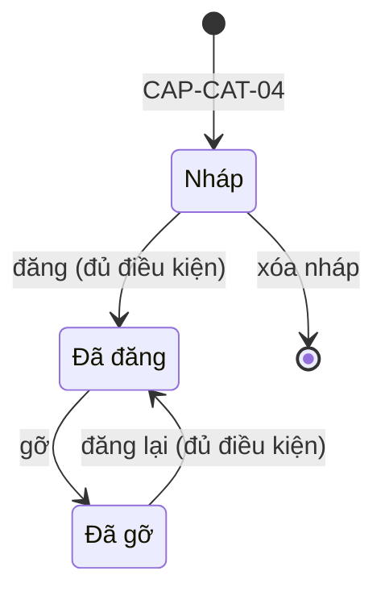

# Sản phẩm — `AGG-CAT-04`

Một trong năm aggregate của Danh mục hàng (xem [`0.overview.md`](0.overview.md)). Mã BC `CAT`.

## 1. Định nghĩa

**Sản phẩm** là thứ được mô tả cho người mua xem (áo thun nam X): tiêu đề, mô tả, danh mục, thương hiệu, thông số, ảnh. Nó thuộc **một người bán** (chủ sản phẩm). Sản phẩm **không phải thứ được bán**: thứ được bán là [biến thể](variant.md). Một sản phẩm có một hoặc nhiều biến thể.

Sản phẩm còn là nơi điều khiển **hiển thị**: có lúc nên thấy, lúc không (đang soạn, người bán gỡ, người bán không còn được duyệt, sau này bị chặn). Hai bên điều khiển (người bán và quản trị) nên cần một định nghĩa khép kín (`INV-CAT-95`).

## 2. Thành phần

- **Chủ sản phẩm** — mã tài khoản người bán; không đổi sau khi tạo.
- **Tiêu đề** (5 đến 200 ký tự) và **mô tả** (**chữ thuần**, tối đa 5.000 ký tự). Mô tả hiển thị cho người mua nên không cho định dạng/HTML: cho HTML là mở cửa chèn mã. Nội dung có ký tự đặc biệt được lưu như chữ và hiển thị như chữ, không từ chối.
- **Danh mục** — một danh mục lá (cấp ba) dùng được lúc tạo. **Không đổi sau khi tạo**: đổi danh mục là di chuyển sản phẩm, việc chưa làm (mục 7). Muốn khác thì tạo sản phẩm mới.
- **Thương hiệu** — tùy chọn (`brand.md`).
- **Giá trị thuộc tính** — với mỗi thuộc tính được gán cho danh mục: giá trị (chữ, số, đúng/sai, ngày) hoặc tùy chọn được chọn (kiểu chọn). Thuộc tính *bắt buộc* phải có giá trị khi đăng (`INV-CAT-91`); nháp được soạn từng bước nên có thể chưa đủ. **Giá trị đã lưu được giữ nguyên khi sửa phần khác**: Quản trị tắt một tùy chọn, tắt một mẫu hoặc bỏ gán một thuộc tính sau khi sản phẩm được tạo thì người bán vẫn sửa được phần không liên quan, không bị kẹt. Với thuộc tính đã bị gỡ khỏi danh mục, sản phẩm chỉ giữ hoặc bỏ hẳn giá trị, không thêm hay đổi. Thuộc tính bắt buộc chỉ ép người bán điền khi mẫu còn dùng được (`attribute-template.md` mục 3).
- **Trục biến thể** — sản phẩm chọn trong các thuộc tính **kiểu chọn một** của danh mục để làm trục, và cho mỗi trục chọn **tập giá trị** dùng cho sản phẩm này (tập con các tùy chọn đang dùng). Ví dụ: trục Màu với {Đỏ, Xanh}, trục Cỡ với {M, L}. Tối đa 2 trục (`Q-CAT-01`). **Trục là một thuộc tính của sản phẩm được đánh dấu làm trục**, không phải danh sách thứ hai: tập giá trị của trục chính là giá trị của thuộc tính đó, khai một lần. Vì vậy thuộc tính bắt buộc đã làm trục coi như đã điền (`INV-CAT-91`).
- **Ảnh** — tối đa 9, thứ tự có nghĩa, ảnh đầu là ảnh chính. Mỗi ảnh do chủ sản phẩm tải lên cho **chính sản phẩm này**.
- **Trạng thái** — Nháp, Đã đăng, Đã gỡ. **Hiển thị** là giá trị suy ra (`INV-CAT-95`).
- **Phiên bản** — tăng mỗi lần sản phẩm hay biến thể của nó đổi; mọi sự kiện mang phiên bản (`INV-CAT-36`).

**Vì sao trục do sản phẩm khai, không do danh mục quy định.** Danh mục chỉ nói thuộc tính nào *có thể* dùng; sản phẩm tự quyết trục. Áo thun có thể bán theo Màu và Cỡ, hoặc chỉ theo Màu. Giá trị trục vẫn lấy từ danh sách chuẩn nên lọc "màu đỏ" qua mọi người bán vẫn được. Phương án đã cân nhắc: danh mục quy định cứng trục của mọi sản phẩm trong nó. Loại vì ép người bán dùng trục không hợp hàng của họ.

**Vì sao tập giá trị trục ở sản phẩm.** Người bán áo chỉ có Đỏ và Xanh không nên thấy 30 màu khác khi tạo biến thể, và biến thể phải chọn trong tập đó (`INV-CAT-94`).

**Sản phẩm không có trục** (ví dụ cuốn sách) có **đúng một biến thể mặc định** với tổ hợp rỗng, để mọi thứ phía sau luôn trỏ vào một biến thể (`variant.md`).

## 3. Vòng đời & hành vi

| Từ | Hành động | Ai | Điều kiện | Sang | Sự kiện |
|---|---|---|---|---|---|
| (chưa có) | Tạo | Người bán đã duyệt | `INV-CAT-30`, `31`, `32`, `97` | Nháp | — |
| Nháp, Đã đăng, Đã gỡ | Sửa tiêu đề, mô tả, thương hiệu, thông số | Chủ sản phẩm | `INV-CAT-31`, `32` | giữ nguyên | `EVT-CAT-01` nếu hiển thị |
| Nháp, Đã đăng, Đã gỡ | Khai, đổi trục biến thể | Chủ sản phẩm | `INV-CAT-33` | giữ nguyên | — |
| Nháp, Đã đăng, Đã gỡ | Gắn, bỏ, sắp xếp ảnh | Chủ sản phẩm | `INV-CAT-34` | giữ nguyên | `EVT-CAT-01` nếu hiển thị |
| Nháp, Đã gỡ | Đăng | Chủ sản phẩm | `INV-CAT-91` | Đã đăng | `EVT-CAT-01`, `EVT-CAT-02` |
| Đã đăng | Gỡ | Chủ sản phẩm | — | Đã gỡ | `EVT-CAT-01` |
| Nháp | Xóa | Chủ sản phẩm | `INV-CAT-35` | (bỏ) | `EVT-CAT-02` nếu có biến thể |

Sửa sản phẩm đã đăng **có hiệu lực ngay, không duyệt lại**: duyệt sản phẩm trước khi hiển thị là cắt tạm (`0.overview.md` mục 11). Xóa chỉ với bản Nháp; sản phẩm đã từng đăng không xóa vì đơn và tồn kho có thể tham chiếu biến thể của nó (`INV-CAT-35`, `variant.md`).

**Ma trận hành động × trạng thái**

| Hành động \ Trạng thái | (chưa có) | Nháp | Đã đăng | Đã gỡ |
|---|---|---|---|---|
| Tạo | ✓ | ✗ | ✗ | ✗ |
| Sửa thông tin, thông số | ✗ | ✓ | ✓ | ✓ |
| Khai, đổi trục | ✗ | ✓ | ✓ (chỉ khi chưa có biến thể) | ✓ (như vậy) |
| Gắn, bỏ ảnh | ✗ | ✓ | ✓ (còn ít nhất một ảnh) | ✓ |
| Đăng | ✗ | ✓ | ✗ | ✓ |
| Gỡ | ✗ | ✗ | ✓ | ✗ |
| Xóa | ✗ | ✓ | ✗ | ✗ |

Bỏ ảnh cuối cùng của sản phẩm đang Đã đăng bị từ chối (sản phẩm đã đăng luôn có ít nhất một ảnh). Danh mục của sản phẩm ngừng dùng **không** làm sản phẩm đã đăng hết hiển thị; chỉ chặn đăng lại sản phẩm đã gỡ (`INV-CAT-91`, `category.md` mục 3).

## 4. Năng lực

Sáu câu của P3 (xem `category.md` mục 4).

### CAP-CAT-04 Tạo và sửa sản phẩm (stage: H5)

1. Người bán đã duyệt (tạo); chủ sản phẩm (sửa).
2. Danh mục tự xử lý, không có bước duyệt: kiểm người bán đã duyệt qua bản sao trạng thái (`CAP-CAT-08`), chủ sản phẩm, danh mục lá dùng được lúc tạo (`INV-CAT-97`), tiêu đề và mô tả (`INV-CAT-31`), giá trị thuộc tính (`INV-CAT-32`), trục (`INV-CAT-33`).
3. Chủ sản phẩm thấy kết quả ngay. Nếu sản phẩm hiển thị thì phát `EVT-CAT-01`.
4. Đường không suôn sẻ:
   - Tài khoản chưa được duyệt làm người bán: từ chối (`INV-CAT-30`).
   - Sửa sản phẩm của người khác: từ chối **như thể sản phẩm không tồn tại**, không lộ sự tồn tại.
   - Danh mục không phải lá (cấp ba), đã ngừng dùng, hoặc có tổ tiên ngừng dùng: từ chối.
   - Giá trị thuộc tính ngoài danh sách cho phép, sai kiểu: từ chối kèm tên thuộc tính.
   - Hai lần sửa đồng thời: lần sau nhận lỗi phiên bản cũ, không ghi đè âm thầm.
   - Khai lại trục khi đã có biến thể: từ chối.
5. Chưa có lịch sử sửa ở C1a; sản phẩm giữ phiên bản và thời điểm cập nhật.
6. Chảy sang Tìm kiếm (`EVT-CAT-01`, C1b).

### CAP-CAT-06 Gắn ảnh (stage: H6)

1. Chủ sản phẩm.
2. Người bán tải ảnh lên cho sản phẩm; Danh mục xác nhận ảnh đó đã được tải lên cho chính sản phẩm này rồi gắn vào (`INV-CAT-34`). Ảnh nằm trong Danh mục ở C1a (Quản lý tệp là BC riêng, hoãn có điểm nối: sản phẩm giữ mã tệp, `0.overview.md` mục 11).
3. Phát `EVT-CAT-01` nếu sản phẩm hiển thị.
4. Đường không suôn sẻ:
   - Quá 9 ảnh: từ chối.
   - Không phải ảnh, hoặc định dạng, dung lượng ngoài giới hạn: từ chối.
   - Ảnh tải lên cho sản phẩm khác hoặc không tồn tại: từ chối.
   - Tải ảnh quá nhiều lần liên tiếp: bị giới hạn tần suất.
   - Bỏ ảnh cuối của sản phẩm đã đăng: từ chối.
5. Không có lịch sử riêng.
6. Chảy sang Tìm kiếm cùng sản phẩm (`EVT-CAT-01`).

### CAP-CAT-07 Đăng, gỡ, đăng lại, xóa nháp (stage: H7)

1. Chủ sản phẩm.
2. Danh mục tự xử lý. **Đăng** kiểm đủ điều kiện đăng (`INV-CAT-91`) tại thời điểm bấm; **gỡ** và **xóa nháp** kiểm trạng thái (`INV-CAT-35`).
3. Chủ sản phẩm thấy kết quả ngay. Đăng, gỡ phát `EVT-CAT-01` (cờ hiển thị đổi); đăng lần đầu và đăng lại còn phát `EVT-CAT-02` cho từng biến thể hoạt động; xóa nháp có biến thể phát `EVT-CAT-02` (bỏ).
4. Đường không suôn sẻ:
   - Đăng thiếu điều kiện (không ảnh, không biến thể hoạt động, biến thể thiếu giá, thiếu thuộc tính bắt buộc, danh mục ngừng dùng, người bán chưa được duyệt): từ chối kèm **đủ** danh sách điều kiện còn thiếu để người bán sửa một lượt.
   - Gỡ sản phẩm không ở trạng thái Đã đăng, xóa sản phẩm không còn là Nháp: từ chối.
   - Hai thao tác cùng lúc trên một sản phẩm: lần sau nhận lỗi phiên bản cũ.
5. Không có lịch sử riêng ở C1a.
6. Chảy sang Tìm kiếm (`EVT-CAT-01`) và Tồn kho (`EVT-CAT-02`).

### CAP-CAT-08 Biết người bán đã duyệt hay chưa (stage: H8)

1. Người bán phát kết quả duyệt (`EVT-SEL-01`, `EVT-SEL-02`).
2. Danh mục giữ một **bản sao trạng thái người bán** (`RM-CAT-06`) và dùng nó để kiểm `INV-CAT-30` và `INV-CAT-91`, thay vì hỏi Người bán mỗi lần. Chỉ nhận sự kiện có phiên bản mới hơn bản đang giữ. Người bán chưa có trong bản sao được coi là **chưa duyệt** (mặc định từ chối).
3. Không ai được báo.
4. Đường không suôn sẻ: sự kiện "được duyệt" chậm hoặc mất lượt: được gửi lại; nhận lặp thì bỏ qua; trong lúc chờ, người bán thấy "được duyệt" ở cổng nhưng chưa tạo được sản phẩm vài giây. Chấp nhận độ trễ vì duyệt là việc thủ công. Sự kiện sai thứ tự (C1b có thêm "bị khóa") không làm sai trạng thái.
5. Không có.
6. Dữ liệu chỉ chảy vào BC này.

## 5. Bất biến (INV)

| ID | Bất biến | Lý do | Loại | Kiểm tra khi | Từ stage |
|---|---|---|---|---|---|
| `INV-CAT-30` | Chỉ người bán đã duyệt tạo sản phẩm; chỉ chủ sản phẩm sửa, đăng, gỡ, xóa sản phẩm đó | Chặn tạo nháp hàng loạt từ tài khoản bất kỳ; chặn sửa hàng của người khác | Tiên quyết | mọi hành động của người bán | R6, R7 |
| `INV-CAT-31` | Tiêu đề 5 đến 200 ký tự; mô tả là chữ thuần, tối đa 5.000 ký tự | Người mua đọc mô tả; cho HTML là mở cửa chèn mã | Tiên quyết | tạo, sửa | mới |
| `INV-CAT-32` | Giá trị **mới hoặc đổi** của thuộc tính chỉ cho thuộc tính được gán cho danh mục, đúng kiểu, chọn từ tùy chọn đang dùng, nằm trong ràng buộc riêng của danh mục. Giá trị **đã lưu và không đổi** được miễn kiểm lại | Giữ giá trị chuẩn để lọc được, mà người bán không bị kẹt khi Quản trị tắt tùy chọn hay mẫu sau đó | Tiên quyết | tạo, sửa | mới |
| `INV-CAT-33` | Trục biến thể là thuộc tính kiểu chọn một được gán cho danh mục, tối đa 2 trục, tập giá trị thuộc các tùy chọn đang dùng; chỉ khai trục khi chưa có biến thể; không rút giá trị đang được biến thể dùng | Trục quyết định cái gì là một đơn vị bán được; đổi sau khi có biến thể làm nghĩa của biến thể đổi | Liên tục | khai, đổi trục | R9 |
| `INV-CAT-34` | Tối đa 9 ảnh, đúng định dạng và dung lượng, mỗi ảnh được tải lên cho chính sản phẩm, thứ tự có nghĩa; sản phẩm đã đăng luôn có ít nhất một ảnh | Ảnh là điều kiện để người mua tin hàng; ảnh của người khác không được gắn vào | Liên tục | gắn, bỏ ảnh | R8 |
| `INV-CAT-35` | Chỉ chuyển trạng thái theo bảng ở mục 3; chỉ xóa khi Nháp và chưa từng đăng | Tránh nhảy trạng thái; đơn và tồn kho tham chiếu biến thể đã đăng | Liên tục | mọi hành động đổi trạng thái | mới |
| `INV-CAT-36` | Phiên bản của sản phẩm tăng đơn điệu; mọi sự kiện mang phiên bản | Bên nhận (Tìm kiếm) không bao giờ lùi về bản cũ khi sự kiện đến sai thứ tự | Liên tục | mọi thay đổi | mới |

**Giữ nguyên giá trị đã lưu (grandfathering).** Khi Quản trị tắt một tùy chọn, tắt một mẫu hoặc bỏ gán mẫu khỏi danh mục, sản phẩm đã lưu giá trị đó **không bị xóa hay đổi giá trị**. Việc tắt chỉ chặn *chọn mới* (`INV-CAT-32`: giá trị mới hoặc đổi bị kiểm, giá trị cũ không đổi được miễn kiểm). Nhờ vậy người bán sửa tiêu đề hay mô tả mà không bị kẹt vì một tùy chọn đã tắt. Thuộc tính bắt buộc chỉ ép điền khi mẫu còn dùng được (`attribute-template.md` mục 3). Cùng ý với danh mục ngừng dùng: sản phẩm đã đăng không hết hiển thị (`INV-CAT-95`).

Quy tắc xuyên aggregate liên quan sản phẩm: `INV-CAT-91` (điều kiện đăng), `92` đến `94` (biến thể), `95` (hiển thị), `96` (SKU), `97` (danh mục lá), ở [`0.overview.md`](0.overview.md) mục 7.

## 6. Event

| Event | Khi nào | Nội dung chính | Bên nhận |
|---|---|---|---|
| `EVT-CAT-01` Sản phẩm công khai thay đổi | Sản phẩm hay biến thể của nó đổi và sản phẩm hiển thị, hoặc cờ hiển thị đổi | Trạng thái đầy đủ + cờ hiển thị + phiên bản | Tìm kiếm (C1b) |
| `EVT-CAT-02` Đơn vị bán được được tạo, đổi trạng thái, bỏ | Đăng lần đầu, đăng lại, ngừng biến thể, xóa nháp | Mã biến thể, mã sản phẩm, mã người bán, hoạt động hay không; không mang giá | Tồn kho (C2a) |

Sản phẩm không phát `EVT-CAT-04`: tạo, sửa sản phẩm là hành động của người bán, không phải quản trị.

## 7. Chưa làm

| Năng lực | Trạng thái | Chặng dự kiến | Giá trị | Lý do xếp sau | Điểm nối |
|---|---|---|---|---|---|
| Chặn, mở sản phẩm | Trong scope (B1) | C1b | Quản trị xử lý vi phạm | Cần phân quyền sâu | Cờ chặn độc lập; một điều kiện của `INV-CAT-95` |
| Duyệt sản phẩm trước khi hiển thị | **Cắt tạm** (B1) | Sau C1b | Chống hàng cấm | Sửa sản phẩm đã đăng có hiệu lực ngay | Trạng thái chờ duyệt |
| Di chuyển sản phẩm sang danh mục khác | Cắt tạm | Chưa dự kiến | Xử lý khi danh mục ngừng dùng | Chưa có nhu cầu | Hành động mới |
| Sao chép sản phẩm, nhập hàng loạt | Cắt tạm | Chưa dự kiến | Người bán nhiều hàng | Chưa có nhu cầu | Sản phẩm |
| Mô tả có định dạng, video, đường dẫn thân thiện | Cắt tạm | Chưa dự kiến | Trình bày | Chưa có nhu cầu | Sản phẩm |
| Thông tin bảo hành | Cắt tạm | Khi có hàng cần | Người mua biết bảo hành | Chưa có nhu cầu | Thông số |
| Lịch sử sửa sản phẩm | Cắt tạm | Chưa dự kiến | Truy ai sửa gì | Chưa có nhu cầu | Sản phẩm |

## 8. Câu hỏi cần trả lời

`Q-CAT-01` (giới hạn: ảnh, trục, độ dài) ở [`0.overview.md`](0.overview.md).
