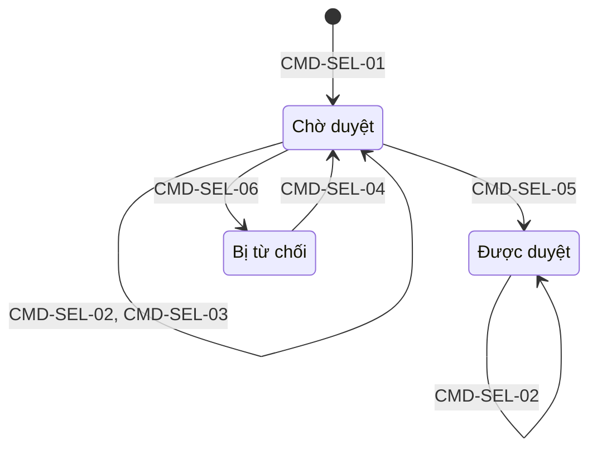

# Phân tích nghiệp vụ: Người bán

> **Trạng thái:** DRAFT · **Cập nhật:** `2026-10-23` · **Mã BC:** `SEL` (tiền tố cho ID)
>
> Tài liệu giữ nghiệp vụ **kèm lý do**, phản ánh trạng thái hiện tại, không ghi lịch sử thay đổi. Bản này phủ phần thuộc chặng C1a (hồ sơ người bán và quy trình duyệt); phần của chặng sau ở mức tên (mục 13).
>
> **Nguồn:** `4-context-map.md` B10, `5-ui-analysis.md`, `7-roadmap.md` C1a · **Chặng:** [`stage.md` của C1a](../../stage/c1a-listing/stage.md)

## 1. Nhiệm vụ và ranh giới

Người bán là **nguồn sự thật duy nhất** cho câu hỏi "tài khoản này có được bán trên sàn không, và gian hàng của họ là ai". Nó:
- giữ **hồ sơ người bán** của một tài khoản: loại hình, thông tin pháp lý khai báo, danh tính gian hàng;
- chạy **quy trình duyệt**: người dùng nộp, quản trị quyết định, kết quả được công bố cho BC khác.

**Điểm sâu:** không có. Người bán ở C1a là một máy trạng thái nhỏ với vài quy tắc duy nhất và một bước duyệt thủ công; khối lượng thấp.

Người bán **không** làm:

| Việc | Thuộc | Lý do |
|---|---|---|
| Tài khoản, mật khẩu, vai | Xác thực | Danh tính đăng nhập có vòng đời riêng; người bán không phải vai |
| Sản phẩm, biến thể, giá, đăng bán | Danh mục hàng | Người bán chỉ quyết *được bán hay không*, không quyết *bán gì* |
| Ghi và tra cứu lịch sử hành động quản trị | Nhật ký kiểm toán | Dấu vết dùng chung, bất biến, nhiều BC cùng ghi |
| Hồ sơ người mua, sổ địa chỉ nhận hàng | Khách hàng (C2a) | Có vòng đời riêng |
| Nội dung tệp đính kèm hồ sơ (giấy tờ) | Quản lý tệp (sau này) | Cần chế độ lưu riêng tư cho tệp |
| Gửi thư kết quả duyệt | Thông báo (C2a) | BC riêng |
| Sản phẩm của người bán bị chặn | Danh mục hàng (C1b) | Kiểm duyệt nội dung, không phải tư cách người bán |

## 2. Tại sao cần một BC riêng

| Nhu cầu | Nếu không tách |
|---|---|
| Biết ai đứng sau mỗi gian hàng (cá nhân, hộ kinh doanh, doanh nghiệp) để truy trách nhiệm | Đặt thông tin pháp lý vào Xác thực: tài khoản đăng nhập phình ra dữ liệu nhạy cảm mà người mua chưa bao giờ cần |
| Cổng kiểm soát ai được bán, với bước duyệt của nhân sự sàn | Đặt vào Danh mục hàng: sản phẩm lẫn với thủ tục xét người, hai thứ đổi vì lý do khác nhau |
| Danh tính gian hàng (tên, liên hệ) có vòng đời riêng: đổi tên dễ, đổi pháp nhân gần như là người bán khác | Lẫn vào tài khoản: đổi tên gian hàng kéo theo đổi tài khoản |
| Tài khoản chờ duyệt vẫn đăng nhập và mua bình thường | Trạng thái duyệt đặt ở tài khoản sẽ chặn nhầm cả việc mua |

## 3. Tác nhân và chức năng lõi

| Tác nhân | Việc |
|---|---|
| Người dùng (chưa bán) | Nộp hồ sơ người bán |
| Chủ hồ sơ | Xem hồ sơ của mình; sửa thông tin gian hàng; sửa thông tin pháp lý khi còn chờ duyệt; sửa và nộp lại khi bị từ chối |
| Quản trị | Xem danh sách hồ sơ chờ duyệt, mở chi tiết, duyệt hoặc từ chối kèm lý do |
| BC khác | Nhận kết quả duyệt (Danh mục hàng); nhận hành động quản trị (Nhật ký kiểm toán) |

Tài khoản nội bộ (Quản trị) không nộp hồ sơ: người vận hành sàn không đồng thời bán trên sàn.

## 4. Ngôn ngữ chung

| Thuật ngữ | Cách gọi khác | Định nghĩa | Nghĩa ở BC khác |
|---|---|---|---|
| Người bán | Seller | Tài khoản có hồ sơ được duyệt. **Không phải vai**: token chỉ có Người dùng hoặc Quản trị | Xác thực không biết tài khoản có là người bán hay không |
| Hồ sơ người bán | — | Dữ liệu và vòng đời của một năng lực thêm vào tài khoản Người dùng (hồ sơ năng lực): xin được bán | — |
| Loại hình | Loại người bán | Cá nhân, hộ kinh doanh, hoặc doanh nghiệp | — |
| Thông tin pháp lý | — | Điều người nộp **tự khai** để quản trị xác định chủ thể: tên pháp lý, người đại diện (doanh nghiệp), số căn cước, mã số thuế, địa chỉ kinh doanh | — |
| Khóa định danh | — | Giá trị chuẩn hóa nhận ra "cùng một chủ thể pháp lý": số căn cước (cá nhân), mã số thuế (hộ, doanh nghiệp) | — |
| Thông tin gian hàng | — | Tên, mô tả, thông tin liên hệ; đổi được bất cứ lúc nào | — |
| Gian hàng | Shop | Danh tính công khai của người bán trên sàn (tên gian hàng) | Danh mục hàng gắn sản phẩm với gian hàng qua mã tài khoản |
| Địa chỉ kinh doanh | — | Nơi cư trú (cá nhân), địa điểm kinh doanh (hộ), trụ sở (doanh nghiệp). Thuộc thông tin pháp lý, không công khai | — |
| Địa chỉ liên hệ | — | Địa chỉ vận hành của gian hàng; tùy chọn, để trống thì coi là địa chỉ kinh doanh | — |
| Duyệt | — | Quyết định của quản trị công nhận hồ sơ. Không có cờ "đã xác minh" riêng: trạng thái được duyệt chính là sự công nhận đó | — |

## 5. Mô hình domain

### 5.0 Suy ra thực thể

Sàn có nhiều người bán lạ gặp người mua và nền tảng đứng ra bảo đảm giao dịch (overview §2). Nếu ai có tài khoản cũng đăng hàng được thì sàn không bảo đảm được gì, và khi có tranh chấp hay vi phạm không truy được ai đứng sau gian hàng. Cần ba thứ tách khỏi tài khoản đăng nhập:

1. **Cổng kiểm soát ai được bán:** người nộp hồ sơ, quản trị xét. Đây là trạng thái của *hồ sơ*, không phải của tài khoản, vì tài khoản chờ duyệt vẫn mua bình thường.
2. **Biết người bán là ai về mặt pháp lý:** theo loại hình, với thông tin tương ứng. Là nền cho trách nhiệm, thuế và truy vết sau này. Một tài khoản đăng nhập chỉ biết email. Quy định thương mại điện tử cũng yêu cầu sàn xác thực danh tính người bán trước khi cho mở gian hàng.
3. **Danh tính gian hàng:** tên, mô tả, liên hệ. Vòng đời khác thông tin pháp lý (đổi tên dễ, đổi pháp nhân thì gần như là người bán khác).

Ba thứ này là các thành phần của **một** aggregate, không phải ba. Lý do: mọi quy tắc quan trọng cắt ngang chúng (duyệt phải áp lên đúng bản thông tin pháp lý đã xem; sửa pháp lý chỉ được khi chưa duyệt; tên gian hàng phải duy nhất trong cùng hồ sơ hợp lệ), nên cần một ranh giới nhất quán. Phương án đã cân nhắc và loại:
- **Tách thông tin pháp lý thành aggregate riêng:** quy tắc "duyệt đúng bản đã xem" và "khóa sau khi duyệt" sẽ thành quy tắc xuyên aggregate, phức tạp hơn mà không thêm giá trị.
- **Tách "đơn xin bán" khỏi "người bán":** sàn thật hay làm vậy khi một người có nhiều đơn qua nhiều lần xét. Ở C1a một tài khoản một hồ sơ, nộp lại là sửa chính hồ sơ cũ; lịch sử các lần nộp nằm ở Nhật ký kiểm toán.

**Mức xác minh: mức 1.** Người nộp *khai*, quản trị đọc rồi quyết định. Chưa có tệp đính kèm (ảnh căn cước, giấy đăng ký: mức 2, cần chế độ lưu riêng tư) và không xác thực điện tử qua định danh điện tử như sàn thật; việc đó nằm ngoài dự án.

**Bản đồ aggregate**

| ID | Aggregate | Chứa bên trong | Vai trò | Phụ thuộc | Độ chi tiết |
|---|---|---|---|---|---|
| `AGG-SEL-01` | Hồ sơ người bán | Loại hình, thông tin pháp lý, tên gian hàng, mô tả, liên hệ, lý do từ chối, người và thời điểm quyết định | Bảo vệ tính nhất quán của quy trình duyệt và của danh tính pháp lý | Mã tài khoản (Xác thực) | DONE (phần C1a) |

### 5.1 Hồ sơ người bán — `AGG-SEL-01`

**Vai trò & ranh giới.** Trả lời "tài khoản này xin bán chưa, đã được duyệt chưa, gian hàng và chủ thể pháp lý là gì". Không trả lời sản phẩm, đơn hay tiền. BC khác tham chiếu người bán bằng **mã tài khoản**, không bằng mã hồ sơ: mã tài khoản là thứ họ đã biết từ danh tính đăng nhập, và một tài khoản chỉ có một hồ sơ.

**Thành phần**

- **Loại hình** — cá nhân, hộ kinh doanh, doanh nghiệp. Quyết định thông tin pháp lý nào bắt buộc; không đổi sau khi được duyệt.
- **Thông tin pháp lý** — bắt buộc theo loại hình:

| Thông tin | Cá nhân | Hộ kinh doanh | Doanh nghiệp |
|---|---|---|---|
| Tên pháp lý | họ tên | tên chủ hộ | tên doanh nghiệp |
| Người đại diện theo pháp luật | không có | không có | bắt buộc |
| Số căn cước (12 chữ số) | bắt buộc | bắt buộc (của chủ hộ) | bắt buộc (của người đại diện) |
| Mã số thuế (10 hoặc 13 chữ số) | tùy chọn | bắt buộc | bắt buộc |
| Địa chỉ kinh doanh (văn bản tự do) | nơi cư trú | địa điểm kinh doanh | trụ sở |
| **Khóa định danh** (suy ra) | số căn cước | mã số thuế | mã số thuế |

  Khóa định danh khác nhau theo loại hình vì cùng một người có thể vừa là cá nhân bán hàng vừa là người đại diện của một doanh nghiệp (cùng số căn cước), nên số căn cước không thể là khóa duy nhất cho mọi loại.
- **Tên gian hàng** — hiển thị nguyên dạng người nhập; so sánh trùng sau khi chuẩn hóa (bỏ khoảng trắng thừa, chữ thường, bỏ dấu tiếng Việt). Là danh tính công khai nên phải duy nhất toàn sàn: "Cửa Hàng A" và "cua hang a" là một tên với người mua.
- **Mô tả** (tùy chọn) và **liên hệ** (người liên hệ, số điện thoại, địa chỉ liên hệ tùy chọn). Người liên hệ có thể khác người đại diện pháp lý. Số điện thoại chỉ kiểm định dạng ở C1a, không xác minh bằng mã.
- **Lý do từ chối** — của lần từ chối gần nhất, để người bán biết sửa gì. Lịch sử các lần nộp, từ chối **không nằm trong hồ sơ**: nằm ở Nhật ký kiểm toán.
- **Người và thời điểm quyết định, thời điểm nộp** — thứ tự hàng chờ (cũ nhất trước) và truy trách nhiệm.
- **Phiên bản hồ sơ** — tăng mỗi lần hồ sơ thay đổi; quản trị duyệt kèm phiên bản đã xem.

**Địa chỉ kinh doanh (pháp lý) khác địa chỉ liên hệ (gian hàng).** Địa chỉ kinh doanh là một phần danh tính pháp lý: quản trị đối chiếu khi duyệt, không hiển thị công khai, khóa sau khi duyệt như phần còn lại của thông tin pháp lý. Địa chỉ liên hệ là thông tin vận hành: đổi được bất cứ lúc nào (chuyển văn phòng, đổi nơi nhận) mà không kéo theo xét lại hồ sơ pháp lý. Hàng hoàn về địa chỉ nào để C3b quyết khi có luồng hoàn hàng; ứng viên là địa chỉ liên hệ, nếu trống thì địa chỉ kinh doanh. Sàn của ta nhận hàng người bán tự mang tới kho, nên không có "địa chỉ lấy hàng".

**Vòng đời & hành vi**

Một tài khoản có tối đa một hồ sơ (gian hàng một chủ ở C1a). Nộp lặp, do bấm hai lần hay mạng chậm, không tạo hồ sơ thứ hai.

Ba trạng thái: **Chờ duyệt**, **Được duyệt**, **Bị từ chối**. Chặng C1b thêm **Bị khóa**. Quy tắc theo lý do:

- **Chờ duyệt vẫn sửa được** (cả thông tin gian hàng lẫn pháp lý). Phương án đã cân nhắc: khóa sửa khi chờ duyệt, để quản trị luôn thấy một bản cố định. Loại vì bắt người nộp chờ chỉ để sửa một lỗi gõ; thay vào đó duyệt phải kèm phiên bản đã xem, nếu hồ sơ đã đổi thì quản trị phải xem lại.
- **Từ chối bắt buộc có lý do** để người bán biết sửa gì và quản trị chịu trách nhiệm về quyết định. Lý do là chữ tự do, tối đa 500 ký tự; không chọn từ danh sách vì lý do thực tế đa dạng và danh sách cố định bắt quản trị chọn cái gần đúng.
- **Bị từ chối thì sửa mọi thứ rồi nộp lại**, không giới hạn số lần ở C1a. Hồ sơ bị từ chối **không giữ** khóa định danh, để người đó không bị chặn khi nộp lại hoặc dùng tài khoản khác.
- **Được duyệt thì chỉ sửa thông tin gian hàng**, không duyệt lại. Loại hình và thông tin pháp lý **khóa**: đổi pháp nhân gần như là người bán khác và cần xét lại; chưa có luồng xét lại ở C1a (mục 13). Tên gian hàng vẫn phải duy nhất khi đổi.
- **Khóa định danh duy nhất trong các hồ sơ hiệu lực** (chờ duyệt hoặc được duyệt): một chủ thể pháp lý không mở nhiều gian hàng để lách khi một gian hàng bị xử lý. Thông báo từ chối trùng không nói hồ sơ của ai.
- **Quản trị duyệt hoặc từ chối kèm phiên bản đã xem.** Nếu người nộp sửa trong lúc quản trị đang xem, quản trị không duyệt nhầm bản cũ. Hai quản trị cùng bấm: người sau nhận lỗi vì hồ sơ không còn ở trạng thái chờ.
- **Dữ liệu định danh nhạy cảm.** Số căn cước, mã số thuế, địa chỉ kinh doanh chỉ đọc được bởi chủ hồ sơ và quản trị, qua chính BC này. Danh sách chờ duyệt không có chúng (chỉ thông tin cơ bản để chọn hồ sơ), chi tiết cho quản trị thấy đầy đủ vì cần để đối chiếu. Không xuất hiện trong log, sự kiện hay danh sách. Mã hóa khi lưu chưa làm (mục 13); che trong log và sự kiện là bắt buộc ngay.

#### Kết luận

**Quy tắc bất biến**

| ID | Quy tắc | Loại | Kiểm tra khi | Từ stage |
|---|---|---|---|---|
| `INV-SEL-01` | Mỗi tài khoản có tối đa một hồ sơ; nộp lặp không tạo hồ sơ thứ hai | Liên tục | `CMD-SEL-01` | R1 |
| `INV-SEL-02` | Chỉ chuyển trạng thái theo bảng chuyển đổi | Liên tục | mọi hành động đổi trạng thái | R3 |
| `INV-SEL-03` | Từ chối phải có lý do (tối đa 500 ký tự) | Tiên quyết | `CMD-SEL-06` | R5 |
| `INV-SEL-04` | Tên gian hàng duy nhất toàn sàn, so sánh sau chuẩn hóa (bỏ khoảng trắng thừa, chữ thường, bỏ dấu) | Liên tục | `CMD-SEL-01`, `02`, `03`, `04` | R2 |
| `INV-SEL-05` | Chỉ Quản trị duyệt hoặc từ chối; chỉ Người dùng nộp hồ sơ; chỉ chủ hồ sơ sửa và xem hồ sơ của mình | Tiên quyết | mọi hành động | R6 |
| `INV-SEL-06` | Duyệt hoặc từ chối chỉ áp dụng cho đúng phiên bản hồ sơ quản trị đã xem | Tiên quyết | `CMD-SEL-05`, `06` | R4 |
| `INV-SEL-07` | Mỗi lần duyệt hoặc từ chối đi cùng một hành động quản trị gửi Nhật ký kiểm toán; quyết định và dấu vết cùng thành công hoặc cùng không | Liên tục | `CMD-SEL-05`, `06` | R12 |
| `INV-SEL-08` | Thông tin pháp lý phải đủ và đúng định dạng theo loại hình | Tiên quyết | `CMD-SEL-01`, `03`, `04` | mới |
| `INV-SEL-09` | Mỗi khóa định danh chỉ có tối đa một hồ sơ hiệu lực (chờ duyệt hoặc được duyệt); hồ sơ bị từ chối không giữ khóa | Liên tục | `CMD-SEL-01`, `03`, `04` | R1 |
| `INV-SEL-10` | Sau khi được duyệt, loại hình và thông tin pháp lý không đổi (ở C1a) | Liên tục | `CMD-SEL-03` | mới |
| `INV-SEL-11` | Số căn cước, mã số thuế, địa chỉ kinh doanh không xuất hiện trong log, sự kiện, danh sách; chỉ trả đầy đủ ở "hồ sơ của tôi" và chi tiết cho quản trị | Liên tục | mọi đầu ra | R11 |

Quy tắc "chỉ người bán đã duyệt mới đăng được sản phẩm" (R7) do Danh mục hàng kiểm, dựa trên sự kiện của BC này (mục 8).

**Trạng thái & chuyển đổi**

| Từ | Hành động | Ai | Điều kiện | Sang | Sự kiện |
|---|---|---|---|---|---|
| (chưa có) | `CMD-SEL-01` Nộp hồ sơ | Người dùng | `INV-SEL-01`, `04`, `08`, `09` | Chờ duyệt | `EVT-SEL-03` |
| Chờ duyệt | `CMD-SEL-05` Duyệt | Quản trị | `INV-SEL-06` | Được duyệt | `EVT-SEL-01`, `EVT-SEL-04` |
| Chờ duyệt | `CMD-SEL-06` Từ chối | Quản trị | `INV-SEL-03`, `06` | Bị từ chối | `EVT-SEL-02`, `EVT-SEL-04` |
| Bị từ chối | `CMD-SEL-04` Sửa và nộp lại | Chủ hồ sơ | như nộp; xóa lý do từ chối | Chờ duyệt | `EVT-SEL-03` |
| Chờ duyệt | `CMD-SEL-03` Sửa thông tin pháp lý, loại hình | Chủ hồ sơ | như nộp | Chờ duyệt | — |
| Chờ duyệt, Được duyệt | `CMD-SEL-02` Sửa thông tin gian hàng | Chủ hồ sơ | `INV-SEL-04` | giữ nguyên | — |

**Ma trận hành động × trạng thái**

| Hành động \ Trạng thái | (chưa có) | Chờ duyệt | Được duyệt | Bị từ chối |
|---|---|---|---|---|
| `CMD-SEL-01` Nộp | ✓ | ✗ | ✗ | ✗ (dùng `CMD-SEL-04`) |
| `CMD-SEL-02` Sửa thông tin gian hàng | ✗ | ✓ | ✓ | ✗ (sửa cùng lúc nộp lại) |
| `CMD-SEL-03` Sửa pháp lý, loại hình | ✗ | ✓ | ✗ (`INV-SEL-10`) | ✗ (sửa cùng lúc nộp lại) |
| `CMD-SEL-04` Sửa và nộp lại | ✗ | ✗ | ✗ | ✓ |
| `CMD-SEL-05` Duyệt | ✗ | ✓ | ✗ | ✗ |
| `CMD-SEL-06` Từ chối | ✗ | ✓ | ✗ | ✗ |

**Sự kiện phát sinh**

| ID | Sự kiện | Phát sinh khi | Phạm vi |
|---|---|---|---|
| `EVT-SEL-01` | Hồ sơ người bán được duyệt | `CMD-SEL-05` | Liên BC |
| `EVT-SEL-02` | Hồ sơ người bán bị từ chối | `CMD-SEL-06` | Liên BC |
| `EVT-SEL-03` | Hồ sơ người bán đã nộp | `CMD-SEL-01`, `CMD-SEL-04` | Liên BC (chưa ai nhận ở C1a) |
| `EVT-SEL-04` | Hành động quản trị đã thực hiện (duyệt, từ chối) | `CMD-SEL-05`, `CMD-SEL-06` | Liên BC (hợp đồng bản ghi của Nhật ký kiểm toán) |

## 6. Năng lực

Mỗi năng lực trả lời sáu câu của P3: (1) ai khởi tạo, (2) ai xử lý và theo quy trình nào, (3) ai được báo, (4) đường không suôn sẻ, (5) ai xem lại được lịch sử, (6) dữ liệu chảy sang đâu.

### CAP-SEL-01 Nộp hồ sơ người bán (stage: H1)

1. Người dùng đã đăng nhập, chưa có hồ sơ. Đầu vào: loại hình, thông tin pháp lý, thông tin gian hàng.
2. Người bán tự kiểm: đủ trường theo loại hình và đúng định dạng (`INV-SEL-08`), tên gian hàng chưa dùng (`INV-SEL-04`), khóa định danh chưa có hồ sơ hiệu lực (`INV-SEL-09`), tài khoản chưa có hồ sơ (`INV-SEL-01`). Tạo hồ sơ ở trạng thái Chờ duyệt.
3. Người nộp thấy trạng thái Chờ duyệt ngay. Phát `EVT-SEL-03` (chỗ cắm cho thông báo "có hồ sơ mới"); chưa ai nhận ở C1a.
4. Đường không suôn sẻ:
   - Tài khoản đã có hồ sơ (bất kỳ trạng thái): từ chối; nếu hồ sơ bị từ chối thì chỉ dẫn dùng "sửa và nộp lại".
   - Tên gian hàng đã dùng (kể cả khác dấu, khác chữ hoa): từ chối. Hai người đua cùng tên: người sau nhận lỗi.
   - Khóa định danh đã có hồ sơ hiệu lực của tài khoản khác: từ chối bằng thông báo chung, không nói hồ sơ của ai.
   - Thiếu thông tin pháp lý theo loại hình, hoặc số căn cước, mã số thuế sai định dạng: từ chối, nêu trường thiếu hoặc sai.
   - Tài khoản Quản trị nộp: từ chối (`INV-SEL-05`).
5. Lịch sử các lần nộp: Nhật ký kiểm toán chỉ ghi quyết định của quản trị, không ghi việc nộp; hồ sơ giữ thời điểm nộp gần nhất.
6. Trạng thái chảy sang Danh mục hàng khi có quyết định (CAP-SEL-03).

### CAP-SEL-02 Xem, sửa hồ sơ của mình và nộp lại (stage: H2)

1. Chủ hồ sơ.
2. Người bán tự xử lý, không có bước duyệt riêng cho việc sửa. Ba trường hợp: sửa thông tin gian hàng (khi Chờ duyệt hoặc Được duyệt); sửa thông tin pháp lý, loại hình (chỉ khi Chờ duyệt); sửa rồi nộp lại (chỉ khi Bị từ chối, xóa lý do từ chối, về Chờ duyệt). Mọi sửa làm phiên bản hồ sơ tăng.
3. Chủ hồ sơ thấy ngay kết quả. Nộp lại phát `EVT-SEL-03`.
4. Đường không suôn sẻ: sửa pháp lý khi đã được duyệt bị từ chối (`INV-SEL-10`); sửa khi không phải chủ hồ sơ bị từ chối; các lỗi trùng tên, trùng khóa định danh, định dạng như CAP-SEL-01.
5. "Hồ sơ của tôi" cho chủ hồ sơ thấy trạng thái, lý do từ chối gần nhất và mọi trường kể cả thông tin pháp lý; chưa có hồ sơ thì hiển thị "chưa là người bán". Lịch sử các lần sửa không có ở C1a.
6. Không có luồng dữ liệu sang BC khác khi sửa, trừ lúc nộp lại.

### CAP-SEL-03 Duyệt và từ chối hồ sơ (stage: H3)

1. Quản trị: xem danh sách chờ duyệt (cũ nhất trước, chỉ thông tin cơ bản: tên gian hàng, loại hình, thời điểm nộp), mở chi tiết một hồ sơ (đầy đủ trường, kèm phiên bản), rồi duyệt hoặc từ chối.
2. Người bán kiểm quyền quản trị, hồ sơ đang Chờ duyệt, phiên bản khớp bản đã xem (`INV-SEL-06`); từ chối thì kiểm lý do (`INV-SEL-03`). Đổi trạng thái, ghi người và thời điểm quyết định.
3. Phát `EVT-SEL-01` hoặc `EVT-SEL-02` cho BC quan tâm, và `EVT-SEL-04` cho Nhật ký kiểm toán, **cùng một lần với đổi trạng thái** (`INV-SEL-07`). Người bán thấy kết quả khi mở "Hồ sơ của tôi"; chưa gửi thư (Thông báo chưa có).
4. Đường không suôn sẻ:
   - Hồ sơ không còn Chờ duyệt (hai quản trị cùng bấm): người sau nhận lỗi.
   - Hồ sơ đã bị sửa sau khi quản trị mở: lỗi phiên bản cũ, quản trị xem lại bản mới.
   - Từ chối không có lý do: từ chối thao tác.
   - Không phải Quản trị: từ chối (`INV-SEL-05`).
   - Sự kiện tới Danh mục chậm hoặc lặp: Danh mục nhận lặp thì bỏ qua; trong lúc chờ, người bán thấy "được duyệt" nhưng chưa đăng được. Chấp nhận độ trễ vì duyệt là việc thủ công.
5. Lịch sử quyết định: Nhật ký kiểm toán (ai, lúc nào, hồ sơ nào, lý do từ chối). Hồ sơ chỉ giữ quyết định gần nhất.
6. Kết quả chảy sang Danh mục hàng (người bán được duyệt hay không), Nhật ký kiểm toán (hành động quản trị).

## 7. Quy tắc xuyên aggregate

N/A — chỉ có một aggregate. Quy tắc xuyên BC (mục 8, 11).

## 8. Sự kiện nghiệp vụ

### 8.1 Phát ra cho BC khác (hợp đồng)

| ID | Sự kiện | Ý nghĩa nghiệp vụ | BC quan tâm | Nội dung chính |
|---|---|---|---|---|
| `EVT-SEL-01` | Hồ sơ người bán được duyệt | Tài khoản này là người bán | Danh mục hàng | mã tài khoản, mã hồ sơ, phiên bản, thời điểm. **Không** mang thông tin pháp lý và **không** mang tên gian hàng: Danh mục chỉ giữ bản sao trạng thái (đã duyệt hay chưa) để kiểm điều kiện đăng và độ hiển thị; tên gian hàng đổi được sau khi duyệt, mang theo sẽ làm bản sao cũ mà không ai cần |
| `EVT-SEL-02` | Hồ sơ người bán bị từ chối | Tài khoản này chưa là người bán | Danh mục hàng; Thông báo (sau này) | mã tài khoản, phiên bản. **Không** mang lý do (lý do nằm ở Nhật ký kiểm toán) |
| `EVT-SEL-03` | Hồ sơ người bán đã nộp | Có hồ sơ mới cần xét | (chưa ai nhận ở C1a) | mã tài khoản, mã hồ sơ |
| `EVT-SEL-04` | Hành động quản trị đã thực hiện | Dấu vết của quyết định duyệt, từ chối | Nhật ký kiểm toán | người thực hiện, hành động (duyệt, từ chối hồ sơ người bán), đối tượng (mã hồ sơ), lý do từ chối, phiên bản đã xem, thời điểm; **không** mang số căn cước, mã số thuế, địa chỉ |

Các sự kiện mang **trạng thái kèm phiên bản** để bên nhận chỉ chấp nhận bản mới hơn bản đang giữ: khi C1b thêm "bị khóa" thì sự kiện tới sai thứ tự không làm sai trạng thái.

### 8.2 Nhận từ BC khác

Không — upstream thuần ở C1a. Chỉ đọc mã tài khoản và vai từ hợp đồng danh tính của Xác thực.

## 9. Policy

N/A — chưa có luật "khi X thì ra lệnh Y". Hạn xử lý hồ sơ và quá hạn là việc chưa làm (mục 13).

## 10. Hiển thị & tra cứu

| ID | Ai | Xem gì | Điều kiện được xem | Dữ liệu nguồn | Độ tươi |
|---|---|---|---|---|---|
| `RM-SEL-01` | Chủ hồ sơ | Hồ sơ của tôi: trạng thái, lý do từ chối, mọi trường kể cả thông tin pháp lý | Chính chủ | `AGG-SEL-01` | Ngay lập tức |
| `RM-SEL-02` | Quản trị | Danh sách chờ duyệt, cũ nhất trước, phân trang; chỉ thông tin cơ bản (tên gian hàng, loại hình, thời điểm nộp), không có dữ liệu định danh | Quản trị | `AGG-SEL-01` | Ngay lập tức |
| `RM-SEL-03` | Quản trị | Chi tiết một hồ sơ (mọi trạng thái, kèm trạng thái và người, thời điểm quyết định), đầy đủ trường, kèm phiên bản để duyệt đúng bản | Quản trị | `AGG-SEL-01` | Ngay lập tức |

Quản trị thấy đầy đủ số căn cước ở chi tiết vì cần để đối chiếu. Danh sách chỉ cần đủ để chọn hồ sơ nào mở trước (tên, loại hình, đã chờ bao lâu); số căn cước, kể cả bản che, không giúp chọn, nên không có trong danh sách (giảm bề mặt lộ khi duyệt nhiều hồ sơ). Chi tiết mở được cho hồ sơ ở mọi trạng thái, để quản trị biết hồ sơ đã được quyết định thế nào khi mở lại liên kết cũ. Ghi nhật ký lượt xem chi tiết là việc chưa làm.

## 11. Quan hệ với BC khác

| BC | Chiều | Kiểu quan hệ | BC này cung cấp / nhận gì |
|---|---|---|---|
| Xác thực | Upstream | Conformist | Nhận mã tài khoản và vai từ hợp đồng danh tính |
| Danh mục hàng | Downstream | Customer-Supplier (Người bán là supplier) | `EVT-SEL-01`, `EVT-SEL-02`: Danh mục dựng bản sao trạng thái để kiểm "chỉ người bán được duyệt mới đăng" mà không gọi lại Người bán |
| Nhật ký kiểm toán | Downstream | OHS-PL (Nhật ký sở hữu hợp đồng bản ghi) | `EVT-SEL-04` |
| Thông báo | Downstream (sau này) | — | `EVT-SEL-02`, `EVT-SEL-03` khi C2a vào |
| Quản lý tệp | Upstream (sau này) | — | Hồ sơ tham chiếu tệp đính kèm khi có chế độ riêng tư (mức 2) |

## 12. Kỳ vọng phi chức năng từ nghiệp vụ

**Dữ kiện.** Yêu cầu gốc không có con số riêng cho Người bán. Quy mô mô phỏng của dự án là sàn có vài trăm người bán (**giả định**, chưa có số trong `6-non-function-requirement.md` cho BC này); mỗi hồ sơ được nộp, vài lần sửa, rồi duyệt bởi người.

**Phân tích.** Hồ sơ được duyệt bởi người nên không có áp lực về tốc độ; số hồ sơ chờ duyệt cùng lúc nhỏ. Điều cần giữ: (1) tính đúng ở các quy tắc duy nhất khi hai người đua nhau (tên gian hàng, khóa định danh, hai quản trị cùng duyệt) vì lỗi ở đây gây hậu quả nghiệp vụ; (2) không lộ dữ liệu định danh; (3) quyết định và dấu vết kiểm toán không lệch nhau (`INV-SEL-07`). Độ trễ hiển thị trạng thái "được duyệt" sang Danh mục chấp nhận vài giây.

| Chức năng | Kỳ vọng | Lý do nghiệp vụ | Nguồn |
|---|---|---|---|
| Nộp, duyệt | Không có yêu cầu độ trễ riêng; đúng khi đua nhau | Quy tắc duy nhất là chặn lách và nhầm | Phân tích này |
| Công bố kết quả duyệt | Vài giây | Duyệt là việc thủ công, người bán chờ được | Giả định |
| Dữ liệu định danh | Không lộ ra log, sự kiện, danh sách | Dữ liệu cá nhân nhạy cảm, khó thu hồi | `INV-SEL-11` |

## 13. Chưa làm

| Năng lực | Trạng thái | Chặng dự kiến | Giá trị | Lý do xếp sau | Điểm nối |
|---|---|---|---|---|---|
| Tài liệu đính kèm hồ sơ (ảnh căn cước, giấy đăng ký) — mức 2 | Cắt tạm | Khi Quản lý tệp dựng chế độ riêng tư | Quản trị đối chiếu giấy tờ thay vì tin lời khai | Cần chế độ lưu riêng tư cho tệp | Hồ sơ tham chiếu tệp bằng mã |
| Đổi thông tin pháp lý, loại hình sau khi được duyệt | Cắt tạm | Cùng luồng xét lại | Người bán đổi pháp nhân hợp lệ | Cần luồng xét lại | Quản trị mở khóa để xét lại |
| Khóa, mở người bán | Trong scope (B10) | C1b | Quản trị xử lý người bán vi phạm | Cần Nhật ký kiểm toán đi kèm và danh sách người dùng | Thêm trạng thái Bị khóa; Danh mục chỉ nhận sự kiện có phiên bản mới hơn |
| Gửi thư kết quả duyệt | Chưa có ở root | C2a | Người bán biết kết quả không cần mở cổng | Chưa có Thông báo | `EVT-SEL-02`, `EVT-SEL-03` |
| Hạn xét và quá hạn | Cắt tạm | C2b | Hồ sơ không nằm vô hạn | Cần Lập lịch | Policy "quá hạn chờ duyệt thì nhắc" |
| Rút lại hồ sơ đang chờ | Cắt tạm | Chưa dự kiến | Người nộp tự hủy | Không cản đường chính | Thêm hành động và trạng thái |
| Mã hóa dữ liệu định danh khi lưu | Hoãn | Khi cần | Giảm thiệt hại khi lộ kho dữ liệu | Che trong log, sự kiện là đủ cho C1a | Lớp lưu trữ |
| Ghi nhật ký lượt quản trị xem chi tiết | Cắt tạm | Khi cần truy vết người xem | Truy trách nhiệm xem dữ liệu nhạy cảm | Chưa có nhu cầu | Nhật ký kiểm toán |
| Xác minh số điện thoại bằng mã | Cắt tạm | Khi có Thông báo | Liên hệ được | Cần gửi mã | Thông báo |
| Địa chỉ có cấu trúc (tỉnh, huyện, xã) | Hoãn | Khi Giao nhận cần | Tính phí vận chuyển, vùng giao | Địa chỉ ở C1a là văn bản tự do | Dữ liệu tham chiếu |
| Địa chỉ nhận hàng hoàn riêng | Hoãn | C3b | Hàng hoàn về đúng nơi | Chưa có luồng hoàn hàng | Địa chỉ liên hệ, nếu trống thì địa chỉ kinh doanh |
| Tài khoản ngân hàng nhận tiền | Hoãn | Cùng Sổ cái | Chi trả cho người bán | Chưa có Sổ cái | Thông tin thanh toán của hồ sơ |
| Xác thực điện tử qua định danh điện tử | Ngoài | — | Như sàn thật | Ngoài dự án | — |
| Nhiều tài khoản một gian hàng, nhân viên gian hàng | Ngoài | Chưa dự kiến | Chủ giao việc | Chưa có nghiệp vụ | Quan hệ thành viên giữa tài khoản và gian hàng |
| Loại người bán đối tác, hạng và chỉ số hiệu suất | Ngoài / cắt tạm | — | — | Ngoài phạm vi | — |

## 14. Câu hỏi cần trả lời

| # | Câu hỏi | Vì sao đáng hỏi | Đề xuất |
|---|---|---|---|
| Q-SEL-01 | Cá nhân có bắt buộc khai mã số thuế không | Quy định thuế hiện hành có thể đòi cá nhân kinh doanh trên sàn có mã số thuế; nếu đòi thì khóa định danh của cá nhân đổi | Tùy chọn ở C1a; kiểm chứng quy định khi cần |

## 15. Tham khảo từ hệ thống khác

Dùng để hình dung, không phải chứng cứ chính thức. Ngày truy cập `2026-10-22`.

- **Shopee (Kênh Người Bán), Tiki (Seller Center):** cổng bán hàng riêng với cổng mua, cùng một tài khoản mua và bán; người bán đăng ký theo loại hình (cá nhân, hộ kinh doanh, doanh nghiệp) rồi chờ sàn xét. Rút ra: người bán là hồ sơ gắn tài khoản, không phải tài khoản riêng.
- **Luật Thương mại điện tử 2025 (hiệu lực `2026-07-01`):** sàn phải xác thực danh tính người bán trước khi mở gian hàng, theo loại hình. Rút ra: cần thông tin pháp lý theo loại hình; mức xác thực điện tử nằm ngoài dự án.

## 16. Tài liệu liên quan

- [`stage.md` của C1a](../../stage/c1a-listing/stage.md) — yêu cầu và kịch bản của chặng
- [`4-context-map.md`](../../global/1.requirement/4-context-map.md) — B10
- [`oauth2-service/analysis/0.overview.md`](../oauth2-service/analysis/0.overview.md) — Xác thực, hợp đồng danh tính
