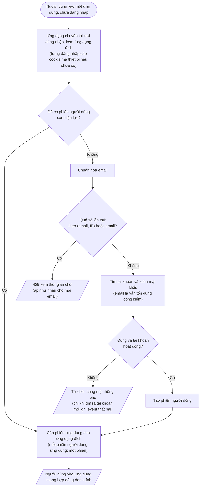

# Feature 02: Đăng nhập và phiên

> **Trạng thái:** DRAFT thiết kế · **Chặng:** C0 · **Loại:** Nghiệp vụ
>
> **Nguồn:** CAP-ATH-02, 03, 05 · **Kiểm chứng bằng:** S1, S3, S4; INV-ATH-03, 06, 08, 10
>
> **Cùng thư mục:** `plan.md` (kế hoạch). Các tệp `tech.md` (giải pháp kỹ thuật), `nfr.md` (đáp ứng NFR), `deferred.md` (phần hoãn) thêm khi
> viết đến.

## 1. Mục tiêu và phạm vi

Người có tài khoản đăng nhập bằng email và mật khẩu để vào một ứng dụng; được đăng nhập chung giữa các ứng dụng; phiên tự hết hạn.
**Xác thực không phân quyền:** đăng nhập đúng thì luôn có phiên, qua bất kỳ ứng dụng (client) đã đăng ký, và vai cơ bản đi trong mã
đăng nhập. Ứng dụng và BC nhận mã tự quyết vai nào được dùng gì, mặc định từ chối (`analysis/login-session.md`).

Feature gồm hai phần, làm theo thứ tự A → B. Mỗi phần quan sát và kiểm chứng được riêng.

| Phần | Nội dung | Quan sát được | Kiểm chứng |
|---|---|---|---|
| **A. Đăng nhập một ứng dụng** | Client đã đăng ký cho ứng dụng Cửa hàng và Vận hành; trang đăng nhập cấp cookie mã thiết bị (`DEVICE_KEY`); kiểm email và mật khẩu; cấp phiên người dùng và một phiên ứng dụng; hợp đồng danh tính (kèm vai cơ bản) trong mã đăng nhập, token cắt hạn theo hạn phiên; ghi event `SessionIssued`, `ClientSessionIssued`, `LoginFailed` trong miền; CSRF, PKCE, `state` | Đăng nhập ra mã đăng nhập đọc được; Quản trị có sẵn nhận mã mang vai Quản trị | S3, S4, phần đăng nhập của S1 · INV-ATH-03, 06 |
| **B. Đăng nhập chung và vòng đời phiên** | Vào ứng dụng thứ hai không hỏi lại mật khẩu; mỗi (phiên người dùng, ứng dụng) một phiên; **làm mới token** (xoay vòng, tra theo `sid`, từ chối khi hết hạn phiên) và xác thực im lặng đổi liên kết; hết hạn; xác nhận phiên khi được hỏi; nhiều thiết bị | Đăng nhập một lần, vào hai ứng dụng; làm mới được trong hạn phiên; phiên hết hạn thì bị từ chối | Phần giữ phiên của S1 · INV-ATH-08, 10 |

Ngoài phạm vi: đăng xuất (feature 03); tài khoản Quản trị có sẵn (feature 04; riêng KT-09 cần một tài khoản vai Quản trị, test có thể tự tạo);
việc từ chối vai không được dùng ứng dụng hay API (do ứng dụng và BC nhận mã kiểm, chứng minh ở BC đầu tiên có thao tác cần chặn và ở feature 05, 09);
xác thực nhiều lớp, khóa tạm tài khoản, thu hồi phiên từ xa, đăng nhập mạng xã hội (C3c hoặc cắt tạm, `analysis/0.overview.md` mục 10 và `analysis/user-account.md` mục 9); CAPTCHA (để sau cùng,
chừa chỗ ở bước "kiểm trước khi xử lý"); giao diện (feature 05).

## 2. Đầu vào và đầu ra

| | Nội dung |
|---|---|
| Vào | `email`, `password`, và **ứng dụng đích**. Ứng dụng đích do ứng dụng chuyển người dùng tới nơi đăng nhập, người dùng không tự gõ hay chọn |
| Ra khi thành công | Người dùng được đưa về ứng dụng đích trong trạng thái đã đăng nhập, mang **hợp đồng danh tính** (mã tài khoản, vai, `sid` là mã phiên ứng dụng, hạn; không có tên, email, trạng thái bán, không có mã cookie đăng nhập) |
| Ra khi lỗi | Mã lỗi và thông điệp (mục 4) |
| Xác nhận phiên | Truy vấn nội bộ của Xác thực (không phải API cho mọi BC, vì hợp đồng danh tính tự mô tả): phiên còn hiệu lực hay không, của tài khoản nào, vai gì |
| Làm mới token | BFF gửi refresh token kèm `sid`; ra access token, ID token, refresh token mới (cũ vô hiệu), hạn không vượt hạn phiên; hết hạn phiên thì `invalid_grant` |

## 3. Luồng chính

1. **Giới hạn tần suất** theo địa chỉ mạng do cổng thực hiện trước khi yêu cầu vào dịch vụ (feature 06). Giới hạn số lần thử theo email là bước 3 dưới đây.
2. **Kiểm trước khi xử lý** (chừa chỗ, mặc định tắt): bước kiểm bằng chứng người thật, đứng trước mọi bước tốn tài nguyên (CAPTCHA, `analysis/0.overview.md` mục 10).
3. **Phần A. Giới hạn số lần thử theo email** (`analysis/0.overview.md` CAP-ATH-02): sau khi chuẩn hóa email (cắt khoảng trắng, chữ thường) và trước khi tìm tài khoản, đếm lần thử theo hai khóa: cặp (email, địa chỉ mạng) và riêng email. Vượt thì trả 429 kèm thời gian chờ, không kiểm mật khẩu. Áp như nhau cho mọi email kể cả email không tồn tại.
4. **Phần A. Xác thực người dùng:** tìm tài khoản; kiểm mật khẩu. Tìm không ra tài khoản thì vẫn chạy
   một lần kiểm mật khẩu giả, để thời gian trả lời không phân biệt email có thật hay không (INV-ATH-03). Kiểm tài khoản đang hoạt động (khóa là C1b).
5. **Phần A. Tạo phiên người dùng** khi thông tin đúng, rồi cấp phiên ứng dụng cho ứng dụng đích.
6. **Phần B. Đăng nhập chung:** nếu người dùng đã có phiên người dùng còn hiệu lực (đã đăng nhập ở ứng dụng khác trên cùng thiết bị) thì bỏ qua kiểm mật khẩu (bước 4) và
   tạo phiên người dùng (bước 5), chỉ cấp phiên ứng dụng (`issueClientSession`, lúc đổi mã lấy token).
7. **Cấp phiên ứng dụng** (`issueClientSession`, theo `clientId`: tạo mới hoặc dùng lại) bên dưới phiên người dùng; mỗi (phiên người dùng, ứng dụng) tối đa một phiên đang hoạt động (INV-ATH-10). Xác thực **không kiểm** vai có được dùng ứng dụng
   đó hay không; việc đó thuộc ứng dụng và BC nhận mã.
8. **Hợp đồng danh tính** đi kèm mã đăng nhập: mã tài khoản, vai, `sid` (mã phiên ứng dụng), hạn (`analysis/0.overview.md` mục 5). Người dùng được đưa về ứng dụng đích. Token cắt hạn theo hạn phiên (ADR-0003 mục 3).
9. **Phần A. Mã thiết bị:** khi trình duyệt vào trang đăng nhập mà chưa có cookie `DEVICE_KEY` thì Xác thực cấp một mã ngẫu nhiên 256 bit (`HttpOnly`, `Secure`, `SameSite=Lax`, 12 tháng, gia hạn mỗi lần đăng nhập, ADR-0005), **trước** khi nhập mật khẩu, để đăng nhập thất bại cũng mang được mã. Cơ sở dữ liệu chỉ lưu bản băm; mọi event (`SessionIssued`, `ClientSessionIssued`, `LoginFailed`) chỉ mang bản băm, mã thô không rời Xác thực.
10. **Phần A. Event ghi trong miền** (chưa có bus): `SessionIssued` khi mở phiên người dùng, `ClientSessionIssued` ở mỗi lần cấp token cho phiên ứng dụng, `LoginFailed` chỉ khi tìm ra tài khoản (nội dung ở `service.md` mục 5). Phiên người dùng mở ở một điểm cuối chuỗi xác thực để sau này chèn xác thực nhiều lớp mà không sửa phiên (ADR-0003 mục 6).
11. **Phần B. Làm mới token:** BFF gửi refresh token kèm `sid`; Xác thực kiểm hạn phiên (còn hiệu lực), tra phiên ứng dụng và bản ghi ủy quyền theo khóa chính, so refresh token, cấp token mới có hạn không vượt hạn phiên, cập nhật bản ghi tại chỗ, giữ nguyên `sid`. Việc này là `refreshClientSession` (theo `sid`). Xác thực im lặng về ứng dụng đã có phiên đi qua `issueClientSession`: giữ `sid`, đổi liên kết `authorization_id` và xóa bản ghi cũ trong cùng giao dịch (ADR-0003 mục 5, 8).

Sau khi đăng nhập thành công, mọi dịch vụ đọc mã đăng nhập đặt `user.id` ở một chỗ duy nhất theo `logging.md` (mục 7 cuối tệp này).

## 4. Đường không suôn sẻ

Mã lỗi dưới đây là đề xuất, chốt khi viết `api.yaml`.

| Tình huống | Kết quả | Mã lỗi | INV |
|---|---|---|---|
| Sai email hoặc sai mật khẩu | 401, cùng một thông báo và cùng thời gian trả lời | `INVALID_CREDENTIALS` | INV-ATH-03 |
| Email không tồn tại | Cùng kết quả như sai mật khẩu; không ghi event thất bại | `INVALID_CREDENTIALS` | INV-ATH-03 |
| Tài khoản bị khóa, mật khẩu đúng | Từ chối, nói rõ bị khóa (C1b) | `ACCOUNT_LOCKED` | |
| Quá số lần thử cho một email, hoặc cho cặp (email, địa chỉ mạng) | 429 kèm thời gian chờ, áp như nhau cho mọi email kể cả email không tồn tại | `TOO_MANY_REQUESTS` | |
| Một địa chỉ mạng bắn quá mức | 429 do cổng, trước khi vào dịch vụ | `TOO_MANY_REQUESTS` | |
| Phiên đã hết hạn khi người dùng đang làm | Từ chối, yêu cầu đăng nhập lại | `SESSION_EXPIRED` | INV-ATH-08 |
| Cookie đăng nhập của Spring còn sống nhưng phiên của ta đã xóa hoặc hết hạn, ở bước cấp mã | Không cấp mã; yêu cầu đăng nhập lại | `SESSION_EXPIRED` | INV-ATH-08 |
| Làm mới token khi hạn phiên đã hết | `invalid_grant`, không cấp token | `invalid_grant` | INV-ATH-08 |
| Làm mới với refresh token đã dùng, sai, hoặc `sid` không khớp bản ghi | `invalid_grant`; BFF rơi vào xác thực im lặng | `invalid_grant` | |
| Gửi biểu mẫu đăng nhập thiếu hoặc sai mã CSRF | 403 | `FORBIDDEN` | |
| Thiếu `code_verifier` (PKCE) ở bước đổi mã, hoặc yêu cầu cấp mã thiếu `state` | Từ chối; `state` sai ở callback do BFF từ chối (feature 06) | `invalid_request` | |
| Xin phiên ứng dụng lặp cho cùng (phiên người dùng, ứng dụng) | Không tạo thêm; trả lại phiên đang hoạt động | | INV-ATH-10 |
| Đăng nhập khi đã đăng nhập, hoặc ở thiết bị khác | Được; mỗi lần đăng nhập một phiên người dùng riêng | | |
| Lỗi hệ thống khi cấp phiên | 500, không có phiên nửa vời | `INTERNAL_ERROR` | |

Vai không được dùng ứng dụng hay API: Xác thực vẫn cấp phiên và mã đăng nhập; bên nhận từ chối (403 ở API, trang "không có quyền" ở ứng dụng).

## 5. Trạng thái sau khi xong

- **Phần A:** có một phiên người dùng và một phiên ứng dụng đang hoạt động cho (tài khoản, ứng dụng); mã đăng nhập mang hợp đồng danh tính với vai cơ bản; mật khẩu
  không xuất hiện ở bất kỳ đâu (INV-ATH-02). Hệ số băm cũ hơn mức hiện tại thì được băm lại (ADR-0002).
- **Phần A:** trình duyệt có cookie `DEVICE_KEY`; event `SessionIssued`, `ClientSessionIssued` (và `LoginFailed` khi có tài khoản) đã được ghi trong miền; `idp_session_id` giữ mã cookie Spring và không xuất hiện ngoài cookie và cơ sở dữ liệu.
- **Phần B:** vào ứng dụng thứ hai không hỏi lại mật khẩu; làm mới token giữ nguyên `sid`; phiên hết hạn thì không còn hiệu lực; đăng nhập ở thiết bị khác là phiên người dùng khác.

## 6. Test cần có (viết từ kịch bản và bất biến, trước khi viết mã)

Cột "Phần" là A hoặc B. Cột "Mức": **Miền**, **Use case**, **Lưu trữ**, **API**, **Đồng thời**, **Hệ thống**. Cột "Chứng minh" trỏ về kịch bản chặng (S),
bất biến (INV-ATH), luật ở `analysis/`, quyết định ở ADR hoặc `tech.md`.

| # | Kịch bản test | Phần | Mức | Chứng minh |
|---|---|---|---|---|
| KT-01 | Đăng nhập đúng (Người dùng, Cửa hàng) mở một phiên người dùng (`open`, phát `SessionIssued`) rồi, lúc đổi mã lấy token, cấp một phiên ứng dụng (`issueClientSession`) | A | Use case | S1, CAP-ATH-02 |
| KT-02 | Mã đăng nhập mang đúng mã tài khoản, vai, `sid`, hạn; không mang email, tên, mật khẩu, mã cookie Spring, `authorization_id` | A | API | `analysis/0.overview.md` mục 5, INV-ATH-02 |
| KT-03 | Sai email và sai mật khẩu cho cùng mã lỗi, cùng thông điệp | A | API | S3, INV-ATH-03 |
| KT-04 | Email không tồn tại vẫn chạy một lần kiểm mật khẩu (thời gian không phân biệt được với email có thật) | A | Use case | INV-ATH-03 |
| KT-05 | Email được chuẩn hóa khi đăng nhập (chữ hoa, khoảng trắng) vẫn vào được | A | Use case | INV-ATH-01 |
| KT-06 | Đăng nhập thất bại với tài khoản có thật ghi nhận event; email không tồn tại thì không | A | Use case | `analysis/0.overview.md` CAP-ATH-02 |
| KT-07 | Hệ số băm lưu thấp hơn mức hiện tại thì được băm lại sau đăng nhập đúng; sai mật khẩu thì không đổi | A | Lưu trữ | ADR-0002 |
| KT-08 | Dòng log hoàn tất của yêu cầu đã xác thực có `user.id` ở dịch vụ phát token và ở một dịch vụ đọc token; không có mật khẩu hay token trong log | A | Hệ thống | `logging.md`, INV-ATH-02 |
| KT-09 | Tài khoản vai Quản trị đăng nhập qua client Vận hành; mã đăng nhập mang vai Quản trị. Tài khoản vai Người dùng qua cùng client vẫn nhận mã mang vai Người dùng (Xác thực không chặn) | A | API | S4, INV-ATH-06 |
| KT-10 | Có phiên người dùng còn hiệu lực, xin ứng dụng thứ hai: không hỏi mật khẩu, chỉ cấp phiên ứng dụng (`issueClientSession`, tạo mới) | B | Use case | S1, `analysis/login-session.md` |
| KT-11 | `issueClientSession` lặp, kể cả song song, cho cùng (phiên người dùng, ứng dụng) chỉ ra một phiên | B | Đồng thời | INV-ATH-10 |
| KT-12 | Phiên hết hạn thì xác nhận phiên trả không hợp lệ và yêu cầu đăng nhập lại; hết hạn suy ra từ hạn, không phát event | B | Use case | INV-ATH-08 |
| KT-13 | Xác nhận phiên khi còn hiệu lực trả đúng tài khoản và vai | B | Use case | CAP-ATH-03 |
| KT-14 | Đăng nhập ở thiết bị khác tạo phiên người dùng khác, không đụng phiên người dùng cũ | B | Use case | `analysis/login-session.md` |
| KT-15 | Quá số lần thử cho cặp (email, địa chỉ mạng) thì lần kế tiếp bị 429 kèm thời gian chờ mà không kiểm mật khẩu; email không tồn tại bị đối xử y như email có thật; hết thời gian chờ thì thử lại được | A | Use case | `analysis/0.overview.md` CAP-ATH-02, INV-ATH-03 |
| KT-16 | Nhiều địa chỉ mạng khác nhau thử cùng một email: vượt mức theo email thì bị 429 dù mỗi địa chỉ chưa vượt mức của cặp | A | Use case | `analysis/0.overview.md` CAP-ATH-02 |
| KT-17 | Bộ đếm không dùng được (Redis lỗi): đăng nhập vẫn chạy như bình thường, ghi một cảnh báo, không trả 500 (quyết định mở cửa, chấp nhận mất bảo vệ giới hạn số lần thử trong lúc lỗi) | A | Use case | `analysis/0.overview.md` CAP-ATH-02, `rate-limiting-layers.md` mục 5 |
| KT-18 | `exp` của access token, ID token và refresh token bằng nhỏ hơn của (bây giờ + TTL theo loại tài khoản, hạn phiên) | A | Use case | ADR-0003 mục 3, `analysis/login-session.md` 3.3 |
| KT-19 | `refreshClientSession` (làm mới) trong hạn phiên: cấp token mới, refresh token cũ bị từ chối, `sid` giữ nguyên, `ClientSessionIssued` được ghi | B | API | ADR-0003 mục 5, 8 |
| KT-20 | Làm mới khi hạn phiên đã hết: `invalid_grant`, không cấp token | B | API | INV-ATH-08 |
| KT-21 | Làm mới với `sid` sai hoặc không thuộc refresh token bị từ chối; tra bản ghi ủy quyền theo khóa chính (kế hoạch truy vấn không quét bảng) | B | Lưu trữ | ADR-0003 mục 8 |
| KT-22 | `issueClientSession` khi xác thực im lặng với ứng dụng đã có phiên: đổi `authorization_id`, bản ghi cũ bị xóa cùng giao dịch, vẫn một phiên ứng dụng; use case so `sid` do hành vi trả về với `sid` đã nằm trong token và quay lui giao dịch nếu khác (đua nhau) | B | Lưu trữ | ADR-0003 mục 5, INV-ATH-10 |
| KT-23 | Cookie Spring còn sống nhưng phiên của ta đã xóa hoặc hết hạn thì `/oauth2/authorize` không cấp mã | B | Hệ thống | ADR-0003 mục 2, INV-ATH-08 |
| KT-24 | `idp_session_id` cập nhật khi mã session Spring đổi (chống chiếm phiên) | A | Hệ thống | ADR-0003 mục 1 |
| KT-25 | `SESSION_ID`, `authorization_id` không có trong token, event, log | A | Hệ thống | ADR-0003 mục 4 |
| KT-26 | `SessionIssued` ghi khi mở phiên người dùng (mã phiên, tài khoản, thời điểm, mã thiết bị băm, địa chỉ mạng, thông tin thiết bị), không ghi khi cấp phiên ứng dụng hay làm mới; `ClientSessionIssued` ghi ở mỗi lần cấp token (`issueClientSession`, `refreshClientSession`) với mã event lấy từ `jti`, không có địa chỉ mạng | A | Use case | `service.md` mục 5 |
| KT-27 | Trang đăng nhập cấp cookie `DEVICE_KEY` (ngẫu nhiên 256 bit, `HttpOnly`, `Secure`, `SameSite=Lax`, 12 tháng) khi chưa có, không đổi khi đã có; cơ sở dữ liệu chỉ lưu bản băm | A | API | ADR-0005 |
| KT-28 | `LoginFailed` ghi khi tìm ra tài khoản, mang bản băm mã thiết bị, không mang mã thô; email không tồn tại thì không | A | Use case | `analysis/0.overview.md` CAP-ATH-02 |
| KT-29 | Biểu mẫu đăng nhập thiếu hoặc sai mã CSRF bị 403 (mã nằm trong cookie riêng và không xoay khi đăng nhập, nên biểu mẫu mở lâu hoặc sau khi session mất vẫn gửi được); `/oauth2/token` gọi được không cần mã CSRF | A | API | ADR-0005 |
| KT-30 | Client BFF không đổi được mã nếu thiếu `code_verifier` (PKCE); yêu cầu cấp mã thiếu `state` bị từ chối (`state` sai do BFF kiểm, thuộc feature 06) | A | API | ADR-0005 |
| KT-31 | Use case dọn phiên quá hạn và ủy quyền mồ côi xóa đúng theo lô (lô rỗng, lô dở dang, chạy lại); truy vấn "phiên đang sống" lọc theo hạn, không dựa vào việc dọn | B | Lưu trữ | ADR-0003 mục 7, INV-ATH-08 |
| KT-32 | Yêu cầu đăng nhập từ client chưa đăng ký hoặc redirect URI không khớp bị từ chối, không cấp mã | A | API | `analysis/0.overview.md` mục 6 (ứng dụng và điều kiện vào) |
| KT-33 | Dùng lại mã ủy quyền đã dùng bị từ chối; phiên của ta không đổi (không tạo thêm, không kết thúc phiên) | B | API | ADR-0003 mục 5 |

Giới hạn tần suất do cổng thực hiện nên kiểm ở feature 06; giới hạn số lần thử theo email ở bước đăng nhập kiểm ở KT-15, 16 của feature này.
Đăng xuất và thu hồi phiên kiểm ở feature 03. Việc bên nhận từ chối vai không được dùng ứng dụng hay API không kiểm ở đây (xem mục 1, Ngoài phạm vi).

Cách test phần A và B không cần giao diện: client HTTP có bộ nhớ cookie đi hết luồng `/oauth2/authorize`, trang đăng nhập, mã, token; cookie giữ lại
là phiên người dùng.

## 7. Việc đã giao cho feature này

- **Đặt `user.id` khi phân tích token ở mỗi dịch vụ** (quy tắc ở `docs/global/4.convention/logging.md`, mục "Đặt `user.id`"): tìm chỗ duy nhất trong từng dịch vụ đọc token đã kiểm chữ ký, gọi `LogContext.user(mã tài khoản)` tại đó, và thêm test đọc log JSON thật chứng minh dòng hoàn tất của yêu cầu có `user.id` (gồm cả dịch vụ phát token và một dịch vụ đọc token). Ghi chú còn nợ này đã có ở `00-features.md` (feature 07). Test: KT-08.
- Sửa phần đăng nhập theo quy ước log (`docs/global/4.convention/logging.md` mục 7): bỏ dòng ghi nguyên token ở mức WARN trong phần cấp token, ưu tiên mã tài khoản thay email ở các bộ xử lý đăng nhập thành công và thất bại, sửa mức log theo quy tắc, che `Cookie` và `Set-Cookie` (ADR-0003 mục 4). MFA và đăng nhập mạng xã hội không thuộc feature này (MFA ở C3c, mạng xã hội cắt tạm); phần mã hiện có của chúng để nguyên.
- **Ghi token khi cấp, chỉ ở dev** để có token thật khi test tay các dịch vụ khác và khi chạy thật: mỗi lần luồng đăng nhập cấp token, một dòng log INFO có tài khoản, client, `sid`, hạn và các token. Chốt chặn: chỉ khi profile `dev` **và** `observability.logging.reveal-secrets=true` (cờ tự từ chối khởi động ngoài `dev`); thiếu một trong hai thì không ghi gì. Quyết định `2026-10-16`: không làm công cụ giả lập token vì token giả không gắn phiên thật. Test tự động không cần công cụ này (dùng hỗ trợ test của Spring Security để gắn danh tính giả). Xem `docs/global/4.convention/logging.md`, mục "Ngoại lệ có kiểm soát".
- **Client dev cho Postman:** một client đăng ký sẵn dùng mã ủy quyền kèm PKCE, redirect URI giả, chỉ cho môi trường dev, để chạy tay luồng đăng nhập (thủ công hoặc qua trình duyệt tự động).
- **Chỗ chừa cho CAPTCHA:** trang đăng nhập có vị trí gắn thành phần; bước "kiểm trước khi xử lý" là mắt xích tùy chọn, mặc định tắt (`analysis/0.overview.md` mục 10).
- **CSRF, PKCE, `state` ở máy chủ xác thực** (ADR-0005): bật CSRF cho chuỗi dùng cookie, miễn `/oauth2/token`; bật PKCE cho client BFF; từ chối yêu cầu cấp mã thiếu `state` (bộ kiểm tra tùy biến, ADR-0005); cookie phiên `HttpOnly`, `Secure`, `SameSite=Lax`. Phía BFF (cookie `XSRF-TOKEN`, header) thuộc feature 05 và việc gửi `sid` khi làm mới thuộc cổng truy cập (feature 06).
- **Sửa client seed** (migration): bí mật client thật thay `{noop}secret`, `require-proof-key=true` cho client BFF.
