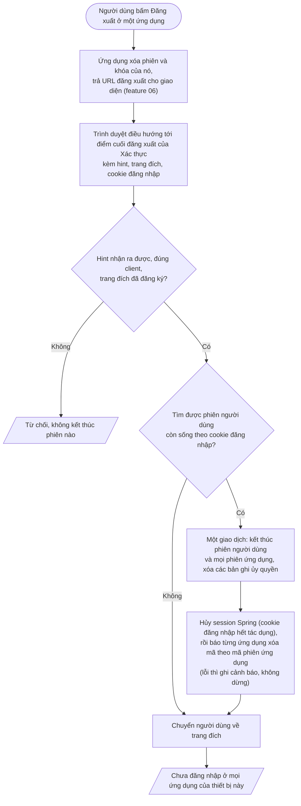

# Feature 03: Đăng xuất

> **Trạng thái:** Đã làm `2026-10-17` · **Chặng:** C0 · **Loại:** Nghiệp vụ
>
> **Nguồn:** CAP-ATH-04 · **Kiểm chứng bằng:** S1, S5; INV-ATH-05, 08
>
> **Cùng thư mục:** `plan.md` (kế hoạch). Các tệp `tech.md` (giải pháp kỹ thuật), `nfr.md` (đáp ứng NFR), `deferred.md` (phần hoãn) thêm khi
> viết đến.

## 1. Mục tiêu và phạm vi

Người đang đăng nhập bấm đăng xuất ở một ứng dụng thì trở về trạng thái **chưa đăng nhập ở mọi ứng dụng của thiết bị đó**: phiên người dùng của lần đăng nhập
này và mọi phiên ứng dụng bên dưới nó kết thúc cùng lúc, token đã cấp cho các phiên đó không còn làm mới được, cookie đăng nhập không còn đổi được mã mới. Lần
đăng nhập khác của cùng tài khoản (thiết bị khác) giữ nguyên. Đăng xuất luôn thành công, kể cả khi phiên đã hết hạn hoặc người dùng chưa đăng nhập (INV-ATH-05, S5).

**Cơ chế đã chốt (đã chạy được ở mô hình phiên cũ, nay áp cho miền mới):** theo OIDC RP-Initiated Logout. Ứng dụng (BFF) xóa phiên và khóa của nó, rồi trả URL đăng xuất cho
giao diện bằng mã 2xx kèm `Location` (không dùng 302, vì lời gọi từ `fetch` không điều hướng cấp cao); trình duyệt tự điều hướng tới điểm cuối đăng xuất OIDC của Xác thực
(`/connect/logout`) kèm `id_token_hint`, `post_logout_redirect_uri`, `state`, gửi theo cookie đăng nhập. Feature này làm **phía Xác thực**; phía BFF (xóa phiên, trả URL, chống giả mạo
yêu cầu ở BFF) thuộc feature 06.

Phần việc chính của feature: (1) rà các lỗ hổng khi áp cơ chế này cho miền phiên mới (mục 4); (2) thay xử lý đăng xuất cũ (`OAuthSession`, bảng `oauth_sessions`,
`EndIdpSession`, `RevokeSession`) bằng `LoginSession.end` của feature 02; (3) báo BFF theo `sid`.

Một phần, không chia A, B.

Ngoài phạm vi:
- Đăng xuất từ xa (một thiết bị khác, mọi thiết bị khác) và danh sách thiết bị: C3c (`analysis/login-session.md` bảng lý do kết thúc).
- Kết thúc phiên do khóa tài khoản, đổi mật khẩu: C1b. Hành vi `end` với lý do khác đã có ở miền; feature này chỉ dùng "tự đăng xuất".
- Phía BFF và giao diện của đăng xuất: feature 05, 06 (ở đây chỉ chốt hợp đồng Xác thực nhận và gửi gì).
- Thu hồi mã truy cập đã lộ ngoài luồng: không làm; giới hạn bằng hạn mã truy cập vừa phải (`analysis/0.overview.md`, "Đăng xuất, thu hồi và token đã cấp").
- Job dọn phiên quá hạn và bản ghi ủy quyền mồ côi: `02-login-session/deferred.md`.
- Chuyển sang Back-Channel Logout theo chuẩn OIDC (thay báo BFF tự chế): hướng nâng cấp sau, ghi ở `deferred.md` khi làm.

## 2. Đầu vào và đầu ra

| | Nội dung |
|---|---|
| Vào | Yêu cầu tới điểm cuối đăng xuất OIDC: `id_token_hint` (ID token lúc đăng nhập, có thể đã hết hạn), `post_logout_redirect_uri` đã đăng ký, `state`, kèm cookie đăng nhập (`OAUTH2_SESSION`) |
| Ra khi thành công | Chuyển hướng về trang đích kèm `state`; cookie đăng nhập không còn tác dụng |
| Ra khi lỗi | Yêu cầu sai (hint không nhận ra, trang đích lạ) bị từ chối và **không** kết thúc phiên nào; riêng trường hợp phiên đã không còn thì vẫn là thành công (mục 4) |
| Event | `SessionEnded` kèm lý do "tự đăng xuất", ghi trong miền (chưa có bus). Chỉ phát khi thật sự có phiên bị kết thúc |

## 3. Luồng chính

1. **Phía ứng dụng** (feature 06): xóa phiên và khóa của BFF, trả URL đăng xuất (mã 200 hoặc 204 kèm `Location`, hoặc JSON). Xác thực không phụ thuộc thứ tự, vì mã làm mới đã
   bị xóa ở bước 4 nên BFF còn sót phiên cũng không làm mới được.
2. **Kiểm yêu cầu (do Spring Authorization Server làm, bản ghi tra bằng lớp bọc của ta):** tìm bản ghi ủy quyền của phiên ứng dụng trong `id_token_hint` (kiểm chữ ký, không kiểm hạn, `tech.md` T1), kiểm client, kiểm trang đích nằm trong danh sách
   đã đăng ký của client; hint hết hạn vẫn được chấp nhận (chỉ từ chối khi bị vô hiệu hóa). Không đạt thì dừng, không đổi gì. Hint chính là bằng chứng chống đăng xuất ngầm từ trang khác.
3. **Tìm phiên người dùng còn sống** của lần đăng nhập hiện tại theo cookie đăng nhập (phiên đã quá hạn coi như không có, dù hàng còn trong kho). Không có cookie thì không kết thúc theo mỗi hint (chốt tạm: hint không chứng minh người gọi đang cầm phiên). Không tìm ra (chưa đăng nhập, đã hết hạn, đã kết thúc) thì **không phải lỗi**: bỏ qua các bước kết thúc,
   đi thẳng tới chuyển hướng (INV-ATH-05).
4. **Kết thúc trong một giao dịch:** chụp lại mã phiên ứng dụng và mã bản ghi ủy quyền của từng phiên ứng dụng (vì `LoginSession.end` xóa danh sách này), rồi `end` với lý do
   "tự đăng xuất" (INV-ATH-05, 08), xóa phiên và các bản ghi ủy quyền. Lỗi giữa chừng thì hoàn tác và không hủy session Spring, để người dùng thử lại được.
5. **Hủy session Spring** sau khi giao dịch xong, để cookie cũ không dựng lại ngữ cảnh đăng nhập. `DEVICE_KEY` giữ nguyên (nhận diện thiết bị, không phải phiên).
6. **Báo ứng dụng** sau khi giao dịch xong: mỗi phiên ứng dụng vừa kết thúc một lời gọi nội bộ tới ứng dụng giữ mã (BFF), theo mã phiên ứng dụng (`sid`). Cố gắng hết sức: không với tới
   được thì ghi cảnh báo, đi tiếp; mã làm mới đã xóa và mã truy cập hết hạn ngắn là lưới an toàn. Chưa có hàng đợi thử lại ở C0.
7. **Chuyển hướng** về trang đích. **Event** `SessionEnded` ghi trong miền khi có phiên bị kết thúc; đăng xuất lần hai không phát lại.

Sau đăng xuất: làm mới bằng mã cũ trả `invalid_grant`, `/oauth2/authorize` với cookie cũ không cấp mã mà chuyển về trang đăng nhập, `/userinfo` với mã truy cập cũ bị từ chối (tra theo `sid`).

## 4. Đường không suôn sẻ và các lỗ hổng cần rà

Mã lỗi dưới đây là đề xuất, chốt khi viết `api.yaml`.

| Tình huống | Kết quả | Mã lỗi | INV |
|---|---|---|---|
| Đăng xuất khi chưa đăng nhập, phiên đã hết hạn hoặc đã kết thúc | Thành công, chuyển hướng về trang đích; không event | | INV-ATH-05 |
| Gọi đăng xuất hai lần, kể cả song song | Cả hai thành công; một lần kết thúc thật, một event | | INV-ATH-05 |
| Trang đích không thuộc danh sách đã đăng ký | Từ chối, không chuyển hướng, không kết thúc phiên | `invalid_request` | |
| Hint không nhận ra, sai client | Từ chối, không kết thúc phiên | `invalid_token` | |
| Không báo được cho ứng dụng (BFF) | Đăng xuất vẫn thành công; ghi cảnh báo; mã truy cập còn dùng tới khi hết hạn (cộng độ lệch đồng hồ 5 giây) | | |
| Lỗi hệ thống giữa lúc kết thúc | 500, giao dịch hoàn tác, session Spring còn nguyên; thử lại được | `INTERNAL_ERROR` | |
| Đăng xuất ở thiết bị này khi tài khoản đang đăng nhập ở thiết bị khác | Chỉ phiên của thiết bị này kết thúc | | |

**Lỗ hổng khi áp cơ chế cũ cho miền mới.** Đã chạy thử `2026-10-16` bằng yêu cầu thật tới `/connect/logout` (bước 1 của `plan.md`, kết luận ở `tech.md` T1 đến T6). Tình trạng: **Đã thử** là quan sát được khi chạy; **Đã xác minh** là đọc mã Spring Authorization Server 7.0.5 hoặc mã của ta; **Chưa thử** là cần mã của bước sau mới kiểm được.

| # | Rủi ro | Hậu quả nếu không xử lý | Tình trạng |
|---|---|---|---|
| R12 | Lớp bọc ủy quyền của ta (`SessionBoundAuthorizationService.findByToken`) cố ý không tra ID token (ADR-0003 mục 8) | **Mọi** yêu cầu đăng xuất có hint đều `invalid_token` ngay ở bước tìm bản ghi; điểm cuối đăng xuất hiện hỏng hoàn toàn | **Đã thử, xác nhận; đã sửa bước 5** (`tech.md` T1) |
| R1 | Trang đích sau đăng xuất phải thuộc danh sách đã đăng ký của client | Trang đích lạ bị `invalid_request` (đúng ý); client không có trang nào thì không dùng được `post_logout_redirect_uri` | **Đã xác minh `2026-10-17`:** `web-gateway` đã có `http://localhost:4200` từ V4 (nhận định đầu "không client nào đăng ký" sai); `postman-dev` được thêm ở seed |
| R2 | Spring so claim `sid` của hint với băm mã session Spring (sổ phiên của nó có theo dõi session đăng nhập); `sid` của ta là mã phiên ứng dụng | `invalid_token` (tham số `sid`) khi cookie còn, người dùng không đăng xuất được ở OP, SSO vẫn sống | **Đã thử, xác nhận; đã sửa bước 5** bằng sổ phiên rỗng (`tech.md` T2) |
| R13 | Spring tự sinh `sid` lúc đổi mã bằng cách đoán session "mới nhất" của người dùng (yêu cầu đổi mã không có cookie); nhiều thiết bị cộng đăng nhập chung thì chọn nhầm | Nếu dùng `sid` của Spring: đăng xuất bị từ chối nhầm ở thiết bị cũ | **Đã thử `2026-10-17`, xác nhận** (A lần 2 mang băm session của B); loại bằng sổ phiên rỗng và `sid` của ta |
| R3 | Spring dùng ID token **lưu trong bản ghi** cho các kiểm tra sau; làm mới token cấp ID token mới khác cái cũ (đã thử: khác), còn BFF giữ ID token lúc đăng nhập; xác thực im lặng thì xóa bản ghi cũ | Nếu tra theo giá trị hint thì đăng xuất hỏng sau lần làm mới đầu tiên (khoảng 15 phút sau đăng nhập) | **Đã thử** (ID token đổi sau làm mới); hậu quả kiểm sau khi sửa R12 |
| R4 | Đăng xuất lần hai (bấm đúp, thử lại) dùng hint đã mất bản ghi | Trang lỗi ở OP, trái INV-ATH-05 "luôn thành công" | **Đã thử, xác nhận; đã sửa bước 5** (`tech.md` T4) |
| R5 | Không có cookie đăng nhập, hint hợp lệ | Có thể lỗi hoặc hiện trang xác nhận | **Đã thử, ổn:** chuyển hướng 302 về `/` (bộ xử lý hiện tại); chưa thử trường hợp có `post_logout_redirect_uri` |
| R6 | `LoginSession.end` xóa danh sách phiên ứng dụng | Use case quên chụp `sid` và mã bản ghi ủy quyền trước khi `end` thì không xóa được bản ghi, không báo được BFF | Đã xác minh trong mã miền |
| R7 | Đăng xuất đua với làm mới hoặc cấp token: bên kia nạp phiên trước khi bị xóa rồi lưu lại | Phiên hồi sinh sau khi đã đăng xuất | **Đã thử `2026-10-17`, xác nhận** (KT-15 đỏ trước khi sửa: `INSERT ... ON CONFLICT DO UPDATE` tạo lại hàng); sửa bằng khóa hàng, `tech.md` T9 |
| R8 | Mã ủy quyền đã cấp trước đăng xuất, đổi sau đăng xuất | Token cấp cho phiên đã kết thúc | **Đã thử, ổn:** `invalid_grant` "The login session is no longer valid", không cấp token; bản ghi ủy quyền còn sót (R9) |
| R9 | Bản ghi ủy quyền không gắn phiên ứng dụng nào (mã đã cấp chưa đổi) không bị xóa khi đăng xuất | Sót bản ghi tới khi job dọn (hoãn) hoặc hết hạn | Đã thử (bản ghi còn sau R8); chấp nhận, ghi ở `deferred.md` |
| R10 | `id_token_hint` nằm trong URL | Lộ vào log truy cập nếu không che | **Đã thử, ổn ở dịch vụ này:** giá trị hint không có trong log (chỉ có tên tham số trong thông báo lỗi); log của cổng và BFF kiểm ở feature 06 |
| R11 | Hạn ID token (15 phút) ngắn hơn thời gian người dùng ở lại | Hint hết hạn lúc đăng xuất | Đã xác minh: Spring chấp nhận hint hết hạn (chỉ từ chối khi vô hiệu hóa) |
## 5. Trạng thái sau khi xong

- Phiên người dùng của lần đăng nhập này và mọi phiên ứng dụng của nó không còn trong kho; các bản ghi ủy quyền của chúng đã xóa.
- Cookie đăng nhập cũ không cấp được mã mới; làm mới bằng mã cũ trả `invalid_grant`; `/userinfo` với mã cũ bị từ chối.
- `SessionEnded` đã ghi trong miền (lý do tự đăng xuất, không mang mã cookie Spring hay mã bản ghi ủy quyền).
- Phiên người dùng của thiết bị khác giữ nguyên.
- Client đã đăng ký trang đích sau đăng xuất; các rủi ro R1 đến R8, R10, R12, R13 đã có kết luận (sửa hoặc chấp nhận có ghi).
- Mô hình đăng xuất cũ đã gỡ: không còn `OAuthSession`, `EndIdpSession`, `RevokeSession` và bảng `oauth_sessions`.

## 6. Test cần có (viết từ kịch bản và bất biến, trước khi viết mã)

Cột "Mức": **Miền**, **Use case**, **Lưu trữ**, **API**, **Đồng thời**, **Hệ thống**. Cột "Chứng minh" trỏ về kịch bản chặng (S), bất biến (INV-ATH),
luật ở `analysis/`, quyết định ở ADR hoặc `tech.md`, rủi ro ở mục 4.

| # | Kịch bản test | Mức | Chứng minh |
|---|---|---|---|
| KT-01 | Đăng xuất kết thúc phiên người dùng và mọi phiên ứng dụng của nó cùng lúc; phiên không còn trong kho | Use case | S1, INV-ATH-05, 08 |
| KT-02 | Các bản ghi ủy quyền của các phiên ứng dụng đó bị xóa cùng giao dịch; lỗi giữa chừng thì không xóa gì và session Spring còn | Lưu trữ | R6, `analysis/0.overview.md` CAP-ATH-04 |
| KT-03 | Đăng xuất khi chưa đăng nhập, phiên đã hết hạn, phiên đã kết thúc: đều thành công, chuyển hướng về trang đích, không event | Use case + API | S5, INV-ATH-05, R5 |
| KT-04 | Đăng xuất ở một thiết bị không đụng phiên người dùng của thiết bị khác cùng tài khoản | Use case | CAP-ATH-04 |
| KT-05 | Sau đăng xuất: làm mới bằng mã cũ trả `invalid_grant`; `/oauth2/authorize` với cookie cũ chuyển về trang đăng nhập; `/userinfo` với mã truy cập cũ bị từ chối | API | INV-ATH-08 |
| KT-06 | `SessionEnded` ghi một lần với lý do tự đăng xuất, không mang mã cookie Spring hay `authorization_id`; đăng xuất lần hai không phát lại | Miền + use case | `service.md` mục 5, ADR-0003 mục 4 |
| KT-07 | Báo ứng dụng theo `sid` cho từng phiên ứng dụng vừa kết thúc, sau khi giao dịch xong; không với tới được thì đăng xuất vẫn thành công và có một cảnh báo | Bộ xử lý (hạ tầng) | `analysis/0.overview.md` CAP-ATH-04 |
| KT-08 | Hai yêu cầu đăng xuất song song cho cùng phiên: cả hai thành công, một event | Đồng thời | INV-ATH-05 |
| KT-09 | Trang đích không đăng ký, hoặc client lạ, bị từ chối, không chuyển hướng, không kết thúc phiên; client đã seed có trang đích hợp lệ | API | ADR-0005, R1 |
| KT-10 | Hint sai, hint của client khác, hoặc thiếu hint bị từ chối, không kết thúc phiên | API | R3 |
| KT-11 | Hủy session Spring: cookie đăng nhập cũ không còn hàng trong kho session; `DEVICE_KEY` giữ nguyên | Hệ thống | ADR-0003 mục 2 |
| KT-12 | Gỡ mô hình cũ: ứng dụng khởi động và toàn bộ test xanh khi không còn `OAuthSession`, `oauth_sessions`, `EndIdpSession`, `RevokeSession` | Hệ thống | `00-features.md` mục 03 |
| KT-13 | Hint do ứng dụng giữ từ lúc đăng nhập vẫn đăng xuất được: `sid` của ta khác mã session Spring (R2), sau làm mới token (R3) và sau xác thực im lặng (R3) | API | R2, R3, `tech.md` T1, T2 |
| KT-14 | Đăng xuất lần hai với hint cũ vẫn kết thúc ở trạng thái thành công, về trang đích, không lỗi (R4) | API | INV-ATH-05, R4 |
| KT-15 | Đăng xuất đua với làm mới token và với đổi mã: không có phiên hay bản ghi ủy quyền nào hồi sinh sau khi đăng xuất | Đồng thời (lưu trữ) | R7, `tech.md` T9 |
| KT-16 | Mã ủy quyền cấp trước đăng xuất không đổi được token sau đăng xuất | API | R8 |
| KT-17 | `id_token_hint` không xuất hiện trong log của dịch vụ | Hệ thống | R10, `logging.md` |
| KT-18 | Điểm cuối đăng xuất nhận ID token do chính Xác thực cấp (tra bản ghi theo `sid`, không theo giá trị đã lưu), kể cả đã hết hạn; từ chối ID token ký sai, của client khác, hoặc đã mất bản ghi | API | R12, R3, `tech.md` T1 |
| KT-19 | Hint hợp lệ nhưng cookie đăng nhập thuộc phiên khác (không khớp `idp_session_id` của phiên trong hint) không kết thúc phiên nào | Use case + API | R2, `tech.md` T2 |
| KT-20 | Một tài khoản, hai trình duyệt A và B: A đăng nhập, B đăng nhập, A xin mã lại (đăng nhập chung hoặc xác thực im lặng) rồi A đăng xuất: thành công, chỉ phiên của A kết thúc, phiên của B giữ nguyên | API | R13, `tech.md` T2 |
| KT-21 | ID token không còn claim `auth_time` do Spring đặt (chưa có nơi dùng); `sid` trong ID token là mã phiên ứng dụng | Hệ thống | `tech.md` T2, T8 |
| KT-22 | Phiên đã quá hạn nhưng hàng còn trong kho: đăng xuất không kết thúc gì, không event (hàng do job dọn lo) | Use case | INV-ATH-08, `tech.md` T5 |
| KT-23 | Không có cookie đăng nhập: không kết thúc theo mỗi hint (hint không chứng minh người gọi đang cầm phiên; chốt tạm) | Use case | R5, `tech.md` T5 |
| KT-24 | Kết quả liệt kê đủ mã phiên ứng dụng, client và mã bản ghi ủy quyền của mọi phiên ứng dụng vừa kết thúc, lấy ra trước khi `end` xóa danh sách | Use case | R6 |

Đăng xuất từ xa và danh sách thiết bị kiểm ở C3c. Việc BFF xóa phiên, trả URL và nhận báo kiểm ở feature 06.

Cách test không cần giao diện: client HTTP có bộ nhớ cookie đi hết luồng đăng nhập (feature 02) rồi gọi điểm cuối đăng xuất như trình duyệt, sau đó thử lại làm mới, cấp mã và `/userinfo`.

## 7. Việc đã giao cho feature này

- **Trang đích sau đăng xuất:** `web-gateway` đã có từ V4; thêm cho `postman-dev` ở `RegisteredClientSeeder` (R1, `tech.md` T3).
- **Gỡ mô hình phiên cũ:** `OAuthSession`, `OAuthSessionRepository`, `OAuthSessionMapper` và adapter, `EndIdpSession`, `RevokeSession`, các event phiên cũ (`SessionRevokedEvent`,
  `SessionsBulkExpiredEvent`) và handler của chúng, migration bỏ bảng `oauth_sessions`.
- **`MeController`:** bỏ endpoint thu hồi một phiên cũ (`DELETE /api/v1/me/sessions/{ossId}`, thuộc đăng xuất từ xa C3c); các endpoint mật khẩu giữ nguyên.
- **`OidcLogoutSuccessHandler` và `WebGatewayRevocationClient`:** viết lại theo `LoginSession`; báo BFF theo `sid`.
- **Hợp đồng báo BFF (đã chốt, `tech.md` T7):** thân `{"sid": ...}`; bên nhận ở feature 06 phải đổi từ `ossId` sang `sid`, và khóa Redis, bước dọn khi đăng xuất phía BFF (`extractOssId` đọc `oss_id`, claim đã không còn) sang `sid`.
- **Che `id_token_hint`** trong log ở các dịch vụ thấy URL này (R10).
- **Tài liệu cũ còn mô tả mô hình đã gỡ** (cần viết lại hoặc bỏ khi tới lượt, không thuộc feature này): `global/3.technical/spring-security-logout-bff.md` (luồng đăng xuất với `OAuthSession`, `EndIdpSession`), `global/2.architecture/1. bounded-contexts.md` và `7. security-architecture.md`, `global/4.convention/ddd-structure.md` (ví dụ `OAuthSession`, `RevokeSession`), và cả thư mục `feature/02-login/` (thiết kế cũ). Phía `identity-service` còn `SessionRevokedConsumer` và `LoginActivity` đọc event phiên cũ mà `oauth2-service` không còn phát; thay bằng nhận `SessionIssued`, `ClientSessionIssued`, `SessionEnded` khi có hộp thư event (C1a, C3c).
- **Bean `SessionRegistry` không lưu gì** để Spring không sinh `sid`, `auth_time` và bỏ qua kiểm `sid` (`tech.md` T2); kiểm hint với cookie do ta làm ở bộ xử lý đăng xuất.
- **ADR-0003 mục 4:** ghi rõ `sid` của ta khác `sid` mặc định của Spring và vì sao Spring không sinh nó.
