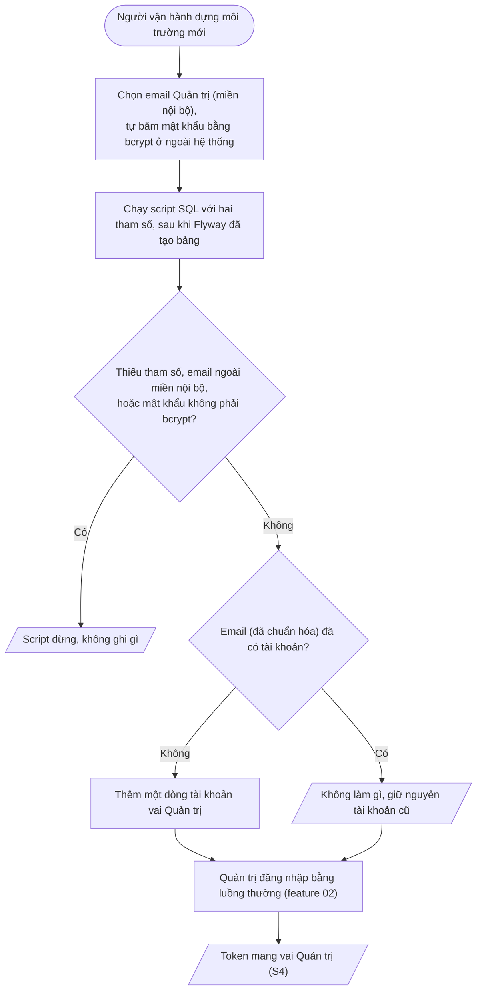

# Feature 04: Quản trị có sẵn

> **Trạng thái:** Đã làm `2026-10-17` · **Chặng:** C0 · **Loại:** Dữ liệu khởi tạo
>
> **Nguồn:** Dữ liệu khởi tạo (`analysis/user-account.md` mục 6) · **Kiểm chứng bằng:** S4; INV-ATH-01, 02, 06, 07, 11
>
> **Cùng thư mục:** `plan.md` (kế hoạch). Các tệp `tech.md` (giải pháp kỹ thuật), `deferred.md` (phần hoãn).

## 1. Mục tiêu và phạm vi

Khi dựng một môi trường mới, hệ thống có sẵn **đúng một tài khoản Quản trị** để người vận hành đăng nhập và nhận ra vai Quản trị (S4). Tài khoản này
là **đường duy nhất** tạo tài khoản nội bộ ở C0 (INV-ATH-11): không có thao tác nào của người dùng, không có API nào tạo hay sửa được nó.

**Cơ chế đã chốt:** một **script SQL `INSERT` chạy tay** bởi người vận hành khi dựng môi trường, **ngoài Flyway** và **không có bộ nạp trong mã**. Lý do: mô phỏng
cách các công ty làm (dữ liệu khởi tạo thuộc về môi trường, không thuộc phiên bản mã); mật khẩu băm không bao giờ nằm trong repo hay migration (Q1 của `analysis`).
Script nhận email và mật khẩu băm làm **tham số lúc chạy**.

Ngoài phạm vi:
- API tạo, sửa tài khoản nội bộ và đổi mật khẩu cho Quản trị: C1b (cần người gọi là Quản trị đã đăng nhập, mà tài khoản đầu tiên phải có trước; INV-ATH-11).
- Bắt đổi mật khẩu ở lần đăng nhập đầu, khóa hay vô hiệu hóa tài khoản Quản trị: C1b.
- Tài khoản nội bộ khác ngoài Quản trị: chưa có vai nào khác ở C0.

## 2. Đầu vào và đầu ra

| | Nội dung |
|---|---|
| Vào | Hai tham số của script: email Quản trị (miền nội bộ) và mật khẩu đã băm bcrypt; kết nối tới cơ sở dữ liệu của Xác thực đã chạy đủ migration |
| Ra khi thành công | Một dòng `user_accounts`: vai `ADMIN`, trạng thái `ACTIVE`, `registration_method` `CREDENTIAL`, `mfa_enabled` `false`, mã UUID v7, email đã chuẩn hóa |
| Ra khi lỗi | Script dừng và **không ghi gì**: thiếu tham số, email ngoài miền nội bộ, mật khẩu không phải chuỗi bcrypt |
| Chạy lại | Không thêm dòng, không ghi đè mật khẩu đã có (an toàn khi dựng lại môi trường nhiều lần) |
| Event | Không. Dữ liệu khởi tạo không phát event |

## 3. Luồng chính

1. **Chuẩn bị:** mật khẩu thô do người vận hành chọn theo luật mật khẩu (8 đến 64 ký tự ASCII, có chữ và số) và băm ở ngoài hệ thống; mật khẩu thô không đi vào script,
   không vào repo, không vào log.
2. **Chạy script:** script là **một câu lệnh ghi duy nhất**, nên không có trạng thái ghi dở. Mọi kiểm tra đầu vào làm trước khi ghi.
3. **Đăng nhập:** không có luồng mới. Quản trị đi qua đúng luồng đăng nhập của feature 02; phần của feature này là chứng minh luồng đó nhận ra vai Quản trị.

## 4. Đường không suôn sẻ và các điểm cần rà

| # | Tình huống | Hướng xử lý | Chứng minh |
|---|---|---|---|
| R1 | Chạy script hai lần (dựng lại môi trường, chạy nhầm) | Bỏ qua khi email đã có; không ghi đè hash. Nếu Quản trị đã đổi mật khẩu (C1b), chạy lại không đặt lại về mật khẩu ban đầu | INV-ATH-01 |
| R2 | Người vận hành dán nhầm mật khẩu thô vào tham số hash | Script từ chối nếu tham số không có dạng bcrypt (`$2a$`, `$2b$`, `$2y$`, cost hai chữ số, đủ độ dài); không để mật khẩu đọc được nằm trong bảng | INV-ATH-02 |
| R3 | Email ngoài miền nội bộ, hoặc viết hoa, thừa khoảng trắng | Ngoài miền: từ chối (không thì tài khoản vai nội bộ có email công khai, trái INV-ATH-07). Viết hoa, khoảng trắng: chuẩn hóa như đăng ký; ràng buộc `chk_user_accounts_email_norm` chặn bản ghi chưa chuẩn hóa | INV-ATH-01, 07 |
| R4 | Miền nội bộ trong script lệch với cấu hình `app.internal-email-domains` của dịch vụ | Script nhận miền làm tham số thứ ba có mặc định bằng mặc định của dịch vụ; lệch là lỗi cấu hình của môi trường, ghi ở `tech.md` và README của script. Dịch vụ không đọc lại tài khoản này khi khởi động. Test KT-11 giữ hai giá trị mặc định khớp nhau | INV-ATH-07 |
| R5 | Script chạy khi bảng chưa có (Flyway chưa chạy) | Lỗi của cơ sở dữ liệu, không ghi gì; ghi thứ tự chạy ở README. Không cần test riêng | |
| R6 | Mã tài khoản không phải UUID v7 | Postgres 16 chưa có hàm `uuidv7()`; script tự dựng UUID v7 trong SQL từ thời điểm hiện tại | ADR-0001 |
| R7 | Lộ mật khẩu băm qua lịch sử lệnh hoặc danh sách tiến trình | Chấp nhận ở dự án mô phỏng; truyền bằng biến môi trường của môi trường chạy, không ghi cứng vào script; README nêu cách | Ghi để biết |
| R8 | Có đường nào khác tạo được tài khoản vai nội bộ | Không: `POST /register` luôn ra vai Người dùng và bỏ qua trường `role`, từ chối email miền nội bộ; không endpoint nào khác ghi `user_accounts` ngoài đăng ký | INV-ATH-06, 07, 11 |
| R9 | Mật khẩu ban đầu yếu hoặc dùng chung giữa các môi trường | Không kiểm được từ hash; ghi ở README: mỗi môi trường một mật khẩu riêng. Việc bắt đổi ở lần đầu là C1b | Q1 |

## 5. Trạng thái sau khi xong

- Script nằm trong repo (`infra/seed/`), kèm README nêu thứ tự chạy, tham số, cách băm; **không** chứa mật khẩu hay hash thật.
- Chạy script trên cơ sở dữ liệu trống đã migrate cho đúng một tài khoản Quản trị đăng nhập được; chạy lại không đổi gì.
- Đăng nhập bằng tài khoản đó ra token có `role` = `ADMIN`; tài khoản tự đăng ký ra `USER` dù gửi kèm vai quản trị (S4).
- Không có migration, bộ nạp hay mật khẩu nào của tài khoản Quản trị trong mã nguồn.

## 6. Test cần có (viết từ kịch bản và bất biến, trước khi viết script)

Cột "Mức": **Script** (chạy script thật trên Postgres của test), **API**, **Hệ thống**.

| # | Kịch bản test | Mức | Chứng minh |
|---|---|---|---|
| KT-01 | Chạy script trên cơ sở dữ liệu đã migrate và trống: đúng một dòng, vai `ADMIN`, `ACTIVE`, `CREDENTIAL`, `mfa_enabled` false, `password_hash` là chuỗi bcrypt đã truyền | Script | S4, INV-ATH-02, 06 |
| KT-02 | Chạy lần hai (kể cả với hash khác): vẫn một dòng, hash cũ không đổi; script in thông báo phân biệt "đã tạo" với "đã có, không thêm" (cả khi dòng sẵn có không phải vai `ADMIN`) | Script | R1, INV-ATH-01 |
| KT-03 | Email viết hoa và thừa khoảng trắng được lưu dạng chuẩn hóa; chạy lại với dạng viết khác của cùng email không thêm dòng | Script | R3, INV-ATH-01 |
| KT-04 | Email ngoài miền nội bộ bị từ chối, không ghi gì | Script | R3, INV-ATH-07 |
| KT-05 | Tham số hash là mật khẩu thô hoặc chuỗi không dạng bcrypt bị từ chối, không ghi gì | Script | R2, INV-ATH-02 |
| KT-06 | Thiếu email hoặc hash: script lỗi, không ghi gì | Script | Mục 2 (ra khi lỗi) |
| KT-07 | Mã tài khoản là UUID phiên bản 7 | Script | R6, ADR-0001 |
| KT-08 | Đăng nhập bằng tài khoản Quản trị qua luồng thật (PKCE, `/oauth2/token`): token mang `role` = `ADMIN` và `sid`; sai mật khẩu bị từ chối như mọi tài khoản | API | S4, INV-ATH-06 |
| KT-09 | Đăng ký công khai bằng email miền nội bộ trả `EMAIL_RESERVED`; đăng ký gửi kèm `role` = `ADMIN` ra tài khoản `USER` | API | S4, R8, INV-ATH-06, 07, 11 |
| KT-10 | Không có migration nào chèn dòng `user_accounts`: quét thư mục `db/migration`, không có `INSERT INTO user_accounts`. ("Không endpoint nào khác tạo vai nội bộ" dựa vào KT-09 và bộ test của feature 01) | Hệ thống | R8, INV-ATH-11 |
| KT-11 | Chạy script không truyền miền, với email `@t3nexus.com.vn`: thành công; chính email đó được `ConfiguredInternalEmailPolicy` (mặc định của dịch vụ) coi là nội bộ | Script + hệ thống | R4, INV-ATH-07 |

Cách test không cần giao diện: chạy **chính tệp script** bằng `psql` bên trong container Postgres của test (không chép nội dung sang test), rồi đọc bảng; KT-08, 09 dùng client
HTTP có cookie như feature 02.

## 7. Việc đã giao cho feature này

- **Script khởi tạo Quản trị** ở `infra/seed/` và README vận hành (thứ tự chạy: Flyway trước, script sau).
- **Chứng minh S4 phía Xác thực:** KT-08, KT-09 (nửa còn lại của S4 qua giao diện là feature 05).
- **Ghi thành tài liệu:** `service.md` mục "Dữ liệu khởi tạo" đổi nhãn Dự kiến thành Đã làm kèm cách chạy; `data.md` mục 3 ghi script thay cho "chi tiết ở feature 04".
- **Không làm ở đây (đã giao nơi khác):** API tạo, sửa tài khoản nội bộ, đổi mật khẩu, bắt đổi mật khẩu lần đầu (C1b).
