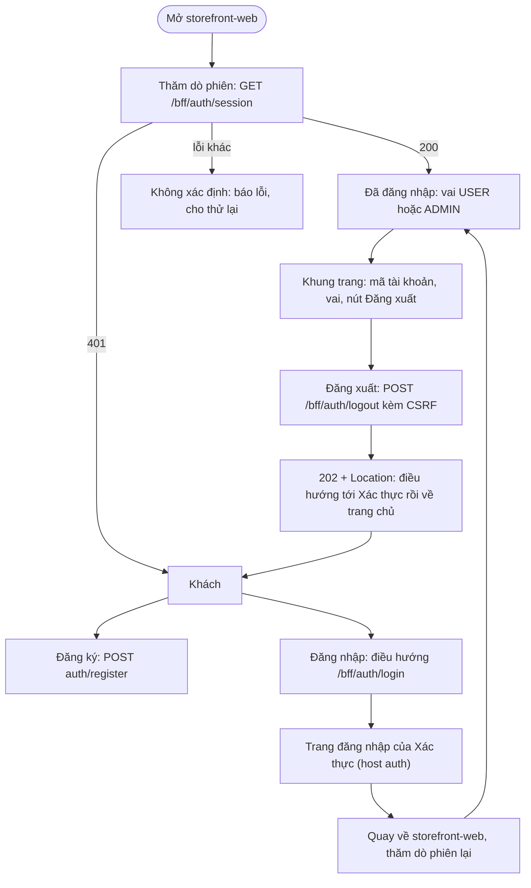

# Feature 05: Khung giao diện

> **Trạng thái:** Đã thiết kế `2026-10-19`, chưa làm · **Chặng:** C0 · **Loại:** Giao diện
>
> **Nguồn:** `stage.md` mục 3 (giao diện cho H1, H3, H5 và một khung trang cho người đã đăng nhập), `5-ui-analysis.md` (ứng dụng Cửa hàng), ADR-0003, ADR-0005, ADR-0006, việc giao từ feature 06 ·
> **Kiểm chứng bằng:** S1, S2, S4, S5 (nhìn thấy qua giao diện)
>
> **Cùng thư mục:** `plan.md` (kế hoạch). Các tệp `tech.md` (giải pháp kỹ thuật), `deferred.md` (phần hoãn) thêm khi viết đến.

## 1. Mục tiêu và phạm vi

Cho người dùng làm được H1 (đăng ký), H3 (đăng nhập), H5 (đăng xuất) bằng giao diện, thấy mình đã đăng nhập kèm vai (H6), qua **một khung trang**
mà các ứng dụng sau dùng lại cách làm. Giao diện nói chuyện với backend đúng hợp đồng đã chốt ở feature 06: phiên do BFF giữ (cookie `HttpOnly`), mã CSRF,
401 nghĩa là chưa có phiên, đăng xuất bằng 202 kèm `Location`.

**Viết lại, không sửa tiếp `web/`.** Ứng dụng mới `storefront-web` nằm trong thư mục mới `frontends/` (một dự án Angular mới); `web/` giữ nguyên làm tham chiếu
và không bị sửa. Mã được **copy từ `web/` đến đâu cần thì quét đến đó**: mỗi phần copy được rà theo hợp đồng mới (vai, CSRF, 401, `?error`) trước khi giữ; không copy
thứ chưa dùng. Khi feature đóng, quyết định giữ hay xóa `web/` (lịch sử vẫn ở git).

**Đã chốt (người, `2026-10-19`):**
- Thư mục `frontends/`, ứng dụng tên `storefront-web` (cùng mẫu `<ứng dụng>-<kênh>` với `storefront-web-bff`, client OAuth2 `storefront-web`, host `shop`).
- Angular CLI nhiều dự án (`projects/`), **không Nx**; giữ Angular 19. Đã thử `2026-10-19`: Jest và Playwright chạy được trên Angular CLI thuần (Node 26).
- **Thư viện dùng chung chỉ chứa logic**, không chứa thành phần giao diện: `auth` (phiên, vai, guard), `http` (bộ chặn: CSRF tự phục hồi, chặn vòng lặp 401, lỗi), `model` (kiểu dữ liệu).
  Thành phần giao diện chỉ tách khi hai ứng dụng thật sự lặp lại (cập nhật `5-ui-analysis.md` mục 3.2 khi đóng feature).
- Vai dùng thẳng từ vựng của backend: `USER` và `ADMIN`.
- S4 ở C0: khung Cửa hàng hiện nhãn vai; Quản trị đăng nhập vào cùng khung và thấy nhãn "Quản trị". Chưa dựng ứng dụng Vận hành.
- Kiểm chứng: Jest cho `projects/*` (logic), Playwright cho `storefront-web` trên ba dịch vụ thật.
- Chạy dev: giao diện cổng 4201 (4200 đang bị ứng dụng khác chiếm), mở qua cổng ở `http://shop.localhost:8000` (`SHOP_FRONTEND_URL=http://localhost:4201`).

Ngoài phạm vi:
- Hồ sơ, tên hiển thị, đổi mật khẩu, bảo mật tài khoản (thiết bị, lịch sử đăng nhập), xác minh email, giỏ hàng, danh mục, đơn hàng: các chặng sau.
- Ứng dụng Người bán, Vận hành, Shipper: chưa có BFF và host tương ứng.
- Thành phần giao diện dùng chung, chủ đề giao diện đa ứng dụng, đa ngôn ngữ: khi có ứng dụng thứ hai.
- Nhớ trang định vào để quay lại sau đăng nhập: `deferred.md` (BFF hiện luôn chuyển về một địa chỉ cố định sau đăng nhập).

## 2. Đầu vào và đầu ra

| Màn hình | Vào | Ra |
|---|---|---|
| **Khởi động ứng dụng** | Mở bất kỳ địa chỉ nào của `storefront-web` | Thăm dò phiên: 200 `{userId, role}` thì đã đăng nhập; 401 thì khách; lỗi khác thì "không xác định" |
| **Trang chủ** `/` | Ai cũng vào được | Nội dung giới thiệu tối giản; nút Đăng ký và Đăng nhập cho khách; khung có tên vai và nút Đăng xuất cho người đã đăng nhập |
| **Đăng ký** `/register` | Email, mật khẩu (nhập lại mật khẩu để xác nhận ở giao diện, không gửi) | 201: thông báo thành công và đường tới Đăng nhập; lỗi hiện lý do theo mã (mục 4 R6) |
| **Đăng nhập** `/login` | Bấm nút đăng nhập | Chuyển trình duyệt sang `/bff/auth/login` (302 tới Xác thực); `?error` thì hiện thông báo chung |
| **Trang tài khoản** `/account` (cần đăng nhập) | Người đã đăng nhập | Hiện mã tài khoản và vai (Người dùng hoặc Quản trị); chưa đăng nhập thì được đưa đi đăng nhập |
| **Đăng xuất** (nút trong khung) | Người đã đăng nhập | Về trang chủ ở trạng thái chưa đăng nhập; mọi trang cần đăng nhập lại bị chặn |
| **Không tìm thấy** (`**`) | Địa chỉ lạ | Trang "không tìm thấy" trong khung, không chuyển hướng bừa |

Hợp đồng backend dùng (không đổi ở feature này):

| Việc | Lời gọi | Kết quả |
|---|---|---|
| Thăm dò phiên | `GET /bff/auth/session` | 200 `{userId, role}` (`role` là `USER` hoặc `ADMIN`); 401 khi chưa có phiên; đồng thời cấp cookie `XSRF-TOKEN` nếu thiếu |
| Bắt đầu đăng nhập | Điều hướng cấp cao tới `/bff/auth/login` | 302 tới Xác thực; sau đăng nhập về địa chỉ cố định của BFF |
| Đăng ký | `POST {auth}/register` (host `auth`, khác nguồn gốc, không cookie, miễn CSRF) với `{email, password}` | 201; 400 (`EMAIL_INVALID`, `EMAIL_RESERVED`, `PASSWORD_INVALID`, `VALIDATION_FAILED`); 409 `EMAIL_TAKEN`; 429 kèm `Retry-After` |
| Đăng xuất | `POST /bff/auth/logout` kèm `X-XSRF-TOKEN` | 202 kèm `Location` (tới `connect/logout`, hoặc về trang đích nếu phiên đã mất); 403 `CSRF_TOKEN_INVALID` |
| Mọi lời gọi `/api/**` | Đường tương đối cùng nguồn gốc | 401 `UNAUTHENTICATED` (chưa có phiên), 403 `CSRF_TOKEN_INVALID`, 429, 503 |

## 3. Luồng chính

1. **Khởi động.** Trước khi hiện trang, ứng dụng thăm dò phiên một lần. 401 là trạng thái bình thường của khách, không phải lỗi và không chuyển hướng. Lỗi mạng hoặc 5xx là
   "không xác định": không được coi là khách (sẽ đẩy người đang đăng nhập về đăng nhập oan) mà báo lỗi và cho thử lại.
2. **Trang cần đăng nhập** (`/account`) có guard: chưa đăng nhập thì điều hướng cấp cao tới `/bff/auth/login`. Đã đăng nhập mà vào `/login` hoặc `/register` thì về `/account`.
3. **Đăng ký** là lời gọi tới host `auth` (khác nguồn gốc, không cookie, không CSRF). Thành công thì hiện thông báo và nút sang Đăng nhập; giao diện **không** tự đăng nhập vì
   đăng ký không tạo phiên (INV của Xác thực).
4. **Đăng nhập** luôn là điều hướng cấp cao tới BFF: SPA không nhận hay giữ token nào. Xác thực hiện trang đăng nhập riêng ở host `auth` (S3 kiểm ở đó, không ở giao diện này).
   Quay về thì BFF chuyển tới địa chỉ cố định (`/account`) và ứng dụng thăm dò phiên lại.
5. **Lời gọi API** đi bằng đường tương đối, tự mang cookie; Angular tự gửi `X-XSRF-TOKEN` cho yêu cầu ghi (cần xác nhận khi chạy thật, `plan.md` bước 2). Bộ chặn xử lý lỗi theo bảng hành vi lỗi của BFF
   (`service/storefront-web-bff/service.md` mục 3.1): 401 thì đi đăng nhập (một lần), 403 `CSRF_TOKEN_INVALID` thì phục hồi mã rồi thử lại đúng một lần, 429 và 503 thì báo thử lại sau và **không** đổi trạng thái đăng nhập.
6. **Đăng xuất.** `POST /bff/auth/logout` bằng `fetch` rồi **tự điều hướng** tới `Location` (điều hướng cấp cao mới mang được cookie của host `auth`). Phiên đã mất thì BFF vẫn trả 202 kèm trang đích nên luồng không đổi (S5).

## 4. Đường không suôn sẻ và các điểm cần rà

| # | Tình huống | Hướng xử lý | Chứng minh |
|---|---|---|---|
| R1 | Giao diện cũ dùng `CUSTOMER`, `SELLER`, `SHIPPER`, `GUEST`; Xác thực cấp `USER` và `ADMIN`. Guard cũ đẩy `USER` về `/login`, trang đăng nhập lại chuyển về `/user`: vòng lặp (đã gặp khi chạy giao diện cũ ở feature 06) | Từ vựng vai là `USER` và `ADMIN`, định nghĩa một chỗ (`model`); vai lạ trong phản hồi phiên coi là lỗi, không cho vào | KT-01, 03 |
| R2 | Sau đăng nhập mà lời gọi API đầu tiên vẫn 401 (dịch vụ sau từ chối token, cấu hình sai): bộ chặn cũ gọi đăng nhập ngay ở mọi 401 nên lặp vô hạn qua SSO im lặng | Cờ "vừa đăng nhập" (trong `sessionStorage`, chỉ chứa cờ, không chứa token): có cờ mà vẫn 401 thì dừng, hiện lỗi; không có cờ thì đi đăng nhập một lần | KT-05, 15 |
| R3 | Mất cookie `XSRF-TOKEN` khi phiên còn (xóa cookie, hết cookie phiên của trình duyệt) | 403 `CSRF_TOKEN_INVALID`: `GET /bff/auth/session` cấp lại mã rồi thử lại **đúng một lần**; lần hai vẫn 403 thì trả lỗi. 403 `FORBIDDEN` không thử lại | KT-04, 13 |
| R4 | Bộ chặn thử lại gửi **hai lần**: `HttpClient` phát cả sự kiện `Sent` lẫn `Response`, `switchMap` chạy hai lần (đã gặp khi thử `2026-10-19`) | Chỉ xử lý sự kiện `HttpResponse`, lấy một | KT-04 |
| R5 | Đăng nhập lỗi: callback về `/login?error` (không kèm lý do) | Trang đăng nhập hiện thông báo chung và nút thử lại; **không** tự chuyển lại sang đăng nhập (tránh vòng lặp) | KT-14 |
| R6 | Đăng ký lỗi | Theo mã: `EMAIL_TAKEN` "Email đã được đăng ký"; `EMAIL_INVALID`, `EMAIL_RESERVED` "Email không dùng được để đăng ký"; `PASSWORD_INVALID` nêu quy tắc mật khẩu; 429 nêu thời gian chờ từ `Retry-After`; lỗi khác hoặc mạng "thử lại sau". Không đoán lý do từ chữ của thông điệp | KT-07, 10 |
| R7 | Bấm đăng ký hai lần liên tiếp | Khóa nút khi đang gửi; phía Xác thực email trùng là 409 nên tối đa một tài khoản | KT-07, 10 |
| R8 | Đăng xuất: 403 CSRF, mạng lỗi, hoặc phiên đã mất | 403: phục hồi rồi thử lại một lần; mạng lỗi: giữ nguyên trạng thái và báo, cho bấm lại; phiên đã mất: vẫn 202 kèm trang đích nên không cần xử lý riêng | KT-08, 12 |
| R9 | Hết phiên khi đang dùng (phiên BFF mất hoặc refresh token hết hạn) | API trả 401: đi đăng nhập một lần (R2); phiên Xác thực còn thì SSO im lặng đưa về, hết thì hỏi mật khẩu | KT-16 |
| R10 | Thăm dò phiên lúc khởi động lỗi 5xx hoặc mạng | Trạng thái "không xác định": báo lỗi và nút thử lại; không coi là khách | KT-02 |
| R11 | Token lọt vào chỗ JavaScript đọc được (`localStorage`, biến toàn cục) | SPA không bao giờ nhận token (BFF giữ); chỉ có cờ R2 trong `sessionStorage` | KT-17 |
| R12 | Mở giao diện trực tiếp ở `localhost:4201` (không qua cổng) | Cookie và CSRF thuộc host `shop`; mở thẳng thì lời gọi BFF không tới đúng nơi. Ghi ở README và `environment`; không xử lý bằng mã | |
| R13 | Mã copy từ `web/` mang theo hành vi cũ (gửi `fullName` và `role: 'CUSTOMER'` khi đăng ký, đọc `res.data.userId`, mọi 401 gọi đăng nhập, route `/customer`) | Quy tắc copy: mỗi tệp copy qua rà theo `flow.md` này; hành vi cũ nào không có trong mục 2, 3 thì bỏ | Rà ở `plan.md` từng bước |
| R14 | Thư viện logic bị kéo vào giao diện hoặc ngược lại | `projects/auth`, `http`, `model` không import `@angular/material` hay mã trong `projects/storefront-web` (ESLint, `no-restricted-imports`) | KT-18 |
| R15 | Địa chỉ BFF chuyển về sau đăng nhập đang là `/customer` (cấu hình cố định `app.login.success-redirect-uri`) | Đổi mặc định thành `/account` ở BFF (test `OriginsTest` đi kèm) | KT-09 |
| R16 | Địa chỉ lạ, trang không tìm thấy | Trang riêng trong khung; không chuyển hướng ngầm về trang chủ như giao diện cũ | KT-19 |

## 5. Trạng thái sau khi xong

| Thành phần | Trạng thái |
|---|---|
| `frontends/` | Dự án Angular CLI 19 với `projects/storefront-web`, `auth`, `http`, `model`; Jest và Playwright cấu hình; ESLint ranh giới thư viện |
| `storefront-web` | Trang chủ, Đăng ký, Đăng nhập (kèm `?error`), Tài khoản (cần đăng nhập, hiện mã và vai), khung trang với nút Đăng xuất, trang không tìm thấy |
| BFF | `app.login.success-redirect-uri` mặc định `/account` |
| `web/` | Không sửa; quyết định giữ hay xóa ở bước đóng feature |
| Tài liệu | ADR-0007 (cấu trúc `frontends/`), `5-ui-analysis.md` mục 3.2 cập nhật, `tech-stack.md`, `deferred.md`, hàng 05 và điều học được ở `00-features.md` |

## 6. Test cần có (viết từ kịch bản và các rủi ro trên, trước khi viết mã)

**Đơn vị (Jest, `projects/*`):**

| # | Kiểm | Chứng minh |
|---|---|---|
| KT-01 | Phản hồi phiên 200 thành người dùng với vai `USER` hoặc `ADMIN`; 401 thành khách; vai lạ bị từ chối | R1 |
| KT-02 | Thăm dò phiên: 401 là khách (không chuyển hướng); 5xx hoặc mạng là "không xác định", không phải khách | R10 |
| KT-03 | Guard: chưa đăng nhập vào trang cần đăng nhập thì đi đăng nhập một lần; đã đăng nhập vào `/login`, `/register` thì về `/account`; không đủ vai thì không vào | R1 |
| KT-04 | Bộ chặn CSRF: 403 `CSRF_TOKEN_INVALID` thì `GET` phiên rồi thử lại đúng một lần (một yêu cầu, không phải hai); lần hai vẫn 403 thì trả lỗi; 403 `FORBIDDEN` không thử lại | R3, R4 |
| KT-05 | Bộ chặn 401: 401 thì đi đăng nhập một lần; có cờ "vừa đăng nhập" thì dừng và báo lỗi | R2 |
| KT-06 | Lỗi 429, 503, mạng thành thông báo, không đổi trạng thái đăng nhập | R6, R8 |
| KT-07 | Đăng ký chỉ gửi `{email, password}`; ánh xạ 400, 409, 429 sang thông báo; nút bị khóa khi đang gửi | R6, R7, R13 |
| KT-08 | Đăng xuất: 202 thì điều hướng tới `Location`; 403 CSRF thì phục hồi; mạng lỗi thì báo và giữ trạng thái | R8 |
| KT-18 | Lint ranh giới: thư viện logic không import Angular Material hay mã ứng dụng | R14 |

**Đầu-cuối (Playwright, ba dịch vụ thật qua cổng `shop.localhost:8000`, Chrome):**

| # | Kiểm | Chứng minh |
|---|---|---|
| KT-09 | **S1:** đăng ký, đăng nhập (trang Xác thực), thấy mã và vai "Người dùng", đăng xuất, vào `/account` bị đưa tới đăng nhập; sau đăng nhập về `/account` | S1, R15 |
| KT-10 | **S2:** email đã có (khác chữ hoa) và email miền nội bộ hiện lý do rõ; bấm đăng ký hai lần chỉ tạo một tài khoản | S2, R6, R7 |
| KT-11 | **S4:** tài khoản Quản trị có sẵn đăng nhập thì khung hiện "Quản trị"; tài khoản tự đăng ký (kể cả khi gửi kèm `role: ADMIN` trực tiếp tới API đăng ký) hiện "Người dùng" | S4 |
| KT-12 | **S5:** xóa phiên BFF trước rồi bấm đăng xuất vẫn về trạng thái chưa đăng nhập | S5, R8 |
| KT-13 | Xóa cookie `XSRF-TOKEN` rồi đăng xuất vẫn thành công, không phải đăng nhập lại | R3 |
| KT-14 | `/login?error` hiện thông báo chung, không tự chuyển hướng | R5 |
| KT-15 | Dịch vụ sau từ chối token ngay sau đăng nhập: giao diện dừng và báo lỗi, không vòng lặp | R2 |
| KT-16 | Xóa phiên BFF khi đang dùng rồi thao tác: được đưa đi đăng nhập một lần; phiên Xác thực còn thì không hỏi mật khẩu | R9 |
| KT-17 | JavaScript thấy `XSRF-TOKEN`, không thấy `STOREFRONT_SESSION`; `localStorage` không có token, `sessionStorage` chỉ có cờ R2 | R11 |
| KT-19 | Địa chỉ lạ hiện trang không tìm thấy trong khung | R16 |

KT-04 và KT-05 phải có ca "gửi hai lần" và "vòng lặp" làm điều kiện đỏ trước khi viết mã (R2, R4 đã gặp thật khi thử).

## 7. Việc đã giao cho feature này

Từ feature 06 (`06-access-gateway/deferred.md`, `tech.md`):
- Gửi `X-XSRF-TOKEN` cho mọi yêu cầu ghi qua BFF kể cả đăng xuất; phục hồi 403 `CSRF_TOKEN_INVALID` bằng `GET /bff/auth/session` rồi thử một lần (ADR-0005).
- Chặn vòng lặp 401 sau đăng nhập (R2).
- Route `/login` đọc `?error`, hiện thông báo chung, không tự chuyển lại sang đăng nhập (R5).
- Đăng xuất: đọc `Location` rồi điều hướng, kể cả khi phiên đã mất (R8).
- Từ vựng vai `USER` và `ADMIN` (R1).
- Cách chạy dev: `ng serve --live-reload=false --hmr=false` khi mở qua cổng (nợ `TD-06` của cổng), cổng 4201.

Từ feature 02 và 03: trang đăng nhập và đăng xuất ở host `auth` là của Xác thực (đã làm); giao diện này chỉ điều hướng tới và từ đó.
