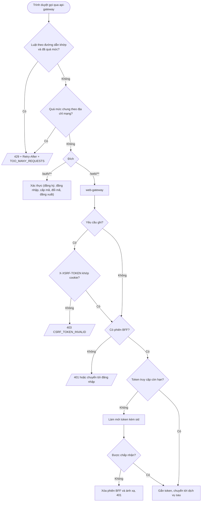
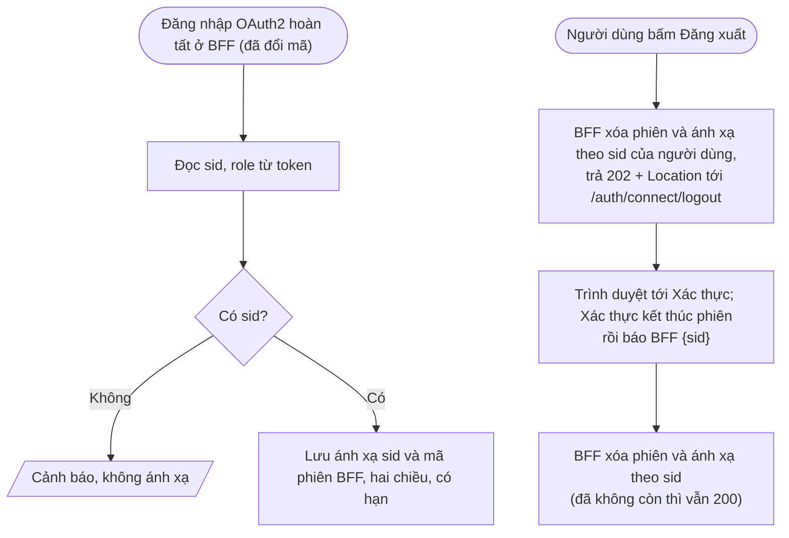

# Feature 06: Cổng truy cập

> **Trạng thái:** Đã thiết kế `2026-10-17`, chưa làm · **Chặng:** C0 · **Loại:** Kỹ thuật
>
> **Nguồn:** Roadmap C0 (hạ tầng), `rate-limiting-layers.md`, ADR-0003 mục 8, ADR-0005, việc giao từ feature 01, 02, 03, 07 · **Kiểm chứng bằng:** Mọi kịch bản đi qua cổng
>
> **Cùng thư mục:** `plan.md` (kế hoạch). Các tệp `tech.md` (giải pháp kỹ thuật), `nfr.md` (đáp ứng NFR), `deferred.md` (phần hoãn) thêm khi
> viết đến.

## 1. Mục tiêu và phạm vi

Mọi yêu cầu từ ngoài vào hệ thống đi qua **một điểm vào** là `api-gateway` (cổng 8000), rồi tới `web-gateway` (BFF của trình duyệt, cổng 8090) hoặc thẳng tới
Xác thực (`/auth/**`). Feature này làm cho hai cổng này **đúng với mô hình danh tính mới** của feature 01 đến 03 và thêm các lớp bảo vệ chỉ cổng làm được. Bốn nhóm việc, mỗi nhóm một
bước thi công riêng ở `plan.md`:

| Nhóm | Việc | Cổng |
|---|---|---|
| A. Giới hạn tần suất theo đường dẫn | Danh sách luật theo đường dẫn nạp từ cấu hình; luật đầu tiên: `POST /auth/register` 10 yêu cầu mỗi giờ mỗi địa chỉ mạng; 429 có thân lỗi chuẩn | `api-gateway` |
| B. CSRF phía BFF | Cookie `XSRF-TOKEN` đọc được bằng JavaScript, header `X-XSRF-TOKEN` cho mọi yêu cầu ghi; thiếu hoặc sai thì 403 với mã lỗi ổn định (ADR-0005) | `web-gateway` |
| C. Làm mới token kèm `sid` | BFF gửi `sid` (đọc từ token) khi làm mới token; làm mới bị từ chối thì xóa phiên BFF | `web-gateway` |
| D. BFF theo hợp đồng danh tính mới | Ánh xạ phiên BFF theo `sid` thay cho `oss_id`; nhận báo đăng xuất `{"sid": ...}` của Xác thực (nợ của feature 03); đọc `role` (chuỗi) thay `roles` (mảng) | `web-gateway` |

Cộng hai việc giao từ feature 07: địa chỉ mạng tin cậy chuyển xuống dịch vụ sau (để `client.ip` trong log đúng) và bộ ghi log cho cổng (WebFlux). Cộng độ lệch đồng hồ 5 giây cho bộ giải mã JWT ở BFF (đã chốt ở feature 02).

Ngoài phạm vi:
- Cổng di động thật (`mobile-gateway`), cổng WebSocket, CAPTCHA, đổi luật lúc chạy (cấu hình động), giới hạn nhóm 2 (nằm trong BC).
- Các route tới dịch vụ cũ (`identity`, `customer`, `catalog`, `order`) và danh sách `permitAll` của chúng: không đụng.
- Phía giao diện của CSRF (bộ chặn gửi header, thử lại một lần): feature 05.
- Đo tải và độ trễ của cổng (feature 08, NFR); chạy lại cả chuỗi S1 đến S5 (feature 09).

## 2. Đầu vào và đầu ra

| Nhóm | Vào | Ra khi thành công | Ra khi lỗi |
|---|---|---|---|
| A | Yêu cầu từ ngoài tới `api-gateway` (địa chỉ mạng của kết nối) | Yêu cầu được chuyển tiếp | 429 kèm `Retry-After`, thân `{success:false, code:"TOO_MANY_REQUESTS", message}`; Redis lỗi thì cho qua kèm cảnh báo |
| B | Yêu cầu ghi (`POST`, `PUT`, `PATCH`, `DELETE`) của trình duyệt tới BFF, kèm cookie phiên BFF và header `X-XSRF-TOKEN` | Chuyển tiếp xuống dịch vụ sau | 403 thân `{success:false, code:"CSRF_TOKEN_INVALID"}`, khác 403 thiếu quyền; phiên không bị hủy |
| C | Yêu cầu của trình duyệt khi token truy cập đã hết hạn | BFF làm mới (`grant_type=refresh_token` kèm `sid`), lưu token mới, gọi tiếp dịch vụ sau | Làm mới bị từ chối thì BFF xóa phiên và ánh xạ, trả 401 |
| D | Đăng nhập xong (`sub`, `role`, `sid` trong token); báo đăng xuất `{"sid"}` từ Xác thực kèm token dịch vụ phạm vi `webgw.internal`; yêu cầu đăng xuất của trình duyệt | Ánh xạ hai chiều `sid` và mã phiên BFF; phiên BFF bị xóa khi nhận báo hoặc khi đăng xuất; đăng xuất trả 202 kèm `Location` tới điểm cuối đăng xuất của Xác thực | Báo thiếu hoặc sai token: 401, 403; `sid` không phải UUID: 400; `sid` không có ánh xạ: vẫn 200 |

## 3. Luồng chính

Hai luồng phụ (cùng cổng, khác trục):

1. **Giới hạn tần suất (A):** hai tầng chạy tại `api-gateway` trước khi chọn đích: luật theo đường dẫn (khóa gồm tên luật và địa chỉ mạng), rồi mức chung theo địa chỉ mạng. Địa chỉ mạng là địa chỉ của kết nối TCP, không đọc `X-Forwarded-For` từ client.
2. **CSRF (B):** chỉ chuỗi dùng cookie phiên của BFF. Chuỗi `/webgw/internal/**` xác thực bằng token dịch vụ nên không cần.
3. **Làm mới (C):** BFF đọc `sid` từ chính token truy cập sắp hết hạn; `sid` không phải bí mật nhưng Xác thực dùng nó làm khóa tra phiên (ADR-0003 mục 8).
4. **Ánh xạ và đăng xuất (D):** giữ hình dạng cũ (hai khóa Redis), đổi khóa từ `oss_id` sang `sid`. Báo đăng xuất của Xác thực chỉ cần một khóa là `sid`.
5. **Log (07):** `api-gateway` ghi một dòng hoàn tất mỗi yêu cầu và truyền cùng mã truy vết xuống; địa chỉ mạng tin cậy do `api-gateway` đặt vào tiêu đề chuyển xuống, dịch vụ sau chỉ tin tiêu đề đó khi nhận từ cổng.

## 4. Đường không suôn sẻ và các điểm cần rà

| # | Tình huống | Hướng xử lý | Chứng minh |
|---|---|---|---|
| R1 | Redis lỗi hoặc chậm | Giới hạn tần suất mở cửa và ghi cảnh báo (thư viện đã mở cửa khi lỗi); **lệnh đếm chưa có thời gian chờ**, thêm thời gian chờ ngắn để yêu cầu không treo | `rate-limiting-layers.md` mục 5 |
| R2 | Client gửi `X-Forwarded-For` giả để né luật | Khóa lấy từ địa chỉ kết nối; `api-gateway` là hop ngoài cùng. Sau này có bộ cân bằng tải đứng trước thì đổi (ghi ở `tech.md`) | `rate-limiting-layers.md` mục 2.1 |
| R3 | Luật khớp quá rộng hoặc quá hẹp (dấu `/` cuối, phương thức khác, đường dẫn khác bắt đầu giống nhau) | Khớp theo phương thức và đường dẫn đã chuẩn hóa; luật cho `POST /auth/register` không chặn `POST /auth/login` hay `GET /auth/register` | KT-02, 07 |
| R4 | Cấu hình luật sai (mức hoặc thời gian không dương, trùng tên) | Không khởi động; luật tắt không áp; luật mặc định dự phòng 300 mỗi 60 giây mỗi địa chỉ | KT-06 |
| R5 | Yêu cầu bị luật đường dẫn chặn có tính vào mức chung không | Chốt ở `tech.md` T1 (yêu cầu bị chặn không nên làm cạn mức chung của người dùng bình thường chung địa chỉ) | KT-01 |
| R6 | Nhiều người dùng chung địa chỉ mạng (NAT, văn phòng) bị chặn nhầm khi đăng ký | Chấp nhận ở C0; mức 10 mỗi giờ là lưới an toàn thô, không phải luật nghiệp vụ (nhóm 2 nằm ở BC) | Ghi để biết |
| R7 | `Retry-After` quá lớn hoặc sai so với thời gian chờ thật | Chốt ở `tech.md` T2: số giây còn lại của cửa sổ, không phải độ dài cửa sổ | KT-01, 03 |
| R8 | Mất cookie `XSRF-TOKEN` trong khi phiên còn sống làm người dùng bị 403 liên tục | Mã lỗi ổn định cho phép phía giao diện sinh lại mã bằng một `GET` nhẹ rồi thử một lần; cookie gia hạn trượt theo hoạt động (ADR-0005 A, C); phiên không đăng xuất | KT-11 |
| R9 | 403 do CSRF lẫn với 403 thiếu quyền | Mã lỗi ổn định `CSRF_TOKEN_INVALID` phân biệt | KT-10 |
| R10 | CSRF chặn nhầm việc BFF nhận báo đăng xuất của Xác thực | `/webgw/internal/**` ở chuỗi riêng, không CSRF, xác thực bằng token dịch vụ | KT-12 |
| R11 | Nhiều yêu cầu đồng thời gặp token hết hạn, cùng làm mới | Chưa biết Xác thực có cho dùng lại mã làm mới đã dùng hay không; **cần thử**, nếu làm mới đồng thời làm hỏng phiên thì BFF phải gộp (một làm mới cho mỗi phiên) | KT-15, bước thử đầu của `plan.md` |
| R12 | Làm mới bị từ chối vì phiên đã kết thúc (đăng xuất ở thiết bị khác, quá hạn) | BFF xóa phiên và ánh xạ, trả 401 một lần; không lặp lại làm mới | KT-14 |
| R13 | Token không có `sid` (cấu hình lệch, token cũ) | Không tạo ánh xạ, ghi cảnh báo (đang hành xử như vậy với `oss_id`); không làm hỏng đăng nhập | KT-16 |
| R14 | Báo đăng xuất tới lặp lại, hoặc `sid` đã không còn ánh xạ | Vẫn 200 (bên gửi không thử lại, nhưng tính lũy đẳng vẫn cần); `sid` không đúng dạng UUID thì 400 để lỗi lập trình thấy ngay | KT-18 |
| R15 | Báo đăng xuất tới từ nơi không phải Xác thực | Cần token dịch vụ phạm vi `webgw.internal` (đã có ở chuỗi riêng); thiếu 401, sai phạm vi 403 | KT-18 |
| R16 | Cổng cũ đọc claim không còn tồn tại: `oss_id` (ánh xạ, đăng xuất), `roles` (phiên) | Đổi sang `sid` và `role`; `/webgw/auth/session` hiện trả `role = null` với token mới | KT-16, 17, 20 |
| R17 | BFF không gửi PKCE (client BFF đã bắt buộc PKCE ở Xác thực từ feature 02) hoặc `state` | Kiểm trên chạy thật; Spring Security OAuth2 Client phải sinh `code_challenge`; `state` sai ở callback do BFF từ chối | KT-22 |
| R18 | Bộ giải mã JWT của BFF dùng độ lệch đồng hồ mặc định 60 giây | Đặt 5 giây như Xác thực (consumer tự cấu hình) | KT-23 |
| R19 | Log của dịch vụ sau lấy `client.ip` là địa chỉ của `api-gateway` hoặc tin tiêu đề do client gửi | Cổng ghi đè tiêu đề địa chỉ, dịch vụ sau chỉ tin tiêu đề nhận từ cổng; log đúng `client.ip` | KT-24 |
| R20 | Cổng không để lại dấu vết khi lỗi | Một dòng hoàn tất mỗi yêu cầu, mã truy vết xuyên suốt (feature 07) | KT-25 |

## 5. Trạng thái sau khi xong

- `api-gateway` có danh sách luật theo đường dẫn (luật đầu: `POST /auth/register` 10 mỗi giờ mỗi địa chỉ); 429 đúng thân lỗi; Redis lỗi thì mở cửa, lệnh đếm có thời gian chờ.
- `web-gateway` đòi `X-XSRF-TOKEN` cho mọi yêu cầu ghi của trình duyệt, 403 có mã `CSRF_TOKEN_INVALID`; `/webgw/internal/**` không bị CSRF.
- BFF làm mới token kèm `sid`; làm mới bị từ chối thì phiên BFF bị xóa.
- BFF ánh xạ phiên theo `sid`, nhận báo đăng xuất `{"sid"}` và xóa phiên, đọc `role` đúng; không còn mã nào đọc `oss_id` hay `roles`.
- Chạy thật qua cổng: đăng nhập qua BFF, gọi API, token hết hạn thì làm mới được, đăng xuất ở BFF kết thúc phiên ở cả Xác thực và BFF, báo đăng xuất từ Xác thực xóa phiên BFF.
- Log của `api-gateway` và dịch vụ sau mang cùng mã truy vết và `client.ip` đúng.

## 6. Test cần có (viết từ kịch bản và bất biến, trước khi viết mã)

Cột "Mức": **Đơn vị**, **Cổng** (ứng dụng cổng thật với Redis thật của Testcontainers và dịch vụ sau giả), **Hệ thống** (ba dịch vụ thật). Cột "Chứng minh" trỏ về tài liệu hoặc rủi ro ở mục 4.

| # | Kịch bản test | Nhóm | Mức | Chứng minh |
|---|---|---|---|---|
| KT-01 | `POST /auth/register`: 10 yêu cầu đầu trong một cửa sổ từ cùng địa chỉ được chuyển tiếp; yêu cầu thứ 11 nhận 429 kèm `Retry-After` và thân `TOO_MANY_REQUESTS` | A | Cổng | `rate-limiting-layers.md` mục 8, R5, R7 |
| KT-02 | Sau khi quá mức luật đăng ký, `POST /auth/login`, `GET /auth/register`, `POST /auth/oauth2/token` vẫn qua | A | Cổng | R3 |
| KT-03 | Hết cửa sổ thì đăng ký lại được; `Retry-After` là số giây còn lại của cửa sổ | A | Cổng | R7 |
| KT-04 | Tiêu đề `X-Forwarded-For` do client gửi không đổi khóa đếm; hai địa chỉ kết nối khác nhau đếm riêng | A | Đơn vị | R2 |
| KT-05 | Redis dừng: yêu cầu vẫn qua và có cảnh báo; lệnh đếm có thời gian chờ ngắn nên yêu cầu không treo | A | Cổng | R1 |
| KT-06 | Cấu hình luật sai (mức hoặc thời gian không dương, trùng tên) không cho khởi động; luật tắt không áp; không có luật nào thì áp mức chung 300 mỗi 60 giây | A | Cổng | R4 |
| KT-07 | Luật khớp `POST /auth/register` và `POST /auth/register/`; không khớp phương thức hay đường dẫn có tiền tố giống (`/auth/register-x`) | A | Đơn vị | R3 |
| KT-08 | Yêu cầu ghi tới BFF thiếu hoặc sai `X-XSRF-TOKEN` nhận 403 `CSRF_TOKEN_INVALID`; đúng thì chuyển tiếp | B | Cổng | ADR-0005, R9 |
| KT-09 | `GET` không cần mã; một `GET` đầu sinh cookie `XSRF-TOKEN` không `HttpOnly`; cookie phiên BFF vẫn `HttpOnly` | B | Cổng | ADR-0005 |
| KT-10 | 403 do thiếu quyền có mã khác `CSRF_TOKEN_INVALID` | B | Cổng | R9 |
| KT-11 | Mất cookie `XSRF-TOKEN`, phiên còn: `GET` nhẹ sinh lại, gửi lại thành công, phiên không bị hủy | B | Cổng | R8 |
| KT-12 | `/webgw/internal/**` không cần CSRF (xác thực bằng token dịch vụ); `POST /webgw/auth/logout` cần CSRF | B | Cổng | R10 |
| KT-13 | Token truy cập hết hạn: BFF gọi làm mới kèm `sid` lấy từ token, lưu token mới, yêu cầu tiếp tục thành công | C | Cổng (Xác thực giả) | ADR-0003 mục 8 |
| KT-14 | Làm mới bị từ chối (`invalid_grant`): BFF xóa phiên và ánh xạ, trả 401, không lặp | C | Cổng (Xác thực giả) | R12 |
| KT-15 | Nhiều yêu cầu đồng thời gặp token hết hạn: không người dùng nào bị đăng xuất nhầm | C | Cổng (Xác thực giả) rồi Hệ thống | R11 |
| KT-16 | Đăng nhập xong tạo ánh xạ hai chiều theo `sid` có hạn; token thiếu `sid` thì không ánh xạ và có cảnh báo | D | Cổng | R13, R16 |
| KT-17 | `GET /webgw/auth/session` trả `userId` = `sub` và `role` đúng từ claim `role`; chưa đăng nhập thì 401 | D | Cổng | R16 |
| KT-18 | `POST /webgw/internal/sessions/revoke {"sid"}` với token dịch vụ đúng phạm vi xóa phiên và ánh xạ; lặp hoặc `sid` không có ánh xạ vẫn 200; thiếu token 401, sai phạm vi 403, `sid` không phải UUID 400 | D | Cổng | R14, R15 |
| KT-19 | Sau khi nhận báo đăng xuất, yêu cầu mang cookie phiên cũ nhận 401 | D | Cổng | R15 |
| KT-20 | Đăng xuất ở BFF xóa ánh xạ theo `sid` của người dùng và trả 202 kèm `Location` tới `/auth/connect/logout?id_token_hint=...&post_logout_redirect_uri=...` | D | Cổng | R16 |
| KT-21 | Đăng xuất đầu-cuối: BFF còn đúng 0 phiên, Xác thực còn 0 phiên người dùng và phiên ứng dụng, mã làm mới cũ bị từ chối | D | Hệ thống | `03-logout/flow.md` mục 5 |
| KT-22 | Đăng nhập qua BFF với Xác thực thật: yêu cầu cấp mã có `code_challenge` và `state`; `state` sai ở callback bị BFF từ chối | D | Hệ thống | R17, ADR-0005 |
| KT-23 | Bộ giải mã token dịch vụ ở BFF chấp nhận lệch đồng hồ tối đa 5 giây, từ chối token hết hạn quá 5 giây | D | Đơn vị | R18 |
| KT-24 | Dịch vụ sau ghi `client.ip` đúng địa chỉ kết nối mà `api-gateway` thấy; tiêu đề giả do client gửi không đổi giá trị | 07 | Hệ thống | R19 |
| KT-25 | Mỗi yêu cầu qua `api-gateway` có một dòng hoàn tất và cùng mã truy vết ở dịch vụ sau (đọc log thật) | 07 | Hệ thống | R20 |

Cách test: nhóm A, B, D (phần cổng) chạy ứng dụng cổng thật bằng `WebTestClient` với Redis của Testcontainers; Xác thực và dịch vụ sau được giả bằng máy chủ HTTP giả (`MockWebServer` hoặc tương đương); Hệ thống chạy cả ba dịch vụ cục bộ ở bước "Chạy thật".

## 7. Việc đã giao cho feature này

- **Giới hạn tần suất theo đường dẫn** (từ feature 01, `01-register/tech.md` T6): danh sách luật nạp từ thuộc tính lúc khởi động, mỗi luật gồm tên, đường dẫn, phương thức, mức, khoảng thời gian, bật hay tắt; luật mặc định dự phòng 300 mỗi 60 giây mỗi IP; luật đầu `POST /auth/register` 10 mỗi giờ mỗi địa chỉ; Redis lỗi mở cửa kèm cảnh báo; lệnh đếm có thời gian chờ ngắn; địa chỉ do cổng xác định.
- **CSRF phía BFF** (ADR-0005 mục "CSRF ở BFF"): cookie `XSRF-TOKEN` không `HttpOnly`, header `X-XSRF-TOKEN`, mã lỗi ổn định, cơ chế A (gia hạn trượt) và C (giao diện sinh lại một lần) quyết định kỹ thuật ở `tech.md`.
- **Gửi `sid` khi làm mới token** (ADR-0003 mục 8).
- **Đổi claim ở BFF** (từ feature 03): ánh xạ phiên theo `sid` (`SessionMappingAuthenticationSuccessHandler`), đăng xuất đọc `sid` (`WebGatewayLogoutSuccessHandler`), nhận báo `{"sid"}` (`SessionRevokeController`), đọc `role` (`AuthController`).
- **Việc từ feature 07:** bộ ghi log cho `api-gateway` (WebFlux) và truyền ngữ cảnh Reactor; địa chỉ mạng tin cậy chuyển xuống dịch vụ sau.
- **Việc từ feature 02:** độ lệch đồng hồ 5 giây cho bộ giải mã JWT của BFF; PKCE và `state` ở BFF kiểm trên chạy thật.
- **Tài liệu:** `rate-limiting-layers.md` mục 8 (đổi trạng thái luật đăng ký), cập nhật các tài liệu cũ nói tới `oss_id` ở phía BFF (`global/3.technical/spring-security-logout-bff.md`, `security-architecture.md`) hoặc ghi vào `deferred.md` nếu chưa viết lại.
