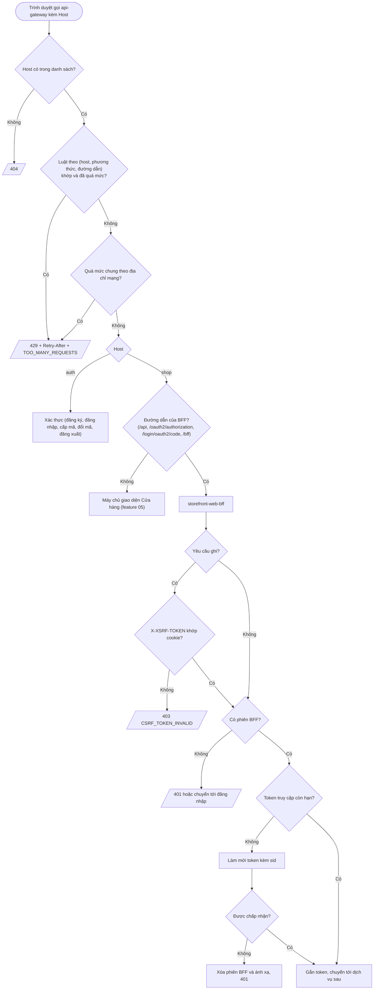

# Feature 06: Cổng truy cập

> **Trạng thái:** Đã làm `2026-10-18` (thiết kế `2026-10-17`, kèm nhóm E và ADR-0006) · **Chặng:** C0 · **Loại:** Kỹ thuật
>
> **Nguồn:** Roadmap C0 (hạ tầng), `rate-limiting-layers.md`, ADR-0003 mục 8, ADR-0005, ADR-0006, việc giao từ feature 01, 02, 03, 07 · **Kiểm chứng bằng:** Mọi kịch bản đi qua cổng
>
> **Cùng thư mục:** `plan.md` (kế hoạch), `tech.md` (giải pháp kỹ thuật và ghi nhận từng bước), `deferred.md` (phần hoãn). Không có `nfr.md`: feature không có NFR đo riêng (đo ở feature 08).

## 1. Mục tiêu và phạm vi

Mọi yêu cầu từ ngoài vào hệ thống đi qua **một điểm vào** là `api-gateway` (một cổng, 8000), **định tuyến theo `Host`** (ADR-0006): `auth.localhost` tới Xác thực, `shop.localhost` tới giao diện Cửa hàng và BFF của vai Người dùng
(`storefront-web-bff`, cổng 8090; trước đây tên `web-gateway`, đổi ở bước 4b của `plan.md` theo mẫu `<ứng dụng>-<kênh>-bff` của ADR-0006), `ops.localhost` giữ chỗ cho Vận hành. Feature này làm cho hai cổng **đúng với mô hình danh tính mới** của feature 01 đến 03, tách nguồn gốc theo subdomain và thêm các lớp bảo vệ chỉ cổng làm được. Năm nhóm việc, mỗi nhóm
một bước thi công ở `plan.md` (**E làm trước** vì nó đổi đường dẫn và địa chỉ mà các nhóm khác dùng):

| Nhóm | Việc | Cổng |
|---|---|---|
| E. Tách nguồn gốc theo subdomain (ADR-0006) | Định tuyến theo `Host` thay cho tiền tố `/auth`, `/web`; bỏ `X-Forwarded-Prefix` và biểu thức đường dẫn kép; `issuer`, redirect URI và trang đích đăng xuất đổi sang host mới; cookie theo máy; host lạ bị từ chối | `api-gateway`, `storefront-web-bff`, `oauth2-service` |
| A. Giới hạn tần suất theo đường dẫn | Danh sách luật theo (host, phương thức, đường dẫn) nạp từ cấu hình; luật đầu tiên: `POST /register` trên host `auth`, 10 yêu cầu mỗi giờ mỗi địa chỉ mạng; 429 có thân lỗi chuẩn | `api-gateway` |
| B. CSRF phía BFF | Cookie `XSRF-TOKEN` đọc được bằng JavaScript, header `X-XSRF-TOKEN` cho mọi yêu cầu ghi; thiếu hoặc sai thì 403 với mã lỗi ổn định (ADR-0005) | `storefront-web-bff` |
| C. Làm mới token kèm `sid` | BFF gửi `sid` (đọc từ token) khi làm mới token; làm mới bị từ chối thì xóa phiên BFF | `storefront-web-bff` |
| D. BFF theo hợp đồng danh tính mới | Ánh xạ phiên BFF theo `sid` thay cho `oss_id`; nhận báo đăng xuất `{"sid": ...}` của Xác thực (nợ của feature 03); đọc `role` (chuỗi) thay `roles` (mảng) | `storefront-web-bff` |

Cộng hai việc giao từ feature 07: địa chỉ mạng tin cậy chuyển xuống dịch vụ sau (để `client.ip` trong log đúng) và bộ ghi log cho cổng (WebFlux). Cộng độ lệch đồng hồ 5 giây cho bộ giải mã JWT ở BFF (đã chốt ở feature 02).

Ngoài phạm vi:
- Cổng di động thật (`mobile-gateway`), cổng WebSocket, CAPTCHA, đổi luật lúc chạy (cấu hình động), giới hạn nhóm 2 (nằm trong BC).
- **BFF và client đăng ký riêng cho Vận hành** (và Người bán): chỉ chuẩn bị chỗ ở định tuyến theo `Host`; làm khi có ứng dụng đó (`02-login-session/deferred.md`).
- Máy chủ giao diện (Angular) và cấu hình phía giao diện của CSRF (bộ chặn gửi header, thử lại một lần): feature 05. Feature này chỉ chuyển tiếp đường dẫn không thuộc BFF tới địa chỉ giao diện đã cấu hình.
- Các route tới dịch vụ cũ (`identity`, `customer`, `catalog`, `order`) và danh sách `permitAll` của chúng: không đụng (chỉ đổi cách tới BFF theo host).
- Đo tải và độ trễ của cổng (feature 08, NFR); chạy lại cả chuỗi S1 đến S5 (feature 09).

## 2. Đầu vào và đầu ra

| Nhóm | Vào | Ra khi thành công | Ra khi lỗi |
|---|---|---|---|
| E | Yêu cầu từ trình duyệt kèm `Host` | Chuyển tới đúng đích theo `Host`; `X-Forwarded-Host`, `X-Forwarded-Proto` do cổng đặt từ yêu cầu thật; Xác thực, BFF dựng địa chỉ công khai đúng host | `Host` không có trong danh sách: 404, không chọn tuyến |
| A | Yêu cầu từ ngoài tới `api-gateway` (địa chỉ mạng của kết nối) | Yêu cầu được chuyển tiếp | 429 kèm `Retry-After`, thân `{success:false, code:"TOO_MANY_REQUESTS", message}`; Redis lỗi thì cho qua kèm cảnh báo |
| B | Yêu cầu ghi (`POST`, `PUT`, `PATCH`, `DELETE`) của trình duyệt tới BFF, kèm cookie phiên BFF và header `X-XSRF-TOKEN` | Chuyển tiếp xuống dịch vụ sau | 403 thân `{success:false, code:"CSRF_TOKEN_INVALID"}`, khác 403 thiếu quyền; phiên không bị hủy |
| C | Yêu cầu của trình duyệt khi token truy cập đã hết hạn | BFF làm mới (`grant_type=refresh_token` kèm `sid`), lưu token mới, gọi tiếp dịch vụ sau | Làm mới bị từ chối thì BFF xóa phiên và ánh xạ, trả 401 |
| D | Đăng nhập xong (`sub`, `role`, `sid` trong token); báo đăng xuất `{"sid"}` từ Xác thực kèm token dịch vụ phạm vi `storefront.internal`; yêu cầu đăng xuất của trình duyệt | Ánh xạ hai chiều `sid` và mã phiên BFF; phiên BFF bị xóa khi nhận báo hoặc khi đăng xuất; đăng xuất trả 202 kèm `Location` tới điểm cuối đăng xuất của Xác thực | Báo thiếu hoặc sai token: 401, 403; `sid` không phải UUID: 400; `sid` không có ánh xạ: vẫn 200 |

## 3. Luồng chính

Hai luồng phụ (cùng cổng, khác trục):

1. **Nguồn gốc (E):** `Host` quyết định tuyến; host `auth` không có tiền tố đường dẫn; host `shop` phục vụ giao diện và BFF cùng nguồn gốc, nên giao diện gọi BFF bằng đường tương đối. `api-gateway` giữ `Host` của trình duyệt, đặt `X-Forwarded-Host`, `X-Forwarded-Proto` từ yêu cầu thật.
   Báo đăng xuất `{sid}` từ Xác thực tới BFF đi **trực tiếp** (địa chỉ nội bộ `app.webgateway.base-url`), không qua cổng công khai, nên không đổi.
2. **Giới hạn tần suất (A):** hai tầng chạy tại `api-gateway` trước khi chọn đích: luật theo (host, phương thức, đường dẫn) với khóa gồm tên luật và địa chỉ mạng, rồi mức chung theo địa chỉ mạng. Địa chỉ mạng là địa chỉ của kết nối TCP, không đọc `X-Forwarded-For` từ client.
3. **CSRF (B):** chỉ chuỗi dùng cookie phiên của BFF. Chuỗi `/bff/internal/**` xác thực bằng token dịch vụ nên không cần. Cookie CSRF của BFF không còn va chạm với cookie cùng tên của Xác thực vì hai host có hai kho cookie.
4. **Làm mới (C):** BFF đọc `sid` từ chính token truy cập sắp hết hạn; `sid` không phải bí mật nhưng Xác thực dùng nó làm khóa tra phiên (ADR-0003 mục 8).
5. **Ánh xạ và đăng xuất (D):** giữ hình dạng cũ (hai khóa Redis), đổi khóa từ `oss_id` sang `sid`. Báo đăng xuất của Xác thực chỉ cần một khóa là `sid`. Mỗi callback đăng nhập thành công ở BFF, **kể cả xác thực im lặng** (phiên BFF mất nhưng phiên Xác thực còn, cấp mã ngay không qua biểu mẫu), làm bốn việc: lưu token mới có hạn mới vào phiên BFF (Spring OAuth2 Client), ghi hoặc ghi đè ánh xạ `sid` (xác thực im lặng giữ `sid`), xoay mã CSRF, đặt lại hạn phiên BFF. Mã CSRF độc lập với phiên Redis (`tech.md` T4).
6. **Log (07):** `api-gateway` ghi một dòng hoàn tất mỗi yêu cầu và truyền cùng mã truy vết xuống; địa chỉ mạng tin cậy do `api-gateway` đặt vào tiêu đề chuyển xuống, dịch vụ sau chỉ tin tiêu đề đó khi nhận từ cổng.

## 4. Đường không suôn sẻ và các điểm cần rà

| # | Tình huống | Hướng xử lý | Chứng minh |
|---|---|---|---|
| R1 | Redis lỗi hoặc chậm | Giới hạn tần suất mở cửa và ghi cảnh báo (thư viện đã mở cửa khi lỗi); **lệnh đếm chưa có thời gian chờ**, thêm thời gian chờ ngắn để yêu cầu không treo | `rate-limiting-layers.md` mục 5 |
| R2 | Client gửi `X-Forwarded-For` giả để né luật | Khóa lấy từ địa chỉ kết nối; `api-gateway` là hop ngoài cùng. Sau này có bộ cân bằng tải đứng trước thì đổi (ghi ở `tech.md`) | `rate-limiting-layers.md` mục 2.1 |
| R3 | Luật khớp quá rộng hoặc quá hẹp (host khác, dấu `/` cuối, phương thức khác, đường dẫn khác bắt đầu giống nhau) | Khớp theo host, phương thức và đường dẫn đã chuẩn hóa; luật cho `POST /register` trên host `auth` không chặn `POST /login`, `GET /register`, hay `POST /register` ở host khác | KT-02, 07 |
| R4 | Cấu hình luật sai (mức hoặc thời gian không dương, trùng tên, host không có trong danh sách) | Không khởi động; luật tắt không áp; luật mặc định dự phòng 300 mỗi 60 giây mỗi địa chỉ | KT-06 |
| R5 | Yêu cầu bị luật đường dẫn chặn có tính vào mức chung không | Chốt ở `tech.md` T1 (yêu cầu bị chặn không nên làm cạn mức chung của người dùng bình thường chung địa chỉ) | KT-33 |
| R6 | Nhiều người dùng chung địa chỉ mạng (NAT, văn phòng) bị chặn nhầm khi đăng ký | Chấp nhận ở C0; mức 10 mỗi giờ là lưới an toàn thô, không phải luật nghiệp vụ (nhóm 2 nằm ở BC) | Ghi để biết |
| R7 | `Retry-After` quá lớn hoặc sai so với thời gian chờ thật | Chốt ở `tech.md` T2: số giây còn lại của cửa sổ, không phải độ dài cửa sổ | KT-01, 03 |
| R8 | Mất cookie `XSRF-TOKEN` trong khi phiên còn sống làm người dùng bị 403 liên tục | Mã lỗi ổn định cho phép phía giao diện sinh lại mã bằng một `GET` nhẹ (`/bff/auth/session`) rồi thử một lần (ADR-0005 C); mã CSRF là cookie phiên của trình duyệt, độc lập với phiên Redis, phát khi thiếu, xoay ở callback, xóa khi đăng xuất, nên không cần gia hạn trượt (ADR-0005 A không cần; `tech.md` T4); phiên không đăng xuất | KT-11, 34 |
| R9 | 403 do CSRF lẫn với 403 thiếu quyền | Mã lỗi ổn định `CSRF_TOKEN_INVALID` phân biệt | KT-10 |
| R10 | CSRF chặn nhầm việc BFF nhận báo đăng xuất của Xác thực | `/bff/internal/**` ở chuỗi riêng, không CSRF, xác thực bằng token dịch vụ | KT-12 |
| R11 | Nhiều yêu cầu đồng thời gặp token hết hạn, cùng làm mới | **Đã thử, là thật:** hai làm mới đồng thời cùng một mã làm mới cùng thành công nhưng chỉ một mã mới dùng được (`tech.md`, ca 5). BFF phải tuần tự hóa làm mới theo phiên (một làm mới cho mỗi phiên, các yêu cầu còn lại chờ kết quả) | KT-15 |
| R12 | Làm mới bị từ chối vì phiên đã kết thúc (đăng xuất ở thiết bị khác, quá hạn) | BFF xóa phiên và ánh xạ, trả 401 một lần; không lặp lại làm mới (hiện trả 500 rồi 302, đã thử ở bước 2). Hạn token có thể bị cắt sớm hơn phiên BFF (ADR-0003: cắt theo hạn phiên người dùng, nên xác thực im lặng gần cuối phiên cho token rất ngắn), vì vậy đường này luôn có thể xảy ra. Chỉ `invalid_grant` mới xóa phiên (rồi SSO ở lần đăng nhập kế); lỗi khác (Xác thực chậm, 5xx) trả 503 và **giữ** phiên | KT-14, 40 |
| R13 | Token không có `sid` (cấu hình lệch, token cũ) | Không tạo ánh xạ, ghi cảnh báo (đang hành xử như vậy với `oss_id`); không làm hỏng đăng nhập | KT-16 |
| R14 | Báo đăng xuất tới lặp lại, hoặc `sid` đã không còn ánh xạ | Vẫn 200 (bên gửi không thử lại, nhưng tính lũy đẳng vẫn cần); `sid` không đúng dạng UUID thì 400 để lỗi lập trình thấy ngay | KT-18 |
| R15 | Báo đăng xuất tới từ nơi không phải Xác thực | Cần token dịch vụ phạm vi `storefront.internal` (đã có ở chuỗi riêng); thiếu 401, sai phạm vi 403 | KT-18 |
| R16 | Cổng cũ đọc claim không còn tồn tại: `oss_id` (ánh xạ, đăng xuất), `roles` (phiên) | Đổi sang `sid` và `role`; `/bff/auth/session` hiện trả `role = null` với token mới | KT-16, 17, 20 |
| R17 | BFF không gửi PKCE (client BFF đã bắt buộc PKCE ở Xác thực từ feature 02) hoặc `state` | Kiểm trên chạy thật; Spring Security OAuth2 Client phải sinh `code_challenge`; `state` sai ở callback do BFF từ chối | KT-22 |
| R18 | Bộ giải mã JWT của BFF dùng độ lệch đồng hồ mặc định 60 giây | Đặt 5 giây như Xác thực (consumer tự cấu hình) | KT-23 |
| R19 | Log của dịch vụ sau lấy `client.ip` là địa chỉ của `api-gateway` hoặc tin tiêu đề do client gửi | Cổng ghi đè tiêu đề địa chỉ, dịch vụ sau chỉ tin tiêu đề nhận từ cổng; log đúng `client.ip` | KT-24 |
| R20 | Cổng không để lại dấu vết khi lỗi | Một dòng hoàn tất mỗi yêu cầu, mã truy vết xuyên suốt (feature 07) | KT-25 |
| R21 | Tiêu đề `Host` giả hoặc lạ chọn nhầm tuyến | Cổng chỉ nhận `Host` trong danh sách cấu hình; ngoài danh sách thì 404 | KT-26 |
| R22 | Cổng chuyển `X-Forwarded-Host`, `X-Forwarded-Proto` do client tự gửi, hoặc giữ giá trị cấu hình tĩnh khi có nhiều host | Cổng ghi đè từ yêu cầu thật, mỗi host một giá trị; BFF và Xác thực dựng địa chỉ công khai đúng host của yêu cầu | KT-27, 28 |
| R23 | Đổi `issuer` làm token đã cấp và bộ kiểm hint (`NimbusIdTokenHintVerifier`) không khớp | `issuer` mới là host `auth` (không còn `/auth`); token cấp trước khi đổi không còn hợp lệ, chấp nhận ở dev (không có dữ liệu thật); BFF dùng `jwk-set-uri` trỏ đúng | KT-29 |
| R24 | Redirect URI và `post_logout_redirect_uri` của client `storefront-web` còn trỏ host cũ (V4, V9 đã chạy) | Đổi qua `RegisteredClientSeeder` (cấu hình theo môi trường) hoặc migration mới; yêu cầu mang URI cũ bị từ chối | KT-32 |
| R25 | `auth.localhost` và `shop.localhost` bị coi là hai site khác nhau nên cookie `SameSite=Lax` không đi theo yêu cầu chéo site | Đăng nhập và đăng xuất là điều hướng cấp cao nên phải đi được; **chưa chạy thử**, kiểm ở bước thử và bước chạy thật; nếu hỏng thì đổi cách dựng luồng, không bỏ `SameSite` | KT-31 |
| R26 | `*.localhost` phân giải ra `::1` (IPv6) nhưng dịch vụ chỉ nghe IPv4 | Kiểm ở bước thử; cấu hình nghe cả hai hoặc ép phân giải; ghi cách làm ở `tech.md` | KT-31 |
| R27 | Cookie đặt thuộc tính `Domain` chia sẻ giữa subdomain, mất tách cookie | Cookie theo máy, không đặt `Domain`; kiểm bằng test | KT-30 |
| R28 | Tên đường dẫn của BFF trùng với đường dẫn của giao diện ở host `shop` | Danh sách đường dẫn BFF cố định và có tiền tố riêng (`/api`, `/bff`, ...); giao diện không dùng các tiền tố này; ghi ở `tech.md` | KT-26 |
| R29 | Xác thực cho hai làm mới đồng thời cùng một mã làm mới cùng thành công (xoay không nguyên tử, thấy ở bước 2), chỉ một mã mới dùng được | Tuần tự hóa ở BFF (R11) là phần bắt buộc của feature này. **Đã chọn: ghi nợ `deferred.md`, không sửa phía Xác thực trong feature này** (sửa đúng cần bao cả yêu cầu `/oauth2/token` trong một giao dịch khóa hàng; `tech.md` T5) | Không có (KT-37 bỏ) |
| R31 | Xác thực im lặng (phiên BFF mất, phiên Xác thực còn): `sid` giữ nguyên, token và hạn mới; BFF không lưu lại hay không ghi đè ánh xạ thì phiên BFF mới dùng token cũ đã bị thay, hoặc phiên BFF cũ mồ côi trong Redis | Callback luôn lưu token mới (Spring), ghi đè ánh xạ và xóa phiên BFF cũ nếu khác, xoay CSRF; cùng một đường với đăng nhập mật khẩu, BFF không phân biệt | KT-38 |
| R30 | BFF dựng đường chuyển hướng bằng `contextPath` (tiền tố do `X-Forwarded-Prefix` đặt): bộ chuyển hướng "chưa đăng nhập" (`/oauth2/authorization/storefront-web`) và `AuthController.login`. Bỏ tiền tố ở nhóm E mà quên các chỗ này thì chuyển hướng tới đường dẫn không tồn tại | Sau nhóm E `contextPath` rỗng, đường dẫn là `/oauth2/authorization/storefront-web`; kiểm bằng test, không dựa vào việc "chạy được lúc có tiền tố" | KT-36 |
| R32 | Giao diện đi qua cổng (host `shop`, đường dẫn không thuộc BFF): máy chủ phát triển phục vụ hàng trăm tệp cho một lần mở trang nên mức chung 300 mỗi 60 giây trả 429 cho `main.js`, ứng dụng không khởi động và cạn luôn mức dành cho lời gọi API cùng địa chỉ (phát hiện khi chạy giao diện thật, bước 5) | Mức chung bảo vệ API và Xác thực, không phải tài nguyên tĩnh: tuyến tới máy chủ giao diện không bị đếm và không làm cạn bộ đếm của tuyến khác (`tech.md` T1, mục chạy giao diện thật) | KT-41 |
| R33 | WebSocket tự tải lại của `ng serve` (Vite) hỏng khi qua cổng: bắt tay Gateway tới Vite nhận 400, Vite client tải lại trang liên tục | Chưa tìm nguyên nhân gốc; cách tránh `--live-reload=false --hmr=false`; ghi nợ `TD-06` của cổng và việc của feature 05 | Không có test (môi trường phát triển) |

## 5. Trạng thái sau khi xong

- `api-gateway` định tuyến theo `Host` (`auth`, `shop`, giữ chỗ `ops`); host lạ bị 404; không còn tiền tố `/auth`, `/web`, không còn `X-Forwarded-Prefix`, `apigateway.public-host`, biểu thức đường dẫn kép ở BFF.
- `issuer` là host `auth`; client `storefront-web` đăng ký redirect URI và trang đích đăng xuất ở host `shop`; cookie của Xác thực và BFF là cookie theo máy, tách kho.
- `api-gateway` có danh sách luật theo (host, phương thức, đường dẫn) (luật đầu: `POST /register` trên host `auth`, 10 mỗi giờ mỗi địa chỉ); 429 đúng thân lỗi; Redis lỗi thì mở cửa, lệnh đếm có thời gian chờ.
- `storefront-web-bff` đòi `X-XSRF-TOKEN` cho mọi yêu cầu ghi của trình duyệt, 403 có mã `CSRF_TOKEN_INVALID`; `/bff/internal/**` không bị CSRF.
- BFF làm mới token kèm `sid`; làm mới bị từ chối thì phiên BFF bị xóa.
- BFF ánh xạ phiên theo `sid`, nhận báo đăng xuất `{"sid"}` và xóa phiên, đọc `role` đúng; không còn mã nào đọc `oss_id` hay `roles`.
- Chạy thật qua cổng: đăng nhập qua BFF (trang đăng nhập ở host `auth`, callback về host `shop`), gọi API, token hết hạn thì làm mới được, đăng xuất ở BFF kết thúc phiên ở cả Xác thực và BFF, báo đăng xuất từ Xác thực xóa phiên BFF.
- Log của `api-gateway` và dịch vụ sau mang cùng mã truy vết và `client.ip` đúng.
- ADR-0006 chuyển Accepted khi các điểm "Cần kiểm" của nó (R25, R26 ở đây) đã kiểm.

## 6. Test cần có (viết từ kịch bản và bất biến, trước khi viết mã)

Cột "Mức": **Đơn vị**, **Cổng** (ứng dụng cổng thật với Redis thật của Testcontainers và dịch vụ sau giả), **Hệ thống** (ba dịch vụ thật). Cột "Chứng minh" trỏ về tài liệu hoặc rủi ro ở mục 4. Đường dẫn trong test ghi theo host sau khi nhóm E làm xong (`POST /register` trên host `auth`).

| # | Kịch bản test | Nhóm | Mức | Chứng minh |
|---|---|---|---|---|
| KT-01 | `POST /register` trên host `auth`: 10 yêu cầu đầu trong một cửa sổ từ cùng địa chỉ được chuyển tiếp; yêu cầu thứ 11 nhận 429 kèm `Retry-After` và thân `TOO_MANY_REQUESTS` | A | Cổng | `rate-limiting-layers.md` mục 8, R5, R7 |
| KT-02 | Sau khi quá mức luật đăng ký, `POST /login`, `GET /register`, `POST /oauth2/token` trên host `auth` vẫn qua; `POST /register` ở host khác không bị luật này chặn | A | Cổng | R3 |
| KT-03 | Hết cửa sổ thì đăng ký lại được; `Retry-After` là số giây còn lại của cửa sổ | A | Cổng | R7 |
| KT-04 | Tiêu đề `X-Forwarded-For` do client gửi không đổi khóa đếm; hai địa chỉ kết nối khác nhau đếm riêng | A | Đơn vị | R2 |
| KT-05 | Redis dừng: yêu cầu vẫn qua và có cảnh báo; lệnh đếm có thời gian chờ ngắn nên yêu cầu không treo | A | Cổng | R1 |
| KT-06 | Cấu hình luật sai (mức hoặc thời gian không dương, trùng tên, host ngoài danh sách) không cho khởi động; luật tắt không áp; không có luật nào thì áp mức chung 300 mỗi 60 giây; 429 của mức chung cũng có thân `TOO_MANY_REQUESTS` và `Retry-After` | A | Cổng | R4, R7 |
| KT-07 | Luật khớp `POST /register` và `POST /register/`; không khớp phương thức hay đường dẫn có tiền tố giống (`/register-x`) | A | Đơn vị | R3 |
| KT-08 | Yêu cầu ghi tới BFF thiếu hoặc sai `X-XSRF-TOKEN` nhận 403 `CSRF_TOKEN_INVALID`; đúng thì chuyển tiếp | B | Cổng | ADR-0005, R9 |
| KT-09 | `GET` không cần mã; một `GET` đầu sinh cookie `XSRF-TOKEN` không `HttpOnly`; cookie phiên BFF vẫn `HttpOnly` | B | Cổng | ADR-0005 |
| KT-10 | 403 do thiếu quyền có mã khác `CSRF_TOKEN_INVALID` | B | Cổng | R9 |
| KT-11 | Mất cookie `XSRF-TOKEN`, phiên còn: `GET` nhẹ sinh lại, gửi lại thành công, phiên không bị hủy | B | Cổng | R8 |
| KT-12 | `/bff/internal/**` không cần CSRF (xác thực bằng token dịch vụ); `POST /bff/auth/logout` cần CSRF | B | Cổng | R10 |
| KT-13 | Token truy cập hết hạn: BFF gọi làm mới kèm `sid` lấy từ token, lưu token mới, yêu cầu tiếp tục thành công | C | Cổng (Xác thực giả) | ADR-0003 mục 8 |
| KT-14 | Làm mới bị từ chối (`invalid_grant`): BFF xóa phiên và ánh xạ, trả 401, không lặp | C | Cổng (Xác thực giả) | R12 |
| KT-15 | Nhiều yêu cầu đồng thời gặp token hết hạn: không người dùng nào bị đăng xuất nhầm | C | Cổng (Xác thực giả) rồi Hệ thống | R11 |
| KT-16 | Đăng nhập xong tạo ánh xạ hai chiều theo `sid` có hạn; token thiếu `sid` thì không ánh xạ và có cảnh báo | D | Cổng | R13, R16 |
| KT-17 | `GET /bff/auth/session` trả `userId` = `sub` và `role` đúng từ claim `role`; chưa đăng nhập thì 401 | D | Cổng | R16 |
| KT-18 | `POST /bff/internal/sessions/revoke {"sid"}` với token dịch vụ đúng phạm vi xóa phiên và ánh xạ; lặp hoặc `sid` không có ánh xạ vẫn 200; thiếu token 401, sai phạm vi 403, `sid` không phải UUID 400 | D | Cổng | R14, R15 |
| KT-19 | Sau khi nhận báo đăng xuất, yêu cầu mang cookie phiên cũ nhận 401 | D | Cổng | R15 |
| KT-20 | Đăng xuất ở BFF xóa ánh xạ theo `sid` của người dùng và trả 202 kèm `Location` tới `connect/logout` của host `auth` (`id_token_hint`, `post_logout_redirect_uri` ở host `shop`) | D | Cổng | R16 |
| KT-21 | Đăng xuất đầu-cuối: BFF còn đúng 0 phiên, Xác thực còn 0 phiên người dùng và phiên ứng dụng, mã làm mới cũ bị từ chối | D | Hệ thống | `03-logout/flow.md` mục 5 |
| KT-22 | Đăng nhập qua BFF với Xác thực thật: yêu cầu cấp mã có `code_challenge` và `state`; `state` sai ở callback bị BFF từ chối | D | Hệ thống | R17, ADR-0005 |
| KT-23 | Bộ giải mã token dịch vụ ở BFF chấp nhận lệch đồng hồ tối đa 5 giây, từ chối token hết hạn quá 5 giây | D | Đơn vị | R18 |
| KT-24 | Qua cổng: dịch vụ sau ghi `client.ip` đúng địa chỉ kết nối mà `api-gateway` thấy, tiêu đề `X-Client-Ip` do client gửi bị cổng ghi đè. Gọi thẳng dịch vụ sau từ địa chỉ không nằm trong danh sách proxy tin cậy kèm `X-Client-Ip` giả: tiêu đề bị bỏ qua, `client.ip` là địa chỉ kết nối | 07 | Hệ thống | R19, `tech.md` T7 |
| KT-25 | Mỗi yêu cầu qua `api-gateway` có một dòng hoàn tất và cùng mã truy vết ở dịch vụ sau (đọc log thật) | 07 | Hệ thống | R20 |
| KT-26 | Định tuyến theo `Host`: host `auth` tới Xác thực không tiền tố; host `shop` với đường dẫn BFF tới BFF, đường dẫn khác tới máy chủ giao diện đã cấu hình; `Host` ngoài danh sách nhận 404; giao diện không dùng tiền tố của BFF | E | Cổng | R21, R28, ADR-0006 |
| KT-27 | Tiêu đề `X-Forwarded-Host`, `X-Forwarded-Proto` ở dịch vụ sau lấy từ yêu cầu thật, giá trị do client gửi bị ghi đè, mỗi host một giá trị | E | Cổng | R22 |
| KT-28 | BFF dựng đúng `redirect_uri` ở host `shop` và địa chỉ cấp mã ở host `auth`; Xác thực dựng địa chỉ công khai ở host `auth` | E | Cổng + Xác thực | R22 |
| KT-29 | `iss` của access token và ID token là host `auth` (không `/auth`); `jwk-set-uri` trả khóa; bộ kiểm hint chấp nhận ID token với `iss` mới, từ chối `iss` cũ | E | Hệ thống | R23, ADR-0006 |
| KT-30 | Cookie của Xác thực (`OAUTH2_SESSION`, `DEVICE_KEY`, CSRF) và của BFF không có thuộc tính `Domain` và có tên khác nhau | E | Cổng + Xác thực | R27 |
| KT-31 | Đăng nhập và đăng xuất đầu-cuối qua các host: trang đăng nhập ở `auth`, callback về `shop`, đăng xuất đi `auth` rồi về `shop`, trên localhost với `*.localhost` (kể cả IPv6) | E | Hệ thống | R25, R26 |
| KT-32 | Client `storefront-web-bff` chỉ chấp nhận redirect URI và trang đích đăng xuất ở host `shop`; URI ở `localhost:8000/web` cũ bị từ chối | E | Xác thực | R24 |
| KT-33 | Yêu cầu bị luật đường dẫn chặn không làm tăng bộ đếm mức chung theo địa chỉ mạng (hành vi cuối cùng theo quyết định `tech.md` T1) | A | Cổng | R5 |
| KT-34 | Vòng đời mã CSRF của BFF (`tech.md` T4): yêu cầu đầu tiên không có cookie nhận cookie `XSRF-TOKEN` (không `HttpOnly`, không `Max-Age`); callback đăng nhập thành công xoay mã (cookie mới); đăng xuất xóa cookie; phiên mất mà cookie CSRF còn khớp thì yêu cầu ghi nhận 401 (không phải 403) | B | Cổng | R8, ADR-0005 |
| KT-38 | Callback thành công **lần hai** với `sid` cũ nhưng token mới (mô phỏng xác thực im lặng, không qua biểu mẫu): phiên BFF thay token cũ bằng token mới có hạn mới, ánh xạ `sid` ghi đè và phiên BFF cũ bị xóa, mã CSRF xoay, và yêu cầu API sau đó dùng token mới | D | Cổng | R31, `tech.md` T6 |
| KT-39 | Mỗi lần BFF lưu token mới (đăng nhập, xác thực im lặng, làm mới thành công) đặt lại hạn phiên BFF và gia hạn ánh xạ `sid`; hạn ánh xạ không nhỏ hơn hạn phiên; người dùng hoạt động liên tục quá một TTL thì ánh xạ vẫn còn | D | Cổng | R31, `tech.md` T5, T6 |
| KT-40 | Lỗi tạm thời khi làm mới (Xác thực trả 5xx hoặc hết giờ): BFF trả 503 và **giữ** phiên và ánh xạ; khi Xác thực hồi phục, yêu cầu kế tiếp làm mới thành công mà không phải đăng nhập lại; chỉ `invalid_grant` mới xóa phiên | C | Cổng (Xác thực giả) | R12, `tech.md` T5 |
| KT-41 | Yêu cầu tới máy chủ giao diện (host `shop`, đường dẫn không thuộc BFF) không bị mức chung đếm hay chặn, kể cả quá mức; không tạo bộ đếm Redis và không làm cạn mức dành cho tuyến khác (`FrontendRateLimitExemptionTest`) | A | Cổng | R32, `tech.md` T1 |
| KT-35 | CORS (đã chọn: danh sách nguồn gốc đọc từ cấu hình, ở dev dùng mẫu `http://*.localhost:*`, vẫn cho phép cookie; demo chỉ đổi biến cấu hình): nguồn gốc `shop.localhost:4200` nhận đúng header kèm `Allow-Credentials`; nguồn gốc lạ (`evil.example`) không nhận header cho phép; không dùng `*` kèm cookie | E | Cổng | ADR-0006 |
| KT-36 | `GET /bff/auth/login` trả 302 tới `/oauth2/authorization/storefront-web` ở host `shop`, đường dẫn không còn tiền tố `/web`, dù `X-Forwarded-Prefix` có lọt tới; yêu cầu `/api/**` chưa đăng nhập trả 401 ở mọi `Accept` (người gọi là fetch của SPA; bảng hành vi lỗi hai loại, `service.md` của BFF mục 3.1) | E | Cổng | R30, ADR-0006 |
| KT-37 | (Bỏ vì R29 ghi nợ; chỉ làm nếu sau này sửa phía Xác thực) Hai làm mới đồng thời cùng một mã làm mới: đúng một thành công, còn lại `invalid_grant`; mã mới của bên thành công dùng được | C | Đồng thời (Xác thực) | R29 |

Cách test: nhóm A, B, D (phần cổng) và E (phần cổng) chạy ứng dụng cổng thật bằng `WebTestClient` với Redis của Testcontainers; Xác thực và dịch vụ sau được giả bằng máy chủ HTTP giả (`MockWebServer` hoặc tương đương); KT-29, 32 chạy trong bộ test của Xác thực; Hệ thống chạy cả ba dịch vụ cục bộ ở bước "Chạy thật".

## 7. Việc đã giao cho feature này

- **Tách nguồn gốc theo subdomain** (ADR-0006): định tuyến theo `Host` ở `api-gateway`; bỏ tiền tố, `X-Forwarded-Prefix`, `apigateway.public-host`, biểu thức đường dẫn kép ở BFF; `issuer` đổi sang host `auth` (`spring.security.oauth2.authorizationserver.issuer`, `NimbusIdTokenHintVerifier`, `jwk-set-uri` của BFF); redirect URI và trang đích đăng xuất của client `storefront-web` (V4, V9, `RegisteredClientSeeder`); `FRONTEND_URL`, `app.webgateway.base-url`, CORS; host lạ bị 404; cookie theo máy; cập nhật `api.yaml` (`servers`) và các test đang dùng `localhost:8000/auth`.
- **Giới hạn tần suất theo đường dẫn** (từ feature 01, `01-register/tech.md` T6): danh sách luật nạp từ thuộc tính lúc khởi động, mỗi luật gồm tên, host, đường dẫn, phương thức, mức, khoảng thời gian, bật hay tắt; luật mặc định dự phòng 300 mỗi 60 giây mỗi IP; luật đầu `POST /register` trên host `auth`, 10 mỗi giờ mỗi địa chỉ; Redis lỗi mở cửa kèm cảnh báo; lệnh đếm có thời gian chờ ngắn; địa chỉ do cổng xác định.
- **CSRF phía BFF** (ADR-0005 mục "CSRF ở BFF"): cookie `XSRF-TOKEN` không `HttpOnly`, header `X-XSRF-TOKEN`, mã lỗi ổn định, cơ chế A (gia hạn trượt) và C (giao diện sinh lại một lần) quyết định kỹ thuật ở `tech.md`.
- **Gửi `sid` khi làm mới token** (ADR-0003 mục 8).
- **Đổi claim ở BFF** (từ feature 03): ánh xạ phiên theo `sid` (`SessionMappingAuthenticationSuccessHandler`), đăng xuất đọc `sid` (`WebGatewayLogoutSuccessHandler`), nhận báo `{"sid"}` (`SessionRevokeController`), đọc `role` (`AuthController`).
- **Việc từ feature 07:** bộ ghi log cho `api-gateway` (WebFlux) và truyền ngữ cảnh Reactor; địa chỉ mạng tin cậy chuyển xuống dịch vụ sau.
- **Việc từ feature 02:** độ lệch đồng hồ 5 giây cho bộ giải mã JWT của BFF; PKCE và `state` ở BFF kiểm trên chạy thật.
- **Đổi tên BFF** (bước 4b, đổi cơ học trước nhóm E): `web-gateway` thành `storefront-web-bff` (mẫu `<ứng dụng>-<kênh>-bff`); client OAuth2 `web-gateway` thành `storefront-web` (kéo theo registration id trong `/oauth2/authorization/<id>` và `/login/oauth2/code/<id>`, mã nội bộ, biến môi trường); cookie, tiền tố Redis, phạm vi token và tiền tố đường dẫn `/webgw/**` đổi theo quyết định ở đầu bước 4b. Các mục ở trên đã dùng tên mới.
- **Tài liệu service của hai cổng** (bước 3b): `docs/service/storefront-web-bff/` (`service.md`, `data.md`, `api.yaml`) và `docs/service/api-gateway/service.md`, không có `analysis.md` vì không có nghiệp vụ; phần tuyến và danh sách công khai của dịch vụ cũ ghi là hiện có, sửa khi làm feature của BC tương ứng; cập nhật khi mã thật khác thiết kế (§16 điền ở bước 12).
- **Tài liệu:** ADR-0006 (viết, Proposed); `rate-limiting-layers.md` mục 8 (đổi trạng thái luật đăng ký, ghi theo host); ADR-0005 (mục "CSRF ở BFF" và "Hệ quả" về `__Host-`); các tài liệu nhắc `/auth`, `/web`, `oss_id` ở phía BFF (`global/3.technical/spring-security-logout-bff.md`, `security-architecture.md`, `service/oauth2-service/api.yaml`) viết lại hoặc ghi vào `deferred.md` nếu chưa viết lại.
