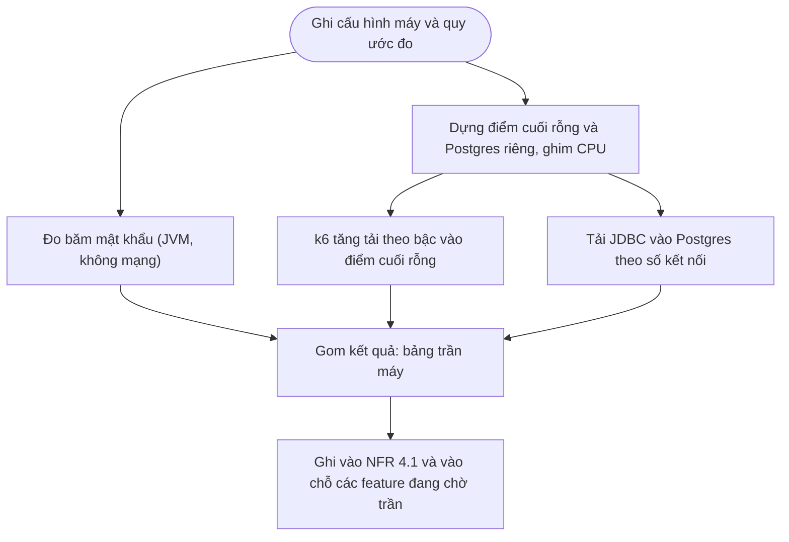

# Feature 08: Bộ đo nền

> **Trạng thái:** Đã làm `2026-10-20` · **Chặng:** C0 · **Loại:** Kỹ thuật
>
> **Nguồn:** NFR 4.1, 5.1, 5.3, roadmap C0 · **Kiểm chứng bằng:** Số trần máy cho điểm cuối rỗng, ghi cơ sở dữ liệu, băm mật khẩu
>
> **Cùng thư mục:** `plan.md` (kế hoạch), `tech.md` (giải pháp kỹ thuật, quy ước đo và kết quả), `deferred.md` (phần hoãn). Không có `nfr.md`: feature tự sinh số đo, kết quả ghi thẳng vào bảng NFR 4.1.

## 1. Mục tiêu và phạm vi

Đo **trần của máy** trước khi đo ứng dụng. Phần chênh giữa trần máy và số đo của ứng dụng là giới hạn do mã (NFR 4.1). Không có
trần thì số đo của ứng dụng không có gì để so và không kết luận được nút cổ chai nằm ở máy hay ở mã.

Ba phép đo, mỗi phép trả lời một câu hỏi:

| Phép đo | Câu hỏi | Đại lượng ở NFR 4.1 | Công cụ |
|---|---|---|---|
| Băm mật khẩu | Một máy băm được bao nhiêu mật khẩu mỗi giây, với hệ số nào? | Băm mật khẩu/giây | Đoạn Java chạy `BCryptPasswordEncoder` (cùng thư viện với `oauth2-service`) |
| Điểm cuối rỗng | Khung Spring Boot trên máy này phục vụ được bao nhiêu yêu cầu đọc rỗng mỗi giây, độ trễ bao nhiêu? | Đọc/giây | k6 (Docker) gọi một Spring Boot tối thiểu |
| Ghi một dòng | Postgres trên máy này nhận được bao nhiêu dòng ghi mỗi giây? | Ghi/giây | Tải JDBC thuần viết bằng Java vào Postgres trong container riêng |

Hai phép sau tách nhau có chủ đích: điểm cuối rỗng đo khung, ghi một dòng đo cơ sở dữ liệu. Gộp thành một điểm cuối ghi qua
HTTP thì không tách được phần do khung và phần do Postgres.

**Ngoài phạm vi:**
- Thao tác bộ đệm, giữ chỗ trên mặt hàng nóng, truy vấn tìm kiếm: NFR 4.1 chỉ đo khi hạ tầng đó được bật (chặng sau).
- Đo qua cổng (`api-gateway` tới điểm cuối rỗng) để biết cổng tốn bao nhiêu: ngoài phạm vi, chưa có nơi làm sẵn.
- Chạy lại các phép đo NFR của đăng ký, đăng nhập (feature 01, 02) và overhead của log (feature 07). Feature này chỉ
  **cung cấp trần**; mở khóa các khoản nợ đó bằng cách ghi trần vào chỗ chúng chờ, việc đo ứng dụng là bước sau của từng feature.
- Đo mở rộng 1, 2, 4 thể hiện (NFR 5.3) và đo theo tỷ lệ (NFR 5.2): cần ứng dụng thật, thuộc chặng đo tải.
- Dữ liệu quy mô lớn (3 triệu tài khoản, SKU, đơn): thuộc chặng cần chúng.

## 2. Đầu vào và đầu ra

| Phép đo | Vào | Ra | Điều kiện hợp lệ |
|---|---|---|---|
| Băm | Hệ số bcrypt (10, 11, 12), số luồng (1 đến 16), thời lượng đo | Băm/giây và thời gian một lần băm (P50, P99) theo từng số luồng | Có giai đoạn khởi động bỏ qua; chạy lặp lại, báo cả độ lệch giữa các lần |
| Điểm cuối rỗng | Số kết nối đồng thời tăng theo bậc | Yêu cầu/giây và P50, P95, P99 theo từng bậc; bậc mà độ trễ bắt đầu tăng vọt là trần | Khung và k6 có nhân riêng; có giai đoạn khởi động; không lỗi |
| Ghi một dòng | Số kết nối (1, 4, 16, 64) | Dòng/giây và P99 theo số kết nối | Postgres có nhân và RAM giới hạn; bảng sạch mỗi lần đo; bật `fsync` như cấu hình thật |

Mỗi con số ghi kèm **điều kiện đo**: cấu hình CPU và RAM của container, phiên bản Postgres và JDK, thời lượng, số lần lặp,
ngày đo. Nhãn mức chứng minh là **Đã đo** (NFR 5.1). Con số suy ra từ trần (ví dụ số lõi cần cho 700 đăng nhập/giây) ghi
**Suy ra** và nêu mô hình.

## 3. Luồng chính

## 4. Quy tắc đo

1. **Không đo trên cơ sở dữ liệu dev.** Phép ghi dùng Postgres trong container riêng của bộ đo, xóa được; không chạm dữ liệu của
   dịch vụ nào.
2. **Công cụ sinh tải và hệ thống bị đo không tranh nhân** (NFR 5.3). Ghim CPU bằng giới hạn của Docker; ghi cách ghim cạnh số.
3. **Khởi động trước, đo sau.** JVM cần làm nóng (biên dịch JIT); bỏ giai đoạn đầu khỏi kết quả.
4. **Một biến đổi một lần.** Mỗi lượt chỉ đổi một thông số (số luồng, số kết nối, hệ số); lặp lại ít nhất ba lần, báo giá trị giữa và biên độ.
5. **Trần là điểm độ trễ gãy, không phải thông lượng cao nhất.** Thông lượng cao nhất kèm P99 tăng vọt không dùng được; trần ghi là mức cao nhất
   mà P99 còn trong ngưỡng đã nêu cho phép đo.
6. **Số máy khác nhau thì không so được.** Bảng ghi cấu hình máy đo (CPU, nhân, RAM, hệ điều hành, Docker) để đọc lại về sau biết số thuộc về máy nào.

## 5. Đường lỗi

| Tình huống | Cách xử lý |
|---|---|
| Docker không đủ nhân để ghim | Giảm số nhân gán cho từng thành phần, ghi cấu hình thực tế; không âm thầm đo không ghim |
| Chênh lệch lớn giữa các lần lặp | Không báo số; tìm nguồn nhiễu (tiến trình nền, nhiệt, nguồn điện) rồi đo lại |
| k6 chạy trong Docker làm tải đi qua mạng ảo | Ghi điều kiện này cạnh số; điểm cuối rỗng chạy trên máy chủ, k6 gọi qua `host.docker.internal` |
| Bắt gặp lỗi (5xx, hết kết nối) ở bậc tải | Bậc đó không tính; trần là bậc liền trước |

## 6. Việc giao đi

- Trần băm → `01-register/nfr.md`, `02-login-session/nfr.md` (độ trễ đăng ký, đăng nhập), và quyết định hệ số băm ở `02-login-session/tech.md` (giữ 10 hay đổi).
- Trần khung → `07-error-tracing` bước đo overhead (so điểm cuối rỗng khi bật và tắt log).
- Cả ba → bảng NFR 4.1 (`6-non-function-requirement.md`).
