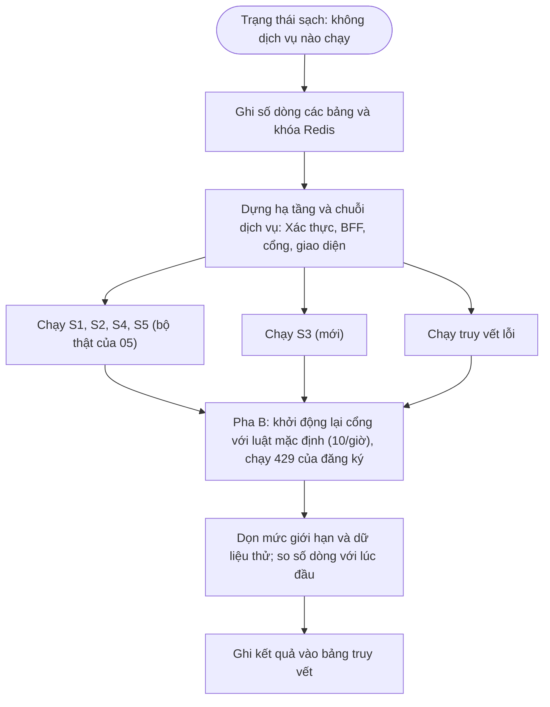

# Feature 09: Kiểm đầu-cuối cả chặng

> **Trạng thái:** Đã làm `2026-10-21` · **Chặng:** C0 · **Loại:** Kỹ thuật
>
> **Nguồn:** Roadmap C0, `stage.md` mục 4 · **Kiểm chứng bằng:** Chạy hết S1 đến S5 qua cổng trên ứng dụng thật
>
> **Cùng thư mục:** `plan.md` (kế hoạch). `tech.md` (ghi nhận từng bước) và `deferred.md` tạo khi có nội dung. Không có `nfr.md`: feature không có NFR đo riêng.

Việc dựng, chạy và gọi API thật của từng chức năng thuộc **bước "Chạy thật" trong mỗi feature**, không thuộc feature này. Feature này
chạy một lần ở cuối chặng, sau khi 01 đến 08 xong, **từ trạng thái sạch**, để bắt lỗi ở chỗ nối giữa các feature mà từng feature riêng không thấy.

## 1. Mục tiêu và phạm vi

Chứng minh năm kịch bản của chặng (`stage.md` mục 4) đúng trên hệ thống thật, đi qua cổng (`api-gateway`, cổng 8000) tới `storefront-web-bff`,
`oauth2-service` và giao diện `frontends/storefront-web`. Phần lớn đã có test thật từ feature 05; feature này không viết lại mà **gom, lấp chỗ thiếu và chạy lại từ đầu**.

| Kịch bản | Chứng minh | Đã có test thật (feature 05, `frontends/e2e-real`) | Việc của 09 |
|---|---|---|---|
| S1 | H1, H3, H4, H5 | KT-09 | Chạy lại từ trạng thái sạch |
| S2 | R1, R4, R7 | KT-10 | Chạy lại |
| S3 | R3 (INV-ATH-03) | **Chưa có qua cổng** (có ở test đơn vị của `oauth2-service`) | **Viết mới** |
| S4 | H2, H6, R6 | KT-11 | Chạy lại |
| S5 | R5 | KT-12 | Chạy lại |

Ba việc mới ngoài S3, mỗi việc kiểm một chỗ nối giữa các feature:

| Chỗ nối | Feature nối | Kiểm gì |
|---|---|---|
| Truy vết lỗi qua cổng | 06 và 07 | Một yêu cầu lỗi qua cổng trả `traceId`; tìm đúng `trace.id` đó trong log JSON của `oauth2-service` và thấy nguyên nhân (đúng yêu cầu của 07: "một yêu cầu lỗi lần ra nguyên nhân từ log") |
| Giới hạn tần suất đăng ký | 01 và 06 | Quá mức của `POST /register` ở host `auth` qua cổng trả 429 kèm `Retry-After` và thân lỗi chuẩn (luật do 06 giữ, hành vi của 01) |
| Dọn dữ liệu | mọi feature | Số dòng từng bảng và khóa Redis sau khi chạy bằng lúc bắt đầu (cách đã dùng ở 05) |

**Bảng truy vết:** một bảng ghi mỗi kịch bản S1 đến S5, mỗi bất biến INV-ATH-01 đến 11 và mỗi điều R1 đến R7 được chứng minh bằng test nào ở feature nào,
để đóng chặng.

**Ngoài phạm vi:**
- Đo tải và độ trễ (feature 08 đã có trần; đo ứng dụng thuộc từng feature).
- Viết lại test giao diện của feature 05; thêm kịch bản ngoài S1 đến S5; kiểm hành vi chưa thuộc C0 (phân quyền, khóa tài khoản, tạo tài khoản nội bộ).
- Phân tích thống kê sâu hơn thời gian phản hồi của đăng nhập (đo phía dịch vụ, nhiều lượt, nhiều mức tải): KT-22 chỉ kiểm lệch trung vị.

## 2. Đầu vào và đầu ra

| Kiểm | Vào | Ra mong đợi |
|---|---|---|
| S3 | Hai lần đăng nhập qua trang đăng nhập của Xác thực: (a) tài khoản thật, sai mật khẩu; (b) email không tồn tại | Cả hai về cùng `/login?error`, cùng thông báo trên trang; không lần nào đưa email lên địa chỉ; trung vị thời gian của 20 lần mỗi nhánh, xen kẽ, lệch dưới 30 ms (một lần băm mỗi lần) |
| Truy vết | Một yêu cầu lỗi đã biết qua cổng (ví dụ nội dung đăng ký hỏng) | 400 kèm `traceId`; log JSON của `oauth2-service` có dòng với `trace.id` đó và mã lỗi, không có mật khẩu |
| 429 | Chuỗi `POST /register` vượt mức 10 yêu cầu mỗi giờ mỗi địa chỉ mạng | Yêu cầu vượt mức: 429, `Retry-After`, thân `{success:false, code:"TOO_MANY_REQUESTS"}`; yêu cầu trong mức: bình thường |
| Dọn dữ liệu | Số dòng từng bảng và khóa Redis lúc đầu và lúc cuối | Bằng nhau (trừ dữ liệu thử có tiền tố `e2e-` đã được xóa) |

## 3. Luồng chính

## 4. Quy tắc

1. **Từ trạng thái sạch.** Không dịch vụ nào đang chạy khi bắt đầu; chuỗi được dựng bằng một script duy nhất để lần sau chạy lại được bằng một lệnh.
2. **Kiểm 429 chạy ở pha riêng.** Bộ thật cần luật đăng ký được nâng (nếu không 10 lần đăng ký mỗi giờ là hết), còn kiểm 429 cần luật mặc định; nên pha A chạy với cổng luật nâng, pha B khởi động lại cổng với luật mặc định và chạy riêng kiểm 429. Sau pha B xóa đúng khóa giới hạn trong Redis (không xóa cả Redis) để không làm hỏng lần chạy sau (`tech.md` T1.3 mục 1).
3. **Tài khoản của người dùng giữ nguyên.** `ducthinh@dev.aplus.vn` và các bản ghi không mang tiền tố `e2e-` không bị đụng; xóa dữ liệu thử chỉ theo tiền tố hoặc theo số dòng đã đếm (xóa không điều kiện bị chặn).
4. **S3 kiểm thời gian bằng trung vị của nhiều lần, xen kẽ hai nhánh**, không bằng một lần đo: nhiễu của máy lớn hơn chênh cần phát hiện (một lần băm), nên đo thẳng form đăng nhập qua cổng (không qua trình duyệt), xen kẽ hai nhánh, 20 lần mỗi nhánh, ngưỡng lệch trung vị 30 ms (`tech.md` T3).
5. **Phá thử:** với S3, phá cơ chế (cho sai email chuyển về địa chỉ khác, hoặc bỏ bước băm giả) rồi xác nhận test đỏ, để chắc test thật sự bắt được lỗi.
6. **Test chạy trên cơ sở dữ liệu dev** (Postgres, Redis, Kafka): báo trước, dữ liệu thử có tiền tố `e2e-`.

## 5. Đường lỗi

| Tình huống | Cách xử lý |
|---|---|
| Một kịch bản đỏ | Tìm lỗi ở chỗ nối (cấu hình giữa dịch vụ, host, cookie, header), sửa ở feature sở hữu, ghi vào Session Log của 09; không vá riêng trong 09 |
| Dịch vụ không lên (cổng chiếm, JDK sai) | Script dừng và báo dịch vụ nào; JDK 21 tại `C:\Program Files\Java\jdk-21` (mặc định máy là 1.8) |
| Mức giới hạn còn sót lần chạy trước | Script xóa khóa giới hạn trước khi bắt đầu |
| Dữ liệu lệch sau khi dọn | Báo bảng và số dòng lệch, không âm thầm bỏ qua |

## 6. Việc giao đi

Lỗi tìm thấy ở chỗ nối được giao về feature sở hữu (06 cho cổng, 02 và 03 cho phiên, 05 cho giao diện...) và ghi vào `deferred.md` của feature đó nếu không sửa trong chặng.
