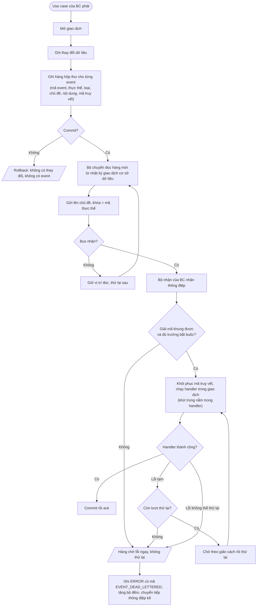

# Feature 01: Hộp thư event và bus

> **Trạng thái:** Thiết kế (bước 5) · **Chặng:** C1a · **Loại:** Kỹ thuật
>
> **Nguồn:** Roadmap C1a (hạ tầng), `tech-stack.md`, `4. communication.md`, `idempotency-layering.md`, `5. event-catalog.md` · **Kiểm chứng bằng:** R12 (ghi cùng giao dịch); event đến bus ít nhất một lần; bên nhận khử trùng; hàng chờ lỗi kèm cảnh báo; thứ tự theo thực thể
>
> **Cùng thư mục:** `tech.md` (giải pháp kỹ thuật, câu hỏi đã chốt), `plan.md` (kế hoạch). Quyết định đúng cho mọi BC nằm ở ADR-0008.

## 1. Mục tiêu và phạm vi

C0 chưa gửi event nào ra ngoài. Từ C1a, ba BC nói chuyện với nhau bằng event: Người bán báo kết quả duyệt cho Danh mục hàng, Người bán và Danh mục hàng gửi bản ghi hành động cho Nhật ký kiểm toán (`stage.md` mục 5). Hai điều phải đúng ở **mọi** luồng đó, nên làm một lần dùng chung:

1. **Phát đúng:** thay đổi dữ liệu và event của nó cùng thành công hoặc cùng không (R12). Đã commit thì event nhất định đến bus; chưa commit thì không có event.
2. **Nhận đúng:** bên nhận không mất event, không xử lý trùng làm sai dữ liệu, và một event hỏng không chặn các event sau.

Feature này làm phần chung, chưa có nghiệp vụ nào. Gồm:

| Phần | Việc |
|---|---|
| Phát | Hộp thư event trong cơ sở dữ liệu của BC phát; ghi cùng giao dịch với thay đổi; chuyển ra bus theo thứ tự của từng thực thể |
| Hợp đồng thông điệp | Khung chung của mọi event (mã, loại, thời điểm, mã truy vết, phiên bản hợp đồng, nội dung); khóa thông điệp |
| Nhận | Bộ nhận event dùng chung: giải mã khung, khôi phục mã truy vết, ack sau khi xử lý xong, thử lại có giãn cách, hàng chờ lỗi, cảnh báo |
| Khử trùng | Quy tắc và bộ kiểm cho bên nhận (cách khử trùng là của từng BC; thư viện không giữ bảng chung) |
| Hạ tầng dev | Cấu hình bộ chuyển hộp thư ra bus cho từng cơ sở dữ liệu của BC phát; script đăng ký |

Ngoài phạm vi:
- Nội dung nghiệp vụ của từng event (EVT-SEL-*, EVT-CAT-*, `AuditActionRecorded`): thuộc feature 03, 04, 05, 09 và 02.
- Dọn hàng đã chuyển khỏi hộp thư: roadmap hoãn tới C2b (Lập lịch).
- Schema Registry, Avro: hướng sau (`tech-stack.md`). Định dạng event ở C1a là JSON.
- RabbitMQ cho thông báo: quyết ở C2a.

## 2. Đầu vào và đầu ra

| Phần | Vào | Ra khi thành công | Ra khi lỗi |
|---|---|---|---|
| Phát | Use case của BC phát, trong một giao dịch: thay đổi dữ liệu và danh sách event của aggregate | Một hàng hộp thư mỗi event, cùng commit với thay đổi | Giao dịch rollback thì không còn hàng hộp thư nào; gọi ghi hộp thư ngoài giao dịch bị từ chối ngay |
| Chuyển ra bus | Hàng mới trong hộp thư | Thông điệp trên chủ đề đã khai báo, khóa là mã thực thể, đến bus ít nhất một lần | Bộ chuyển hoặc bus tạm hỏng: hàng nằm lại, chuyển tiếp khi hồi phục; không mất, có thể trùng |
| Nhận | Thông điệp từ bus | Handler của BC chạy một lần có hiệu lực; ack sau khi giao dịch của handler commit | Lỗi tạm: thử lại giãn cách. Hết lượt, hoặc lỗi không thể thử lại (sai khung, thiếu trường): sang hàng chờ lỗi, ghi lỗi mức ERROR có mã cố định, các thông điệp sau vẫn chạy |
| Khử trùng | Cùng một event tới lần thứ hai | Hiệu lực như lần đầu, không thêm gì | Không có |

## 3. Luồng chính

Khử trùng không là một nút riêng vì nằm trong handler: handler nhận event lần hai ra cùng kết quả như lần đầu (ràng buộc duy nhất ở lưu trữ, hoặc ghi giá trị tuyệt đối kèm phiên bản).

## 4. Đường không suôn sẻ

| # | Tình huống | Hành vi cần có |
|---|---|---|
| E1 | Use case lỡ gọi ghi hộp thư ngoài giao dịch | Từ chối ngay bằng lỗi lập trình, không im lặng tự mở giao dịch riêng (sẽ phá R12) |
| E2 | Hai event cùng một thực thể trong một giao dịch | Cả hai vào hộp thư; thứ tự trên bus đúng thứ tự ghi |
| E3 | Bộ chuyển dừng giữa chừng rồi chạy lại | Có thể gửi lại event đã gửi: bên nhận khử trùng. Không bỏ sót |
| E4 | Bus hoặc bộ chuyển hỏng lâu | Hộp thư tích lại; chuyển tiếp đủ và đúng thứ tự khi hồi phục. Cảnh báo theo độ trễ chưa có ở C1a (không có hạ tầng báo); phát hiện bằng mắt qua số hàng chưa chuyển, ghi vào `deferred.md` khi đóng |
| E5 | Thông điệp sai khung hoặc thiếu trường | Hàng chờ lỗi ngay; các thông điệp khác không bị chặn |
| E6 | Cơ sở dữ liệu của bên nhận tạm hỏng | Thử lại giãn cách; hết lượt thì hàng chờ lỗi và cảnh báo |
| E7 | Event tới sai thứ tự (hàng chờ lỗi xử lý lại muộn, cùng thực thể) | Handler không dựa vào thứ tự mà vào phiên bản trong nội dung hoặc giá trị tuyệt đối (quy tắc cho từng BC) |
| E8 | Nội dung event chứa dữ liệu định danh | Không được: nội dung do BC phát khai báo, thư viện chỉ cấm tên trường thuộc danh sách dữ liệu định danh khi dựng khung (`logging.md`) |
| E9 | Mã truy vết của yêu cầu gốc | Đi theo event từ hộp thư tới handler, để log của hai bên nối được |
