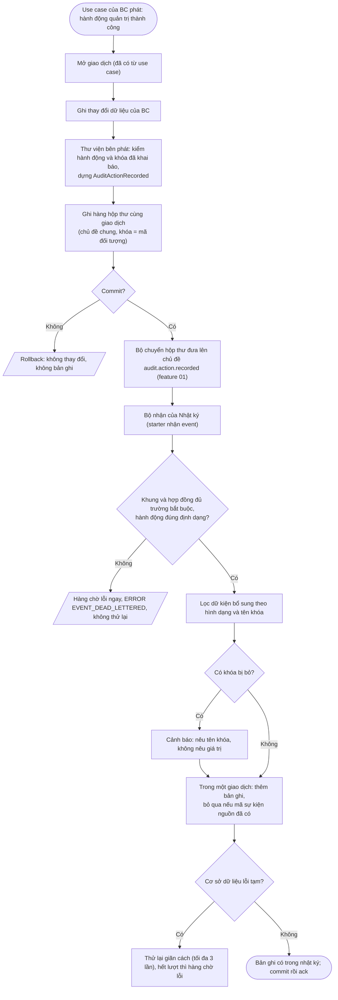
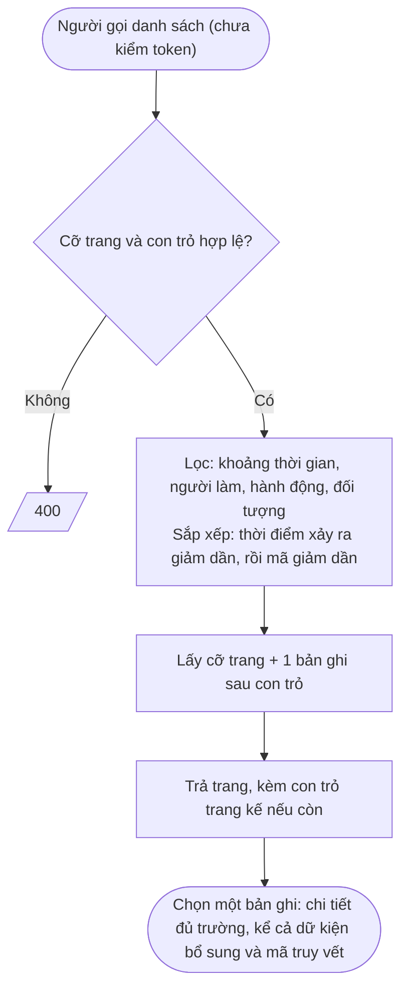

# Feature 02: Nhật ký kiểm toán

> **Trạng thái:** Thiết kế (bước 5) · **Chặng:** C1a · **Loại:** Nghiệp vụ
>
> **Nguồn:** CAP-AUD-01, CAP-AUD-02 (`audit-service/analysis.md`) · **Kiểm chứng bằng:** S8 (phần ghi và tra cứu; chuỗi đầu-cuối với Người bán ở feature 13), S9 (phần tra cứu); R11, R13; INV-AUD-01 đến 05, 07 đến 09 (INV-AUD-06 hoãn, `tech.md` T8)
>
> **Cùng thư mục:** `tech.md` (giải pháp kỹ thuật, câu hỏi cần chốt), `plan.md` (kế hoạch). Quyết định đúng cho mọi BC: ADR-0008 (hộp thư, nhận event), ADR-0009 (bất biến ở lưu trữ).

## 1. Mục tiêu và phạm vi

Quản trị cần trả lời sau này: *ai, lúc nào, làm gì, lên đối tượng nào*, cho các quyết định có hậu quả (duyệt hay từ chối hồ sơ người bán, quản danh mục, thuộc tính, thương hiệu). Câu trả lời không được đổi sau khi đã ghi, và không được chứa dữ liệu định danh.

Feature gồm bốn phần, làm theo thứ tự A → D. Mỗi phần quan sát và kiểm chứng được riêng.

| Phần | Nội dung | Quan sát được | Kiểm chứng |
|---|---|---|---|
| **A. Hợp đồng và bên phát** | Hợp đồng bản ghi `AuditActionRecorded`; thư viện nhỏ cho BC phát dựng bản ghi đúng hợp đồng và ghi vào hộp thư cùng giao dịch | BC phát gọi một hàm, có một hàng hộp thư khớp hợp đồng; hành động hay khóa chưa khai báo bị từ chối ngay | INV-AUD-09 (phía phát), R12 |
| **B. Nhận và lưu bất biến** | Dịch vụ `audit-service`; bộ nhận bản ghi; kiểm đủ trường, định dạng hành động, lọc dữ kiện bổ sung; lưu một lần; bảng chỉ ghi thêm | Bản ghi vào bảng đúng một lần dù nhận lặp; không có đường sửa hay xóa | INV-AUD-01 đến 05, 07; R11, R13 |
| **C. Tra cứu** | Danh sách có lọc, mới nhất trước, phân trang theo con trỏ; chi tiết một bản ghi; chưa kiểm token và vai (hoãn) | Bản ghi vừa ghi thấy được, lọc được, duyệt hết không lặp không sót | RM-AUD-01, 02 |
| **D. Chạy thật** | Hộp thư của một bên phát thử → bus → Nhật ký → cơ sở dữ liệu → API | Một hành động đi hết chuỗi, đo độ trễ | INV-AUD-09 |

Ngoài phạm vi:
- Các BC phát cụ thể (Người bán, Danh mục hàng) gọi thư viện bên phát: feature 04 và 05, 09. Feature này chỉ cung cấp thư viện và chứng minh bằng bên phát thử; chuỗi đầu-cuối với BC thật ở feature 13.
- Giao diện tra cứu cho Quản trị: feature 12. Cổng truy cập và route cho Nhật ký: feature 10.
- Kiểm token và vai `ADMIN` (INV-AUD-06): hoãn tới khi có mô-đun phân quyền. Ở feature này API không đòi đăng nhập, chỉ chạy trong mạng dev, chưa có route ở cổng truy cập (`tech.md` T8).
- Hành động của chặng sau (khóa, mở tài khoản; chặn, mở sản phẩm): C1b. Chính sách lưu trữ, dọn, chuỗi băm, ghi lại việc xem nhật ký: chưa làm (`analysis.md` mục 12).

## 2. Đầu vào và đầu ra

| Phần | Vào | Ra khi thành công | Ra khi lỗi |
|---|---|---|---|
| A. Bên phát | Hành động thành công trong use case của BC phát: người làm, hành động, đối tượng, dữ kiện bổ sung | Một hàng hộp thư cùng giao dịch với hành động, khóa thông điệp là mã đối tượng | Hành động chưa khai báo, khóa dữ kiện chưa khai báo, thiếu trường: lỗi lập trình, từ chối ngay; gọi ngoài giao dịch: từ chối (ADR-0008) |
| B. Nhận | Thông điệp `AuditActionRecorded` trên chủ đề chung | Một bản ghi; nhận lặp thì bỏ qua êm | Thiếu trường bắt buộc, sai định dạng hành động: không lưu, hàng chờ lỗi ngay, cảnh báo, không chặn thông điệp sau. Lỗi tạm của cơ sở dữ liệu: thử lại giãn cách |
| C. Tra cứu | Bộ lọc, con trỏ, cỡ trang (chưa kiểm token) | Trang bản ghi mới nhất trước kèm con trỏ trang kế; chi tiết một bản ghi | Cỡ trang quá trần hoặc con trỏ sai: 400; không có kết quả: danh sách rỗng; mã bản ghi không có: 404 |

## 3. Luồng chính

### 3.1 Ghi

### 3.2 Tra cứu

Việc tra cứu không ghi gì vào nhật ký (`analysis.md` mục 12). Bước kiểm token và vai `ADMIN` (401, 403) chưa có ở feature này.

## 4. Đường không suôn sẻ

| # | Tình huống | Hành vi cần có |
|---|---|---|
| E1 | Nhật ký tạm không nhận được | Bản ghi nằm ở hộp thư của bên phát, đến bù khi Nhật ký lên lại: chậm, không mất (INV-AUD-09; chứng minh ở feature 01 và phần D) |
| E2 | Nhận cùng bản ghi hai lần (bên phát chuyển lại, hay giao lại sau khi chưa ack) | Bỏ qua êm, đúng một bản ghi; thử cả hai lần đồng thời (INV-AUD-02) |
| E3 | Thông điệp thiếu trường bắt buộc, sai kiểu, hành động sai định dạng | Không lưu; hàng chờ lỗi ngay; cảnh báo; thông điệp sau cùng phân vùng vẫn chạy (INV-AUD-03, 07) |
| E4 | Hành động lạ nhưng đúng định dạng | Vẫn nhận và lưu (INV-AUD-07): thêm hành động ở BC phát không cần đổi Nhật ký |
| E5 | Dữ kiện bổ sung mang khóa thuộc loại dữ liệu định danh | Bỏ khóa đó, vẫn lưu bản ghi, cảnh báo nêu tên khóa không nêu giá trị (INV-AUD-04, R11) |
| E6 | Dữ kiện bổ sung không phẳng (lồng nhau), quá nhiều khóa, khóa hay giá trị quá dài | Bỏ phần vi phạm, vẫn lưu, cảnh báo (INV-AUD-04) |
| E7 | Đồng hồ hai BC lệch | Thời điểm xảy ra giữ theo giờ BC phát, thời điểm nhận giữ giờ Nhật ký; không sửa |
| E8 | Có người (hay lỗi mã) cố sửa, xóa bản ghi | Từ chối ở cơ sở dữ liệu cho cả tài khoản dịch vụ và chủ bảng; API không có điểm cuối ghi (INV-AUD-01, ADR-0009) |
| E9 | Hai bản ghi cùng thời điểm xảy ra | Thứ tự phụ theo mã ổn định; duyệt hết các trang không lặp, không sót (`analysis.md` mục 10) |
| E10 | Người làm đổi vai hay bị khóa sau đó | Bản ghi giữ vai và mã tại thời điểm làm; không tra lại (INV-AUD-05) |
| E11 | Cơ sở dữ liệu của Nhật ký tạm hỏng khi nhận | Thử lại giãn cách (tối đa 3 lần, ADR-0008); hết lượt thì hàng chờ lỗi, cảnh báo; bản ghi chưa vào nhật ký, cần người xử lý |
| E12 | Quản trị lọc theo khoảng thời gian rất rộng | Phân trang theo con trỏ, trần cỡ trang; không có truy vấn quét cả bảng một lần |
