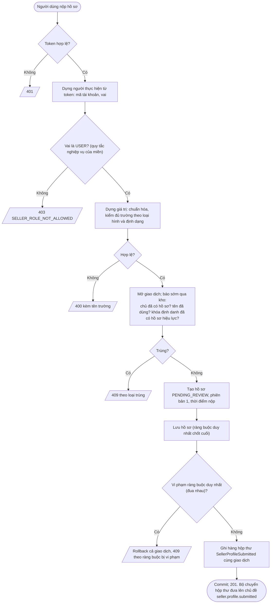
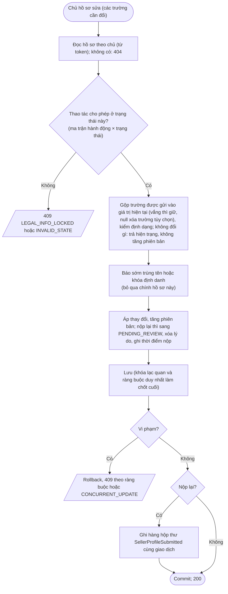

# Feature 03: Nộp và sửa hồ sơ người bán

> **Trạng thái:** Thiết kế (bước 5) · **Chặng:** C1a · **Loại:** Nghiệp vụ
>
> **Nguồn:** CAP-SEL-01, CAP-SEL-02 (`seller-service/analysis.md` mục 6) · **Kiểm chứng bằng:** S4, S2 (nửa nộp lại) · R1, R2, R11 · INV-SEL-01, 04, 08, 09, 10, 11 (INV-SEL-02 phần các chuyển đổi của feature này; INV-SEL-05 phần nộp và sửa)
>
> **Cùng thư mục:** `tech.md` (giải pháp kỹ thuật, câu hỏi cần chốt), `plan.md` (kế hoạch, viết sau khi chốt câu hỏi). Quyết định đúng cho mọi BC: ADR-0001 (UUID v7), ADR-0008 (hộp thư, nhận event), ADR-0003 (hợp đồng danh tính).

## 1. Mục tiêu và phạm vi

Một người dùng đã đăng nhập xin được bán: khai loại hình, thông tin pháp lý và thông tin gian hàng; sau đó xem hồ sơ của mình, sửa khi còn sửa được, và sửa rồi nộp lại khi bị từ chối. Sàn giữ các quy tắc "một chủ, một tên, một chủ thể pháp lý chỉ một gian hàng hiệu lực" kể cả khi hai người đua nhau.

Feature gồm bốn phần, làm theo thứ tự A → D. Mỗi phần quan sát và kiểm chứng được riêng.

| Phần | Nội dung | Quan sát được | Kiểm chứng |
|---|---|---|---|
| **A. Miền** | Hồ sơ người bán (một aggregate), giá trị chuẩn hóa và kiểm định dạng, chuyển đổi trạng thái của feature này | Hồ sơ hợp lệ dựng được; dữ liệu sai bị từ chối ngay với tên trường; chuyển đổi sai bị từ chối | INV-SEL-02, 08, 10 (phần miền) |
| **B. Lưu trữ và tính duy nhất** | Dịch vụ `seller-service`, cơ sở dữ liệu riêng, hộp thư event, ràng buộc duy nhất làm chốt cuối, khóa lạc quan | Hai yêu cầu đua nhau cùng tên, cùng khóa định danh, cùng chủ: đúng một thành công | INV-SEL-01, 04, 09; R1, R2 |
| **C. API** | Nộp, hồ sơ của tôi, sửa gian hàng, sửa pháp lý, sửa và nộp lại; xác thực token, chủ hồ sơ lấy từ token | Gọi được từng thao tác; dữ liệu định danh không rò ra log và event | INV-SEL-05 (nộp, sửa), 11; R11 |
| **D. Chạy thật** | Postgres riêng (`wal_level=logical`), connector hộp thư, Kafka, ứng dụng chạy thật | Một lần nộp đi hết chuỗi đến chủ đề `seller.profile.submitted`; đua nhau trên cơ sở dữ liệu thật | S4, R12 phía phát |

Ngoài phạm vi:
- Duyệt, từ chối, danh sách chờ duyệt, chi tiết cho quản trị, `SellerProfileApproved`, `SellerProfileRejected`, bản ghi kiểm toán: feature 04. Hồ sơ `REJECTED` cần cho "sửa và nộp lại" được dựng trực tiếp trong test của feature này, không qua hành vi từ chối.
- Cổng truy cập, route và BFF cho ứng dụng Người bán: feature 10. Giao diện: feature 11.
- Khóa, mở, rút lại hồ sơ, tệp đính kèm, mã hóa cột, xác minh điện tử: chưa làm (`analysis.md` mục 13).

## 2. Đầu vào và đầu ra

| Phần | Vào | Ra khi thành công | Ra khi lỗi |
|---|---|---|---|
| Nộp | Token (mã tài khoản; vai `USER` do miền kiểm); loại hình, thông tin pháp lý, thông tin gian hàng | 201, hồ sơ `PENDING_REVIEW` (đủ trường, kể cả pháp lý, vì là chủ hồ sơ); một hàng hộp thư `SellerProfileSubmitted` cùng giao dịch | 400 thiếu hoặc sai định dạng; 409 đã có hồ sơ, trùng tên, trùng khóa định danh; 401, 403 `SELLER_ROLE_NOT_ALLOWED` |
| Hồ sơ của tôi | Token | 200 hồ sơ đủ trường, lý do từ chối gần nhất nếu có | 404 chưa là người bán; 401 |
| Sửa thông tin gian hàng | Token, các trường cần đổi (một phần) | 200, trạng thái giữ | 400; 409 trùng tên, sai trạng thái, xung đột đồng thời; 404; 401, 403 |
| Sửa pháp lý, loại hình | Token, các trường cần đổi (một phần) | 200, khóa định danh tính lại | 400; 409 đã được duyệt, trùng khóa, sai trạng thái, phiên bản cũ; 404; 401, 403 |
| Sửa và nộp lại | Token, toàn bộ trường | 200, `PENDING_REVIEW`, lý do từ chối bị xóa; một hàng hộp thư `SellerProfileSubmitted` | như nộp, cộng 409 sai trạng thái, xung đột đồng thời |

## 3. Luồng chính

### 3.1 Nộp hồ sơ

### 3.2 Sửa

### 3.3 Hồ sơ của tôi

Token → đọc hồ sơ theo mã tài khoản → trả đủ trường (kể cả pháp lý, vì là chủ hồ sơ) kèm `status`, lý do từ chối gần nhất. Chưa có hồ sơ: 404 `SELLER_PROFILE_NOT_FOUND`, giao diện hiểu là "chưa là người bán". Đọc không ghi gì, không phát event.

## 4. Đường không suôn sẻ

| # | Tình huống | Hành vi cần có |
|---|---|---|
| E1 | Nộp khi tài khoản đã có hồ sơ (bất kỳ trạng thái), kể cả bấm hai lần hay mạng chậm | 409 `SELLER_PROFILE_EXISTS`; không tạo hồ sơ thứ hai; nếu hồ sơ đang `REJECTED` thì thông báo chỉ dẫn dùng "sửa và nộp lại"; hai yêu cầu đồng thời: đúng một hồ sơ (INV-SEL-01) |
| E2 | Tên gian hàng đã dùng, kể cả khác dấu, khác chữ hoa, thừa khoảng trắng | 409 `SHOP_NAME_TAKEN`; hai người đua cùng tên: người sau nhận lỗi, không có hai hồ sơ cùng khóa tên (INV-SEL-04) |
| E3 | Khóa định danh đã có hồ sơ hiệu lực của tài khoản khác | 409 `IDENTITY_ALREADY_REGISTERED`, thông báo chung không nói hồ sơ của ai; hai tài khoản đua cùng khóa: đúng một thành công (INV-SEL-09) |
| E4 | Khóa định danh trùng với hồ sơ `REJECTED` của người khác | Cho nộp: hồ sơ bị từ chối không giữ khóa (INV-SEL-09) |
| E5 | Thiếu thông tin pháp lý theo loại hình (ví dụ doanh nghiệp thiếu người đại diện hay mã số thuế) | 400 `LEGAL_INFO_REQUIRED` kèm tên trường thiếu (INV-SEL-08) |
| E6 | Số căn cước không đủ 12 chữ số, mã số thuế không đủ 10 hoặc 13 chữ số | 400 `INVALID_IDENTITY_NUMBER` hoặc `INVALID_TAX_CODE` |
| E7 | Tên gian hàng ngoài 3 đến 60 ký tự sau khi bỏ khoảng trắng thừa, mô tả quá 500, số điện thoại không phải số Việt Nam, địa chỉ ngoài 10 đến 300 | 400 kèm tên trường |
| E8 | Tài khoản `ADMIN` nộp hoặc sửa | 403 `SELLER_ROLE_NOT_ALLOWED` do miền từ chối (quy tắc nghiệp vụ, INV-SEL-05), không tạo gì, không event |
| E9 | Không có token, token hết hạn hoặc sai chữ ký | 401 |
| E10 | Sửa hồ sơ của người khác | Không xảy ra qua API: hồ sơ chọn theo mã tài khoản trong token, không nhận mã hồ sơ từ người gọi; hồ sơ không thuộc mình không tồn tại với mình (404) |
| E11 | Sửa pháp lý hay loại hình khi đã `APPROVED` | 409 `LEGAL_INFO_LOCKED` (INV-SEL-10) |
| E12 | Sửa thông tin gian hàng khi `REJECTED`; nộp lại khi `PENDING_REVIEW` hoặc `APPROVED`; sửa pháp lý khi `REJECTED` | 409 `INVALID_STATE` (INV-SEL-02; sửa khi bị từ chối chỉ qua "sửa và nộp lại") |
| E13 | Hai thao tác sửa từ hai thiết bị của cùng chủ | Sửa hai trường khác nhau: cả hai được giữ (`PATCH` một phần). Chạm nhau đúng lúc (cùng đọc một bản, cùng ghi): một bên thành công, bên kia nhận 409 `CONCURRENT_UPDATE` và thử lại; không ghi đè im lặng bằng bản đã cũ |
| E14 | Sửa nhưng không đổi gì | 200 trả hiện trạng, không tăng phiên bản, không event |
| E15 | Nộp lại rồi đổi sang khóa định danh đã bị người khác dùng trong lúc hồ sơ ở `REJECTED` | 409 `IDENTITY_ALREADY_REGISTERED` (kiểm lại lúc nộp lại) |
| E16 | Bộ chuyển hộp thư hay Kafka tạm hỏng sau commit | Hàng hộp thư nằm lại, đến bù khi chạy lại: chậm, không mất (feature 01); chưa ai nhận `SellerProfileSubmitted` ở C1a |
| E17 | Giao dịch rollback (ví dụ vi phạm duy nhất lúc lưu) | Không hồ sơ, không hàng hộp thư (R12) |
| E18 | Số căn cước, mã số thuế, địa chỉ kinh doanh vào log, thông báo lỗi, event, `toString` | Không bao giờ (INV-SEL-11, R11); thông báo lỗi nêu tên trường, không nêu giá trị |
