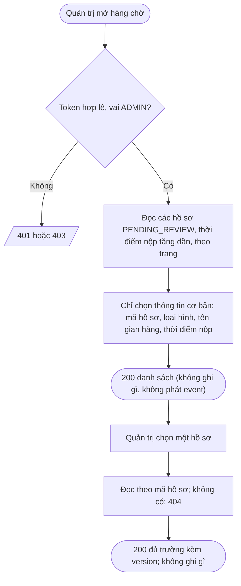
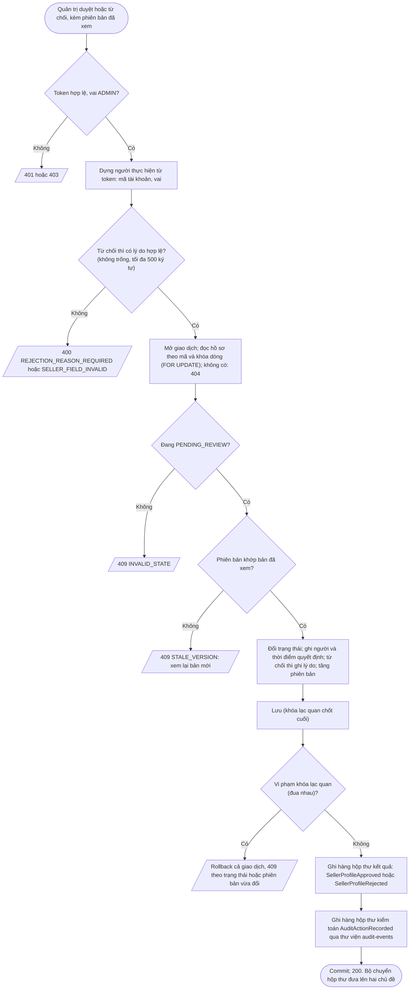

# Feature 04: Duyệt hồ sơ người bán

> **Trạng thái:** Đã làm `2026-10-31` · **Chặng:** C1a · **Loại:** Nghiệp vụ
>
> **Nguồn:** CAP-SEL-03 (`seller-service/analysis.md` mục 6) · **Kiểm chứng bằng:** S2 (nửa từ chối và duyệt), S6 (nửa quản trị), S7, S8 (phía phát) · R3, R4, R5, R6, R11, R12 · INV-SEL-02 (hai chuyển đổi còn lại), 03, 05 (duyệt, từ chối), 06, 07, 11 (danh sách, chi tiết)
>
> **Cùng thư mục:** `tech.md` (giải pháp kỹ thuật, câu hỏi cần chốt), `plan.md` (kế hoạch, viết sau khi chốt câu hỏi). Quyết định liên quan: ADR-0008 (hộp thư), ADR-0011 (khóa lạc quan, `STALE_VERSION`), ADR-0003 (hợp đồng danh tính). Hợp đồng bản ghi kiểm toán: feature 02.

## 1. Mục tiêu và phạm vi

Quản trị xem hàng chờ duyệt, mở một hồ sơ để đối chiếu, rồi duyệt hoặc từ chối kèm lý do. Quyết định áp lên đúng bản mà quản trị đã xem, và chỉ thành công cùng với dấu vết kiểm toán của nó. Người bán thấy kết quả khi mở "Hồ sơ của tôi" (feature 03); Danh mục hàng nhận trạng thái qua event.

Feature gồm bốn phần, làm theo thứ tự A → D. Mỗi phần quan sát và kiểm chứng được riêng.

| Phần | Nội dung | Quan sát được | Kiểm chứng |
|---|---|---|---|
| **A. Miền** | Hai chuyển đổi `PENDING_REVIEW → APPROVED` và `PENDING_REVIEW → REJECTED`; ghi người và thời điểm quyết định, lý do từ chối; kiểm phiên bản đã xem | Duyệt, từ chối đúng trạng thái và đúng phiên bản thì đổi; sai thì bị từ chối với mã lỗi riêng; từ chối thiếu lý do bị từ chối | INV-SEL-02, 03, 06 |
| **B. Quyết định và dấu vết** | Đổi trạng thái, ghi `SellerProfileApproved` hoặc `SellerProfileRejected`, ghi `AuditActionRecorded`, tất cả **một** giao dịch | Không có quyết định mà thiếu dấu vết, và ngược lại; hai quản trị cùng bấm: đúng một thành công | INV-SEL-07; R3, R12 |
| **C. Đọc và API** | Danh sách chờ duyệt (che dữ liệu định danh), chi tiết đầy đủ kèm phiên bản, duyệt, từ chối; vai `ADMIN` | Danh sách cũ nhất trước; người thường bị chặn; không có dữ liệu định danh ở danh sách, log, event | INV-SEL-05, 11; R6, R11 |
| **D. Chạy thật** | Postgres riêng, connector hộp thư, Kafka, ứng dụng chạy thật (không dựng `audit-service`, xem `tech.md` T9) | Một lần duyệt ra hai thông điệp (`seller.profile.approved`, `audit.action.recorded`); đua nhau trên cơ sở dữ liệu thật | S2, S7, S8 phía phát, R12 |

Ngoài phạm vi:
- Cổng truy cập, route và BFF cho ứng dụng Vận hành: feature 10. Giao diện duyệt: feature 11.
- Danh mục hàng nhận `SellerProfileApproved` và `SellerProfileRejected` để dựng bản sao trạng thái người bán: chưa gán feature nào trong `00-features.md` (feature 09 phụ thuộc 04 nên là ứng viên, cần xác nhận). Ở đây chỉ phát.
- Truy vấn nhật ký cho quản trị: feature 02 đã có. Ghi nhật ký lượt xem chi tiết hồ sơ: chưa làm (`analysis.md` mục 10).
- Khóa, mở người bán; thông báo cho người bán qua thư; duyệt hàng loạt: chưa làm (`analysis.md` mục 13).

## 2. Đầu vào và đầu ra

| Phần | Vào | Ra khi thành công | Ra khi lỗi |
|---|---|---|---|
| Danh sách chờ duyệt | Token `ADMIN`; trang | 200 các hồ sơ `PENDING_REVIEW`, cũ nhất (thời điểm nộp) trước; mỗi dòng: mã hồ sơ, loại hình, tên gian hàng, thời điểm nộp; **không** có dữ liệu định danh nào (số căn cước, mã số thuế, địa chỉ kinh doanh, tên pháp lý), kể cả bản che | 401; 403 |
| Chi tiết một hồ sơ chờ duyệt | Token `ADMIN`; mã hồ sơ | 200 đủ trường kèm `version` để quyết định đúng bản; mọi trạng thái đều xem được, kèm `status`, `reviewedAt`, lý do từ chối | 404 không có hồ sơ; 401; 403 |
| Duyệt | Token `ADMIN`; mã hồ sơ, phiên bản đã xem | 200 hồ sơ `APPROVED`, người và thời điểm quyết định; hai hàng hộp thư: `SellerProfileApproved`, `AuditActionRecorded` | 404; 409 `INVALID_STATE`; 409 `STALE_VERSION`; 400 thiếu phiên bản; 401; 403 |
| Từ chối | Token `ADMIN`; mã hồ sơ, phiên bản đã xem, lý do | 200 hồ sơ `REJECTED` kèm lý do; hai hàng hộp thư: `SellerProfileRejected`, `AuditActionRecorded` | như duyệt, cộng 400 `REJECTION_REASON_REQUIRED` |

Chi tiết trả hồ sơ ở mọi trạng thái (đề xuất Q5 của `tech.md`, chờ xác nhận); chỉ lệnh duyệt và từ chối mới kiểm trạng thái.

## 3. Luồng chính

### 3.1 Xem hàng chờ và chi tiết

### 3.2 Duyệt hoặc từ chối

## 4. Đường không suôn sẻ

| # | Tình huống | Hành vi cần có |
|---|---|---|
| E1 | Hai quản trị cùng bấm duyệt (hoặc một duyệt, một từ chối) cùng hồ sơ | Đúng một thành công; người sau chờ ở khóa dòng rồi nhận 409 `INVALID_STATE` (không còn `CONCURRENT_UPDATE` ở lệnh quản trị); không có hai bộ event, không có hai bản ghi kiểm toán (INV-SEL-02, R3) |
| E2 | Duyệt hồ sơ đã `APPROVED`, từ chối hồ sơ đã `APPROVED`, hay duyệt hồ sơ `REJECTED` | 409 `INVALID_STATE`; không đổi gì, không event (R3) |
| E3 | Người bán sửa hồ sơ sau khi quản trị mở chi tiết, rồi quản trị bấm duyệt kèm phiên bản cũ | 409 `STALE_VERSION`; hồ sơ không đổi; quản trị mở lại thấy bản mới (INV-SEL-06, R4, S7) |
| E4 | Từ chối không có lý do, lý do toàn khoảng trắng, hay quá 500 ký tự | 400 kèm tên trường; không đổi gì (INV-SEL-03, R5) |
| E5 | Thiếu phiên bản đã xem trong yêu cầu duyệt hoặc từ chối | 400 kèm tên trường; không đoán là bản mới nhất (INV-SEL-06) |
| E6 | Người dùng thường (`USER`) hoặc người không có vai gọi danh sách, chi tiết, duyệt, từ chối | 403 `SELLER_ROLE_NOT_ALLOWED` do miền hoặc use case từ chối (vai là quy tắc nghiệp vụ, cùng cách với feature 03); không đọc kho (INV-SEL-05, R6, S6) |
| E7 | Không có token, token hết hạn hoặc sai chữ ký | 401 |
| E8 | Mã hồ sơ không tồn tại, hoặc sai định dạng | 404 `SELLER_PROFILE_NOT_FOUND`, hoặc 400 nếu không phải UUID |
| E9 | Chủ hồ sơ là chính quản trị (tài khoản vừa là chủ vừa duyệt) | Không xảy ra: vai `ADMIN` không nộp được hồ sơ (feature 03, E8), nên không có hồ sơ của quản trị để tự duyệt |
| E10 | Mở chi tiết hồ sơ không còn `PENDING_REVIEW` (đã quyết định từ trước, hoặc đã nộp lại sau từ chối) | Trả chi tiết kèm `status` để quản trị thấy vì sao không duyệt được; lệnh duyệt, từ chối mới trả 409 `INVALID_STATE` (đề xuất Q5) |
| E11 | Lưu thành công nhưng ghi hộp thư (kết quả hoặc kiểm toán) lỗi | Rollback cả giao dịch: hồ sơ giữ nguyên trạng thái cũ, không hàng hộp thư nào (INV-SEL-07, R12) |
| E12 | Hành động kiểm toán hay khóa dữ kiện chưa khai báo trong danh mục của thư viện | Thư viện ném lỗi, giao dịch rollback: không quyết định mà thiếu dấu vết (R12). Lỗi này là lỗi lập trình, được bắt bằng test, không phải đường người dùng |
| E13 | Bộ chuyển hộp thư hay Kafka tạm hỏng sau commit | Hàng hộp thư nằm lại, đến bù khi chạy lại: chậm, không mất (feature 01). Người bán thấy kết quả ngay ở "Hồ sơ của tôi" vì đọc thẳng cơ sở dữ liệu; Danh mục chậm vài giây chấp nhận được (`analysis.md` mục 6) |
| E14 | Số căn cước, mã số thuế, địa chỉ kinh doanh, lý do từ chối | Không vào log; không vào `SellerProfileApproved`, `SellerProfileRejected`; lý do từ chối **chỉ** vào bản ghi kiểm toán (đã khai báo là dữ kiện), không vào event kết quả; danh sách không có các trường này (INV-SEL-11, R11) |
| E15 | Hồ sơ bị từ chối rồi người khác nộp cùng khóa định danh | Cho nộp: hồ sơ `REJECTED` không giữ khóa; chỉ mục duy nhất một phần đã đảm bảo từ feature 03 (INV-SEL-09). Feature này chỉ cần đổi trạng thái đúng thì khóa tự nhả |
| E16 | Duyệt xong, người bán sửa thông tin gian hàng | Cho phép (feature 03); thông tin pháp lý khóa (INV-SEL-10). Không có event: `SellerProfileApproved` không mang tên gian hàng, Danh mục chỉ giữ trạng thái (Q1 trong `tech.md`) |

## 5. Điểm chạm với tài liệu và feature khác

- **Hợp đồng bản ghi kiểm toán** (feature 02): hai hành động `SELLER_PROFILE_APPROVED`, `SELLER_PROFILE_REJECTED` và các khóa dữ kiện (phiên bản đã xem, mã tài khoản người bán, lý do từ chối) phải khai báo trong danh mục hành động của `seller-service` trước khi gọi `AuditRecorder`. Nếu tên khóa như `rejectionReason` bị chính sách chặn khóa nhạy cảm thì phải đổi tên khóa, ghi ở `tech.md`.
- **Event kết quả**: `SellerProfileApproved`, `SellerProfileRejected` chưa có lớp event. Thêm theo mẫu `SellerProfileSubmitted`; payload đã nằm sẵn trong `5. event-catalog.md`.
- **Chỉ mục hàng chờ** `(status, submitted_at)`: `data.md` đã ghi là thêm ở feature này; cột `reviewed_at`, `reviewed_by`, `rejection_reason` và hai ràng buộc kiểm đã có sẵn từ migration của feature 03.
- **Quyền**: vai `ADMIN` là quy tắc nghiệp vụ do miền hoặc use case tự kiểm, cùng cách với vai `USER` ở feature 03 (`03.../tech.md` T8: không `@PreAuthorize`). Quản trị không phải chủ hồ sơ nên không có kiểm chủ. `service.md` mục 4 đang viết "chú thích ở lớp trình bày" cho các điểm cuối quản trị, lệch quyết định này; sửa khi đóng feature.

## 6. Việc cần chốt ở `tech.md`

Danh sách câu hỏi để `tech.md` trả lời, theo thứ tự từ ảnh hưởng nhiều đến ít:

1. **Q1.** *(Đã chốt `2026-10-31`.)* Danh mục chỉ giữ bản sao trạng thái người bán nên `SellerProfileApproved` không mang tên gian hàng; không cần event đổi tên.
2. **Q2.** Quyết định và hộp thư kiểm toán dùng chung một `EntityManager` và giao dịch như thế nào: gọi `AuditRecorder` từ use case, hay từ miền qua cổng. Hướng nghiêng: use case, vì miền không biết thư viện.
3. **Q3.** *(Đã chốt `2026-10-31`.)* Khóa dòng khi duyệt; thứ tự kiểm vai → lý do → trạng thái (`INVALID_STATE`) → phiên bản đã xem (`STALE_VERSION`); cả bốn kiểm nằm trong miền, miền giữ `version` nạp ở dạng chỉ đọc.
4. **Q4.** Hình dạng phân trang của danh sách (số trang hay con trỏ; kích thước trang tối đa) và có cho lọc theo loại hình không. Hướng nghiêng: số trang, tối đa 50, không lọc ở C1a.
5. **Q5.** E10: chi tiết hồ sơ đã quyết định trả 200 kèm `status` hay 409.
6. **Q6.** Phương thức và đường dẫn: `GET /api/admin/seller-profiles`, `GET /api/admin/seller-profiles/{id}`, `POST /api/admin/seller-profiles/{id}/approve`, `.../reject`. Thống nhất tiền tố với các điểm cuối quản trị của `catalog-service`.
7. **Q7.** Khóa dữ kiện kiểm toán: tên và độ dài (`rejectionReason` có vượt quy tắc 500 ký tự của `details` không), và có đưa tên gian hàng vào dữ kiện không.
