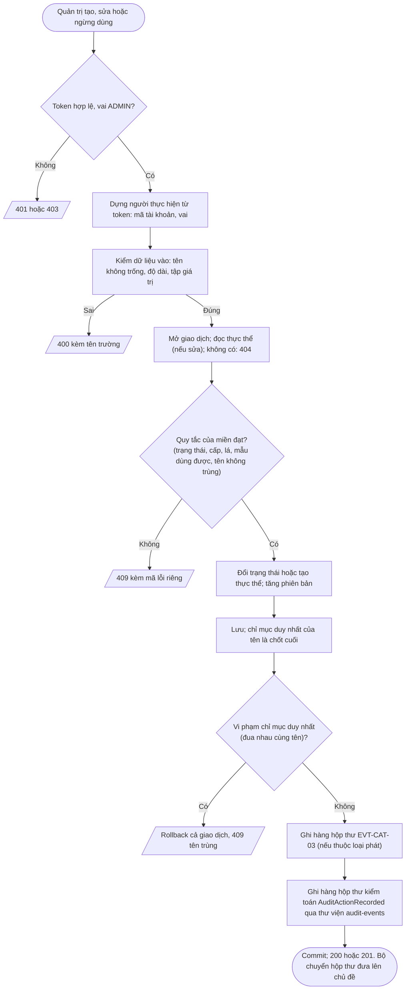
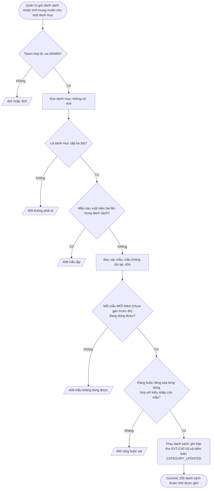
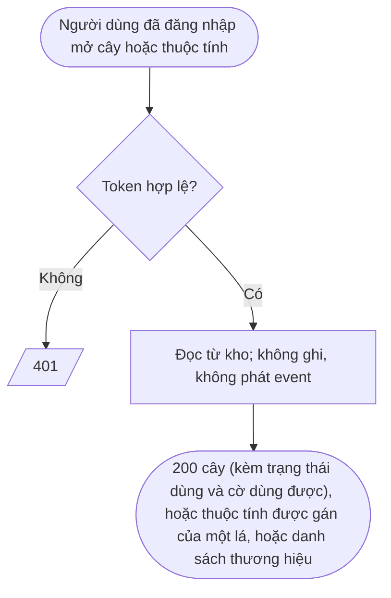

# Feature 05: Cấu trúc danh mục

> **Trạng thái:** Đang làm `2026-11-01` (mới có `flow.md`) · **Chặng:** C1a · **Loại:** Nghiệp vụ
>
> **Nguồn:** CAP-CAT-01, 02, 03 (`catalog-service/analysis/category.md`, `attribute-template.md`, `brand.md`) · **Kiểm chứng bằng:** S9 (phần tạo, ngừng dùng, không xóa thứ đã dùng), S6 (nửa quản trị) · R6, R10, R12 · INV-CAT-01 đến 05, 10 đến 12, 20, 21, `INV-CAT-97` (cách tính "dùng được"), `INV-CAT-98` (nửa không có con)
>
> **Cùng thư mục:** `tech.md` (giải pháp kỹ thuật, câu hỏi cần chốt), `plan.md` (kế hoạch, viết sau khi chốt câu hỏi). Quyết định liên quan: ADR-0001 (mã định danh, D3), ADR-0008 (hộp thư), ADR-0011 (khóa lạc quan). Hợp đồng bản ghi kiểm toán: feature 02.

## 1. Mục tiêu và phạm vi

Quản trị dựng và giữ **cấu trúc dùng chung** để mô tả hàng: cây danh mục ba cấp, mẫu thuộc tính (kèm tùy chọn), việc gán mẫu vào danh mục lá, và danh sách thương hiệu. Mọi thay đổi chỉ thành công cùng với dấu vết kiểm toán của nó. Người bán và quản trị đọc cây, thuộc tính được gán, thương hiệu; chưa có sản phẩm nào dùng chúng ở feature này (feature 07).

Feature gồm sáu phần, làm theo thứ tự A → F. Mỗi phần quan sát và kiểm chứng được riêng.

| Phần | Nội dung | Quan sát được | Kiểm chứng |
|---|---|---|---|
| **A. Nền** | Migration gốc đầu tiên của `catalog-service`; mã định danh thực thể là UUID v7 sinh trong miền | Dịch vụ khởi động trên cơ sở dữ liệu trống; mọi khóa là `uuid` | D3, D8 |
| **B. Mẫu thuộc tính và tùy chọn** | Tạo, sửa tên hiển thị và gợi ý, thêm tùy chọn, ngừng dùng và bật lại mẫu hoặc tùy chọn, sắp xếp tùy chọn; không đổi kiểu nhập, không xóa | Tên mẫu trùng bị từ chối; mẫu chọn không tùy chọn bị từ chối; đua nhau cùng tên: một thành công | INV-CAT-10, 11, 12; R10, R12 |
| **C. Thương hiệu** | Tạo, đổi tên, ngừng dùng, bật lại; không xóa | Tên trùng (khác dấu, khác chữ hoa) bị từ chối; không có thao tác xóa | INV-CAT-20, 21; R10 |
| **D. Cây danh mục và gán thuộc tính** | Tạo (gốc hoặc dưới một cha), đổi tên, sắp xếp, ngừng dùng, bật lại, xóa; thay **toàn bộ** danh sách thuộc tính được gán của danh mục lá trong một lần (thêm, bỏ, đổi bắt buộc, thứ tự, ràng buộc riêng) | Cấp thứ tư bị từ chối; gán vào danh mục không phải lá bị từ chối; xóa danh mục có con bị từ chối | INV-CAT-01, 02, 03, 05; R10 |
| **E. Đọc và API** | Cây danh mục, thuộc tính được gán cho một lá, danh sách thương hiệu (người đã đăng nhập); các thao tác ghi dành cho vai `ADMIN` | Người thường đọc được, ghi bị chặn | INV-CAT-04; R6; S6 |
| **F. Chạy thật** | Postgres riêng, connector hộp thư, Kafka, ứng dụng chạy thật (không dựng `audit-service`, như feature 04) | Một thao tác quản trị ra một thông điệp kiểm toán (và `EVT-CAT-03` nếu thuộc loại phát); đua nhau trên cơ sở dữ liệu thật | S9, R10, R12 |

Mỗi thao tác ghi ở B, C, D là **một giao dịch**: đổi dữ liệu, ghi hộp thư event (nếu thuộc loại phát), ghi hộp thư kiểm toán. Thiếu một thì mất cả (R12).

Ngoài phạm vi:
- Sản phẩm, biến thể, ảnh, đăng: feature 07, 08. Điều kiện xóa "chưa từng có sản phẩm" chỉ kiểm được từ feature 07 (xem `tech.md`).
- Dữ liệu mẫu (bộ danh mục, mẫu thuộc tính, thương hiệu để demo): feature 06.
- Cổng truy cập, route, BFF: feature 10. Giao diện quản lý: feature 12.
- Chưa làm theo `analysis`: di chuyển, gộp danh mục; nhóm thuộc tính dùng chung; ảnh đại diện danh mục; cấu hình khám phá (C1b); thương hiệu có logo, mô tả; người bán đề xuất thương hiệu.
- `audit-service` nhận và lưu bản ghi kiểm toán: feature 02 đã làm phía nhận; chuỗi đầu-cuối ở feature 13.

## 2. Đầu vào và đầu ra

| Phần | Vào | Ra khi thành công | Ra khi lỗi |
|---|---|---|---|
| Tạo, sửa, ngừng dùng, bật lại, xóa danh mục | Token `ADMIN`; dữ liệu danh mục | 200 hoặc 201 danh mục sau thay đổi, kèm `version`; hàng hộp thư kiểm toán (`CATEGORY_*`), `EVT-CAT-03` nếu đổi cây hoặc cách dùng mẫu | 400 dữ liệu; 404; 409 (tên trùng, cấp thứ tư, xóa khi có con, sai trạng thái); 401; 403 |
| Thay danh sách thuộc tính được gán | Token `ADMIN`; mã danh mục lá; danh sách mong muốn cuối cùng (mỗi dòng: mã mẫu, bắt buộc, thứ tự, ràng buộc riêng) | 200 danh sách mới; một bản ghi kiểm toán `CATEGORY_UPDATED`; `EVT-CAT-03` | 400 ràng buộc sai với kiểu nhập; 404; 409 (không phải lá, mẫu **mới thêm** không dùng được, mẫu lặp trong danh sách); 401; 403 |
| Quản mẫu thuộc tính, tùy chọn | Token `ADMIN`; dữ liệu mẫu hoặc tùy chọn | 200 hoặc 201; kiểm toán `ATTRIBUTE_*`; `EVT-CAT-03` nếu đổi cách danh mục dùng mẫu | 400; 404; 409 (tên trùng, giá trị tùy chọn trùng, đổi kiểu nhập, mẫu không phải kiểu chọn); 401; 403 |
| Quản thương hiệu | Token `ADMIN`; tên | 200 hoặc 201; kiểm toán `BRAND_*` (không có `EVT-CAT-03`) | 400; 404; 409 tên trùng; 401; 403 |
| Đọc cây, thuộc tính được gán, danh sách thương hiệu | Token hợp lệ, vai bất kỳ | 200; không ghi gì, không phát event | 404 (không có danh mục); 401 |

## 3. Luồng chính

### 3.1 Thao tác ghi của quản trị (mẫu chung cho B, C, D)

### 3.2 Thay danh sách thuộc tính được gán cho danh mục lá

Một lần gọi thay cả danh sách: thêm, bỏ, đổi bắt buộc hay thứ tự đều là gửi danh sách mong muốn cuối cùng.

Mẫu đã gán từ trước mà nay ngừng dùng vẫn được giữ hoặc sửa trong danh sách (sửa cái đã có, không phải chọn mới).

### 3.3 Đọc

## 4. Đường không suôn sẻ

| # | Tình huống | Hành vi cần có |
|---|---|---|
| E1 | Tên danh mục trùng trong cùng cha (kể cả khác dấu, khác chữ hoa, khoảng trắng thừa), hoặc tên mẫu, tên thương hiệu trùng toàn sàn | 409; không đổi gì, không event (INV-CAT-02, 10, 20; R10). Đổi tên chỉ khác hoa thường với chính nó không phải là trùng |
| E2 | Hai yêu cầu đồng thời tạo hoặc đổi tên thành cùng một tên chuẩn hóa | Đúng một thành công; yêu cầu còn lại nhận 409, không phải 500; không hai bản ghi kiểm toán (R10, R12) |
| E3 | Tạo danh mục dưới một danh mục cấp ba | 409 quá ba cấp; danh mục cấp ba là lá nên không có con (INV-CAT-01) |
| E4 | Gửi danh sách thuộc tính cho danh mục cấp một hoặc hai; trong danh sách có mẫu **mới thêm** đã ngừng dùng hoặc là kiểu chọn không còn tùy chọn đang dùng; mẫu lặp trong danh sách; ràng buộc riêng không hợp kiểu nhập | 409 (ba trường hợp đầu) hoặc 400 (ràng buộc); không đổi gì, không event (INV-CAT-03, 11) |
| E5 | Xóa danh mục còn con; xóa danh mục đã có sản phẩm | 409, gợi ý ngừng dùng (INV-CAT-05, 98). Khi chưa có sản phẩm trong hệ thống (feature này), chỉ kiểm được nửa "còn con" (`tech.md`) |
| E6 | Mẫu thuộc tính hoặc thương hiệu: yêu cầu xóa | Không có thao tác xóa trong API; chỉ ngừng dùng (INV-CAT-12, 21) |
| E7 | Đổi kiểu nhập hoặc đơn vị của mẫu đã tạo | 409 hoặc 400 theo `tech.md`; muốn khác thì tạo mẫu mới (INV-CAT-12) |
| E8 | Thêm tùy chọn vào mẫu đã ngừng dùng, hoặc vào mẫu không phải kiểu chọn; giá trị tùy chọn trùng trong mẫu (sau chuẩn hóa) | 409 (INV-CAT-11) |
| E9 | Ngừng dùng danh mục cha đang có con | Chỉ cha đổi; con giữ nguyên cờ của chúng, nhưng không còn "dùng được" vì tổ tiên đóng (INV-CAT-97). Không ghi hàng loạt xuống con |
| E10 | Tạo con dưới danh mục cha đang ngừng dùng | Cho phép: quản trị chuẩn bị trước cả nhánh rồi mở sau (`category.md` mục 3) |
| E11 | Ngừng dùng hoặc bật lại cái đã ở trạng thái đó | 409 `INVALID_STATE`, không ghi kiểm toán, không event (đề xuất Q5) |
| E12 | Người dùng thường (`USER`) hoặc người không có vai gọi thao tác ghi | 403 (INV-CAT-04, R6, S6); không đọc hay ghi kho. Đọc cây, thuộc tính, thương hiệu: được |
| E13 | Không có token, token hết hạn hoặc sai chữ ký | 401 |
| E14 | Mã không tồn tại (danh mục, mẫu, tùy chọn, thương hiệu), hoặc sai định dạng | 404, hoặc 400 `INVALID_PARAMETER` nếu không phải UUID (xử lý chung ở `common-web`) |
| E15 | Tên rỗng, toàn khoảng trắng, quá dài; kiểu nhập ngoài sáu loại; số chữ số thập phân vượt quy định | 400 kèm tên trường; không đổi gì |
| E16 | Lưu thành công nhưng ghi hộp thư (event hoặc kiểm toán) lỗi | Rollback cả giao dịch: không đổi dữ liệu, không hàng hộp thư nào (R12) |
| E17 | Hành động kiểm toán hay khóa dữ kiện chưa khai báo trong danh mục của thư viện | Thư viện ném lỗi, giao dịch rollback. Lỗi lập trình, bắt bằng test |
| E18 | Bộ chuyển hộp thư hay Kafka tạm hỏng sau commit | Hàng hộp thư nằm lại, đến bù khi chạy lại: chậm, không mất (feature 01) |
| E19 | Không có bên nhận `EVT-CAT-03` ở C1a (Tìm kiếm vào từ C1b) | Vẫn phát hay chưa: xem `tech.md` (đề xuất Q3). Không ảnh hưởng người dùng |

## 5. Điểm chạm với tài liệu và feature khác

- **Hợp đồng bản ghi kiểm toán** (feature 02): các hành động `CATEGORY_CREATED`, `CATEGORY_UPDATED`, `CATEGORY_DEACTIVATED`, `ATTRIBUTE_CREATED`, `ATTRIBUTE_UPDATED`, `ATTRIBUTE_DEACTIVATED`, `BRAND_CREATED`, `BRAND_UPDATED`, `BRAND_DEACTIVATED` và khóa dữ kiện của chúng khai báo trong danh mục hành động của `catalog-service` trước khi gọi `AuditRecorder`. Xóa danh mục có hành động riêng `CATEGORY_DELETED`; bật lại ghi là `CATEGORY_UPDATED` (Q4, đã chốt và đã sửa `category.md`).
- **Event**: `EVT-CAT-03` (cây hay gán thuộc tính đổi) và `EVT-CAT-04` (kiểm toán) đã nằm trong `5. event-catalog.md`; kiểm lại payload khi viết `tech.md`.
- **Dữ liệu và API**: `data.md` và `api.yaml` của `catalog-service` chưa có, tạo ở feature này theo `service.md`. Mã định danh UUID v7 và migration gốc đầu tiên đi cùng (D3, D8): làm ở phần A, thay đổi cấu trúc cơ sở dữ liệu dev của `catalog-service`, **phải báo và được xác nhận trước khi chạm** (cơ sở dữ liệu dev đang dừng).
- **Hàm chuẩn hóa tên** (bỏ khoảng trắng thừa, chữ thường, bỏ dấu tiếng Việt): dùng `StringUtils.removeAccent` của `common-utils`, không viết bản mới.
- **Quyền**: `service.md` mục 4 ghi "chú thích ở lớp trình bày"; feature 04 (seller) đã chọn kiểm vai trong miền hoặc use case. Chọn cách nào cho `catalog-service` là Q2 ở `tech.md`, và `service.md` được sửa cho khớp khi đóng feature.
- **Feature sau**: 06 nạp dữ liệu mẫu qua chính các thao tác này hoặc script ghi trực tiếp (`Q-CAT-02`); 07 thêm kiểm "danh mục có sản phẩm" cho thao tác xóa và dùng cờ "dùng được".

## 6. Việc cần chốt ở `tech.md`

Danh sách câu hỏi để `tech.md` trả lời, theo thứ tự từ ảnh hưởng nhiều đến ít:

1. **Q1.** Sơ đồ dữ liệu: bảng nào, khóa nào, chỉ mục duy nhất nào cho tên (cha gốc không có `parent_id` nên cần xử lý riêng), cách lưu cấp và cách tính "dùng được" (mọi tổ tiên đang dùng). Chốt **sau khi đối chiếu migration và mã hiện có**, không quyết trước; ba thứ ngoài C1a (đường dẫn thân thiện, ảnh đại diện, cấu hình khám phá) không vào migration gốc.
2. **Q2.** Cách kiểm vai `ADMIN`: chú thích ở lớp trình bày (như `service.md` ghi) hay trong miền/use case (như feature 03, 04 của seller).
3. **Q3.** Có phát `EVT-CAT-03` ngay ở C1a khi chưa có bên nhận không. Nghiêng về có, vì ghi cùng giao dịch là chỗ khó sửa về sau, nhưng cần xác nhận payload ở `5. event-catalog.md`.
4. **Q4.** Hành động kiểm toán cho **xóa danh mục** và **bật lại** (danh mục, mẫu, tùy chọn, thương hiệu): `analysis` chỉ nêu `_CREATED`, `_UPDATED`, `_DEACTIVATED`. Nghiêng về: bật lại ghi là `_UPDATED`, xóa danh mục thêm `CATEGORY_DELETED`; cần sửa `category.md` mục 4 và mục 6 trước (thứ tự analysis → service → code).
5. **Q5.** Ngừng dùng hoặc bật lại cái đã ở trạng thái đó: 409 `INVALID_STATE` hay thành công không đổi. Nghiêng về 409, cùng cách với duyệt hồ sơ.
6. **Q6.** `INV-CAT-11` ghi "kiểm tra khi ngừng tùy chọn" nhưng `attribute-template.md` mục 3 nói mẫu không còn tùy chọn đang dùng chỉ là không "dùng được": **ngừng tùy chọn cuối cùng của mẫu đã được gán** bị từ chối hay được phép? **Đã chốt `2026-11-01`: được phép**; mẫu thành không dùng được, `INV-CAT-11` đã sửa để không kiểm lúc ngừng.
7. **Q7.** Điều kiện xóa danh mục khi chưa có sản phẩm: kiểm "còn con" ngay; "đã từng có sản phẩm" kiểm qua cổng mà feature 07 hiện thực, hay thêm ở feature 07. Phần hoãn này nếu thành bước đơn giản hóa trong phạm vi thì ghi vào `deferred.md`.
8. **Q8.** Khóa lạc quan: yêu cầu sửa có mang `version` (ADR-0011) hay chỉ chặn đua bằng chỉ mục duy nhất; mã lỗi riêng cho từng vi phạm (tên trùng, quá cấp, không phải lá...).
9. **Q9.** Hình dạng API: đường dẫn và phương thức (`/api/admin/categories`, `/api/categories`... thống nhất tiền tố với `seller-service`), cây trả một lần hay theo cấp, biểu diễn "thứ tự" (số vị trí hay lên-xuống), độ dài tối đa của tên.
10. **Q10.** Khóa dữ kiện kiểm toán của từng hành động (tên, mã cha, trước và sau của tên) và chính sách `strict`/`lenient` của `AuditDetailsPolicy`.
