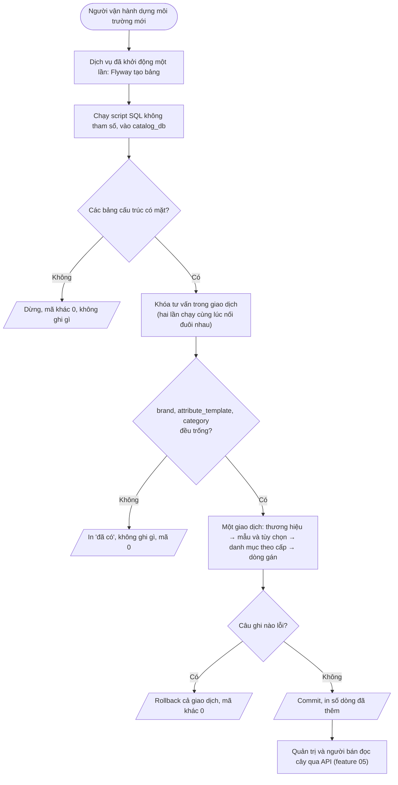

# Feature 06: Dữ liệu mẫu danh mục

> **Trạng thái:** Đã làm `2026-11-04` · **Chặng:** C1a · **Loại:** Dữ liệu khởi tạo
>
> **Nguồn:** `Q-CAT-02` (`catalog-service/analysis/0.overview.md` mục 14) · **Kiểm chứng bằng:** S9 (có dữ liệu để thao tác), S1 và S5 về sau (người bán có danh mục lá, mẫu và thương hiệu để đăng) · INV-CAT-01 đến 03, 10 đến 12, 20 áp lên chính dữ liệu mẫu
>
> **Cùng thư mục:** `tech.md` (giải pháp kỹ thuật, nội dung bộ mẫu), `plan.md` (kế hoạch), `deferred.md` (phần hoãn). Cùng loại với feature 04 của C0 (`c0-foundation/04-seed-admin`).

## 1. Mục tiêu và phạm vi

Khi dựng một môi trường mới, `catalog-service` có sẵn **một bộ cấu trúc dùng chung để demo**: cây danh mục ba cấp, các mẫu thuộc tính kèm tùy chọn, việc gán mẫu vào từng danh mục lá, và danh sách thương hiệu. Có bộ này thì người bán chọn được danh mục lá, điền thuộc tính, chọn thương hiệu ngay sau khi dựng, không phải chờ Quản trị gõ từng thứ (và giao diện Vận hành, feature 12, làm rất muộn).

**Cơ chế đã chốt (như feature 04 của C0):** một **script SQL chạy tay** của người vận hành khi dựng môi trường, **ngoài Flyway**, **không có bộ nạp trong mã**. Lý do: dữ liệu khởi tạo thuộc về môi trường, không thuộc phiên bản mã; migration chạy ở mọi môi trường kể cả môi trường thật, còn bộ mẫu demo thì không nên.

**Dữ liệu mẫu phải là dữ liệu hợp lệ theo đúng nghiệp vụ**, như thể Quản trị đã tạo từng thứ qua API của feature 05. Mục 2 liệt kê các quy tắc nội dung phải đạt. Script ghi thẳng vào bảng nên **không đi qua** miền; vì vậy các quy tắc này được kiểm lại bằng test (mục 6).

Ngoài phạm vi:
- Sản phẩm, biến thể, ảnh mẫu: feature 07, 08. Tài khoản người bán và Quản trị mẫu: đã có đường riêng (feature 04 của C0; hồ sơ người bán qua feature 03, 04).
- Nạp qua API quản trị (đi qua miền, có kiểm toán): không dùng. Dữ liệu khởi tạo không phát event và không ghi kiểm toán, như tài khoản Quản trị. Hệ quả cho Tìm kiếm (C1b): không nhận `EVT-CAT-03` cho dữ liệu mẫu, nên phải dựng chỉ mục ban đầu từ cơ sở dữ liệu (ghi ở `deferred.md`).
- Mẫu, thương hiệu, danh mục ở trạng thái ngừng dùng: bộ mẫu dùng để đăng bán nên mọi thứ đều đang dùng; trạng thái ngừng dùng đã kiểm ở feature 05.
- Logo thương hiệu, ảnh danh mục: chưa có trong cấu trúc (feature 05).
- Chạy trên cơ sở dữ liệu dev: xem mục 5; chỉ làm khi người dùng cho phép đúng đối tượng.

## 2. Quy tắc nội dung (bộ mẫu phải đạt)

Mỗi dòng dưới đây là một điều kiện test kiểm trên chính dữ liệu đã nạp (mục 6).

| # | Quy tắc | Nguồn |
|---|---|---|
| N1 | Cây đúng ba cấp: cấp một không có cha, cấp hai có cha cấp một, cấp ba có cha cấp hai. **Mỗi nhánh đủ xuống lá**: mọi nút cấp một có ít nhất một con cấp hai, mọi nút cấp hai có ít nhất một lá (nhánh cụt không đặt hàng được) | INV-CAT-01 |
| N2 | Tên danh mục duy nhất trong cùng cha theo khóa tên; `name_key` ghi sẵn **bằng đúng kết quả của hàm khóa tên** của miền | INV-CAT-02, feature 05 T3 |
| N3 | Gán thuộc tính **chỉ ở danh mục cấp ba**; mỗi mẫu một lần cho một danh mục; mẫu được gán đang dùng và dùng được (kiểu chọn có ít nhất một tùy chọn đang dùng) | INV-CAT-03, INV-CAT-11 |
| N4 | Tên mẫu đúng dạng mã (`a-z`, `0-9`, `_`), giá trị tùy chọn đúng dạng (thêm `-`), duy nhất; đơn vị chỉ có ở mẫu kiểu số | INV-CAT-10, 11, 12 |
| N5 | `constraints` của dòng gán đúng hình theo kiểu nhập của mẫu (chữ: `maxLength`; số: `min`, `max`, `integerOnly`; chọn nhiều: `maxSelections`; ngày: `inputPrecision`, `minDate`, `maxDate`; chọn một và đúng/sai: không có), mọi dòng đều có giá trị (`{}` khi không ràng buộc); khoảng hợp lý (`min` không lớn hơn `max`, `maxSelections` không vượt số tùy chọn) | `category.md`, `data.md` mục 6 |
| N6 | Tên thương hiệu duy nhất toàn sàn theo khóa tên | INV-CAT-20 |
| N7 | **Mỗi lá có ít nhất một mẫu kiểu chọn một đang dùng được gán**, vì chỉ kiểu chọn một làm được trục biến thể: không thì người bán không tạo được biến thể có trục ở lá đó | `attribute-template.md` mục 2 |
| N8 | Bộ mẫu phủ **đủ sáu kiểu nhập** (chọn một, chọn nhiều, chữ, số, đúng/sai, ngày), cả dòng gán bắt buộc lẫn không bắt buộc, cả dòng có và không có ràng buộc riêng | Để demo và để feature 07 có đủ ca |
| N9 | Mọi thực thể đang dùng, `version` bằng 0 (như vừa tạo), mã định danh UUID v7, thời điểm tạo và sửa là lúc chạy script | ADR-0001; `data.md` mục 1 |
| N10 | Tên hiển thị tiếng Việt có dấu; mã kỹ thuật không dấu | `attribute-template.md` mục 2 |

## 3. Đầu vào và đầu ra

| | Nội dung |
|---|---|
| Vào | Không có tham số. Kết nối tới cơ sở dữ liệu của Danh mục hàng (`catalog_db`) đã chạy đủ migration; ba bảng cấu trúc (`brand`, `attribute_template`, `category`) còn **trống** |
| Ra khi thành công | Bộ mẫu ở `tech.md` T2: 10 thương hiệu, 13 mẫu (35 tùy chọn), 22 danh mục (3 cấp một, 6 cấp hai, 13 lá), 57 dòng gán. Không có hàng hộp thư. Script in số dòng đã thêm |
| Ra khi lỗi | Script dừng với mã thoát khác 0 và **không ghi gì**: bảng chưa có (chạy trước Flyway, hoặc nhầm cơ sở dữ liệu), lỗi ở bất kỳ câu ghi nào |
| Chạy lại hay đã có dữ liệu | Một trong ba bảng cấu trúc đã có dòng: **không thêm gì**, in thông báo "đã có", mã thoát 0 |
| Event, kiểm toán | Không |

## 4. Luồng chính

1. **Thứ tự chạy:** Flyway (dịch vụ khởi động một lần) trước, script sau, như feature 04 của C0.
2. **Một giao dịch:** toàn bộ bộ mẫu vào cùng nhau hoặc không có gì; không có trạng thái nạp dở.
3. **Mã định danh:** script tự dựng UUID v7 trong SQL (Postgres 16 chưa có `uuidv7()`), cùng cách với `admin.sql`.
4. **Sau khi nạp:** dữ liệu là dữ liệu sống bình thường. Quản trị đổi tên, ngừng dùng, thêm tùy chọn qua API của feature 05 như với dữ liệu tự tạo; chạy lại script sau đó **không** đặt lại gì (xem R1, R2).

## 5. Đường không suôn sẻ và các điểm cần rà

| # | Tình huống | Hướng xử lý | Chứng minh |
|---|---|---|---|
| R1 | Chạy script hai lần (dựng lại môi trường, chạy nhầm) | Lần hai thấy bảng đã có dòng: không thêm gì, không ghi đè. Không "bổ sung phần thiếu" vì Quản trị có thể đã đổi tên hay ngừng dùng một mục, nạp lại sẽ hoàn lại thứ họ đã bỏ | KT-02 |
| R2 | Quản trị đã tự tạo dữ liệu trước khi chạy script | Bất kỳ bảng nào trong ba bảng đã có dòng thì không nạp gì. Không trộn bộ mẫu với dữ liệu tay (tên có thể trùng, ràng buộc duy nhất làm hỏng cả lần nạp) | KT-03 |
| R3 | Hai người chạy script cùng lúc | Khóa tư vấn mức giao dịch: lần hai chờ lần một xong rồi thấy "đã có". Không có đua nhau gây lỗi vi phạm ràng buộc duy nhất | KT-02 |
| R4 | Script chạy khi bảng chưa có (Flyway chưa chạy) hoặc chạy nhầm vào cơ sở dữ liệu của dịch vụ khác | Kiểm các bảng có mặt trước khi ghi; thiếu thì dừng, mã khác 0, thông báo nêu đúng việc. Không tạo bảng | KT-04 |
| R5 | Lỗi giữa chừng (ví dụ một dòng vi phạm ràng buộc) | Một giao dịch nên rollback cả; không còn dữ liệu nạp dở | KT-05 |
| R6 | `name_key` ghi sẵn lệch với hàm khóa tên của miền (sửa hàm sau này, hoặc gõ nhầm) | Test đọc từng dòng đã nạp và so với `NameKey.of(name)`; lệch là đỏ. Đây là lý do `name_key` ghi sẵn vẫn an toàn | KT-06 |
| R7 | Dòng sai quy tắc mà cơ sở dữ liệu không bắt (gán vào danh mục không phải lá, mẫu chọn không có tùy chọn, `constraints` sai kiểu nhập) | Test dựng lại dữ liệu đã nạp qua chính các hàm kiểm của miền và đọc qua API (mục 2, N1 đến N8) | KT-07, KT-08 |
| R8 | Quy tắc của miền đổi sau này (ví dụ dạng mã, thêm ràng buộc) làm bộ mẫu lệch | Test chạy ở mỗi lần build, nên lệch hiện ngay. Sửa script cùng lúc với sửa quy tắc | KT-07 |
| R9 | Bộ mẫu không dùng được thật cho feature sau (lá thiếu trục biến thể, mẫu chọn rỗng) | N3, N7 là điều kiện test; trục biến thể kiểm bằng "mỗi lá có mẫu chọn một dùng được" | KT-07 |
| R10 | Có migration chèn dữ liệu mẫu | Không: quét `db/migration` không có `INSERT` vào bảng cấu trúc | KT-10 |
| R11 | Nạp làm sinh hàng hộp thư hay bản ghi kiểm toán | Không: script không ghi `outbox_events`; test đếm bằng 0 | KT-10 |
| R12 | Chạy vào cơ sở dữ liệu dev | Chỉ khi người dùng cho phép đúng đối tượng. Đã làm `2026-11-04`: `catalog_db` dev được dựng lại (còn lịch sử migration cũ) rồi nạp bộ mẫu; mọi kiểm chứng tự động vẫn chạy trên Postgres cách ly | `plan.md` |

## 6. Trạng thái sau khi xong

- Script nằm trong repo (`infra/seed/catalog.sql`), kèm mục mới trong `infra/seed/README.md` nêu thứ tự chạy, cách chạy không cần cài `psql`, và cách hiểu thông báo.
- Chạy script trên `catalog_db` trống đã migrate cho đúng bộ mẫu ở `tech.md` T2; chạy lại không đổi gì.
- Người dùng đã đăng nhập đọc được cây ba cấp, thuộc tính được gán cho từng lá, danh sách thương hiệu qua API của feature 05.
- Không có migration, bộ nạp hay hộp thư nào của dữ liệu mẫu trong mã nguồn.

## 7. Test cần có (viết từ quy tắc nội dung và đường lỗi, trước khi viết script)

Cột "Mức": **Script** (chạy chính tệp script bằng `psql` trong container Postgres của test), **Miền** (dựng lại dữ liệu đã nạp qua hàm kiểm của miền), **API** (ứng dụng thật, MockMvc, như feature 05), **Hệ thống**, **Chạy thật**.

| # | Kịch bản test | Mức | Chứng minh |
|---|---|---|---|
| KT-01 | Chạy script trên cơ sở dữ liệu đã migrate và trống: đúng số dòng từng bảng (10, 13, 35, 22, 57); mọi thực thể `ACTIVE`, `version` 0; thời điểm tạo bằng thời điểm sửa | Script | N9, mục 3 |
| KT-02 | Chạy lần hai: số dòng và mọi mã định danh không đổi, thông báo phân biệt "đã nạp" với "đã có, không thêm"; hai lần chạy đồng thời cho đúng một bộ dữ liệu | Script | R1, R3 |
| KT-03 | Trước khi chạy đã có một thương hiệu do Quản trị tạo (hoặc một danh mục): script không thêm gì ở cả ba nhóm, mã thoát 0 | Script | R2 |
| KT-04 | Chạy trên cơ sở dữ liệu chưa migrate (không có bảng): mã thoát khác 0, thông báo nêu bảng thiếu, không tạo gì | Script | R4 |
| KT-05 | Làm câu ghi cuối lỗi (thêm ràng buộc `CHECK (false)` vào bảng dòng gán trước khi chạy): mã thoát khác 0 và **cả bốn bảng vẫn trống** | Script | R5 |
| KT-06 | Mọi `name_key` của thương hiệu và danh mục bằng `NameKey.of(name)`; thử cả tên có dấu, `Đ`, hoa thường và ký tự `&` | Miền | R6, N2, N6 |
| KT-07 | Dựng lại từ dữ liệu đã nạp và kiểm: N1 (ba cấp, nhánh đủ xuống lá), N3 (gán chỉ ở cấp ba, mỗi mẫu một lần, mẫu dùng được), N4 (dạng mã, đơn vị), N5 (`constraints` qua hàm kiểm của dòng gán, khoảng hợp lý), N7 (mỗi lá có mẫu chọn một), N8 (đủ sáu kiểu nhập, có bắt buộc và không) | Miền | N1, N3 đến N5, N7, N8 |
| KT-08 | Qua API người dùng thường: `GET` cây trả 3 ngành đủ ba cấp theo thứ tự đã nạp; `GET` thuộc tính của một lá khớp dòng gán (thứ tự, bắt buộc, ràng buộc, tùy chọn của mẫu chọn); `GET` thương hiệu trả 10, sắp theo tên; tên hiển thị có dấu đúng | API | R7, N10, S9 |
| KT-09 | Qua API quản trị trên dữ liệu đã nạp: tạo danh mục trùng tên một mục mẫu nhưng khác dấu và hoa thường: 409 `CATEGORY_NAME_TAKEN` (khóa tên khớp); đổi tên một danh mục mẫu: 200; thêm tùy chọn vào một mẫu đã nạp: 201; ngừng dùng một lá mẫu rồi cây dành cho người dùng không còn lá đó | API | N2, dữ liệu mẫu là dữ liệu sống |
| KT-10 | Mọi mã định danh là UUID phiên bản 7; sau khi nạp bảng `outbox_events` trống; quét `db/migration` không có `INSERT INTO` bảng cấu trúc | Hệ thống | N9, R10, R11 |
| KT-11 | Chạy thật trên ngăn xếp cách ly: ứng dụng khởi động trên cơ sở dữ liệu trống (Flyway), chạy script bằng `psql` trong container, gọi API thật bằng token ký thật: cây, thuộc tính một lá, thương hiệu; chạy script lần hai không đổi | Chạy thật | S9, R1 |

Cách test không cần giao diện: dùng cùng nền Testcontainers của feature 05; test chép **chính tệp** `infra/seed/catalog.sql` vào container rồi chạy bằng `psql` (không chép nội dung sang test), như feature 04 của C0.

## 8. Việc đã giao cho feature này

- **Script khởi tạo** `infra/seed/catalog.sql` và mục mới trong `infra/seed/README.md` (thứ tự chạy: Flyway trước, script sau).
- **Test** KT-01 đến KT-10 trong Maven; KT-11 ở bước chạy thật.
- **Ghi thành tài liệu:** `service.md` mục 8 ("Dữ liệu khởi tạo": `Q-CAT-02` đổi thành Đã làm kèm cách chạy); `data.md` thêm ghi chú nơi có dữ liệu khởi tạo; `00-features.md` đóng feature 06.
- **Không làm ở đây (đã giao nơi khác):** sản phẩm và ảnh mẫu (07, 08); chỉ mục tìm kiếm ban đầu từ cơ sở dữ liệu (C1b, ghi ở `deferred.md`); dựng lại cơ sở dữ liệu dev của catalog (việc riêng, cần người dùng cho phép đúng đối tượng).
