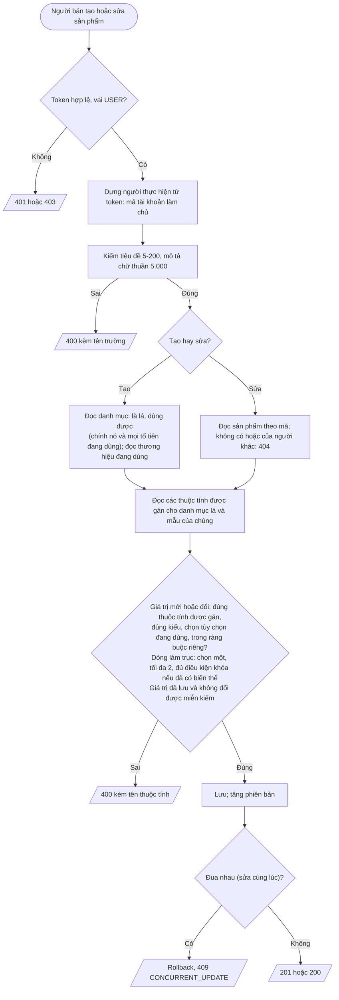
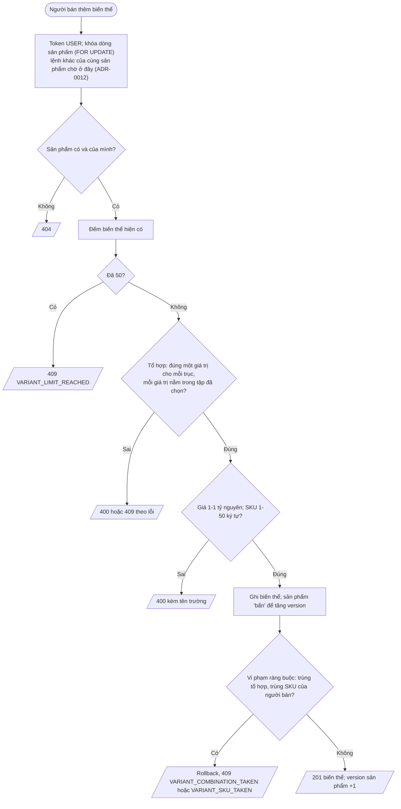

# Feature 07: Sản phẩm và biến thể

> **Trạng thái:** Đang làm `2026-11-04` (mới có `flow.md`, `tech.md`) · **Chặng:** C1a · **Loại:** Nghiệp vụ
>
> **Nguồn:** CAP-CAT-04, 05 (`catalog-service/analysis/product.md`, `variant.md`) · **Kiểm chứng bằng:** S5 (nửa không đăng), S6 (nửa người bán) · R6, R9 · INV-CAT-30 đến 33, 35 (nửa Nháp), 36, 40 đến 44, 91 (nửa điều kiện còn thiếu), 92 đến 94, 96, 97, 98 (nửa đã có sản phẩm)
>
> **Cùng thư mục:** `tech.md` (giải pháp kỹ thuật, câu hỏi cần chốt), `plan.md` (kế hoạch, viết sau khi chốt câu hỏi). Quyết định liên quan: ADR-0001 (mã), ADR-0011 (khóa lạc quan, ràng buộc ở lưu trữ), **ADR-0012 (khóa dòng cha, Proposed)**.

## 1. Mục tiêu và phạm vi

Người bán soạn **sản phẩm nháp**: tiêu đề, mô tả, danh mục lá, thương hiệu, giá trị thuộc tính, các **trục biến thể**; rồi thêm **biến thể**: tổ hợp giá trị trục, giá niêm yết, mã SKU. Người bán xem lại sản phẩm của mình, sửa, đổi giá, ngừng và bật lại biến thể. Mọi thứ mới chỉ ở dạng nháp: chưa đăng, chưa hiển thị cho người mua, chưa có ảnh.

Sản phẩm là thứ được mô tả, biến thể là thứ được bán (đơn, tồn kho, giỏ hàng sau này trỏ vào biến thể). Hai aggregate riêng nhưng có ba quy tắc chung: tối đa 50 biến thể, tổ hợp không trùng, mọi thay đổi biến thể tăng phiên bản sản phẩm.

Ngoài phạm vi (đã giao nơi khác, xem cột "Chưa làm" của `product.md`, `variant.md` mục 7):
- **Ảnh** (gắn, bỏ, sắp xếp, bỏ ảnh cuối của sản phẩm đã đăng): feature 08.
- **Đăng, gỡ, đăng lại, xóa nháp**, điều kiện đăng đầy đủ (`INV-CAT-91`), cờ hiển thị (`INV-CAT-95`): feature 09. Hai chuyển trạng thái ở 07 chỉ có `DRAFT` (không có đường ra khỏi nó).
- **Kiểm "người bán đã duyệt"** (`INV-CAT-30`, nửa kiểm qua bản sao trạng thái người bán): feature 09 cùng với bản sao. Trong lúc chờ, 07 kiểm vai `USER` và quyền chủ sản phẩm; tài khoản `USER` nào cũng tạo được nháp (ghi ở `deferred.md`).
- **Event ra Kafka**: `EVT-CAT-01` (bản chụp sản phẩm hiển thị) và `EVT-CAT-02` (đơn vị bán được) thuộc feature 09, vì chỉ có nghĩa khi sản phẩm hiển thị và còn chờ xác nhận `D6`. 07 **không** ghi hộp thư; `version` sản phẩm vẫn tăng đúng quy tắc để 09 dùng.
- **Dữ liệu mẫu sản phẩm**: không có; test tự tạo.
- Chưa làm theo `analysis`: bảo hành, kích thước và cân nặng biến thể, ảnh riêng của biến thể, lịch sử giá, giá theo bậc, nhập hàng loạt, sao chép sản phẩm.
- Chặn và mở sản phẩm (C1b); cờ chặn không có trong bảng sản phẩm ở 07.
- Cổng truy cập và giao diện Người bán: feature 10, 11.

## 2. Đầu vào và đầu ra

| Phần | Vào | Ra khi thành công | Ra khi lỗi |
|---|---|---|---|
| Tạo sản phẩm nháp | Token vai `USER`; tiêu đề, mô tả, mã danh mục lá, mã thương hiệu (tùy chọn), giá trị thuộc tính | 201 sản phẩm `DRAFT` kèm `version` (0), danh sách giá trị thuộc tính, trục (rỗng) | 400 (tiêu đề, mô tả, giá trị thuộc tính sai, nêu tên trường hoặc thuộc tính); 404 (danh mục, thương hiệu, thuộc tính không tồn tại); 409 (danh mục không dùng được, thương hiệu ngừng dùng); 401; 403 (vai không phải `USER`) |
| Sửa thông tin, thông số, trục | Mã sản phẩm của mình; tiêu đề, mô tả, thương hiệu, danh sách thuộc tính (mỗi dòng: mã mẫu, giá trị, có làm trục không) | 200 sản phẩm sau thay đổi, `version` tăng | 400 (giá trị sai; quá 2 trục; trục không phải chọn một; trục không có giá trị); 404 (sản phẩm không có hoặc **của người khác**); 409 (`CONCURRENT_UPDATE`; đã có biến thể mà đổi tập mẫu làm trục; rút giá trị trục đang được biến thể dùng); 401; 403 |
| Thêm biến thể | Mã sản phẩm; tổ hợp (mỗi trục đúng một mã tùy chọn trong tập đã chọn); giá (VND); SKU (tùy chọn) | 201 biến thể `ACTIVE`, giá, SKU, tổ hợp; `version` sản phẩm tăng | 400 (giá, SKU, tổ hợp thiếu hay thừa trục); 404; 409 (tổ hợp trùng, quá 50, SKU trùng, giá trị ngoài tập đã chọn); 401; 403 |
| Đổi giá, SKU biến thể | Mã sản phẩm, mã biến thể; giá và/hoặc SKU mới | 200 biến thể sau thay đổi; `version` sản phẩm tăng | 400; 404; 409 (SKU trùng); 401; 403 |
| Ngừng, bật lại biến thể | Mã sản phẩm, mã biến thể | 200 biến thể; `version` sản phẩm tăng | 404; 409 (đã ở trạng thái đó); 401; 403 |
| Xem sản phẩm của tôi | Phân trang, lọc theo trạng thái; hoặc mã một sản phẩm | 200 danh sách (trang) hoặc chi tiết đủ: thông tin, giá trị thuộc tính, trục, biến thể, **điều kiện còn thiếu để đăng** (thuộc tính bắt buộc chưa có, chưa có biến thể hoạt động; ảnh và người bán đã duyệt thêm ở 08, 09) | 404 (sản phẩm của người khác như không tồn tại); 401; 403 |

## 3. Luồng chính

### 3.1 Tạo và sửa sản phẩm

Người bán chỉ thấy sản phẩm của mình. Sản phẩm của người khác trả 404 như không tồn tại, không lộ sự tồn tại. Chưa kiểm "người bán đã duyệt" (xem mục 1).

### 3.2 Thêm biến thể (và đổi trục)

1. **Sản phẩm không có trục** (sách): biến thể duy nhất là **biến thể mặc định** với tổ hợp rỗng, tạo khi người bán đặt giá lần đầu (`INV-CAT-44`). Lần thứ hai với tổ hợp rỗng là trùng tổ hợp. Có biến thể rồi thì không đánh dấu trục mới được nữa.
2. **Trục là thuộc tính được đánh dấu** (`axis`): người bán khai trục bằng chính danh sách thuộc tính của sản phẩm, tập giá trị của trục là giá trị của thuộc tính đó (khai một lần; thuộc tính bắt buộc đã làm trục coi như đã điền). **Khi chưa có biến thể:** đổi tự do (tối đa 2 trục, chọn một). **Khi đã có biến thể:** tập mẫu làm trục phải **giữ nguyên**, chỉ thêm hoặc bỏ giá trị trong tập, và không bỏ giá trị đang được biến thể dùng, kể cả biến thể đã ngừng (`INV-CAT-33`).
3. **Lệnh nào chạm biến thể, hoặc sửa danh sách thuộc tính (có thể đổi trục), thì khóa dòng sản phẩm** (ADR-0012); lệnh chỉ sửa tiêu đề, mô tả, thương hiệu dùng khóa lạc quan. Sửa tiêu đề đua với thêm biến thể: bên sửa nhận 409 `CONCURRENT_UPDATE`. Đổi trục đua với thêm biến thể: xếp hàng ở khóa dòng, bên đến sau kiểm trên trạng thái mới nên không bao giờ có biến thể mang giá trị ngoài tập trục.

### 3.3 Đọc

Người bán xem danh sách sản phẩm của mình (mới nhất trước, lọc trạng thái) và chi tiết một sản phẩm. Chi tiết trả "điều kiện còn thiếu để đăng" (`RM-CAT-04`) để người bán sửa một lượt; ở 07 chỉ có hai điều kiện (thuộc tính bắt buộc, biến thể hoạt động), 08 và 09 thêm ảnh và người bán đã duyệt. Không ghi, không khóa dòng.

## 4. Đường không suôn sẻ và các điểm cần rà

| # | Tình huống | Hướng xử lý | Chứng minh |
|---|---|---|---|
| E1 | Danh mục không phải lá, hoặc đã ngừng dùng, hoặc có tổ tiên ngừng dùng, hoặc không tồn tại | Từ chối lúc tạo (404 không có; 409 lá/dùng được). Sản phẩm đã tạo giữ nguyên khi danh mục sau đó ngừng dùng | INV-CAT-97 |
| E2 | Thương hiệu không có hoặc đã ngừng dùng | 404 hoặc 409; không bắt buộc có thương hiệu | `brand.md` |
| E3 | Giá trị thuộc tính ngoài tập tùy chọn, sai kiểu, ngoài ràng buộc riêng, thuộc tính không được gán cho danh mục | 400 kèm tên thuộc tính | INV-CAT-32 |
| E4 | Quản trị tắt tùy chọn, mẫu hay bỏ gán sau khi sản phẩm đã lưu giá trị; người bán sửa phần khác | Giá trị cũ không đổi được miễn kiểm; chỉ giá trị mới hoặc đổi bị kiểm | INV-CAT-32 |
| E5 | Giá trị chọn nhiều hoặc chọn một nhưng gửi thiếu, thừa, trùng | Chọn một: tối đa một giá trị; chọn nhiều: không trùng, không vượt `maxSelections` | INV-CAT-32 |
| E6 | Tiêu đề ngoài 5-200, mô tả quá 5.000, mô tả có ký tự đặc biệt | Ngoài giới hạn: 400. Ký tự đặc biệt (kể cả `<` và `&`) lưu như chữ, không từ chối, không xử lý như mã | INV-CAT-31 |
| E7 | Sửa hoặc xem sản phẩm của người khác, hoặc mã không tồn tại | 404 giống nhau, không lộ sự tồn tại | INV-CAT-30 |
| E8 | Dòng thuộc tính đánh dấu trục: quá 2 trục, không phải kiểu chọn một, mẫu không được gán cho danh mục, mẫu không dùng được, không có giá trị, giá trị không thuộc mẫu hay đã ngừng dùng | 400 (`PRODUCT_AXIS_INVALID`, `PRODUCT_ATTRIBUTE_INVALID`) | INV-CAT-33 |
| E9 | Đổi tập mẫu làm trục khi đã có biến thể; bỏ giá trị đang được biến thể dùng (kể cả biến thể đã ngừng) | 409 `PRODUCT_AXES_LOCKED` hoặc `PRODUCT_AXIS_VALUE_IN_USE` | INV-CAT-33 |
| E10 | Thêm biến thể: tổ hợp thiếu, thừa trục, giá trị ngoài tập | 400 (`VARIANT_COMBINATION_INVALID`) | INV-CAT-94 |
| E11 | Tổ hợp trùng (kể cả khác thứ tự trục), kể cả hai yêu cầu cùng lúc | Đúng một thành công, còn lại 409 `VARIANT_COMBINATION_TAKEN` | INV-CAT-92 |
| E12 | Biến thể thứ 51, kể cả nhiều yêu cầu cùng lúc | 409 `VARIANT_LIMIT_REACHED`; không bao giờ có 51 | INV-CAT-93 |
| E13 | Giá không nguyên, không dương, quá 1 tỷ; SKU rỗng hoặc quá 50 ký tự | 400 kèm tên trường | INV-CAT-40, 43 |
| E14 | SKU trùng trong cùng người bán, kể cả giữa hai sản phẩm khác nhau và hai yêu cầu cùng lúc | 409 `VARIANT_SKU_TAKEN`; SKU của người bán khác không liên quan | INV-CAT-96 |
| E15 | Sửa tổ hợp của biến thể đã có; xóa riêng một biến thể | Không có thao tác nào: API không có đường sửa tổ hợp, không có `DELETE` (404 hoặc 405) | INV-CAT-41, 42 |
| E16 | Ngừng biến thể đã ngừng, bật biến thể đang hoạt động | 409 `CATALOG_INVALID_STATE` (như feature 05); không đổi gì | INV-CAT-42 |
| E17 | Sửa tiêu đề đua với thêm biến thể; hai lần sửa cùng lúc | Bên đọc phiên bản cũ nhận 409 `CONCURRENT_UPDATE`; không mất biến thể, không ghi đè | INV-CAT-36, ADR-0012 |
| E18 | Mọi thay đổi biến thể (thêm, đổi giá, đổi SKU, ngừng, bật) | `version` sản phẩm tăng đúng 1 mỗi lệnh thành công, không nhảy, không trùng, kể cả nhiều lệnh cùng lúc | INV-CAT-36 |
| E19 | Vai không phải `USER` gọi (kể cả `ADMIN`) | 403 `CATALOG_ROLE_NOT_ALLOWED`; không đọc, không ghi | INV-CAT-30 |
| E20 | Không token, token sai | 401 | R6 |
| E21 | Mã sản phẩm hoặc biến thể không phải UUID; biến thể thuộc sản phẩm khác | 400 hoặc 404; biến thể của sản phẩm khác coi như không tồn tại | |
| E22 | Lệnh ghi lỗi giữa chừng | Rollback cả giao dịch (sản phẩm, thuộc tính, biến thể, `version`) | R12 |
| E23 | Gửi trạng thái, `version`, `sellerId`, `id` trong nội dung | Bỏ qua: chủ luôn lấy từ token, trạng thái luôn `DRAFT`, `version` chạy ngầm | |
| E24 | Thuộc tính bắt buộc của danh mục đã được đánh dấu làm trục | Coi như đã điền; không báo `REQUIRED_ATTRIBUTE_MISSING`; tập giá trị trục là giá trị của thuộc tính, khai một lần | INV-CAT-33, 91 |

## 5. Trạng thái sau khi xong

- Người bán (vai `USER`) tạo được sản phẩm nháp với thuộc tính (đánh dấu trục), thêm biến thể có giá và SKU, đổi giá, ngừng và bật lại, xem lại sản phẩm của mình với "điều kiện còn thiếu để đăng". Sản phẩm của người khác không thấy được.
- Mọi quy tắc duy nhất giữ ở lưu trữ (tổ hợp, SKU theo người bán), tối đa 50 giữ bằng khóa dòng sản phẩm; chứng minh bằng đua nhau trên Postgres thật.
- Dịch vụ không phát event nào của sản phẩm. Không có đường đăng; sản phẩm không rời `DRAFT`.
- Mã sản phẩm và biến thể cũ (đang `//~`) được hoàn lại hoặc viết lại theo thiết kế mới; phần ảnh, bản chụp tìm kiếm, bộ nhớ đệm vẫn ở dạng `//~` cho feature 08, 09, C1b.

## 6. Test cần có (viết từ `tech.md` T6 và mục 4, trước khi viết mã)

| # | Kịch bản test | Mức | Chứng minh |
|---|---|---|---|
| KT-01 | Miền sản phẩm: tiêu đề, mô tả, giá trị thuộc tính theo kiểu nhập (chữ, số, đúng/sai, ngày, chọn một, chọn nhiều), giá trị đã lưu miễn kiểm, trục (cờ `axis`: tối đa 2, chọn một, có giá trị; thuộc tính bắt buộc đã làm trục tính là đã điền; khóa tập mẫu và giá trị đang dùng khi đã có biến thể), `version` | Đơn vị | E3 đến E9, E24 |
| KT-02 | Miền biến thể: tổ hợp, giá, SKU, trạng thái; biến thể mặc định; khóa tổ hợp không phụ thuộc thứ tự trục | Đơn vị | E10 đến E16 |
| KT-03 | Use case với kho giả: thứ tự `requireRole` → kiểm chủ → kiểm quy tắc → lưu; lệnh biến thể gọi `findByIdForUpdate`, lệnh khác gọi đường thường; sản phẩm người khác như không có | Đơn vị | E7, E19, ADR-0012 |
| KT-04 | Migration `V2` trên Postgres thật: đủ bảng, tên ràng buộc đúng; từng ràng buộc duy nhất, kiểm tra, khóa ngoại cùng aggregate có hiệu lực (phá thử bỏ từng cái thì test đỏ) | Testcontainers | E11, E14 |
| KT-05 | API: 401, 403 (kể cả `ADMIN`), 404 (sản phẩm người khác như không có), 400, 409 từng mã; không có `permitAll`; không có đường xóa hay sửa tổ hợp | Testcontainers + HTTP | E1 đến E21 |
| KT-06 | Đua nhau trên Postgres thật (ADR-0012): thêm biến thể khác tổ hợp vào sản phẩm đang có 49 (đúng 1 thành công), 20 luồng vào sản phẩm trống (cả 20 thành công, `version` tăng đúng 20), cùng tổ hợp (đúng 1), cùng SKU giữa hai sản phẩm của một người bán (đúng 1), sửa tiêu đề với thêm biến thể (không mất biến thể), đổi trục (bỏ một giá trị) với thêm biến thể dùng giá trị đó (nhất quán, không có biến thể ngoài tập trục) | Testcontainers | E9, E11, E12, E14, E17, E18 |
| KT-07 | Rollback: ghi biến thể lỗi sau khi ghi sản phẩm làm mất cả hai thay đổi (`version` giữ nguyên); không có hàng hộp thư | Testcontainers | E22 |
| KT-08 | Dữ liệu: ràng buộc `(sản phẩm, khóa tổ hợp)` và `(người bán, SKU)` từng cái bị phá thử | Testcontainers | E11, E14 |
| KT-09 | Chạy thật: ngăn xếp cách ly (Postgres, ứng dụng, token ký thật): tạo sản phẩm với thuộc tính và trục, 20 yêu cầu đồng thời thêm biến thể, đọc lại; vai khác 403; sản phẩm của người khác 404 | Ngăn xếp cách ly | E7, E12, E18, S5 |

## 7. Việc đã giao cho feature này

- **Sản phẩm và biến thể** theo `tech.md`: hoàn lại và viết lại mã đang `//~`; migration `V2`.
- **Tài liệu:** `data.md` bảng sản phẩm, biến thể và các bảng con; `api.yaml` các điểm cuối người bán; `service.md` chuyển phần của 07 sang Đã làm; ADR-0012 chuyển Accepted.
- **Không làm ở đây (đã giao nơi khác):** ảnh (08); đăng, gỡ, xóa nháp, bản sao trạng thái người bán, `EVT-CAT-01`, `EVT-CAT-02` (09); chặn, mở (C1b); giao diện (11).
