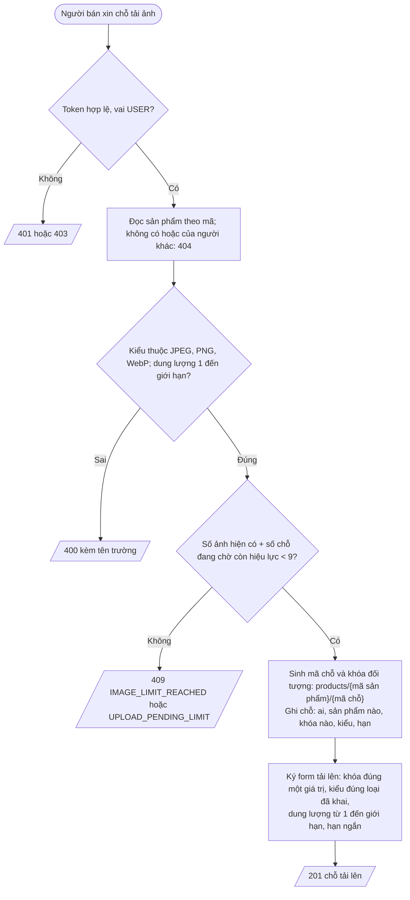
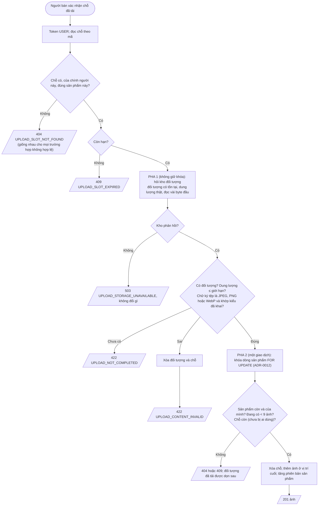

# Feature 08: Ảnh sản phẩm

> **Trạng thái:** Đã làm `2026-11-05` · **Chặng:** C1a · **Loại:** Nghiệp vụ + kỹ thuật
>
> **Nguồn:** CAP-CAT-06 (`catalog-service/analysis/product.md`), roadmap C1a (lưu tệp ảnh) · **Kiểm chứng bằng:** S1 (có ảnh), S5 (thiếu ảnh) · INV-CAT-34
>
> **Cùng thư mục:** `tech.md` (giải pháp kỹ thuật, câu hỏi đã chốt), `plan.md` (viết sau khi người rà `flow.md` và `tech.md`). Quyết định liên quan: ADR-0001 (mã), ADR-0011 (khóa lạc quan), ADR-0012 (khóa dòng sản phẩm), **ADR-0013** (cơ chế tải tệp lên dùng chung, Accepted `2026-11-05`).

## 1. Mục tiêu và phạm vi

Người bán gắn **tối đa 9 ảnh** vào sản phẩm của mình, bỏ ảnh, sắp xếp lại thứ tự; ảnh đứng đầu là ảnh chính. Người bán không gửi nội dung ảnh qua dịch vụ: xin một **chỗ tải lên**, trình duyệt tải thẳng lên kho đối tượng, rồi **xác nhận** để gắn vào sản phẩm.

Điều làm feature này khó hơn "lưu một tệp": ảnh là dữ liệu do người dùng đưa vào, nên phải chứng minh (1) đúng là ảnh, đúng loại và cỡ cho phép, (2) ảnh này được tải lên **cho chính sản phẩm này, do chính người này**, không gắn được ảnh của người khác, (3) đua nhau không vượt 9 ảnh và `version` sản phẩm vẫn tăng đúng. Cơ chế xin chỗ, kiểm tệp, nhận ảnh là **cơ chế dùng chung** (sẽ còn nhiều nơi tải ảnh lên: ảnh đại diện, logo cửa hàng, ảnh đánh giá), nên làm thành thư viện `upload-starter` dùng cho mọi dịch vụ; catalog là nơi dùng đầu tiên (ADR-0013).

Ngoài phạm vi:
- **Bỏ ảnh cuối của sản phẩm đã đăng bị từ chối** (nửa còn lại của `INV-CAT-34`): feature 09, vì 07 và 08 chỉ có `DRAFT`.
- **Event ra Kafka**: `EVT-CAT-01` mang ảnh thuộc feature 09. 08 không ghi hộp thư; `version` sản phẩm vẫn tăng.
- **Phục vụ ảnh cho người mua** (trang sản phẩm công khai): C1b. 08 chỉ trả URL ảnh trong API của người bán.
- **Ảnh riêng của biến thể**, thumbnail, cắt ảnh, quét virus: chưa làm theo `analysis` (`deferred.md`).
- **Chuyển avatar của `identity-service` sang cơ chế chung**: việc riêng, khi đến lượt.
- **Tách "Quản lý tệp" thành dịch vụ**: hoãn có ngưỡng (ADR-0013).
- **Giới hạn tần suất xin chỗ**: cổng truy cập, feature 10. Catalog chưa có thư viện giới hạn tần suất (cần Redis); 08 chỉ chặn bằng hạn mức chỗ đang chờ mỗi sản phẩm (`deferred.md`).
- Giao diện Người bán: feature 11.

## 2. Đầu vào và đầu ra

| Phần | Vào | Ra khi thành công | Ra khi lỗi |
|---|---|---|---|
| Xin chỗ tải lên | Token vai `USER`; mã sản phẩm của mình; kiểu tệp (`image/jpeg`, `image/png`, `image/webp`) và dung lượng định tải | 201: `slotId`, địa chỉ tải lên, các trường form đã ký (khóa đối tượng, kiểu, giới hạn dung lượng, hạn), `expiresAt`, dung lượng tối đa | 400 (kiểu không cho, dung lượng ≤ 0 hoặc quá cỡ); 404; 409 (đã đủ 9 ảnh, quá nhiều chỗ đang chờ); 401; 403 |
| Tải lên | Trình duyệt gửi form đã ký tới kho đối tượng (không qua dịch vụ) | Kho đối tượng nhận tệp | Kho đối tượng từ chối (sai khóa, sai kiểu, quá cỡ, hết hạn): dịch vụ không biết |
| Xác nhận (gắn ảnh) | Mã sản phẩm; `slotId` | 201 ảnh vừa gắn (mã, URL, vị trí); `version` sản phẩm tăng | 404 (chỗ không có, của người khác, của sản phẩm khác, đã dùng); 409 (hết hạn, đủ 9 ảnh); 422 (chưa tải lên, nội dung không đúng); 503 (kho đối tượng không phản hồi); 401; 403 |
| Sắp xếp ảnh | Mã sản phẩm; danh sách mã ảnh theo thứ tự mới (đủ mọi ảnh, mỗi ảnh một lần) | 200 danh sách ảnh theo thứ tự mới; `version` tăng nếu thứ tự đổi | 404; 409 (danh sách thiếu, thừa, trùng, lạ); 401; 403 |
| Bỏ ảnh | Mã sản phẩm; mã ảnh | 200 danh sách ảnh còn lại (thứ tự dồn lại); `version` tăng | 404; 401; 403 |
| Xem sản phẩm của tôi | (như 07) | Chi tiết sản phẩm có thêm danh sách ảnh (mã, URL, vị trí); `missingPublishConditions` có thêm `NO_IMAGE` khi chưa có ảnh nào | |

## 3. Luồng chính

### 3.1 Xin chỗ tải lên

Đây là kiểm **sớm** (báo nhanh cho người bán), không phải chốt. Số 9 chốt ở bước xác nhận, dưới khóa dòng sản phẩm.

### 3.2 Xác nhận (gắn ảnh)

Pha 1 gọi kho đối tượng nên **không giữ khóa** (ADR-0012: không gọi dịch vụ ngoài khi giữ khóa). Pha 2 chỉ chạm cơ sở dữ liệu. Hai yêu cầu xác nhận cùng một chỗ: cả hai qua pha 1, nhưng pha 2 xóa chỗ dưới khóa nên đúng một bên thắng, bên kia nhận 404.

### 3.3 Sắp xếp và bỏ ảnh

Cả hai khóa dòng sản phẩm, rồi:
- **Sắp xếp**: danh sách phải nêu đúng mọi ảnh hiện có, mỗi ảnh một lần; ảnh đầu danh sách là ảnh chính. Không đổi gì nếu thứ tự giống cũ (không tăng `version`).
- **Bỏ ảnh**: xóa dòng, dồn vị trí, tăng `version`. Sau khi giao dịch xong thì xóa đối tượng trên kho; lỗi xóa chỉ để lại tệp mồ côi (có việc dọn), không làm lệnh thất bại.

### 3.4 Đọc

Chi tiết sản phẩm (đường của 07) có thêm `images` (mã, URL công khai, vị trí) và `NO_IMAGE` trong điều kiện còn thiếu khi chưa có ảnh. Danh sách sản phẩm của tôi trả thêm URL ảnh chính (nếu có).

## 4. Đường không suôn sẻ và các điểm cần rà

| # | Tình huống | Hành vi đúng | Bất biến |
|---|---|---|---|
| E1 | Không token, token sai; vai không phải `USER` (kể cả `ADMIN`) | 401; 403 `CATALOG_ROLE_NOT_ALLOWED`; không đọc, không ghi | INV-CAT-30, R6 |
| E2 | Sản phẩm của người khác hoặc không tồn tại (mọi lệnh ảnh) | 404 giống nhau, không lộ sự tồn tại | INV-CAT-30 |
| E3 | Xin chỗ với kiểu không thuộc JPEG, PNG, WebP; dung lượng ≤ 0 hoặc quá giới hạn | 400 `UPLOAD_TYPE_NOT_ALLOWED` hoặc `UPLOAD_SIZE_INVALID` kèm tên trường | INV-CAT-34 |
| E4 | Đã đủ 9 ảnh (kể cả ảnh đang chờ xác nhận) | 409 `IMAGE_LIMIT_REACHED` ở bước xin chỗ; `UPLOAD_PENDING_LIMIT` nếu quá nhiều chỗ chờ | INV-CAT-34 |
| E5 | Xin chỗ nhiều lần liên tiếp mà không xác nhận | 409 `UPLOAD_PENDING_LIMIT` khi số chỗ còn hiệu lực chạm hạn mức (9 mỗi sản phẩm); chỗ hết hạn không tính. Giới hạn tần suất thật: cổng truy cập (feature 10) | stage R9 |
| E6 | Xác nhận bằng chỗ không có, của người khác, của sản phẩm khác, hoặc đã dùng | 404 `UPLOAD_SLOT_NOT_FOUND` giống nhau; không gắn gì | INV-CAT-34 |
| E7 | Xác nhận chỗ đã hết hạn | 409 `UPLOAD_SLOT_EXPIRED`; tệp (nếu có) được dọn sau | INV-CAT-34 |
| E8 | Xác nhận khi người bán chưa tải tệp lên | 422 `UPLOAD_NOT_COMPLETED`; chỗ giữ nguyên (còn hạn thì tải rồi xác nhận lại được) | |
| E9 | Tệp đã tải không phải ảnh thật (chữ ký sai), kiểu thật không khớp kiểu đã khai, hoặc dung lượng thật quá giới hạn | 422 `UPLOAD_CONTENT_INVALID`; đối tượng và chỗ bị xóa; không gắn gì | INV-CAT-34 |
| E10 | Hai yêu cầu xác nhận cùng một chỗ, kể cả 20 luồng | Đúng một thành công (201), còn lại 404; đúng một dòng ảnh | INV-CAT-34 |
| E11 | Sản phẩm đang 8 ảnh, nhiều yêu cầu xác nhận các chỗ khác nhau cùng lúc | Đúng một thành công, còn lại 409 `IMAGE_LIMIT_REACHED`; không bao giờ có 10 ảnh | INV-CAT-34, ADR-0012 |
| E12 | Sắp xếp với danh sách thiếu, thừa, trùng, hoặc có mã ảnh của sản phẩm khác | 409 `IMAGE_ORDER_INVALID`; thứ tự giữ nguyên | INV-CAT-34 |
| E13 | Bỏ ảnh không có, hoặc ảnh thuộc sản phẩm khác | 404 `IMAGE_NOT_FOUND`; không đổi gì | INV-CAT-30 |
| E14 | Bỏ ảnh xong nhưng xóa đối tượng trên kho lỗi | Lệnh vẫn thành công; tệp mồ côi được việc dọn xóa sau | |
| E15 | Ghi thất bại giữa chừng ở pha 2 (sau khi xóa chỗ) | Rollback cả giao dịch: chỗ còn, không có ảnh mới, `version` giữ nguyên | R12 |
| E16 | Kho đối tượng không phản hồi ở pha 1 | 503 `UPLOAD_STORAGE_UNAVAILABLE`; không đổi gì ở cơ sở dữ liệu | |
| E17 | Mọi lệnh ảnh thành công (xác nhận, sắp xếp có đổi, bỏ) | `version` sản phẩm tăng đúng 1, không nhảy, không trùng, kể cả nhiều lệnh cùng lúc | INV-CAT-36 |
| E18 | Chỗ hết hạn mà không ai xác nhận | Việc dọn xóa dòng chỗ và đối tượng (nếu có); không ảnh hưởng sản phẩm | |
| E19 | Mã sản phẩm, mã chỗ, mã ảnh không phải UUID | 400 | |
| E20 | Đọc sản phẩm chưa có ảnh | `images` rỗng, `missingPublishConditions` có `NO_IMAGE` (không chặn lưu nháp) | INV-CAT-91 |
| E21 | Gửi `position`, `objectKey`, `url` hay kiểu tự đặt trong nội dung | Bỏ qua: khóa đối tượng và vị trí luôn do dịch vụ quyết định | INV-CAT-34 |

## 5. Trạng thái sau khi xong

- Người bán (vai `USER`) xin chỗ, tải ảnh thẳng lên kho đối tượng, xác nhận để gắn vào sản phẩm nháp, sắp xếp và bỏ ảnh; xem lại sản phẩm với ảnh và với "thiếu ảnh" nếu chưa có.
- Không gắn được ảnh của người khác, không gắn được tệp không phải ảnh, không vượt 9 ảnh kể cả đua nhau; chứng minh trên Postgres và MinIO thật.
- `upload-starter` có trong `libs`, dùng được cho nơi thứ hai mà không đổi mã nghiệp vụ của catalog.
- Dịch vụ không phát event nào của ảnh; sản phẩm vẫn không rời `DRAFT`.

## 6. Test cần có (viết từ `tech.md` T7 và mục 4, trước khi viết mã)

| # | Kịch bản test | Mức | Chứng minh |
|---|---|---|---|
| KT-01 | `upload-starter`, phần thuần: kiểm chữ ký tệp (JPEG, PNG, WebP; kiểu khai và kiểu thật khớp; tệp quá ngắn; tệp chữ giả đuôi ảnh), giới hạn theo mục đích, dựng khóa đối tượng | Đơn vị | E3, E9 |
| KT-02 | `upload-starter`, vòng đời chỗ với kho giả: cấp, đủ điều kiện kiểm, hết hạn, người khác, sản phẩm khác, dùng hai lần, kho lỗi | Đơn vị | E6 đến E10, E16 |
| KT-03 | Miền sản phẩm: thêm, bỏ, sắp xếp ảnh, đủ 9, vị trí dồn, `NO_IMAGE` | Đơn vị | E4, E11 đến E13, E20 |
| KT-04 | Use case với kho giả: thứ tự `requireSeller` → kiểm chủ → pha 1 không giữ khóa → pha 2 gọi `findOwnedForUpdate`; lỗi pha 2 không mất chỗ | Đơn vị | E1, E2, E15, E16, ADR-0012 |
| KT-05 | Migration `V3` trên Postgres thật: bảng, tên ràng buộc, `uq` vị trí, `uq` khóa đối tượng; từng ràng buộc bị phá thử | Testcontainers | E10, E12 |
| KT-06 | API với Postgres và MinIO thật: toàn luồng xin chỗ → tải → xác nhận; 401, 403, 404, 400, 409, 422 từng mã; tệp giả đuôi ảnh bị từ chối; ảnh người khác không gắn được; URL trả về đọc được công khai | Testcontainers + HTTP | E1 đến E9, E12, E13, E19 đến E21 |
| KT-07 | Đua nhau trên Postgres và MinIO thật: 8 ảnh + nhiều yêu cầu khác chỗ (đúng 1), 20 luồng cùng một chỗ (đúng 1), `version` tăng đúng số lệnh thành công, sắp xếp đua với bỏ ảnh | Testcontainers | E10, E11, E17 |
| KT-08 | Rollback: ghi lỗi sau khi xóa chỗ làm mất cả hai (chỗ còn, `version` giữ nguyên); không có hàng hộp thư | Testcontainers | E15 |
| KT-09 | Việc dọn: chỗ hết hạn bị xóa cùng đối tượng; chỗ còn hạn giữ nguyên | Testcontainers | E18 |
| KT-10 | Chạy thật: ngăn xếp cách ly (Postgres, MinIO, ứng dụng, token ký thật): xin chỗ, tải bằng form ký thật, xác nhận, đọc URL công khai bằng HTTP không token, tệp quá cỡ bị chính MinIO từ chối, hết hạn bị MinIO từ chối; 20 luồng đua nhau | Ngăn xếp cách ly | E3, E7, E10, E11 |

## 7. Việc đã giao cho feature này

Từ `analysis`: CAP-CAT-06, INV-CAT-34 (nửa ảnh nháp). Từ `service.md`: entity `ProductImage` của `AGG-CAT-04`. Từ ADR-0013: cơ chế tải tệp dùng chung.
