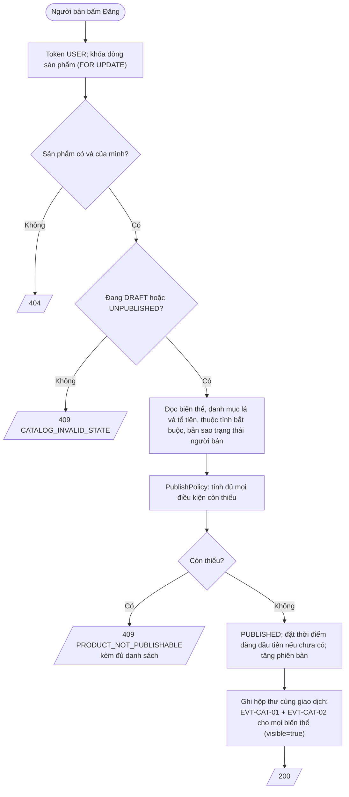
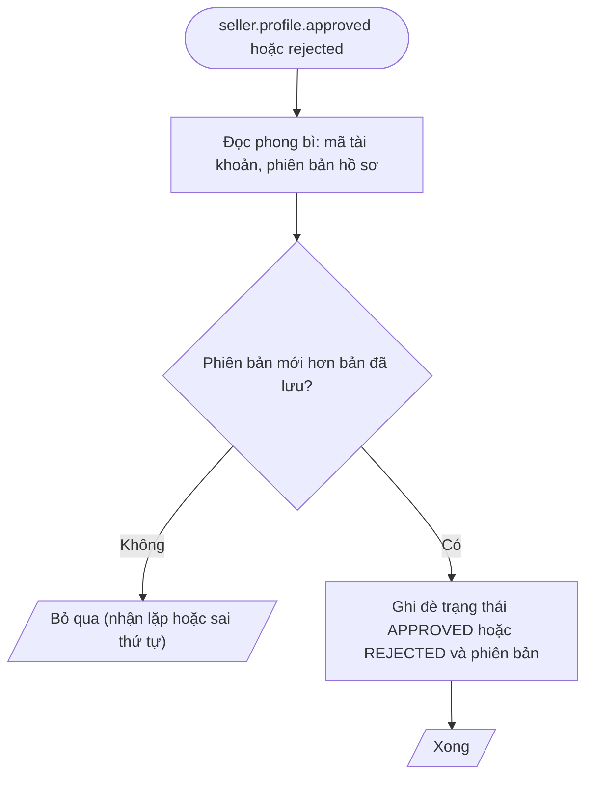

# Feature 09: Đăng sản phẩm

> **Trạng thái:** Đã làm `2026-11-06` · **Chặng:** C1a · **Loại:** Nghiệp vụ
>
> **Nguồn:** CAP-CAT-07, 08 (`catalog-service/analysis/product.md`) · **Kiểm chứng bằng:** S1, S3, S5 · R7, R8 · INV-CAT-30, 34 (nửa sản phẩm đã đăng), 35, 91, 95
>
> **Cùng thư mục:** `tech.md` (giải pháp kỹ thuật, câu hỏi đã chốt), `plan.md`, `deferred.md`. Quyết định liên quan: ADR-0008 (hộp thư, giao ít nhất một lần), ADR-0012 (khóa dòng sản phẩm), **ADR-0014** (sự kiện trạng thái đầy đủ, D6, Accepted `2026-11-06`).

## 1. Mục tiêu và phạm vi

Người bán **đăng** sản phẩm nháp để người mua thấy được, **gỡ** khi cần, **đăng lại** sau khi gỡ, và **xóa** nháp chưa từng đăng. Đăng chỉ được khi đủ điều kiện (`INV-CAT-91`): người bán đã được duyệt, danh mục còn dùng được, có ít nhất một biến thể hoạt động, mọi thuộc tính bắt buộc đã có giá trị, có ít nhất một ảnh. Thiếu thì trả **đủ** danh sách điều kiện còn thiếu một lượt để người bán sửa một thể.

Hai việc đi kèm làm feature này lớn hơn "đổi trạng thái":
- **Biết người bán đã duyệt:** catalog giữ một bản sao trạng thái người bán (đã duyệt hay chưa), cập nhật từ sự kiện `seller.profile.approved` và `seller.profile.rejected` của `seller-service` (feature 04). Từ đây, **tạo nháp** cũng cần người bán đã duyệt (`INV-CAT-30`), nửa mà 07 đã hoãn.
- **Phát sự kiện ra Kafka:** `EVT-CAT-01` (bản chụp sản phẩm) và `EVT-CAT-02` (đơn vị bán được) theo ADR-0014. Khi có sản phẩm đang hiển thị, mọi lệnh sửa sản phẩm, biến thể, ảnh của 07 và 08 phải ghi sự kiện cùng giao dịch.

Ngoài phạm vi:
- **Chặn và mở chặn sản phẩm** (quản trị), người bán bị khóa, phát lại hàng loạt khi người bán mất duyệt: C1b. Ở C1a trạng thái "Được duyệt" của người bán không thu hồi được nên không có chuyện hiển thị mất do người bán.
- **Người mua xem sản phẩm hiển thị** (`RM-CAT-05`), nhận sự kiện ở Tìm kiếm và Tồn kho: C1b, C2a. 09 chỉ phát.
- **Duyệt sản phẩm trước khi hiển thị:** đã cắt (B1). Sửa sản phẩm đã đăng có hiệu lực ngay.
- **Giao diện và cổng:** feature 10, 11.
- Nửa còn lại của `INV-CAT-34` (bỏ ảnh cuối của sản phẩm đã đăng bị từ chối) thuộc 09, vì chỉ có nghĩa khi có sản phẩm đã đăng.

## 2. Đầu vào và đầu ra

| Phần | Vào | Ra khi thành công | Ra khi lỗi |
|---|---|---|---|
| Đăng (và đăng lại) | Token vai `USER`; mã sản phẩm của mình đang `DRAFT` hoặc `UNPUBLISHED` | 200 sản phẩm `PUBLISHED`, `version` tăng | 404; 409 `PRODUCT_NOT_PUBLISHABLE` kèm danh sách điều kiện thiếu; 409 `CATALOG_INVALID_STATE` (đang `PUBLISHED`); 401; 403 |
| Gỡ | Mã sản phẩm của mình đang `PUBLISHED` | 200 sản phẩm `UNPUBLISHED`, `version` tăng | 404; 409 `CATALOG_INVALID_STATE`; 401; 403 |
| Xóa nháp | Mã sản phẩm của mình đang `DRAFT` và chưa từng đăng | 200; sản phẩm, biến thể, ảnh biến mất | 404; 409 `PRODUCT_NOT_DELETABLE`; 401; 403 |
| Tạo sản phẩm (sửa của 07) | như 07 | như 07 | thêm 403 `SELLER_NOT_APPROVED` |
| Nhận kết quả duyệt người bán | Sự kiện `seller.profile.approved` hoặc `seller.profile.rejected` | Bản sao trạng thái người bán được ghi đè nếu `version` mới hơn | Lỗi nhận: thử lại có backoff, hết số lần vào hàng chờ lỗi |
| Xem sản phẩm của tôi (sửa của 07, 08) | như 07 | `missingPublishConditions` thêm `SELLER_NOT_APPROVED`, `CATEGORY_NOT_USABLE` | |

## 3. Luồng chính

### 3.1 Đăng

Bản sao trạng thái người bán có thể cũ vài giây (sự kiện đi qua Kafka): người bán vừa được duyệt có thể chưa đăng được ngay; giao diện nên báo rõ. Đây là chỗ `analysis` đã chấp nhận.

### 3.2 Gỡ và đăng lại

Gỡ: `PUBLISHED` sang `UNPUBLISHED`, phát `EVT-CAT-01` và `EVT-CAT-02` cho mọi biến thể với `visible=false`. Khi đã gỡ, sửa sản phẩm tự do và **không phát gì**. Đăng lại kiểm lại **toàn bộ** điều kiện (kể cả danh mục dùng được: danh mục ngừng dùng chặn đăng lại nhưng không làm sản phẩm đã đăng hết hiển thị) rồi phát lại toàn bộ trạng thái.

### 3.3 Xóa nháp

Chỉ sản phẩm `DRAFT` **chưa từng đăng** (chưa có thời điểm đăng). Xóa trong một giao dịch: biến thể (tường minh, vì khóa ngoại `RESTRICT`; tổ hợp xóa theo), rồi sản phẩm (thuộc tính và ảnh xóa theo khóa ngoại `CASCADE`); sau khi commit xóa các đối tượng ảnh trên kho (nỗ lực tốt nhất). Chỗ tải lên còn chờ của sản phẩm không bị xóa ngay: hết hạn và việc dọn của thư viện xóa chúng (xác nhận trên sản phẩm không còn thì 404). Không phát sự kiện (nháp chưa từng hiển thị).

### 3.4 Nhận kết quả duyệt người bán

Ghi đè theo phiên bản là bất biến với nhận lặp, không cần bảng khử trùng theo mã sự kiện.

### 3.5 Sự kiện khi sửa sản phẩm đã hiển thị

Mọi lệnh làm đổi sản phẩm hoặc biến thể của một sản phẩm đang `PUBLISHED` ghi thêm `EVT-CAT-01` (bản chụp mới); lệnh tạo, ngừng, bật lại một biến thể ghi thêm `EVT-CAT-02` của biến thể đó. Sản phẩm `DRAFT` hoặc `UNPUBLISHED` không phát. Danh sách đầy đủ ở ADR-0014.

## 4. Đường không suôn sẻ và các điểm cần rà

| # | Tình huống | Hành vi đúng | Bất biến |
|---|---|---|---|
| E1 | Không token; vai không phải `USER` | 401; 403 `CATALOG_ROLE_NOT_ALLOWED` | R6 |
| E2 | Sản phẩm của người khác hoặc không tồn tại (đăng, gỡ, xóa) | 404 giống nhau | INV-CAT-30 |
| E3 | Đăng thiếu điều kiện (không ảnh, không biến thể hoạt động, thiếu thuộc tính bắt buộc, danh mục ngừng dùng, người bán chưa duyệt) | 409 `PRODUCT_NOT_PUBLISHABLE`, danh sách **đủ** mọi điều kiện thiếu, không dừng ở cái đầu tiên; không đổi gì | INV-CAT-91 |
| E4 | Đăng sản phẩm đang `PUBLISHED`; gỡ sản phẩm không `PUBLISHED` | 409 `CATALOG_INVALID_STATE`; không đổi gì | INV-CAT-35 |
| E5 | Đăng lại khi danh mục đã ngừng dùng | 409 `PRODUCT_NOT_PUBLISHABLE` (`CATEGORY_NOT_USABLE`); sản phẩm vẫn `UNPUBLISHED` | INV-CAT-91, 97 |
| E6 | Hai yêu cầu đăng cùng lúc; đăng cùng lúc với sửa hay thêm biến thể | Khóa dòng sản phẩm: xếp hàng; đúng một lần đăng thành công, lần sau 409 `CATALOG_INVALID_STATE`; điều kiện luôn tính trên trạng thái mới nhất; `version` tăng đúng 1 mỗi lệnh | ADR-0012 |
| E7 | Tạo sản phẩm khi người bán chưa được duyệt (chưa có bản sao, hoặc bị từ chối) | 403 `SELLER_NOT_APPROVED`; không tạo gì | INV-CAT-30 |
| E8 | Bỏ ảnh cuối của sản phẩm đang `PUBLISHED` | 409 `PRODUCT_LAST_IMAGE`; ảnh còn | INV-CAT-34 |
| E9 | Xóa sản phẩm đã từng đăng (kể cả đang `UNPUBLISHED`), hoặc đang `PUBLISHED` | 409 `PRODUCT_NOT_DELETABLE`; không đổi gì | INV-CAT-35 |
| E10 | Nhận kết quả duyệt: lặp lại, sai thứ tự (phiên bản cũ hơn), sự kiện lạ | Bỏ qua phiên bản không mới hơn; trạng thái không lùi | ADR-0008 |
| E11 | Nhận kết quả duyệt làm hỏng giữa chừng (lỗi cơ sở dữ liệu) | Thử lại có backoff; hết số lần vào hàng chờ lỗi và cảnh báo; không mất bản ghi | ADR-0010 |
| E12 | Sửa sản phẩm đang hiển thị: giá, ảnh, tiêu đề, ngừng biến thể... | Sản phẩm vẫn `PUBLISHED`; ra `EVT-CAT-01` (và `EVT-CAT-02` nếu biến thể đổi) cùng giao dịch; rollback thì không ra gì | ADR-0014, R12 |
| E13 | Sửa nháp hoặc sản phẩm đã gỡ | Không ra thông điệp nào | ADR-0014 |
| E14 | Đăng: số thông điệp và nội dung | Đúng 1 `EVT-CAT-01` (`visible=true`) và 1 `EVT-CAT-02` cho **mỗi** biến thể (kể cả biến thể đã ngừng, `active=false`); cùng khóa là mã sản phẩm, cùng `version`; `EVT-CAT-02` không có giá | ADR-0014 |
| E15 | Gỡ rồi đăng lại | Gỡ: `visible=false` cho cả hai loại; đăng lại: toàn bộ lại; `version` đơn điệu tăng | ADR-0014 |
| E16 | Mã không phải UUID | 400 | |
| E17 | Kết quả duyệt đến sau khi người bán đã có nháp tạo từ trước (dữ liệu cũ) | Không ảnh hưởng nháp có sẵn; tạo nháp mới cần bản sao | INV-CAT-30 |

## 5. Trạng thái sau khi xong

- Người bán (đã được duyệt) tạo nháp, soạn, **đăng**, gỡ, đăng lại, xóa nháp; thấy rõ điều kiện còn thiếu.
- Catalog biết người bán đã duyệt từ sự kiện thật; tạo nháp và đăng đều chặn khi chưa duyệt.
- Mọi thay đổi của sản phẩm đang hiển thị ra `EVT-CAT-01`/`EVT-CAT-02` đúng quy tắc, cùng giao dịch, chạy thật qua hộp thư, Debezium và Kafka.
- Bên nhận (Tìm kiếm, Tồn kho) chưa có; kiểm bằng cách đọc topic.

## 6. Test cần có (viết từ `tech.md` T7 và mục 4, trước khi viết mã)

| # | Kịch bản test | Mức | Chứng minh |
|---|---|---|---|
| KT-01 | Miền: chuyển trạng thái đăng, gỡ, đăng lại, xóa nháp; thời điểm đăng đầu tiên không đổi; `PublishPolicy` trả đủ điều kiện (thứ tự, không dừng sớm); bỏ ảnh cuối khi đã đăng | Đơn vị | E3 đến E5, E8, E9 |
| KT-02 | Bản sao người bán: ghi đè theo phiên bản, sai thứ tự, lặp, từ chối sau duyệt không lùi (hàm thuần của miền) | Đơn vị | E10 |
| KT-03 | Quy tắc phát: bảng "trạng thái × lệnh → thông điệp" (ADR-0014) với kho giả và bộ ghi giả | Đơn vị | E12 đến E15 |
| KT-04 | Use case với kho giả: thứ tự `requireSeller` → khóa → điều kiện → đổi trạng thái → ghi sự kiện; 403 `SELLER_NOT_APPROVED` ở tạo | Đơn vị | E1, E2, E6, E7 |
| KT-05 | Migration `V4` trên Postgres thật: cột `published_at`, `ck_product_published_at`, bảng `seller_state`; từng ràng buộc phá thử | Testcontainers | E9, E10 |
| KT-06 | API Postgres thật: 401, 403, 404, 409 từng mã; danh sách điều kiện thiếu đủ; đăng, gỡ, đăng lại, xóa nháp; hàng hộp thư đúng loại, đúng khóa, đúng số lượng, đúng nội dung; rollback không ra hàng | Testcontainers + HTTP | E1 đến E9, E12 đến E15 |
| KT-07 | Nhận sự kiện duyệt từ Kafka thật: được duyệt, bị từ chối, lặp, sai thứ tự, hỏng giữa chừng vào hàng chờ lỗi | Testcontainers Kafka | E10, E11 |
| KT-08 | Đua nhau: 20 luồng đăng cùng lúc (đúng 1); đăng đua với thêm biến thể và với bỏ ảnh; `version` đúng | Testcontainers | E6 |
| KT-09 | Chạy thật: ngăn xếp cách ly (Postgres, Kafka, Connect, MinIO, ứng dụng): sự kiện duyệt gửi vào topic, tạo, đăng, sửa, gỡ, đăng lại; đọc `catalog.product.snapshot` và `catalog.sellable-unit.changed`: khóa, nội dung, số lượng, `version` | Ngăn xếp cách ly | E7, E12 đến E15 |

## 7. Việc đã giao cho feature này

Từ `07/deferred.md`: nửa "người bán đã duyệt" của `INV-CAT-30`. Từ `07` và `08`: nửa "đã đăng" của `INV-CAT-34`; `EVT-CAT-01`, `EVT-CAT-02` (ADR-0014). Từ `service.md`: `seller_state` (bản sao, không phải aggregate).
